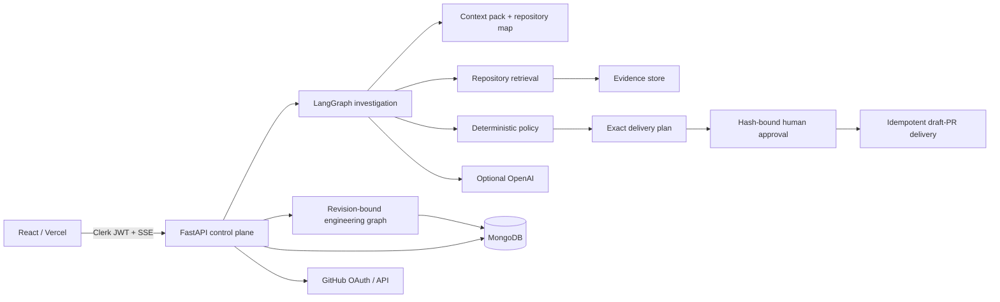
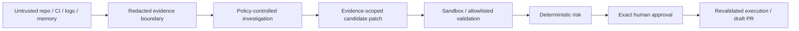

# Architecture

The graph is intentionally small: workspace context, repository map, retrieval, optional read-only GitHub Actions context, action selection, investigation scaffold, optional approval, execution, and response. CI logs and workflow files enter only as untrusted, redacted evidence; they never become commands or mutation authority. The UI exposes safe execution events and evidence rather than hidden model reasoning.

## Engineering Intelligence graph

The static dependency graph in Code remains a lightweight compatibility view.
The newer Engineering Intelligence graph is built during the existing reindex
lifecycle and persisted as immutable, tenant-scoped snapshots bound to the
actual Git revision. Its current extractors use Python AST, bounded local
JavaScript/TypeScript import inspection, safe GitHub Actions YAML parsing, and
manifest parsing. Browser graph queries are focused neighborhoods instead of a
whole-repository dump. See [Engineering graph](ENGINEERING_GRAPH.md) for
provenance, limits, APIs, and safety boundaries.

The Changes workspace can also run a bounded, read-only reverse-dependency
traversal for an exact delivery plan. It uses only the immutable graph at the
plan's base SHA, shows potential dependents/tests/workflows with limitations,
and rejects missing or mismatched revisions. This impact report is advisory
evidence only: it neither changes a candidate workspace nor creates approval
or delivery authority.

## Session workspace

Every authenticated session is a stable workspace, not a single chat screen. `/session/:slugid` redirects to `/session/:slugid/overview`; the same session exposes `overview`, `assistant`, `pipelines`, `investigation`, `knowledge`, `code`, `changes`, and `history` routes. These focused pages reuse the persisted command-center snapshot, evidence, exact delivery plan, approval records, and run replay already owned by that session.

The Pipelines page visualizes only returned workflow/job metadata and never invents dependency edges, rerun controls, or live log content. The Code page uses tenant-scoped, read-only session endpoints to list supported repository files and return a 64 KB centrally-redacted file view. It has no write endpoint; any proposed edit still follows the candidate-workspace, validation, risk, approval, and delivery pipeline.

## Safety boundary

No edge in this diagram lets content from the left register a validator, change policy, disclose credentials, or authorize execution.

## Optional GitHub-native incident reporting

After the signed webhook intake has durably stored and grouped an incident,
the dispatch worker may make one additional best-effort call through the
existing GitHub App installation-token boundary. It is available only when the
deployment enables it, the repository owner selects the Inbox preference, and
that exact session already has a verified App installation binding. The call
creates or updates a `neutral` GitHub Check containing only a centrally
redacted, bounded investigation summary and authenticated incident link.

This reporting path is deliberately downstream of persistence: permission or
network failure adds a visible incident limitation but never discards evidence,
retries the investigation, creates a PR comment, dispatches/reruns Actions, or
turns analysis completion into a CI-success claim. It uses no browser-supplied
repository target and never promotes OAuth read credentials into write scope.
## Optional candidate-verification boundary

The GitHub OAuth integration remains the normal read-only investigation and
draft-PR delivery boundary. Candidate verification uses a separately
configured GitHub App and is disabled by default. Its `CandidateVerificationService`
validates an App installation against the server-authorized session repository,
creates only a non-forced exact candidate ref after a dedicated approval, and
dispatches one repository-owner-selected workflow. A tenant-scoped
`verification_runs` record and the existing `ci_observer` worker persist and
observe the result. The branch/workflow/patch hash/base SHA are all bound to
the approval; YAML commands are not parsed or run by Base64. Refer to
[CANDIDATE_VERIFICATION.md](CANDIDATE_VERIFICATION.md) for setup and limits.

## Historical regression-prevention advisory

The Changes workspace can ask for a deterministic, read-only historical review
of an exact `DeliveryPlan`. `RegressionPreventionService` receives the plan's
already server-authorized repository/session identity and inspects only that
tenant's supported, group-root CI incident summaries. It promotes a pattern to
an advisory only when at least two distinct failed-run SHAs contain the same
failure category and an exact path that the plan changes. The base SHA of the
plan is excluded so an active incident is never mistaken for history.

The response is deliberately informational: it says that repeated incidents
are correlation, not proof that the new change will fail. It creates no patch,
command, approval, background job, GitHub request, or durable policy rule.
The ordinary evidence, validation, risk, exact-approval, and delivery paths
remain the only routes to mutation.

After an incident is durably grouped, `PreventionRuleService` evaluates the
same threshold across that tenant/session's supported incident roots and
upserts an additive `prevention_rules` record keyed by numeric GitHub
repository ID, exact path, and category. The record preserves only incident
IDs, run SHAs, threshold metadata, and advisory limitations. A later
DeliveryPlan still recomputes its live match from incident history, then labels
an equivalent active record as a persisted historical rule. Persisting a rule
does not strengthen the underlying causality claim or authorize any action.

When a signed-in user marks an incident `incorrect`, the existing feedback
route persists that redacted, untrusted annotation first. For current incident
records with server-owned session/repository metadata, it then marks only
active rules containing that incident as `needs_review` and recomputes eligible
patterns without the corrected incident. A rule can return to `active` only
when other independent supported incidents still meet the threshold. Feedback
does not itself create evidence or a rule. The live DeliveryPlan advisory
calculation excludes the same corrected incidents, so delayed rule refreshes
cannot reintroduce a corrected incident as historical support.
