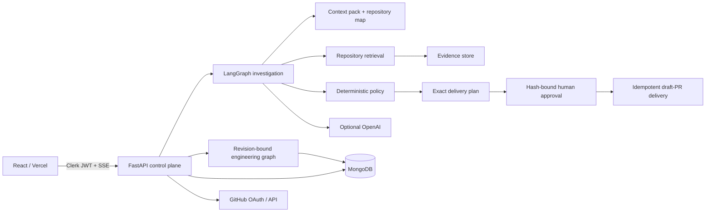
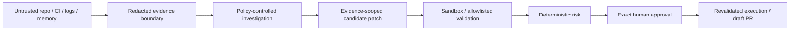

# Architecture

The graph is intentionally small: workspace context, repository map, retrieval, optional read-only GitHub Actions context, action selection, investigation scaffold, optional approval, execution, and response. CI logs and workflow files enter only as untrusted, redacted evidence; they never become commands or mutation authority. The UI exposes safe execution events and evidence rather than hidden model reasoning.

## Engineering Intelligence graph

The static dependency graph in Code remains a lightweight compatibility view.
The newer Engineering Intelligence graph is built during the existing reindex
lifecycle and persisted as immutable, tenant-scoped snapshots bound to the
actual Git revision. Its current extractors use Python AST, bounded local
JavaScript/TypeScript import inspection, safe GitHub Actions YAML parsing, and
manifest parsing. Browser graph queries are focused neighborhoods instead of a
whole-repository dump. See [Engineering graph](ENGINEERING_GRAPH.md) for
provenance, limits, APIs, and safety boundaries.

The Changes workspace can also run a bounded, read-only reverse-dependency
traversal for an exact delivery plan. It uses only the immutable graph at the
plan's base SHA, shows potential dependents/tests/workflows with limitations,
and rejects missing or mismatched revisions. This impact report is advisory
evidence only: it neither changes a candidate workspace nor creates approval
or delivery authority.

## Session workspace

Every authenticated session is a stable workspace, not a single chat screen. `/session/:slugid` redirects to `/session/:slugid/overview`; the same session exposes `overview`, `assistant`, `pipelines`, `investigation`, `knowledge`, `code`, `changes`, and `history` routes. These focused pages reuse the persisted command-center snapshot, evidence, exact delivery plan, approval records, and run replay already owned by that session.

The Pipelines page visualizes only returned workflow/job metadata and never invents dependency edges, rerun controls, or live log content. The Code page uses tenant-scoped, read-only session endpoints to list supported repository files and return a 64 KB centrally-redacted file view. It has no write endpoint; any proposed edit still follows the candidate-workspace, validation, risk, approval, and delivery pipeline.

## Safety boundary

No edge in this diagram lets content from the left register a validator, change policy, disclose credentials, or authorize execution.
