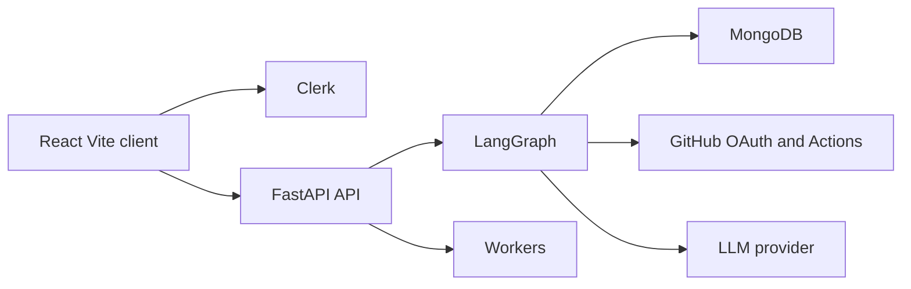
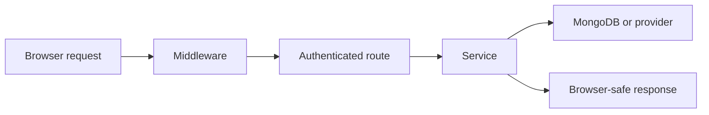
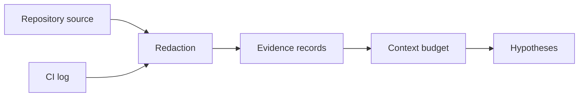
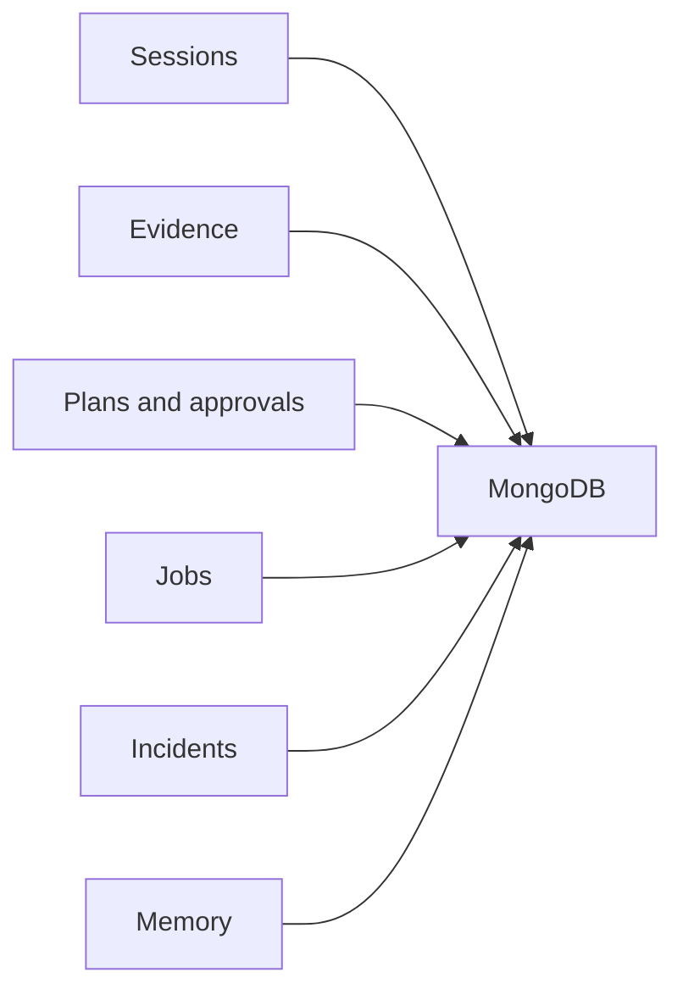
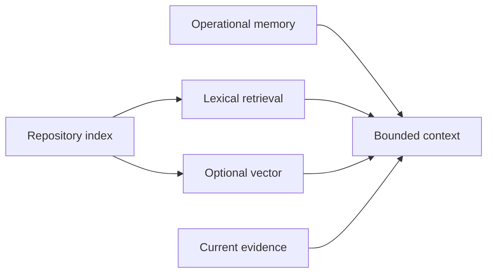
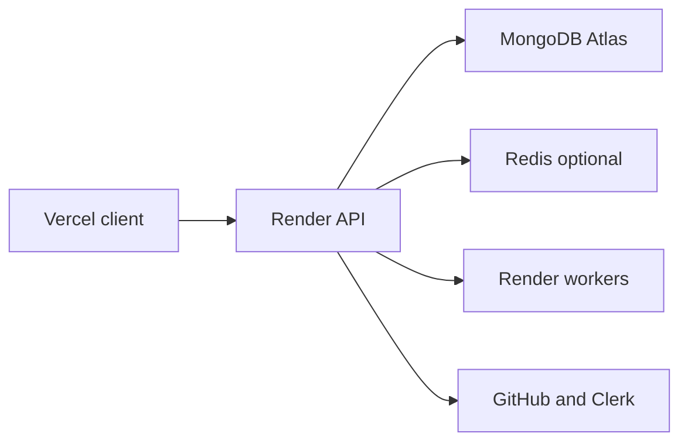
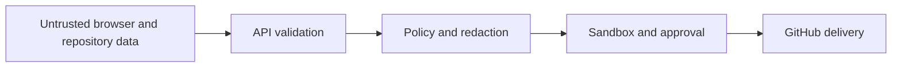

# BASE64-OPS
## Complete System Architecture Engineering Design and Source Code Reference

*An Evidence First AI DevOps Engineering System From Product Problem to Individual Source Files*

- Repository: https://github.com/TopoVista/Base64-Ops
- Generated: 2026-10-14 00:31 UTC
- Analyzed commit: `8de5dde63f240c1c4e4f5cfe76bdc58cca6782c7`
- Scope: Git-tracked source at the recorded commit. Generated outputs, secrets, ignored environment files, decorative assets, and lockfiles are excluded by the accompanying inventory.
- Verification statement: architecture claims are derived from checked-in code and local deterministic tests. External providers and deployed environments are called out as unverified when no live evidence was available.

## Executive abstract

Base64 Ops is a repository-aware, evidence-first AI operations system. It turns bounded repository and GitHub Actions data into reviewable investigations and constrained repair proposals. It is designed to complement general coding assistants by making provenance, authorization, validation, exact-diff approval, and replay explicit. The system is neither an autonomous production operator nor a guarantee of root cause correctness. Its principal safety stance is that logs, source files, workflow YAML, and model output are untrusted until deterministic policy and human approval admit a narrowly defined action.

## Guide to reading this book

Parts I through III explain the product, architecture, and user flows. Part IV is the exhaustive source-file reference. Each included Git-tracked file has exactly one dedicated reference page in the PDF; the Markdown mirrors its content. Claims marked implemented refer to code and local tests, while live-provider claims remain explicitly unverified unless a live check was recorded.

## Table of contents

- [1 What Is Base64 Ops](#chapter-1)
- [2 The Problem Statement](#chapter-2)
- [3 How Base64 Ops Solves the Problems](#chapter-3)
- [4 Comparison With Alternative Tools](#chapter-4)
- [5 Why Developers Would Use Base64 Ops](#chapter-5)
- [6 High Level Architecture](#chapter-6)
- [7 Technology Stack and Architectural Rationale](#chapter-7)
- [8 Backend Architecture](#chapter-8)
- [9 Frontend Architecture](#chapter-9)
- [10 AI and Agent Architecture](#chapter-10)
- [11 GitHub Integration](#chapter-11)
- [12 Evidence and Root Cause Analysis](#chapter-12)
- [13 Patch Generation and Human Approval](#chapter-13)
- [14 Memory Retrieval and Engineering Graphs](#chapter-14)
- [15 Data Architecture](#chapter-15)
- [16 Event Driven Architecture and Background Jobs](#chapter-16)
- [17 Security Architecture](#chapter-17)
- [18 Deployment Architecture](#chapter-18)
- [19 Performance and Cost Optimizations](#chapter-19)
- [20 Reliability Observability and Testing](#chapter-20)
- [21 Authentication Repository Connection and Investigation Workflow](#chapter-21)
- [22 CI Investigation Patch Validation Approval and Delivery Workflow](#chapter-22)
- [23 Incident Memory Export Billing and Replay Workflow](#chapter-23)
- [24 Important Design Decisions](#chapter-24)
- [25 Alternative Architectures](#chapter-25)
- [26 Scalability and Bottlenecks](#chapter-26)
- [27 Failure Modes and Recovery](#chapter-27)
- [28 Future Improvements](#chapter-28)
- [Visual diagrams](#visual-diagrams)
- [Glossary](#glossary)
- [References](#references)
- [Source file reference](#source-file-reference)

## Part I - Product Problem and System Identity

## Chapter 1: What Is Base64 Ops
<a id="chapter-1"></a>

Base64 Ops is an evidence-first engineering application for repository investigation and constrained recovery work. A user connects a repository, indexes bounded source context, asks a diagnostic question, reviews evidence and a structured investigation, and can request an exact patch plan. The implementation combines a React/Vite client with a FastAPI service, MongoDB persistence, LangGraph orchestration, a GitHub OAuth boundary, and repository workspaces. Its differentiator is not unrestricted generation: logs, repository files, workflow YAML, and operational memory are treated as untrusted data; evidence, revision provenance, deterministic policy, validation, risk classification, and human approval constrain what can be proposed or delivered. The product is best understood as a decision-support and guarded-delivery system rather than a general chat interface. It can investigate CI workflows and locally compare a failed run's SHA with current state. It can prepare a bounded unified diff and, after exact approval, use the existing delivery path to prepare a draft pull request. It does not claim autonomous production remediation, arbitrary shell execution, or verified remote candidate CI unless separately configured. A realistic journey starts with a failed GitHub Actions workflow whose log reports a missing package. Base64 Ops retains redacted excerpts, fetches the workflow at the failed SHA, correlates manifests and source imports, labels correlation rather than causation, and presents a reviewable plan. The documented local tests support deterministic behavior; live provider credentials and external mutations remain separately unverified.

## Chapter 2: The Problem Statement
<a id="chapter-2"></a>

CI diagnosis forces developers to join logs, workflow definitions, commit history, repository layout, dependency manifests, and prior incidents manually. Logs can be huge, noisy, secret-bearing, and misleading when read without the failed revision. A generic assistant can summarize text or suggest a plausible patch, but a plausible patch can target a defect that was already fixed, change unrelated files, or lack an auditable connection to evidence. Base64 Ops addresses portions of this fragmentation by retaining bounded, redacted evidence with source metadata and by separating failed-run state from current repository state. The cost it targets is context gathering and review friction, not a quantified productivity claim. Its constrained patch and approval pipeline reduces a particular class of unsafe delivery risk: the delivered arguments and diff are bound to a known plan, branch, SHA, and approval. The repository does not prove lower mean-time-to-repair or universally correct root cause analysis; those need measured production studies. Historical memory is intentionally lower precedence than current evidence, and its live merge lookup remains unverified. Candidate validation can report static results, but targeted remote verification is intentionally not advertised without a GitHub App and reviewed workflow. The engineering problem therefore remains partly unsolved by design: Base64 Ops favors explicit limitations over silently turning incomplete context into confidence.

## Chapter 3: How Base64 Ops Solves the Problems
<a id="chapter-3"></a>

The manual path begins from the command center: a signed-in user selects a connected repository and may index a bounded corpus. A normal investigation flows through the LangGraph state graph, which gathers repository context, retrieves evidence, applies deterministic tool policy, forms structured hypotheses, and produces a diagnosis. A CI-specific request is routed to the existing Actions intelligence service: it resolves a repository-scoped run, retrieves failed jobs and bounded redacted log windows, records workflow evidence at the failed SHA, and compares current state separately. The result remains normal Evidence and investigation context rather than becoming a second agent. A repair request reuses the patch engine, candidate workspace, validation, risk, DeliveryPlan, approval, and delivery services. The code workbench renders the exact diff and an editable suggested commit message, but browser edits alone do not write GitHub. The automatic path exists only for repositories opted into signed workflow-run webhooks. The webhook records a compact, deduplicated envelope and queues read-only incident work. The dispatcher persists an Incident and reuses the same investigation boundary. Later same-SHA success is reconciliation context, not proof of flakiness or resolution. Users can export redacted incident evidence and add an untrusted feedback annotation. The process is deliberately evidence-before-generation and approval-before-mutation.

## Chapter 4: Comparison With Alternative Tools
<a id="chapter-4"></a>

Base64 Ops should be compared narrowly, not marketed as a replacement for every developer tool. ChatGPT and Codex are broad conversational and coding environments; they are often better for exploratory programming, open-ended refactors, and interactive authoring. GitHub Copilot concentrates on in-editor assistance and repository-aware coding workflows. Code review products specialize in pull-request feedback. Sentry Seer is positioned by Sentry as an AI debugging agent over Sentry issue, trace, log, and profile context. GitHub Actions is the execution platform that defines and runs workflows rather than an investigation application. Base64 Ops adds value only where its implementation can join a bounded Actions symptom, the failed repository revision, current repository state, structured evidence, and an exact approval-bound delivery plan. Its security posture is intentionally restrictive: workflow commands never become local validator commands, CI logs are untrusted, and a diff cannot be delivered merely because an agent said it is safe. The relevant tradeoff is friction and coverage: a manual developer or general-purpose coding agent can act faster and has wider latitude; Base64 Ops provides more explicit provenance and guardrails for the particular CI-recovery path. Official references consulted on 2026-10-14 include GitHub Actions documentation at https://docs.github.com/en/actions, Clerk's React provider reference at https://clerk.com/docs/reference/clerk-react/clerkprovider, and Sentry Seer documentation at https://docs.sentry.io/product/ai-in-sentry/seer. Product capabilities change over time; this comparison does not assert exhaustive or current feature parity.

## Chapter 5: Why Developers Would Use Base64 Ops
<a id="chapter-5"></a>

The product value proposition is traceability and repeatability. A user does not need to construct a single large prompt containing a log, a workflow, a branch name, and a list of changed files: the implementation gathers bounded records through authenticated repository APIs and workspace reads. Evidence cards and replay give reviewers a durable explanation of what data informed an investigation. The exact-diff approval model gives the reviewer a precise object to approve rather than a general intent such as fix CI. Historical memory can surface related incidents but cannot override current evidence or authorize a mutation. These are product mechanisms, not proof that every diagnosis is faster or better. Teams should evaluate the product with measured investigation latency, evidence completeness, unsupported causal claims, approval turnaround, repeat-incident rate, and post-delivery CI outcomes. The deterministic evaluation suite measures fixture expectations and safety regressions; it is not a claim of live provider accuracy. The system is most useful when an organization values reviewable recovery workflows and can tolerate explicit incompleteness when logs, repository state, or permissions are unavailable.

## Part II - Architecture and Engineering Design

## Chapter 6: High Level Architecture
<a id="chapter-6"></a>

The implemented architecture has a browser client, an API control plane, optional worker roles, persistent MongoDB collections, optional Redis-backed rate limiting, GitHub OAuth and Actions read APIs, and model-provider calls gated through context budgets. The React client uses Clerk to acquire browser tokens and an Axios/SSE boundary to call FastAPI. FastAPI validates tokens and request limits, registers routers, and reconnects MongoDB conservatively. Services orchestrate GitHub, workspaces, evidence, patch planning, delivery, memory, and background jobs. LangGraph coordinates evidence-first investigations; it does not replace service boundaries. MongoDB is the durable record for sessions, evidence, plans, approvals, jobs, incidents, memory, and trace/replay data. Redis is rate-limit state when configured, not the system of record. External GitHub mutations remain on the reviewed delivery path. The deployment files describe multiple Render profiles and a Vercel frontend; no live deployment is asserted in this book.

## Chapter 7: Technology Stack and Architectural Rationale
<a id="chapter-7"></a>

Python, FastAPI, and Pydantic support typed API contracts and asynchronous service orchestration. LangGraph provides explicit stateful node routing for the agent flow. MongoDB aligns with document-shaped sessions, evidence, plans, jobs, and replay records; its operational consequence is that index and connectivity correctness must be enforced at startup. React, TypeScript, Vite, React Query, and a component library power the interactive client and lazy-loaded workbench. Clerk provides external authentication context while the backend verifies bearer tokens. GitHub OAuth provides repository access; Actions calls remain read-only in the investigation adapter. Docker-backed sandboxing is optional and fail-closed; Render may not provide it. Redis supports rate limits where configured. These choices are architectural rationale inferred from code and configuration, not claimed original author intent. They trade operational complexity for clear typed boundaries, but introduce external configuration requirements and free-tier limitations. The book's technology matrix distinguishes code-present from live-verified capability.

## Chapter 8: Backend Architecture
<a id="chapter-8"></a>

backend/app/main.py constructs the FastAPI app, configures CORS and security middleware, registers routers, performs index creation, and starts a bounded Mongo reconnect loop if startup connectivity fails. Route modules use dependencies from app/api/deps.py to resolve authenticated user context. Core configuration uses pydantic settings and validates production guardrails. Routers delegate to services instead of embedding provider access. Mongo access is centralized in app/db/mongo.py. Services use typed schemas and compact persistence projections. Failures are normalized through core failure and exception handling paths, with secrets redacted at boundaries. Background work uses durable Mongo-backed job records and worker claim/lease semantics rather than browser-owned commands. Shutdown closes database and rate-limit resources. The backend is intentionally fail-closed for unavailable durable dependencies; liveness and readiness are separate.

## Chapter 9: Frontend Architecture
<a id="chapter-9"></a>

client/src/main.tsx mounts the application beneath Clerk, React Query, theme, tooltip, and toast providers, while the public static demo bypasses Clerk deliberately. App and route modules choose protected, public, and error surfaces. Session pages hydrate server-backed data and render overview, evidence, map, history, code workbench, and change-impact views. The code workbench lazy-loads Monaco-like source review and visual tools so ordinary navigation does not pay their cost. API functions centralize bearer token acquisition and structured error recovery. TypeScript contracts mirror browser-safe backend responses. React Query is used for cached reads and mutation invalidation. The UI does not become a second policy engine: server-side approval, risk, and repository boundaries remain authoritative. Loading, degraded backend, and auth-configuration states are explicit rather than silently displaying fabricated data.

## Chapter 10: AI and Agent Architecture
<a id="chapter-10"></a>

The LangGraph graph is assembled in backend/app/agent/graph.py from typed state, deterministic policy, and service adapters. Its nodes load session context, build or retrieve repository evidence, classify intent, investigate, generate a delivery plan where supported, create approval records, and respond. LLM-dependent tasks are bounded by context, output, deadline, and retry settings. Deterministic code decides allowed tools, risk, source selection boundaries, approval binding, and delivery arguments. Hypotheses are structured records linked to evidence; the implementation does not persist hidden chain-of-thought. CI-specific data enters graph state as compact IDs and summary context, not raw multi-megabyte logs. Replay reads persisted facts and spans without rerunning historical GitHub calls, validation, or mutations. When an LLM/provider is unavailable, the API records an explicit limitation rather than substituting unbounded behavior.

## Chapter 11: GitHub Integration
<a id="chapter-11"></a>

GitHub OAuth state, encrypted tokens, repository discovery, API calls, and repository URL normalization live in the existing GitHub service and router. The Actions adapter consumes that boundary for run, job, log, workflow, and pull request reads. Each request carries a user and repository scope; the browser cannot supply an arbitrary owner/name to bypass authorization. Job logs are downloaded with byte caps, redacted centrally, reduced to useful excerpts, and then persisted as evidence. The CI investigation service preserves failed-run SHA provenance, workflow-at-SHA evidence, current-head comparison, and deterministic changed-path correlation. Draft PR delivery uses the established approval-bound service. Signed workflow-run webhook intake is opt-in and durable, but live GitHub App installation identity, native checks/comments, and remote candidate verification are intentionally unsupported until separate authorization exists. OAuth read access is never promoted into a GitHub App permission.

## Chapter 12: Evidence and Root Cause Analysis
<a id="chapter-12"></a>

Evidence is the core unit of investigation. Repository files, CI excerpts, map summaries, tool results, and historical entries are recorded with source types and provenance. Redaction occurs before model context, persistence, trace, or UI presentation. CI excerpt detection uses deterministic failure patterns to select windows; the patterns nominate evidence, not root causes. The investigation service can inspect the workflow at the failed SHA and separately inspect the current workflow. The applicability service avoids re-proposing a condition already corrected on current HEAD. Changed paths, imports, manifests, and stack references are correlation signals rather than automatic causal proof. Structured incident diagnoses assign evidence strength only from the collected record set. Incomplete permissions are surfaced as limitations. The result is more reviewable than a log summary, but still limited by source availability, repository history, provider permissions, and deterministic rules.

## Chapter 13: Patch Generation and Human Approval
<a id="chapter-13"></a>

The patch engine starts from evidence-scoped source paths, validates repository-relative paths, verifies original content hashes, and builds a candidate workspace. It accepts constrained structured edits rather than allowing model text to become an arbitrary shell command. A candidate diff is deterministically generated, then eligible registry commands can validate it in an isolated configured runtime. Risk policy gives CI/CD changes a high minimum. DeliveryPlan persistence binds repository, branch, base SHA, exact diff, validation summary, and arguments. The approval record carries a canonical hash of those properties; any changed SHA, branch, diff, or arguments invalidates it. Delivery rechecks the plan and approval atomically before creating a branch/pushing/creating a draft PR. Candidate verification status is intentionally truthful: static validation is not a claim that GitHub Actions ran against the candidate. Replay makes the plan and outcome reviewable without replaying a mutation.

## Chapter 14: Memory Retrieval and Engineering Graphs
<a id="chapter-14"></a>

Operational memory stores evidence-gated, tenant-scoped records with freshness and verification semantics. It distinguishes observed incident outcomes from delivered and merged fixes, and it is retrieved as secondary context to current evidence. The RAG service indexes bounded repository chunks using lexical retrieval and can use Atlas vector acceleration only when configured. The engineering graph builder constructs bounded dependency relationships from safe static parsing, then change-impact service traverses the immutable revision snapshot for advisory impact reports. The graph does not prove runtime causality, and memory cannot authorize a patch. Automated CI incidents can write partially verified incident outcomes; flaky observations now preserve bounded test identifiers and workflow-level history without declaring a test flaky. Prevention-rule promotion and graph-aware retrieval remain partial or not implemented.

## Chapter 15: Data Architecture
<a id="chapter-15"></a>

MongoDB is the primary durable store. Logical collections include users, sessions, repository maps/chunks/evidence, agent runs/traces, delivery plans/approvals, background jobs, operational memory, engineering graph snapshots, change-impact reports, GitHub OAuth/cache records, webhook event ledger, automation settings, incidents, and flaky test observations. Each user-facing query includes user/session ownership checks. Index setup occurs at application startup and after reconnect; unique indexes enforce OAuth state and event/automation idempotency where defined. Pydantic schemas shape browser contracts while service code writes compact documents. TTL retention is used for selected event records. The repository does not include a relational migration framework because its storage model is document-oriented; compatibility is handled by versioned fields, safe defaults, and browser-safe projections.

## Chapter 16: Event Driven Architecture and Background Jobs
<a id="chapter-16"></a>

FastAPI routes and signed GitHub webhook deliveries are the relevant event producers. The webhook stores a compact HMAC-verified envelope keyed by delivery identifier, then enqueues a server-derived job only for opted-in repository targets. The worker claims Mongo job records with leases, renews while working, retries within bounded policy, and marks terminal outcomes. Indexing and post-delivery CI observation use the same durable job pattern. Incident dispatch invokes the read-only CI investigation service and persists the result. A later success at the same SHA adds reconciliation context without closing a failure. There is no Kafka, CDC, or arbitrary web hook command executor. On low-cost deployments, worker continuity and live dispatcher operation are external operational considerations; the code does not claim a permanently running free worker.

## Chapter 17: Security Architecture
<a id="chapter-17"></a>

The trust model starts with authenticated Clerk bearer tokens and tenant-scoped database filters. GitHub OAuth state is signed and one-time; tokens are encrypted at rest. CI logs, repository source, workflow YAML, runbooks, editor drafts, and memory are treated as untrusted inputs. Redaction service patterns protect secrets before persistence and display. Tool policy and execution registry prevent untrusted text from selecting commands. Workspace path policy rejects escape paths. Docker sandbox execution is optional; production defaults fail closed when authorized isolation is unavailable. Exact approval binding protects delivery from stale diffs and altered arguments. Request-size limits, security headers, CORS origin restrictions, trusted-host validation, rate limiting, and bounded model context reduce exposed surfaces. These controls are defense in depth, not proof of immunity. Live security configuration depends on deployment environment values and external services.

## Chapter 18: Deployment Architecture
<a id="chapter-18"></a>

The repository contains a full Render blueprint, a compact MVP profile, and an additive free-tier profile. They describe API/worker/maintenance/indexer/CI-observer roles with deliberate environment separation. The client has a Vercel configuration and Docker/Nginx assets. MongoDB Atlas and Redis are external managed dependencies; Mongo is required for durable data while Redis is used for rate-limit state where configured. Production settings validate encrypted GitHub token configuration, origins, hosts, and rate-limit expectations. Health reports liveness while readiness fails closed when Mongo or required rate-limit infrastructure is unavailable. Render free tiers have cold-start and worker-continuity constraints; the source does not claim deployed status. Operator-provided secrets remain outside the book and are represented only by names in environment examples.

## Chapter 19: Performance and Cost Optimizations
<a id="chapter-19"></a>

The implementation favors bounded work: CI log byte/excerpt/job limits, repository file/byte/chunk limits, model context/output/retry caps, maximum patch files/lines, result pagination, cache TTLs, graph traversal bounds, background job leases, and tenant concurrency controls. Lazy-loaded frontend surfaces avoid loading editor and visualization tooling on every route. Read-only replay avoids reexecuting a historical graph or provider call. Deterministic rules do useful selection and risk work before a model request. These measures should reduce unbounded latency and token cost, but this repository contains no production benchmark proving a particular latency or cost reduction. A responsible benchmark would record per-stage duration, provider token usage, GitHub request count, retained evidence bytes, and success/error outcomes over controlled fixtures and authorized live tests.

## Chapter 20: Reliability Observability and Testing
<a id="chapter-20"></a>

Tracing and replay store safe spans, selected evidence references, validation summaries, delivery state, and compact CI context. The dev run inspector is read-only: it reconstructs facts without rerunning tools. Failure taxonomy and bounded background retry capture observable failure stage rather than swallowing errors. The deterministic evaluation runner executes fixture-based safety scenarios, including Actions redaction, prompt injection, provenance, and patch policy checks. Pytest covers backend unit and integration-style boundaries; client scripts check TypeScript, bundle budget, auth redirect, and production build. GitHub, Atlas, Clerk, OpenAI, Redis, and deployment verification are not automatically inferred from those tests. At generation time, the book records commands actually executed separately from older documentation claims.

## Part III - User Flows, Operations, and Delivery

## Chapter 21: Authentication Repository Connection and Investigation Workflow
<a id="chapter-21"></a>

Authentication begins in the browser under ClerkProvider and continues when the Axios boundary supplies a bearer token. Backend dependencies validate that identity and map it to a tenant-scoped user record. The GitHub connection is a separate OAuth flow: signed state ties the callback to the user and requested redirect, then encrypted token storage enables repository discovery. Repository selection creates a user-owned session whose repository URL and branch become the context for later reads. An investigation request enters the session route and graph service, which loads session data, repository map/context, selected retrieval evidence, and guarded tool policy. The response includes browser-safe messages, evidence, hypotheses, plan/approval state when applicable, and trace identifiers. Error paths do not infer a provider state: expired GitHub access, unavailable MongoDB, and an unconfigured model each produce bounded user-facing failures. Relevant source files include client/src/main.tsx, client/src/routes/route-guard.tsx, client/src/lib/axios-client.ts, backend/app/api/deps.py, backend/app/api/routes/auth.py, backend/app/api/routes/github.py, backend/app/api/routes/session.py, backend/app/services/auth_service.py, backend/app/services/github_service.py, and backend/app/services/session_service.py.

## Chapter 22: CI Investigation Patch Validation Approval and Delivery Workflow
<a id="chapter-22"></a>

A user can explicitly ask why GitHub Actions failed, use the Code workbench's CI repair affordance, or opt a repository into signed failed-run webhook intake. The CI request-intent and run-resolution services choose an explicit, latest, or PR-associated run inside the authorized session repository. The Actions adapter reads run/job metadata and bounded logs through the existing OAuth client. CI investigation persists redacted ci_log evidence, workflow evidence at the failed SHA, changed-path correlation, history summaries, and current-state applicability separately. A supported repair request continues into the existing patch engine rather than a special CI mutation path. The engine selects evidence-scoped files, verifies original hashes, builds a candidate workspace/diff, runs registry-backed validation when an authorized isolated runtime is available, and computes deterministic risk. The delivery service persists an exact DeliveryPlan and candidate verification record that never overstates static validation as remote CI. Approval binds SHA, branch, diff, action, and arguments. Delivery revalidates that binding before creating a branch, push, and draft PR. The later CI observer may read delivery outcome, but Actions data does not grant mutation authority. Relevant files include backend/app/git/actions.py, backend/app/services/ci_investigation_service.py, patch_engine.py, delivery_service.py, delivery_ci_service.py, candidate_verification_service.py, and client/src/components/ide-workspace.tsx.

## Chapter 23: Incident Memory Export Billing and Replay Workflow
<a id="chapter-23"></a>

A signed completed workflow_run webhook is verified against an exact raw-body HMAC. The webhook service stores a compact deduplicated envelope and queues a server-derived incident-dispatch job only for a previously authorized opt-in repository setting. The dispatcher clones or refreshes a normal read-only workspace, invokes CI investigation, persists a structured diagnosis, writes evidence-supported incident memory through existing policy, and groups equivalent events. User feedback is redacted and stored as an untrusted annotation; it cannot rewrite evidence or approvals. Incident exports use allowlisted incident fields and re-redact evidence before generating JSON or Markdown. Flaky test observations capture test identifiers extracted from bounded logs and same-SHA workflow counts but preserve the limitation that successful workflow runs do not identify individual passing tests. Billing uses Clerk-authenticated checkout requests and separately signed Razorpay webhooks; browser input never supplies a price or entitlement. Replay reads recorded traces, plans, approvals, and compact evidence metadata without re-running calls or mutations. Relevant files include backend/app/services/incident_service.py, incident_export_service.py, flaky_test_service.py, memory/memory_service.py, observability/recorder.py, api/routes/incidents.py, billing/*, and client/src/pages/incidents/index.tsx.

## Part IV - Exhaustive Source File Reference

## Source file reference

The PDF source reference begins on page 37. It contains 367 dedicated file pages. The PDF index spans 8 page(s).

### File reference: `.github/workflows/ci.yml`

#### Purpose

This YAML configuration is part of the continuous integration configuration layer. It supplies the repository behavior or operational contract associated with name, on, permissions.

#### Key responsibilities

It exists to provide a coherent YAML configuration boundary for Ci. Its extracted size is 103 lines and 260 lexical tokens; the source digest begins 5d76068fba46.

#### Important symbols

Important exported or declared symbols/sections identified by static inspection: name, on, permissions, concurrency, jobs. These names are a navigation aid, not a claim that every symbol is externally public.

#### Connections

Static in-repository dependencies: no direct in-repository import was statically resolved. Potential consumers found through bounded textual/import analysis: .commandcode/taste/node.js-scaffolding/taste.md, .commandcode/taste/taste.md, .github/workflows/deployment-readiness.yml, .github/workflows/live-evals.yml. The containing category is Continuous integration configuration.

#### Simplified pseudocode

```text
READ .github/workflows/ci.yml from its owning layer
ACCEPT typed inputs or declared configuration
APPLY the file's focused responsibility
USE only its declared collaborators and boundaries
RETURN typed data, rendered UI, a test assertion, or an operational contract
SURFACE limitations rather than granting new authority
```

#### Workflow role

It participates when GitHub Actions evaluates repository automation. Base64 Ops may inspect it as untrusted repository evidence but never promotes its run commands to local validators.

#### Engineering details

The file is part of the operational contract. Its details should be interpreted with the matching runtime/configuration conditions rather than as evidence that an external environment is live.

#### Brief summary

In one sentence: .github/workflows/ci.yml is a YAML configuration that owns a focused part of continuous integration configuration. Related files: no direct in-repository import was statically resolved. Why it matters: it supplies one explicit, reviewable boundary rather than hiding this responsibility in an unrelated module.

### File reference: `.github/workflows/deployment-readiness.yml`

#### Purpose

This YAML configuration is part of the continuous integration configuration layer. It supplies the repository behavior or operational contract associated with name, on, permissions.

#### Key responsibilities

It exists to provide a coherent YAML configuration boundary for Deployment Readiness. Its extracted size is 48 lines and 125 lexical tokens; the source digest begins ceaec5bb7d72.

#### Important symbols

Important exported or declared symbols/sections identified by static inspection: name, on, permissions, jobs. These names are a navigation aid, not a claim that every symbol is externally public.

#### Connections

Static in-repository dependencies: no direct in-repository import was statically resolved. Potential consumers found through bounded textual/import analysis: docs/reports/Base64-Ops-Complete-Technical-Engineering-Book.md, docs/reports/Base64-Ops-Complete-Technical-Engineering-Book.pdf, docs/reports/source-file-inventory.json. The containing category is Continuous integration configuration.

#### Simplified pseudocode

```text
READ .github/workflows/deployment-readiness.yml from its owning layer
ACCEPT typed inputs or declared configuration
APPLY the file's focused responsibility
USE only its declared collaborators and boundaries
RETURN typed data, rendered UI, a test assertion, or an operational contract
SURFACE limitations rather than granting new authority
```

#### Workflow role

It participates when GitHub Actions evaluates repository automation. Base64 Ops may inspect it as untrusted repository evidence but never promotes its run commands to local validators.

#### Engineering details

The file is part of the operational contract. Its details should be interpreted with the matching runtime/configuration conditions rather than as evidence that an external environment is live.

#### Brief summary

In one sentence: .github/workflows/deployment-readiness.yml is a YAML configuration that owns a focused part of continuous integration configuration. Related files: no direct in-repository import was statically resolved. Why it matters: it supplies one explicit, reviewable boundary rather than hiding this responsibility in an unrelated module.

### File reference: `.github/workflows/live-evals.yml`

#### Purpose

This YAML configuration is part of the continuous integration configuration layer. It supplies the repository behavior or operational contract associated with name, on, permissions.

#### Key responsibilities

It exists to provide a coherent YAML configuration boundary for Live Evals. Its extracted size is 53 lines and 155 lexical tokens; the source digest begins 85b6e6225e4a.

#### Important symbols

Important exported or declared symbols/sections identified by static inspection: name, on, permissions, concurrency, jobs. These names are a navigation aid, not a claim that every symbol is externally public.

#### Connections

Static in-repository dependencies: no direct in-repository import was statically resolved. Potential consumers found through bounded textual/import analysis: docs/IMPLEMENTATION_STATUS.md, docs/LIVE_EVALUATION.md, docs/reports/Base64-Ops-Complete-Technical-Engineering-Book.md, docs/reports/Base64-Ops-Complete-Technical-Engineering-Book.pdf. The containing category is Continuous integration configuration.

#### Simplified pseudocode

```text
READ .github/workflows/live-evals.yml from its owning layer
ACCEPT typed inputs or declared configuration
APPLY the file's focused responsibility
USE only its declared collaborators and boundaries
RETURN typed data, rendered UI, a test assertion, or an operational contract
SURFACE limitations rather than granting new authority
```

#### Workflow role

It participates when GitHub Actions evaluates repository automation. Base64 Ops may inspect it as untrusted repository evidence but never promotes its run commands to local validators.

#### Engineering details

The file is part of the operational contract. Its details should be interpreted with the matching runtime/configuration conditions rather than as evidence that an external environment is live.

#### Brief summary

In one sentence: .github/workflows/live-evals.yml is a YAML configuration that owns a focused part of continuous integration configuration. Related files: no direct in-repository import was statically resolved. Why it matters: it supplies one explicit, reviewable boundary rather than hiding this responsibility in an unrelated module.

### File reference: `README.md`

#### Purpose

This documentation file records the repository's current guidance for Readme. It is a maintained explanation surface rather than executable behavior and is cross-checked against implementation where this book makes claims.

#### Key responsibilities

It exists to provide a coherent documentation boundary for Readme. Its extracted size is 89 lines and 611 lexical tokens; the source digest begins 0cab31b281e6.

#### Important symbols

Important exported or declared symbols/sections identified by static inspection: Base64 Ops, What it does, Why it is different, Flagship demo, Architecture, Quick start, Evaluation and verification. These names are a navigation aid, not a claim that every symbol is externally public.

#### Connections

Static in-repository dependencies: no direct in-repository import was statically resolved. Potential consumers found through bounded textual/import analysis: backend/docs/CONTEXT_ENGINEERING.md, backend/evals/cases/prompt-injection.json, backend/evals/cases/stale-readme.json, backend/tests/test_load_harness_safety.py. The containing category is Repository reference.

#### Simplified pseudocode

```text
READ documented topic
ORGANIZE implementation-grounded guidance
LINK related source paths and constraints
DISTINGUISH verified behavior from limitations
GUIDE operator or contributor decisions
```

#### Workflow role

It participates in developer onboarding and operator decision making. Executable pseudocode is not applicable; its document flow records the contract, limitation, or procedure it explains.

#### Engineering details

The file is part of the operational contract. Its details should be interpreted with the matching runtime/configuration conditions rather than as evidence that an external environment is live.

#### Brief summary

In one sentence: README.md is a documentation that owns a focused part of repository reference. Related files: no direct in-repository import was statically resolved. Why it matters: it supplies one explicit, reviewable boundary rather than hiding this responsibility in an unrelated module.

### File reference: `backend/.env.example`

#### Purpose

This configuration is part of the project configuration layer. It supplies the repository behavior or operational contract associated with its declared configuration and content structure.

#### Key responsibilities

It exists to provide a coherent configuration boundary for .Env. Its extracted size is 161 lines and 962 lexical tokens; the source digest begins e4f672829ffd.

#### Important symbols

Important exported or declared symbols/sections identified by static inspection: no public symbol list was extracted from this file format. These names are a navigation aid, not a claim that every symbol is externally public.

#### Connections

Static in-repository dependencies: no direct in-repository import was statically resolved. Potential consumers found through bounded textual/import analysis: .commandcode/taste/node.js-scaffolding/taste.md, .commandcode/taste/taste.md, README.md, backend/README.md. The containing category is Project configuration.

#### Simplified pseudocode

```text
READ backend/.env.example from its owning layer
ACCEPT typed inputs or declared configuration
APPLY the file's focused responsibility
USE only its declared collaborators and boundaries
RETURN typed data, rendered UI, a test assertion, or an operational contract
SURFACE limitations rather than granting new authority
```

#### Workflow role

It participates as a focused building block in the larger investigation, delivery, deployment, or verification flow described by its containing subsystem.

#### Engineering details

The file is part of the operational contract. Its details should be interpreted with the matching runtime/configuration conditions rather than as evidence that an external environment is live.

#### Brief summary

In one sentence: backend/.env.example is a configuration that owns a focused part of project configuration. Related files: no direct in-repository import was statically resolved. Why it matters: it supplies one explicit, reviewable boundary rather than hiding this responsibility in an unrelated module.

### File reference: `backend/Dockerfile`

#### Purpose

This configuration is part of the deployment configuration layer. It supplies the repository behavior or operational contract associated with its declared configuration and content structure.

#### Key responsibilities

It exists to provide a coherent configuration boundary for Dockerfile. Its extracted size is 19 lines and 67 lexical tokens; the source digest begins 7e4c2e05d2ee.

#### Important symbols

Important exported or declared symbols/sections identified by static inspection: no public symbol list was extracted from this file format. These names are a navigation aid, not a claim that every symbol is externally public.

#### Connections

Static in-repository dependencies: no direct in-repository import was statically resolved. Potential consumers found through bounded textual/import analysis: backend/app/execution/docker_runtime.py, backend/app/services/workspace_service.py, backend/tests/test_agent_policy.py, backend/tests/test_redaction_and_investigation.py. The containing category is Deployment configuration.

#### Simplified pseudocode

```text
READ backend/Dockerfile from its owning layer
ACCEPT typed inputs or declared configuration
APPLY the file's focused responsibility
USE only its declared collaborators and boundaries
RETURN typed data, rendered UI, a test assertion, or an operational contract
SURFACE limitations rather than granting new authority
```

#### Workflow role

It participates as a focused building block in the larger investigation, delivery, deployment, or verification flow described by its containing subsystem.

#### Engineering details

The file is part of the operational contract. Its details should be interpreted with the matching runtime/configuration conditions rather than as evidence that an external environment is live.

#### Brief summary

In one sentence: backend/Dockerfile is a configuration that owns a focused part of deployment configuration. Related files: no direct in-repository import was statically resolved. Why it matters: it supplies one explicit, reviewable boundary rather than hiding this responsibility in an unrelated module.

### File reference: `backend/README.md`

#### Purpose

This documentation file records the repository's current guidance for Readme. It is a maintained explanation surface rather than executable behavior and is cross-checked against implementation where this book makes claims.

#### Key responsibilities

It exists to provide a coherent documentation boundary for Readme. Its extracted size is 27 lines and 122 lexical tokens; the source digest begins f1600ae0ad40.

#### Important symbols

Important exported or declared symbols/sections identified by static inspection: LangGraph DevOps Agent API, Local setup, RAG, DevOps safety. These names are a navigation aid, not a claim that every symbol is externally public.

#### Connections

Static in-repository dependencies: no direct in-repository import was statically resolved. Potential consumers found through bounded textual/import analysis: backend/docs/CONTEXT_ENGINEERING.md, backend/evals/cases/prompt-injection.json, backend/evals/cases/stale-readme.json, backend/tests/test_load_harness_safety.py. The containing category is Repository reference.

#### Simplified pseudocode

```text
READ documented topic
ORGANIZE implementation-grounded guidance
LINK related source paths and constraints
DISTINGUISH verified behavior from limitations
GUIDE operator or contributor decisions
```

#### Workflow role

It participates in developer onboarding and operator decision making. Executable pseudocode is not applicable; its document flow records the contract, limitation, or procedure it explains.

#### Engineering details

The file is part of the operational contract. Its details should be interpreted with the matching runtime/configuration conditions rather than as evidence that an external environment is live.

#### Brief summary

In one sentence: backend/README.md is a documentation that owns a focused part of repository reference. Related files: no direct in-repository import was statically resolved. Why it matters: it supplies one explicit, reviewable boundary rather than hiding this responsibility in an unrelated module.

### File reference: `backend/app/__init__.py`

#### Purpose

This Python module contributes to the backend platform subsystem. It defines focused behavior around its declared configuration and content structure and is composed by higher-level application, service, or worker code.

#### Key responsibilities

It exists to provide a coherent Python module boundary for   Init  . Its extracted size is 1 lines and 5 lexical tokens; the source digest begins f68b575ce78a.

#### Important symbols

Important exported or declared symbols/sections identified by static inspection: no public symbol list was extracted from this file format. These names are a navigation aid, not a claim that every symbol is externally public.

#### Connections

Static in-repository dependencies: no direct in-repository import was statically resolved. Potential consumers found through bounded textual/import analysis: backend/app/agent/graph.py, backend/app/agent/tools.py, backend/app/api/middleware.py, backend/app/billing/billing_service.py. The containing category is Backend platform.

#### Simplified pseudocode

```text
READ backend/app/__init__.py from its owning layer
ACCEPT typed inputs or declared configuration
APPLY the file's focused responsibility
USE only its declared collaborators and boundaries
RETURN typed data, rendered UI, a test assertion, or an operational contract
SURFACE limitations rather than granting new authority
```

#### Workflow role

It participates as a focused building block in the larger investigation, delivery, deployment, or verification flow described by its containing subsystem.

#### Engineering details

The implementation is reviewed in the context of tenant isolation, bounded inputs, centralized redaction, and fail-closed behavior where a durable or authorization-dependent resource is absent.

#### Brief summary

In one sentence: backend/app/__init__.py is a Python module that owns a focused part of backend platform. Related files: no direct in-repository import was statically resolved. Why it matters: it supplies one explicit, reviewable boundary rather than hiding this responsibility in an unrelated module.

### File reference: `backend/app/agent/graph.py`

#### Purpose

This Python module contributes to the langgraph agent orchestration subsystem. It defines focused behavior around _provider_usage_event, _extract_memory_candidates, AgentGraph and is composed by higher-level application, service, or worker code.

#### Key responsibilities

It exists to provide a coherent Python module boundary for Graph. Its extracted size is 1520 lines and 5424 lexical tokens; the source digest begins ff4c66dc9c9a.

#### Important symbols

Important exported or declared symbols/sections identified by static inspection: _provider_usage_event, _extract_memory_candidates, AgentGraph. These names are a navigation aid, not a claim that every symbol is externally public.

#### Connections

Static in-repository dependencies: backend/app/agent/policy.py, backend/app/agent/prompts.py, backend/app/agent/state.py, backend/app/agent/tools.py, backend/app/core/config.py. Potential consumers found through bounded textual/import analysis: backend/.env.example, backend/app/agent/state.py, backend/app/api/routes/session.py, backend/app/billing/usage_service.py. The containing category is LangGraph agent orchestration.

#### Simplified pseudocode

```text
READ backend/app/agent/graph.py from its owning layer
ACCEPT typed inputs or declared configuration
APPLY the file's focused responsibility
USE only its declared collaborators and boundaries
RETURN typed data, rendered UI, a test assertion, or an operational contract
SURFACE limitations rather than granting new authority
```

#### Workflow role

It participates as a focused building block in the larger investigation, delivery, deployment, or verification flow described by its containing subsystem.

#### Engineering details

The implementation is reviewed in the context of tenant isolation, bounded inputs, centralized redaction, and fail-closed behavior where a durable or authorization-dependent resource is absent.

#### Brief summary

In one sentence: backend/app/agent/graph.py is a Python module that owns a focused part of langgraph agent orchestration. Related files: backend/app/agent/policy.py, backend/app/agent/prompts.py, backend/app/agent/state.py, backend/app/agent/tools.py, backend/app/core/config.py. Why it matters: it supplies one explicit, reviewable boundary rather than hiding this responsibility in an unrelated module.

### File reference: `backend/app/agent/policy.py`

#### Purpose

This Python module contributes to the langgraph agent orchestration subsystem. It defines focused behavior around MUTATING_KEYWORDS, ACTION_TOOL_NAMES, is_risky_prompt and is composed by higher-level application, service, or worker code.

#### Key responsibilities

It exists to provide a coherent Python module boundary for Policy. Its extracted size is 79 lines and 224 lexical tokens; the source digest begins 4fc1c3897628.

#### Important symbols

Important exported or declared symbols/sections identified by static inspection: MUTATING_KEYWORDS, ACTION_TOOL_NAMES, is_risky_prompt, choose_action, action_requires_approval. These names are a navigation aid, not a claim that every symbol is externally public.

#### Connections

Static in-repository dependencies: backend/app/agent/state.py. Potential consumers found through bounded textual/import analysis: README.md, backend/app/agent/graph.py, backend/app/core/agent_run_guard.py, backend/app/core/failures.py. The containing category is LangGraph agent orchestration.

#### Simplified pseudocode

```text
READ backend/app/agent/policy.py from its owning layer
ACCEPT typed inputs or declared configuration
APPLY the file's focused responsibility
USE only its declared collaborators and boundaries
RETURN typed data, rendered UI, a test assertion, or an operational contract
SURFACE limitations rather than granting new authority
```

#### Workflow role

It participates as a focused building block in the larger investigation, delivery, deployment, or verification flow described by its containing subsystem.

#### Engineering details

The implementation is reviewed in the context of tenant isolation, bounded inputs, centralized redaction, and fail-closed behavior where a durable or authorization-dependent resource is absent.

#### Brief summary

In one sentence: backend/app/agent/policy.py is a Python module that owns a focused part of langgraph agent orchestration. Related files: backend/app/agent/state.py. Why it matters: it supplies one explicit, reviewable boundary rather than hiding this responsibility in an unrelated module.

### File reference: `backend/app/agent/prompts.py`

#### Purpose

This Python module contributes to the langgraph agent orchestration subsystem. It defines focused behavior around SYSTEM_PROMPT, build_answer_prompt and is composed by higher-level application, service, or worker code.

#### Key responsibilities

It exists to provide a coherent Python module boundary for Prompts. Its extracted size is 35 lines and 217 lexical tokens; the source digest begins 9e326f92cfec.

#### Important symbols

Important exported or declared symbols/sections identified by static inspection: SYSTEM_PROMPT, build_answer_prompt. These names are a navigation aid, not a claim that every symbol is externally public.

#### Connections

Static in-repository dependencies: no direct in-repository import was statically resolved. Potential consumers found through bounded textual/import analysis: backend/app/agent/graph.py, backend/app/agent/state.py, backend/app/api/routes/assistant.py, backend/app/schemas/assistant.py. The containing category is LangGraph agent orchestration.

#### Simplified pseudocode

```text
READ backend/app/agent/prompts.py from its owning layer
ACCEPT typed inputs or declared configuration
APPLY the file's focused responsibility
USE only its declared collaborators and boundaries
RETURN typed data, rendered UI, a test assertion, or an operational contract
SURFACE limitations rather than granting new authority
```

#### Workflow role

It participates as a focused building block in the larger investigation, delivery, deployment, or verification flow described by its containing subsystem.

#### Engineering details

The implementation is reviewed in the context of tenant isolation, bounded inputs, centralized redaction, and fail-closed behavior where a durable or authorization-dependent resource is absent.

#### Brief summary

In one sentence: backend/app/agent/prompts.py is a Python module that owns a focused part of langgraph agent orchestration. Related files: no direct in-repository import was statically resolved. Why it matters: it supplies one explicit, reviewable boundary rather than hiding this responsibility in an unrelated module.

### File reference: `backend/app/agent/state.py`

#### Purpose

This Python module contributes to the langgraph agent orchestration subsystem. It defines focused behavior around AgentAction, AgentState and is composed by higher-level application, service, or worker code.

#### Key responsibilities

It exists to provide a coherent Python module boundary for State. Its extracted size is 66 lines and 277 lexical tokens; the source digest begins 4b1e1e449535.

#### Important symbols

Important exported or declared symbols/sections identified by static inspection: AgentAction, AgentState. These names are a navigation aid, not a claim that every symbol is externally public.

#### Connections

Static in-repository dependencies: no direct in-repository import was statically resolved. Potential consumers found through bounded textual/import analysis: .commandcode/taste/taste.md, README.md, backend/.env.example, backend/app/agent/graph.py. The containing category is LangGraph agent orchestration.

#### Simplified pseudocode

```text
READ backend/app/agent/state.py from its owning layer
ACCEPT typed inputs or declared configuration
APPLY the file's focused responsibility
USE only its declared collaborators and boundaries
RETURN typed data, rendered UI, a test assertion, or an operational contract
SURFACE limitations rather than granting new authority
```

#### Workflow role

It participates as a focused building block in the larger investigation, delivery, deployment, or verification flow described by its containing subsystem.

#### Engineering details

The implementation is reviewed in the context of tenant isolation, bounded inputs, centralized redaction, and fail-closed behavior where a durable or authorization-dependent resource is absent.

#### Brief summary

In one sentence: backend/app/agent/state.py is a Python module that owns a focused part of langgraph agent orchestration. Related files: no direct in-repository import was statically resolved. Why it matters: it supplies one explicit, reviewable boundary rather than hiding this responsibility in an unrelated module.

### File reference: `backend/app/agent/tools.py`

#### Purpose

This Python module contributes to the langgraph agent orchestration subsystem. It defines focused behavior around DevOpsToolbox and is composed by higher-level application, service, or worker code.

#### Key responsibilities

It exists to provide a coherent Python module boundary for Tools. Its extracted size is 45 lines and 180 lexical tokens; the source digest begins 07f611fcd41a.

#### Important symbols

Important exported or declared symbols/sections identified by static inspection: DevOpsToolbox. These names are a navigation aid, not a claim that every symbol is externally public.

#### Connections

Static in-repository dependencies: backend/app/services/workspace_service.py. Potential consumers found through bounded textual/import analysis: backend/app/agent/graph.py, backend/app/agent/policy.py, backend/app/core/config.py, backend/evals/cases/actions-path.json. The containing category is LangGraph agent orchestration.

#### Simplified pseudocode

```text
READ backend/app/agent/tools.py from its owning layer
ACCEPT typed inputs or declared configuration
APPLY the file's focused responsibility
USE only its declared collaborators and boundaries
RETURN typed data, rendered UI, a test assertion, or an operational contract
SURFACE limitations rather than granting new authority
```

#### Workflow role

It participates as a focused building block in the larger investigation, delivery, deployment, or verification flow described by its containing subsystem.

#### Engineering details

The implementation is reviewed in the context of tenant isolation, bounded inputs, centralized redaction, and fail-closed behavior where a durable or authorization-dependent resource is absent.

#### Brief summary

In one sentence: backend/app/agent/tools.py is a Python module that owns a focused part of langgraph agent orchestration. Related files: backend/app/services/workspace_service.py. Why it matters: it supplies one explicit, reviewable boundary rather than hiding this responsibility in an unrelated module.

### File reference: `backend/app/api/deps.py`

#### Purpose

This Python module contributes to the backend platform subsystem. It defines focused behavior around MAX_CLERK_BEARER_TOKEN_CHARS, ensure_user_indexes, _authorized_parties and is composed by higher-level application, service, or worker code.

#### Key responsibilities

It exists to provide a coherent Python module boundary for Deps. Its extracted size is 192 lines and 778 lexical tokens; the source digest begins fafa5bcf4c17.

#### Important symbols

Important exported or declared symbols/sections identified by static inspection: MAX_CLERK_BEARER_TOKEN_CHARS, ensure_user_indexes, _authorized_parties, _get_jwks_client, _decode_clerk_token, get_current_user, get_current_user_id. These names are a navigation aid, not a claim that every symbol is externally public.

#### Connections

Static in-repository dependencies: backend/app/core/config.py, backend/app/db/mongo.py, backend/app/utils/datetime.py, backend/app/utils/ids.py. Potential consumers found through bounded textual/import analysis: backend/app/api/routes/assistant.py, backend/app/api/routes/auth.py, backend/app/api/routes/billing.py, backend/app/api/routes/dev.py. The containing category is Backend platform.

#### Simplified pseudocode

```text
READ backend/app/api/deps.py from its owning layer
ACCEPT typed inputs or declared configuration
APPLY the file's focused responsibility
USE only its declared collaborators and boundaries
RETURN typed data, rendered UI, a test assertion, or an operational contract
SURFACE limitations rather than granting new authority
```

#### Workflow role

It participates as a focused building block in the larger investigation, delivery, deployment, or verification flow described by its containing subsystem.

#### Engineering details

The implementation is reviewed in the context of tenant isolation, bounded inputs, centralized redaction, and fail-closed behavior where a durable or authorization-dependent resource is absent.

#### Brief summary

In one sentence: backend/app/api/deps.py is a Python module that owns a focused part of backend platform. Related files: backend/app/core/config.py, backend/app/db/mongo.py, backend/app/utils/datetime.py, backend/app/utils/ids.py. Why it matters: it supplies one explicit, reviewable boundary rather than hiding this responsibility in an unrelated module.

### File reference: `backend/app/api/middleware.py`

#### Purpose

This Python module contributes to the backend platform subsystem. It defines focused behavior around _EXPENSIVE_PATHS, _BYPASS_PATHS, _EXPENSIVE_SESSION_SUFFIXES and is composed by higher-level application, service, or worker code.

#### Key responsibilities

It exists to provide a coherent Python module boundary for Middleware. Its extracted size is 216 lines and 818 lexical tokens; the source digest begins d05a741c8b22.

#### Important symbols

Important exported or declared symbols/sections identified by static inspection: _EXPENSIVE_PATHS, _BYPASS_PATHS, _EXPENSIVE_SESSION_SUFFIXES, declared_body_exceeds_limit, trusted_client_ip, is_expensive_path, RequestBodyTooLarge. These names are a navigation aid, not a claim that every symbol is externally public.

#### Connections

Static in-repository dependencies: backend/app/core/config.py, backend/app/core/rate_limit.py. Potential consumers found through bounded textual/import analysis: .commandcode/taste/node.js-scaffolding/taste.md, .commandcode/taste/taste.md, backend/app/main.py, backend/tests/test_http_protection.py. The containing category is Backend platform.

#### Simplified pseudocode

```text
READ backend/app/api/middleware.py from its owning layer
ACCEPT typed inputs or declared configuration
APPLY the file's focused responsibility
USE only its declared collaborators and boundaries
RETURN typed data, rendered UI, a test assertion, or an operational contract
SURFACE limitations rather than granting new authority
```

#### Workflow role

It participates as a focused building block in the larger investigation, delivery, deployment, or verification flow described by its containing subsystem.

#### Engineering details

The implementation is reviewed in the context of tenant isolation, bounded inputs, centralized redaction, and fail-closed behavior where a durable or authorization-dependent resource is absent.

#### Brief summary

In one sentence: backend/app/api/middleware.py is a Python module that owns a focused part of backend platform. Related files: backend/app/core/config.py, backend/app/core/rate_limit.py. Why it matters: it supplies one explicit, reviewable boundary rather than hiding this responsibility in an unrelated module.

### File reference: `backend/app/api/routes/assistant.py`

#### Purpose

This router exposes a tenant-aware FastAPI boundary for Assistant. It validates the request context, delegates domain work to existing services, and returns browser-safe data rather than implementing business logic in the route itself.

#### Key responsibilities

It exists to provide a coherent Python module boundary for Assistant. Its extracted size is 41 lines and 150 lexical tokens; the source digest begins 3c10695dcb05.

#### Important symbols

Important exported or declared symbols/sections identified by static inspection: starter_prompts, chat. These names are a navigation aid, not a claim that every symbol is externally public.

#### Connections

Static in-repository dependencies: backend/app/api/deps.py, backend/app/billing/usage_service.py, backend/app/core/agent_run_guard.py, backend/app/schemas/assistant.py, backend/app/services/product_assistant_service.py. Potential consumers found through bounded textual/import analysis: backend/app/agent/graph.py, backend/app/api/middleware.py, backend/app/main.py, backend/app/schemas/session.py. The containing category is Backend API routes.

#### Simplified pseudocode

```text
READ backend/app/api/routes/assistant.py from its owning layer
ACCEPT typed inputs or declared configuration
APPLY the file's focused responsibility
USE only its declared collaborators and boundaries
RETURN typed data, rendered UI, a test assertion, or an operational contract
SURFACE limitations rather than granting new authority
```

#### Workflow role

It participates at the authenticated HTTP boundary, before service coordination and after browser-safe response projection.

#### Engineering details

The implementation is reviewed in the context of tenant isolation, bounded inputs, centralized redaction, and fail-closed behavior where a durable or authorization-dependent resource is absent.

#### Brief summary

In one sentence: backend/app/api/routes/assistant.py is a Python module that owns a focused part of backend api routes. Related files: backend/app/api/deps.py, backend/app/billing/usage_service.py, backend/app/core/agent_run_guard.py, backend/app/schemas/assistant.py, backend/app/services/product_assistant_service.py. Why it matters: it supplies one explicit, reviewable boundary rather than hiding this responsibility in an unrelated module.

### File reference: `backend/app/api/routes/auth.py`

#### Purpose

This router exposes a tenant-aware FastAPI boundary for Auth. It validates the request context, delegates domain work to existing services, and returns browser-safe data rather than implementing business logic in the route itself.

#### Key responsibilities

It exists to provide a coherent Python module boundary for Auth. Its extracted size is 40 lines and 170 lexical tokens; the source digest begins c612b2cf62b1.

#### Important symbols

Important exported or declared symbols/sections identified by static inspection: _me_response, sync_user, get_me. These names are a navigation aid, not a claim that every symbol is externally public.

#### Connections

Static in-repository dependencies: backend/app/api/deps.py, backend/app/db/mongo.py, backend/app/services/serializers.py. Potential consumers found through bounded textual/import analysis: .commandcode/taste/node.js-scaffolding/taste.md, .commandcode/taste/taste.md, .github/workflows/ci.yml, README.md. The containing category is Backend API routes.

#### Simplified pseudocode

```text
READ backend/app/api/routes/auth.py from its owning layer
ACCEPT typed inputs or declared configuration
APPLY the file's focused responsibility
USE only its declared collaborators and boundaries
RETURN typed data, rendered UI, a test assertion, or an operational contract
SURFACE limitations rather than granting new authority
```

#### Workflow role

It participates at the authenticated HTTP boundary, before service coordination and after browser-safe response projection.

#### Engineering details

The implementation is reviewed in the context of tenant isolation, bounded inputs, centralized redaction, and fail-closed behavior where a durable or authorization-dependent resource is absent.

#### Brief summary

In one sentence: backend/app/api/routes/auth.py is a Python module that owns a focused part of backend api routes. Related files: backend/app/api/deps.py, backend/app/db/mongo.py, backend/app/services/serializers.py. Why it matters: it supplies one explicit, reviewable boundary rather than hiding this responsibility in an unrelated module.

### File reference: `backend/app/api/routes/billing.py`

#### Purpose

This router exposes a tenant-aware FastAPI boundary for Billing. It validates the request context, delegates domain work to existing services, and returns browser-safe data rather than implementing business logic in the route itself.

#### Key responsibilities

It exists to provide a coherent Python module boundary for Billing. Its extracted size is 40 lines and 183 lexical tokens; the source digest begins 64d289492e6b.

#### Important symbols

Important exported or declared symbols/sections identified by static inspection: entitlement, checkout, razorpay_webhook. These names are a navigation aid, not a claim that every symbol is externally public.

#### Connections

Static in-repository dependencies: backend/app/api/deps.py, backend/app/billing/billing_service.py, backend/app/billing/razorpay.py, backend/app/core/config.py, backend/app/schemas/billing.py. Potential consumers found through bounded textual/import analysis: backend/.env.example, backend/app/agent/graph.py, backend/app/api/routes/assistant.py, backend/app/api/routes/diagnostic.py. The containing category is Backend API routes.

#### Simplified pseudocode

```text
READ backend/app/api/routes/billing.py from its owning layer
ACCEPT typed inputs or declared configuration
APPLY the file's focused responsibility
USE only its declared collaborators and boundaries
RETURN typed data, rendered UI, a test assertion, or an operational contract
SURFACE limitations rather than granting new authority
```

#### Workflow role

It participates at the authenticated HTTP boundary, before service coordination and after browser-safe response projection.

#### Engineering details

The implementation is reviewed in the context of tenant isolation, bounded inputs, centralized redaction, and fail-closed behavior where a durable or authorization-dependent resource is absent.

#### Brief summary

In one sentence: backend/app/api/routes/billing.py is a Python module that owns a focused part of backend api routes. Related files: backend/app/api/deps.py, backend/app/billing/billing_service.py, backend/app/billing/razorpay.py, backend/app/core/config.py, backend/app/schemas/billing.py. Why it matters: it supplies one explicit, reviewable boundary rather than hiding this responsibility in an unrelated module.

### File reference: `backend/app/api/routes/dev.py`

#### Purpose

This router exposes a tenant-aware FastAPI boundary for Dev. It validates the request context, delegates domain work to existing services, and returns browser-safe data rather than implementing business logic in the route itself.

#### Key responsibilities

It exists to provide a coherent Python module boundary for Dev. Its extracted size is 15 lines and 52 lexical tokens; the source digest begins f7f5042d3659.

#### Important symbols

Important exported or declared symbols/sections identified by static inspection: get_dev_run_inspector. These names are a navigation aid, not a claim that every symbol is externally public.

#### Connections

Static in-repository dependencies: backend/app/api/deps.py, backend/app/schemas/replay.py, backend/app/services/session_service.py. Potential consumers found through bounded textual/import analysis: .commandcode/taste/node.js-scaffolding/taste.md, .commandcode/taste/taste.md, backend/.env.example, backend/README.md. The containing category is Backend API routes.

#### Simplified pseudocode

```text
READ backend/app/api/routes/dev.py from its owning layer
ACCEPT typed inputs or declared configuration
APPLY the file's focused responsibility
USE only its declared collaborators and boundaries
RETURN typed data, rendered UI, a test assertion, or an operational contract
SURFACE limitations rather than granting new authority
```

#### Workflow role

It participates at the authenticated HTTP boundary, before service coordination and after browser-safe response projection.

#### Engineering details

The implementation is reviewed in the context of tenant isolation, bounded inputs, centralized redaction, and fail-closed behavior where a durable or authorization-dependent resource is absent.

#### Brief summary

In one sentence: backend/app/api/routes/dev.py is a Python module that owns a focused part of backend api routes. Related files: backend/app/api/deps.py, backend/app/schemas/replay.py, backend/app/services/session_service.py. Why it matters: it supplies one explicit, reviewable boundary rather than hiding this responsibility in an unrelated module.

### File reference: `backend/app/api/routes/diagnostic.py`

#### Purpose

This router exposes a tenant-aware FastAPI boundary for Diagnostic. It validates the request context, delegates domain work to existing services, and returns browser-safe data rather than implementing business logic in the route itself.

#### Key responsibilities

It exists to provide a coherent Python module boundary for Diagnostic. Its extracted size is 60 lines and 203 lexical tokens; the source digest begins 6f6e6ab706a3.

#### Important symbols

Important exported or declared symbols/sections identified by static inspection: stream, apply_approved_patch. These names are a navigation aid, not a claim that every symbol is externally public.

#### Connections

Static in-repository dependencies: backend/app/api/deps.py, backend/app/billing/usage_service.py, backend/app/core/agent_run_guard.py, backend/app/schemas/session.py, backend/app/services/diagnostic_stream_service.py. Potential consumers found through bounded textual/import analysis: backend/README.md, backend/app/agent/graph.py, backend/app/agent/prompts.py, backend/app/api/middleware.py. The containing category is Backend API routes.

#### Simplified pseudocode

```text
READ backend/app/api/routes/diagnostic.py from its owning layer
ACCEPT typed inputs or declared configuration
APPLY the file's focused responsibility
USE only its declared collaborators and boundaries
RETURN typed data, rendered UI, a test assertion, or an operational contract
SURFACE limitations rather than granting new authority
```

#### Workflow role

It participates at the authenticated HTTP boundary, before service coordination and after browser-safe response projection.

#### Engineering details

The implementation is reviewed in the context of tenant isolation, bounded inputs, centralized redaction, and fail-closed behavior where a durable or authorization-dependent resource is absent.

#### Brief summary

In one sentence: backend/app/api/routes/diagnostic.py is a Python module that owns a focused part of backend api routes. Related files: backend/app/api/deps.py, backend/app/billing/usage_service.py, backend/app/core/agent_run_guard.py, backend/app/schemas/session.py, backend/app/services/diagnostic_stream_service.py. Why it matters: it supplies one explicit, reviewable boundary rather than hiding this responsibility in an unrelated module.

### File reference: `backend/app/api/routes/github.py`

#### Purpose

This router exposes a tenant-aware FastAPI boundary for Github. It validates the request context, delegates domain work to existing services, and returns browser-safe data rather than implementing business logic in the route itself.

#### Key responsibilities

It exists to provide a coherent Python module boundary for Github. Its extracted size is 52 lines and 198 lexical tokens; the source digest begins 9d677be1aeea.

#### Important symbols

Important exported or declared symbols/sections identified by static inspection: connect, callback, webhook, repos, disconnect. These names are a navigation aid, not a claim that every symbol is externally public.

#### Connections

Static in-repository dependencies: backend/app/api/deps.py, backend/app/services/github_service.py, backend/app/services/incident_service.py. Potential consumers found through bounded textual/import analysis: .commandcode/taste/taste.md, .github/workflows/ci.yml, .github/workflows/deployment-readiness.yml, .github/workflows/live-evals.yml. The containing category is Backend API routes.

#### Simplified pseudocode

```text
READ backend/app/api/routes/github.py from its owning layer
ACCEPT typed inputs or declared configuration
APPLY the file's focused responsibility
USE only its declared collaborators and boundaries
RETURN typed data, rendered UI, a test assertion, or an operational contract
SURFACE limitations rather than granting new authority
```

#### Workflow role

It participates at the authenticated HTTP boundary, before service coordination and after browser-safe response projection.

#### Engineering details

The implementation is reviewed in the context of tenant isolation, bounded inputs, centralized redaction, and fail-closed behavior where a durable or authorization-dependent resource is absent.

#### Brief summary

In one sentence: backend/app/api/routes/github.py is a Python module that owns a focused part of backend api routes. Related files: backend/app/api/deps.py, backend/app/services/github_service.py, backend/app/services/incident_service.py. Why it matters: it supplies one explicit, reviewable boundary rather than hiding this responsibility in an unrelated module.

### File reference: `backend/app/api/routes/incidents.py`

#### Purpose

This router exposes a tenant-aware FastAPI boundary for Incidents. It validates the request context, delegates domain work to existing services, and returns browser-safe data rather than implementing business logic in the route itself.

#### Key responsibilities

It exists to provide a coherent Python module boundary for Incidents. Its extracted size is 455 lines and 1544 lexical tokens; the source digest begins 4a05c57c4178.

#### Important symbols

Important exported or declared symbols/sections identified by static inspection: _settings_response, _candidate_verification_settings_response, _incident_response, _record_incorrect_feedback_memory, _flaky_observation_response, configure_automation, automation_settings. These names are a navigation aid, not a claim that every symbol is externally public.

#### Connections

Static in-repository dependencies: backend/app/api/deps.py, backend/app/db/mongo.py, backend/app/memory/memory_service.py, backend/app/memory/models.py, backend/app/schemas/incident.py. Potential consumers found through bounded textual/import analysis: README.md, backend/app/main.py, backend/app/schemas/incident.py, backend/app/schemas/regression_prevention.py. The containing category is Backend API routes.

#### Simplified pseudocode

```text
READ backend/app/api/routes/incidents.py from its owning layer
ACCEPT typed inputs or declared configuration
APPLY the file's focused responsibility
USE only its declared collaborators and boundaries
RETURN typed data, rendered UI, a test assertion, or an operational contract
SURFACE limitations rather than granting new authority
```

#### Workflow role

It participates at the authenticated HTTP boundary, before service coordination and after browser-safe response projection.

#### Engineering details

The implementation is reviewed in the context of tenant isolation, bounded inputs, centralized redaction, and fail-closed behavior where a durable or authorization-dependent resource is absent.

#### Brief summary

In one sentence: backend/app/api/routes/incidents.py is a Python module that owns a focused part of backend api routes. Related files: backend/app/api/deps.py, backend/app/db/mongo.py, backend/app/memory/memory_service.py, backend/app/memory/models.py, backend/app/schemas/incident.py. Why it matters: it supplies one explicit, reviewable boundary rather than hiding this responsibility in an unrelated module.

### File reference: `backend/app/api/routes/memory.py`

#### Purpose

This router exposes a tenant-aware FastAPI boundary for Memory. It validates the request context, delegates domain work to existing services, and returns browser-safe data rather than implementing business logic in the route itself.

#### Key responsibilities

It exists to provide a coherent Python module boundary for Memory. Its extracted size is 224 lines and 761 lexical tokens; the source digest begins 99462647319e.

#### Important symbols

Important exported or declared symbols/sections identified by static inspection: _repository_id_from_url, get_staleness_report, trigger_staleness_check, delete_memory_entry, refresh_memory_entry, promote_memory_entry, list_memory_entries. These names are a navigation aid, not a claim that every symbol is externally public.

#### Connections

Static in-repository dependencies: backend/app/api/routes/auth.py, backend/app/core/config.py, backend/app/memory/memory_service.py, backend/app/services/workspace_service.py, backend/app/db/mongo.py. Potential consumers found through bounded textual/import analysis: README.md, backend/app/agent/graph.py, backend/app/agent/state.py, backend/app/api/routes/incidents.py. The containing category is Backend API routes.

#### Simplified pseudocode

```text
READ backend/app/api/routes/memory.py from its owning layer
ACCEPT typed inputs or declared configuration
APPLY the file's focused responsibility
USE only its declared collaborators and boundaries
RETURN typed data, rendered UI, a test assertion, or an operational contract
SURFACE limitations rather than granting new authority
```

#### Workflow role

It participates at the authenticated HTTP boundary, before service coordination and after browser-safe response projection.

#### Engineering details

The implementation is reviewed in the context of tenant isolation, bounded inputs, centralized redaction, and fail-closed behavior where a durable or authorization-dependent resource is absent.

#### Brief summary

In one sentence: backend/app/api/routes/memory.py is a Python module that owns a focused part of backend api routes. Related files: backend/app/api/routes/auth.py, backend/app/core/config.py, backend/app/memory/memory_service.py, backend/app/services/workspace_service.py, backend/app/db/mongo.py. Why it matters: it supplies one explicit, reviewable boundary rather than hiding this responsibility in an unrelated module.

### File reference: `backend/app/api/routes/session.py`

#### Purpose

This router exposes a tenant-aware FastAPI boundary for Session. It validates the request context, delegates domain work to existing services, and returns browser-safe data rather than implementing business logic in the route itself.

#### Key responsibilities

It exists to provide a coherent Python module boundary for Session. Its extracted size is 287 lines and 968 lexical tokens; the source digest begins 3ad2ececd84b.

#### Important symbols

Important exported or declared symbols/sections identified by static inspection: all_sessions, chat, approval, reindex, sources, evidence, refresh_ci. These names are a navigation aid, not a claim that every symbol is externally public.

#### Connections

Static in-repository dependencies: backend/app/api/deps.py, backend/app/billing/usage_service.py, backend/app/core/agent_run_guard.py, backend/app/schemas/intelligence.py, backend/app/schemas/replay.py. Potential consumers found through bounded textual/import analysis: .commandcode/taste/node.js-scaffolding/taste.md, .commandcode/taste/taste.md, backend/.env.example, backend/app/agent/graph.py. The containing category is Backend API routes.

#### Simplified pseudocode

```text
READ backend/app/api/routes/session.py from its owning layer
ACCEPT typed inputs or declared configuration
APPLY the file's focused responsibility
USE only its declared collaborators and boundaries
RETURN typed data, rendered UI, a test assertion, or an operational contract
SURFACE limitations rather than granting new authority
```

#### Workflow role

It participates at the authenticated HTTP boundary, before service coordination and after browser-safe response projection.

#### Engineering details

The implementation is reviewed in the context of tenant isolation, bounded inputs, centralized redaction, and fail-closed behavior where a durable or authorization-dependent resource is absent.

#### Brief summary

In one sentence: backend/app/api/routes/session.py is a Python module that owns a focused part of backend api routes. Related files: backend/app/api/deps.py, backend/app/billing/usage_service.py, backend/app/core/agent_run_guard.py, backend/app/schemas/intelligence.py, backend/app/schemas/replay.py. Why it matters: it supplies one explicit, reviewable boundary rather than hiding this responsibility in an unrelated module.

### File reference: `backend/app/api/routes/system.py`

#### Purpose

This router exposes a tenant-aware FastAPI boundary for System. It validates the request context, delegates domain work to existing services, and returns browser-safe data rather than implementing business logic in the route itself.

#### Key responsibilities

It exists to provide a coherent Python module boundary for System. Its extracted size is 84 lines and 248 lexical tokens; the source digest begins 9712801d989a.

#### Important symbols

Important exported or declared symbols/sections identified by static inspection: get_system_capabilities. These names are a navigation aid, not a claim that every symbol is externally public.

#### Connections

Static in-repository dependencies: backend/app/core/config.py, backend/app/execution/docker_runtime.py, backend/app/services/github_service.py. Potential consumers found through bounded textual/import analysis: backend/app/agent/graph.py, backend/app/execution/__init__.py, backend/app/intelligence/graph/models.py, backend/app/main.py. The containing category is Backend API routes.

#### Simplified pseudocode

```text
READ backend/app/api/routes/system.py from its owning layer
ACCEPT typed inputs or declared configuration
APPLY the file's focused responsibility
USE only its declared collaborators and boundaries
RETURN typed data, rendered UI, a test assertion, or an operational contract
SURFACE limitations rather than granting new authority
```

#### Workflow role

It participates at the authenticated HTTP boundary, before service coordination and after browser-safe response projection.

#### Engineering details

The implementation is reviewed in the context of tenant isolation, bounded inputs, centralized redaction, and fail-closed behavior where a durable or authorization-dependent resource is absent.

#### Brief summary

In one sentence: backend/app/api/routes/system.py is a Python module that owns a focused part of backend api routes. Related files: backend/app/core/config.py, backend/app/execution/docker_runtime.py, backend/app/services/github_service.py. Why it matters: it supplies one explicit, reviewable boundary rather than hiding this responsibility in an unrelated module.

### File reference: `backend/app/billing/__init__.py`

#### Purpose

This Python module contributes to the backend platform subsystem. It defines focused behavior around its declared configuration and content structure and is composed by higher-level application, service, or worker code.

#### Key responsibilities

It exists to provide a coherent Python module boundary for   Init  . Its extracted size is 1 lines and 11 lexical tokens; the source digest begins 08511684fb5c.

#### Important symbols

Important exported or declared symbols/sections identified by static inspection: no public symbol list was extracted from this file format. These names are a navigation aid, not a claim that every symbol is externally public.

#### Connections

Static in-repository dependencies: no direct in-repository import was statically resolved. Potential consumers found through bounded textual/import analysis: backend/app/agent/graph.py, backend/app/agent/tools.py, backend/app/api/middleware.py, backend/app/billing/billing_service.py. The containing category is Backend platform.

#### Simplified pseudocode

```text
READ backend/app/billing/__init__.py from its owning layer
ACCEPT typed inputs or declared configuration
APPLY the file's focused responsibility
USE only its declared collaborators and boundaries
RETURN typed data, rendered UI, a test assertion, or an operational contract
SURFACE limitations rather than granting new authority
```

#### Workflow role

It participates as a focused building block in the larger investigation, delivery, deployment, or verification flow described by its containing subsystem.

#### Engineering details

The implementation is reviewed in the context of tenant isolation, bounded inputs, centralized redaction, and fail-closed behavior where a durable or authorization-dependent resource is absent.

#### Brief summary

In one sentence: backend/app/billing/__init__.py is a Python module that owns a focused part of backend platform. Related files: no direct in-repository import was statically resolved. Why it matters: it supplies one explicit, reviewable boundary rather than hiding this responsibility in an unrelated module.

### File reference: `backend/app/billing/billing_service.py`

#### Purpose

This Python module contributes to the backend platform subsystem. It defines focused behavior around provider_event_created_at, BillingService and is composed by higher-level application, service, or worker code.

#### Key responsibilities

It exists to provide a coherent Python module boundary for Billing Service. Its extracted size is 277 lines and 1020 lexical tokens; the source digest begins 77055c4f4fc1.

#### Important symbols

Important exported or declared symbols/sections identified by static inspection: provider_event_created_at, BillingService. These names are a navigation aid, not a claim that every symbol is externally public.

#### Connections

Static in-repository dependencies: backend/app/billing/models.py, backend/app/billing/razorpay.py, backend/app/billing/usage_service.py, backend/app/core/config.py, backend/app/db/mongo.py. Potential consumers found through bounded textual/import analysis: backend/app/api/routes/billing.py, backend/app/main.py, backend/tests/test_billing_lifecycle.py, docs/reports/Base64-Ops-Complete-Technical-Engineering-Book.md. The containing category is Backend platform.

#### Simplified pseudocode

```text
READ backend/app/billing/billing_service.py from its owning layer
ACCEPT typed inputs or declared configuration
APPLY the file's focused responsibility
USE only its declared collaborators and boundaries
RETURN typed data, rendered UI, a test assertion, or an operational contract
SURFACE limitations rather than granting new authority
```

#### Workflow role

It participates as a focused building block in the larger investigation, delivery, deployment, or verification flow described by its containing subsystem.

#### Engineering details

The implementation is reviewed in the context of tenant isolation, bounded inputs, centralized redaction, and fail-closed behavior where a durable or authorization-dependent resource is absent.

#### Brief summary

In one sentence: backend/app/billing/billing_service.py is a Python module that owns a focused part of backend platform. Related files: backend/app/billing/models.py, backend/app/billing/razorpay.py, backend/app/billing/usage_service.py, backend/app/core/config.py, backend/app/db/mongo.py. Why it matters: it supplies one explicit, reviewable boundary rather than hiding this responsibility in an unrelated module.

### File reference: `backend/app/billing/models.py`

#### Purpose

This Python module contributes to the backend platform subsystem. It defines focused behavior around SubscriptionTier, SubscriptionStatus, UsageEntitlement and is composed by higher-level application, service, or worker code.

#### Key responsibilities

It exists to provide a coherent Python module boundary for Models. Its extracted size is 29 lines and 51 lexical tokens; the source digest begins fbc3275e241f.

#### Important symbols

Important exported or declared symbols/sections identified by static inspection: SubscriptionTier, SubscriptionStatus, UsageEntitlement. These names are a navigation aid, not a claim that every symbol is externally public.

#### Connections

Static in-repository dependencies: no direct in-repository import was statically resolved. Potential consumers found through bounded textual/import analysis: .commandcode/taste/node.js-scaffolding/taste.md, .commandcode/taste/taste.md, README.md, backend/app/agent/graph.py. The containing category is Backend platform.

#### Simplified pseudocode

```text
READ backend/app/billing/models.py from its owning layer
ACCEPT typed inputs or declared configuration
APPLY the file's focused responsibility
USE only its declared collaborators and boundaries
RETURN typed data, rendered UI, a test assertion, or an operational contract
SURFACE limitations rather than granting new authority
```

#### Workflow role

It participates as a focused building block in the larger investigation, delivery, deployment, or verification flow described by its containing subsystem.

#### Engineering details

The implementation is reviewed in the context of tenant isolation, bounded inputs, centralized redaction, and fail-closed behavior where a durable or authorization-dependent resource is absent.

#### Brief summary

In one sentence: backend/app/billing/models.py is a Python module that owns a focused part of backend platform. Related files: no direct in-repository import was statically resolved. Why it matters: it supplies one explicit, reviewable boundary rather than hiding this responsibility in an unrelated module.

### File reference: `backend/app/billing/razorpay.py`

#### Purpose

This Python module contributes to the backend platform subsystem. It defines focused behavior around _BASE_URL, _TRUSTED_CHECKOUT_HOSTS, verify_webhook_signature and is composed by higher-level application, service, or worker code.

#### Key responsibilities

It exists to provide a coherent Python module boundary for Razorpay. Its extracted size is 143 lines and 505 lexical tokens; the source digest begins b88ac1099f18.

#### Important symbols

Important exported or declared symbols/sections identified by static inspection: _BASE_URL, _TRUSTED_CHECKOUT_HOSTS, verify_webhook_signature, trusted_checkout_url, HostedSubscription, RazorpayClient. These names are a navigation aid, not a claim that every symbol is externally public.

#### Connections

Static in-repository dependencies: backend/app/billing/models.py, backend/app/core/config.py. Potential consumers found through bounded textual/import analysis: backend/app/api/routes/billing.py, backend/app/billing/billing_service.py, backend/app/core/config.py, backend/tests/test_billing_lifecycle.py. The containing category is Backend platform.

#### Simplified pseudocode

```text
READ backend/app/billing/razorpay.py from its owning layer
ACCEPT typed inputs or declared configuration
APPLY the file's focused responsibility
USE only its declared collaborators and boundaries
RETURN typed data, rendered UI, a test assertion, or an operational contract
SURFACE limitations rather than granting new authority
```

#### Workflow role

It participates as a focused building block in the larger investigation, delivery, deployment, or verification flow described by its containing subsystem.

#### Engineering details

The implementation is reviewed in the context of tenant isolation, bounded inputs, centralized redaction, and fail-closed behavior where a durable or authorization-dependent resource is absent.

#### Brief summary

In one sentence: backend/app/billing/razorpay.py is a Python module that owns a focused part of backend platform. Related files: backend/app/billing/models.py, backend/app/core/config.py. Why it matters: it supplies one explicit, reviewable boundary rather than hiding this responsibility in an unrelated module.

### File reference: `backend/app/billing/usage_service.py`

#### Purpose

This Python module contributes to the backend platform subsystem. It defines focused behavior around monthly_period_key, resolve_tier, agent_run_limit and is composed by higher-level application, service, or worker code.

#### Key responsibilities

It exists to provide a coherent Python module boundary for Usage Service. Its extracted size is 236 lines and 821 lexical tokens; the source digest begins 205720d736ea.

#### Important symbols

Important exported or declared symbols/sections identified by static inspection: monthly_period_key, resolve_tier, agent_run_limit, model_token_limit, request_key_hash, reported_token_count, UsageService. These names are a navigation aid, not a claim that every symbol is externally public.

#### Connections

Static in-repository dependencies: backend/app/billing/models.py, backend/app/core/config.py, backend/app/db/mongo.py, backend/app/utils/datetime.py. Potential consumers found through bounded textual/import analysis: backend/app/api/routes/assistant.py, backend/app/api/routes/diagnostic.py, backend/app/api/routes/session.py, backend/app/billing/billing_service.py. The containing category is Backend platform.

#### Simplified pseudocode

```text
READ backend/app/billing/usage_service.py from its owning layer
ACCEPT typed inputs or declared configuration
APPLY the file's focused responsibility
USE only its declared collaborators and boundaries
RETURN typed data, rendered UI, a test assertion, or an operational contract
SURFACE limitations rather than granting new authority
```

#### Workflow role

It participates as a focused building block in the larger investigation, delivery, deployment, or verification flow described by its containing subsystem.

#### Engineering details

The implementation is reviewed in the context of tenant isolation, bounded inputs, centralized redaction, and fail-closed behavior where a durable or authorization-dependent resource is absent.

#### Brief summary

In one sentence: backend/app/billing/usage_service.py is a Python module that owns a focused part of backend platform. Related files: backend/app/billing/models.py, backend/app/core/config.py, backend/app/db/mongo.py, backend/app/utils/datetime.py. Why it matters: it supplies one explicit, reviewable boundary rather than hiding this responsibility in an unrelated module.

### File reference: `backend/app/core/access_logging.py`

#### Purpose

This Python module contributes to the backend platform subsystem. It defines focused behavior around redact_access_path_query, AccessLogQueryRedactionFilter, configure_access_log_redaction and is composed by higher-level application, service, or worker code.

#### Key responsibilities

It exists to provide a coherent Python module boundary for Access Logging. Its extracted size is 44 lines and 207 lexical tokens; the source digest begins dfe890cd5047.

#### Important symbols

Important exported or declared symbols/sections identified by static inspection: redact_access_path_query, AccessLogQueryRedactionFilter, configure_access_log_redaction. These names are a navigation aid, not a claim that every symbol is externally public.

#### Connections

Static in-repository dependencies: no direct in-repository import was statically resolved. Potential consumers found through bounded textual/import analysis: backend/app/main.py, backend/tests/test_http_protection.py, docs/reports/Base64-Ops-Complete-Technical-Engineering-Book.md, docs/reports/Base64-Ops-Complete-Technical-Engineering-Book.pdf. The containing category is Backend platform.

#### Simplified pseudocode

```text
READ backend/app/core/access_logging.py from its owning layer
ACCEPT typed inputs or declared configuration
APPLY the file's focused responsibility
USE only its declared collaborators and boundaries
RETURN typed data, rendered UI, a test assertion, or an operational contract
SURFACE limitations rather than granting new authority
```

#### Workflow role

It participates as a focused building block in the larger investigation, delivery, deployment, or verification flow described by its containing subsystem.

#### Engineering details

The implementation is reviewed in the context of tenant isolation, bounded inputs, centralized redaction, and fail-closed behavior where a durable or authorization-dependent resource is absent.

#### Brief summary

In one sentence: backend/app/core/access_logging.py is a Python module that owns a focused part of backend platform. Related files: no direct in-repository import was statically resolved. Why it matters: it supplies one explicit, reviewable boundary rather than hiding this responsibility in an unrelated module.

### File reference: `backend/app/core/agent_run_guard.py`

#### Purpose

This Python module contributes to the backend platform subsystem. It defines focused behavior around _tenant_key, LeaseStore, InMemoryLeaseStore and is composed by higher-level application, service, or worker code.

#### Key responsibilities

It exists to provide a coherent Python module boundary for Agent Run Guard. Its extracted size is 136 lines and 548 lexical tokens; the source digest begins 6759302e687b.

#### Important symbols

Important exported or declared symbols/sections identified by static inspection: _tenant_key, LeaseStore, InMemoryLeaseStore, RedisLeaseStore, AgentRunLease, AgentRunGuard. These names are a navigation aid, not a claim that every symbol is externally public.

#### Connections

Static in-repository dependencies: backend/app/core/config.py. Potential consumers found through bounded textual/import analysis: backend/app/api/routes/assistant.py, backend/app/api/routes/diagnostic.py, backend/app/api/routes/session.py, backend/tests/test_agent_run_guard.py. The containing category is Backend platform.

#### Simplified pseudocode

```text
READ backend/app/core/agent_run_guard.py from its owning layer
ACCEPT typed inputs or declared configuration
APPLY the file's focused responsibility
USE only its declared collaborators and boundaries
RETURN typed data, rendered UI, a test assertion, or an operational contract
SURFACE limitations rather than granting new authority
```

#### Workflow role

It participates as a focused building block in the larger investigation, delivery, deployment, or verification flow described by its containing subsystem.

#### Engineering details

The implementation is reviewed in the context of tenant isolation, bounded inputs, centralized redaction, and fail-closed behavior where a durable or authorization-dependent resource is absent.

#### Brief summary

In one sentence: backend/app/core/agent_run_guard.py is a Python module that owns a focused part of backend platform. Related files: backend/app/core/config.py. Why it matters: it supplies one explicit, reviewable boundary rather than hiding this responsibility in an unrelated module.

### File reference: `backend/app/core/config.py`

#### Purpose

This Python module contributes to the backend platform subsystem. It defines focused behavior around _is_fernet_key, Settings, get_settings and is composed by higher-level application, service, or worker code.

#### Key responsibilities

It exists to provide a coherent Python module boundary for Config. Its extracted size is 338 lines and 2151 lexical tokens; the source digest begins f579cba08eaf.

#### Important symbols

Important exported or declared symbols/sections identified by static inspection: _is_fernet_key, Settings, get_settings. These names are a navigation aid, not a claim that every symbol is externally public.

#### Connections

Static in-repository dependencies: no direct in-repository import was statically resolved. Potential consumers found through bounded textual/import analysis: .commandcode/taste/node.js-scaffolding/taste.md, .commandcode/taste/taste.md, README.md, backend/README.md. The containing category is Backend platform.

#### Simplified pseudocode

```text
READ backend/app/core/config.py from its owning layer
ACCEPT typed inputs or declared configuration
APPLY the file's focused responsibility
USE only its declared collaborators and boundaries
RETURN typed data, rendered UI, a test assertion, or an operational contract
SURFACE limitations rather than granting new authority
```

#### Workflow role

It participates as a focused building block in the larger investigation, delivery, deployment, or verification flow described by its containing subsystem.

#### Engineering details

The implementation is reviewed in the context of tenant isolation, bounded inputs, centralized redaction, and fail-closed behavior where a durable or authorization-dependent resource is absent.

#### Brief summary

In one sentence: backend/app/core/config.py is a Python module that owns a focused part of backend platform. Related files: no direct in-repository import was statically resolved. Why it matters: it supplies one explicit, reviewable boundary rather than hiding this responsibility in an unrelated module.

### File reference: `backend/app/core/failures.py`

#### Purpose

This Python module contributes to the backend platform subsystem. It defines focused behavior around FailureType, is_retryable and is composed by higher-level application, service, or worker code.

#### Key responsibilities

It exists to provide a coherent Python module boundary for Failures. Its extracted size is 16 lines and 45 lexical tokens; the source digest begins 0ca668c91259.

#### Important symbols

Important exported or declared symbols/sections identified by static inspection: FailureType, is_retryable. These names are a navigation aid, not a claim that every symbol is externally public.

#### Connections

Static in-repository dependencies: no direct in-repository import was statically resolved. Potential consumers found through bounded textual/import analysis: README.md, backend/app/agent/graph.py, backend/app/services/candidate_verification_service.py, backend/app/services/ci_applicability.py. The containing category is Backend platform.

#### Simplified pseudocode

```text
READ backend/app/core/failures.py from its owning layer
ACCEPT typed inputs or declared configuration
APPLY the file's focused responsibility
USE only its declared collaborators and boundaries
RETURN typed data, rendered UI, a test assertion, or an operational contract
SURFACE limitations rather than granting new authority
```

#### Workflow role

It participates as a focused building block in the larger investigation, delivery, deployment, or verification flow described by its containing subsystem.

#### Engineering details

The implementation is reviewed in the context of tenant isolation, bounded inputs, centralized redaction, and fail-closed behavior where a durable or authorization-dependent resource is absent.

#### Brief summary

In one sentence: backend/app/core/failures.py is a Python module that owns a focused part of backend platform. Related files: no direct in-repository import was statically resolved. Why it matters: it supplies one explicit, reviewable boundary rather than hiding this responsibility in an unrelated module.

### File reference: `backend/app/core/rate_limit.py`

#### Purpose

This Python module contributes to the backend platform subsystem. It defines focused behavior around RateLimitDecision, RateLimitStore, InMemoryRateLimitStore and is composed by higher-level application, service, or worker code.

#### Key responsibilities

It exists to provide a coherent Python module boundary for Rate Limit. Its extracted size is 132 lines and 571 lexical tokens; the source digest begins e16f4df51e18.

#### Important symbols

Important exported or declared symbols/sections identified by static inspection: RateLimitDecision, RateLimitStore, InMemoryRateLimitStore, RedisRateLimitStore, rate_limit_key. These names are a navigation aid, not a claim that every symbol is externally public.

#### Connections

Static in-repository dependencies: no direct in-repository import was statically resolved. Potential consumers found through bounded textual/import analysis: backend/app/api/middleware.py, backend/app/core/agent_run_guard.py, backend/app/core/config.py, backend/app/main.py. The containing category is Backend platform.

#### Simplified pseudocode

```text
READ backend/app/core/rate_limit.py from its owning layer
ACCEPT typed inputs or declared configuration
APPLY the file's focused responsibility
USE only its declared collaborators and boundaries
RETURN typed data, rendered UI, a test assertion, or an operational contract
SURFACE limitations rather than granting new authority
```

#### Workflow role

It participates as a focused building block in the larger investigation, delivery, deployment, or verification flow described by its containing subsystem.

#### Engineering details

The implementation is reviewed in the context of tenant isolation, bounded inputs, centralized redaction, and fail-closed behavior where a durable or authorization-dependent resource is absent.

#### Brief summary

In one sentence: backend/app/core/rate_limit.py is a Python module that owns a focused part of backend platform. Related files: no direct in-repository import was statically resolved. Why it matters: it supplies one explicit, reviewable boundary rather than hiding this responsibility in an unrelated module.

### File reference: `backend/app/core/security.py`

#### Purpose

This Python module contributes to the backend platform subsystem. It defines focused behavior around _password_digest, hash_password, verify_password and is composed by higher-level application, service, or worker code.

#### Key responsibilities

It exists to provide a coherent Python module boundary for Security. Its extracted size is 144 lines and 576 lexical tokens; the source digest begins 42c0e2c0d654.

#### Important symbols

Important exported or declared symbols/sections identified by static inspection: _password_digest, hash_password, verify_password, create_access_token, decode_access_token, _legacy_fernet, _fernet. These names are a navigation aid, not a claim that every symbol is externally public.

#### Connections

Static in-repository dependencies: backend/app/core/config.py. Potential consumers found through bounded textual/import analysis: backend/app/core/config.py, backend/app/schemas/investigation.py, backend/app/services/auth_service.py, backend/app/services/delivery_service.py. The containing category is Backend platform.

#### Simplified pseudocode

```text
READ backend/app/core/security.py from its owning layer
ACCEPT typed inputs or declared configuration
APPLY the file's focused responsibility
USE only its declared collaborators and boundaries
RETURN typed data, rendered UI, a test assertion, or an operational contract
SURFACE limitations rather than granting new authority
```

#### Workflow role

It participates as a focused building block in the larger investigation, delivery, deployment, or verification flow described by its containing subsystem.

#### Engineering details

The implementation is reviewed in the context of tenant isolation, bounded inputs, centralized redaction, and fail-closed behavior where a durable or authorization-dependent resource is absent.

#### Brief summary

In one sentence: backend/app/core/security.py is a Python module that owns a focused part of backend platform. Related files: backend/app/core/config.py. Why it matters: it supplies one explicit, reviewable boundary rather than hiding this responsibility in an unrelated module.

### File reference: `backend/app/db/mongo.py`

#### Purpose

This Python module contributes to the backend platform subsystem. It defines focused behavior around MongoUnavailableError, connect_mongo, close_mongo and is composed by higher-level application, service, or worker code.

#### Key responsibilities

It exists to provide a coherent Python module boundary for Mongo. Its extracted size is 64 lines and 199 lexical tokens; the source digest begins cdcd625c1827.

#### Important symbols

Important exported or declared symbols/sections identified by static inspection: MongoUnavailableError, connect_mongo, close_mongo, get_db, mongo_is_connected. These names are a navigation aid, not a claim that every symbol is externally public.

#### Connections

Static in-repository dependencies: backend/app/core/config.py. Potential consumers found through bounded textual/import analysis: .commandcode/taste/node.js-scaffolding/taste.md, backend/.env.example, backend/README.md, backend/app/agent/graph.py. The containing category is Backend platform.

#### Simplified pseudocode

```text
READ backend/app/db/mongo.py from its owning layer
ACCEPT typed inputs or declared configuration
APPLY the file's focused responsibility
USE only its declared collaborators and boundaries
RETURN typed data, rendered UI, a test assertion, or an operational contract
SURFACE limitations rather than granting new authority
```

#### Workflow role

It participates as a focused building block in the larger investigation, delivery, deployment, or verification flow described by its containing subsystem.

#### Engineering details

The implementation is reviewed in the context of tenant isolation, bounded inputs, centralized redaction, and fail-closed behavior where a durable or authorization-dependent resource is absent.

#### Brief summary

In one sentence: backend/app/db/mongo.py is a Python module that owns a focused part of backend platform. Related files: backend/app/core/config.py. Why it matters: it supplies one explicit, reviewable boundary rather than hiding this responsibility in an unrelated module.

### File reference: `backend/app/execution/__init__.py`

#### Purpose

This Python module contributes to the execution safety subsystem. It defines focused behavior around its declared configuration and content structure and is composed by higher-level application, service, or worker code.

#### Key responsibilities

It exists to provide a coherent Python module boundary for   Init  . Its extracted size is 1 lines and 6 lexical tokens; the source digest begins 0e2f57fe5fe3.

#### Important symbols

Important exported or declared symbols/sections identified by static inspection: no public symbol list was extracted from this file format. These names are a navigation aid, not a claim that every symbol is externally public.

#### Connections

Static in-repository dependencies: no direct in-repository import was statically resolved. Potential consumers found through bounded textual/import analysis: backend/app/agent/graph.py, backend/app/agent/tools.py, backend/app/api/middleware.py, backend/app/billing/billing_service.py. The containing category is Execution safety.

#### Simplified pseudocode

```text
READ backend/app/execution/__init__.py from its owning layer
ACCEPT typed inputs or declared configuration
APPLY the file's focused responsibility
USE only its declared collaborators and boundaries
RETURN typed data, rendered UI, a test assertion, or an operational contract
SURFACE limitations rather than granting new authority
```

#### Workflow role

It participates as a focused building block in the larger investigation, delivery, deployment, or verification flow described by its containing subsystem.

#### Engineering details

The implementation is reviewed in the context of tenant isolation, bounded inputs, centralized redaction, and fail-closed behavior where a durable or authorization-dependent resource is absent.

#### Brief summary

In one sentence: backend/app/execution/__init__.py is a Python module that owns a focused part of execution safety. Related files: no direct in-repository import was statically resolved. Why it matters: it supplies one explicit, reviewable boundary rather than hiding this responsibility in an unrelated module.

### File reference: `backend/app/execution/docker_runtime.py`

#### Purpose

This Python module contributes to the execution safety subsystem. It defines focused behavior around DockerSandboxRuntime and is composed by higher-level application, service, or worker code.

#### Key responsibilities

It exists to provide a coherent Python module boundary for Docker Runtime. Its extracted size is 111 lines and 370 lexical tokens; the source digest begins 3bec59db9269.

#### Important symbols

Important exported or declared symbols/sections identified by static inspection: DockerSandboxRuntime. These names are a navigation aid, not a claim that every symbol is externally public.

#### Connections

Static in-repository dependencies: backend/app/execution/models.py, backend/app/services/redaction_service.py. Potential consumers found through bounded textual/import analysis: backend/app/api/routes/system.py, backend/app/execution/runtime.py, backend/tests/test_execution_sandbox.py, docs/PRODUCTION_READINESS_AUDIT.md. The containing category is Execution safety.

#### Simplified pseudocode

```text
READ backend/app/execution/docker_runtime.py from its owning layer
ACCEPT typed inputs or declared configuration
APPLY the file's focused responsibility
USE only its declared collaborators and boundaries
RETURN typed data, rendered UI, a test assertion, or an operational contract
SURFACE limitations rather than granting new authority
```

#### Workflow role

It participates as a focused building block in the larger investigation, delivery, deployment, or verification flow described by its containing subsystem.

#### Engineering details

The implementation is reviewed in the context of tenant isolation, bounded inputs, centralized redaction, and fail-closed behavior where a durable or authorization-dependent resource is absent.

#### Brief summary

In one sentence: backend/app/execution/docker_runtime.py is a Python module that owns a focused part of execution safety. Related files: backend/app/execution/models.py, backend/app/services/redaction_service.py. Why it matters: it supplies one explicit, reviewable boundary rather than hiding this responsibility in an unrelated module.

### File reference: `backend/app/execution/local_runtime.py`

#### Purpose

This Python module contributes to the execution safety subsystem. It defines focused behavior around RestrictedLocalRuntime and is composed by higher-level application, service, or worker code.

#### Key responsibilities

It exists to provide a coherent Python module boundary for Local Runtime. Its extracted size is 108 lines and 339 lexical tokens; the source digest begins e363ab2b7c31.

#### Important symbols

Important exported or declared symbols/sections identified by static inspection: RestrictedLocalRuntime. These names are a navigation aid, not a claim that every symbol is externally public.

#### Connections

Static in-repository dependencies: backend/app/execution/models.py, backend/app/execution/policy.py, backend/app/services/redaction_service.py. Potential consumers found through bounded textual/import analysis: backend/app/execution/runtime.py, docs/reports/Base64-Ops-Complete-Technical-Engineering-Book.md, docs/reports/Base64-Ops-Complete-Technical-Engineering-Book.pdf, docs/reports/source-file-inventory.json. The containing category is Execution safety.

#### Simplified pseudocode

```text
READ backend/app/execution/local_runtime.py from its owning layer
ACCEPT typed inputs or declared configuration
APPLY the file's focused responsibility
USE only its declared collaborators and boundaries
RETURN typed data, rendered UI, a test assertion, or an operational contract
SURFACE limitations rather than granting new authority
```

#### Workflow role

It participates as a focused building block in the larger investigation, delivery, deployment, or verification flow described by its containing subsystem.

#### Engineering details

The implementation is reviewed in the context of tenant isolation, bounded inputs, centralized redaction, and fail-closed behavior where a durable or authorization-dependent resource is absent.

#### Brief summary

In one sentence: backend/app/execution/local_runtime.py is a Python module that owns a focused part of execution safety. Related files: backend/app/execution/models.py, backend/app/execution/policy.py, backend/app/services/redaction_service.py. Why it matters: it supplies one explicit, reviewable boundary rather than hiding this responsibility in an unrelated module.

### File reference: `backend/app/execution/models.py`

#### Purpose

This Python module contributes to the execution safety subsystem. It defines focused behavior around ExecutionRequest, ExecutionResult, ValidatorDefinition and is composed by higher-level application, service, or worker code.

#### Key responsibilities

It exists to provide a coherent Python module boundary for Models. Its extracted size is 47 lines and 140 lexical tokens; the source digest begins 926ae34444df.

#### Important symbols

Important exported or declared symbols/sections identified by static inspection: ExecutionRequest, ExecutionResult, ValidatorDefinition. These names are a navigation aid, not a claim that every symbol is externally public.

#### Connections

Static in-repository dependencies: no direct in-repository import was statically resolved. Potential consumers found through bounded textual/import analysis: .commandcode/taste/node.js-scaffolding/taste.md, .commandcode/taste/taste.md, README.md, backend/app/agent/graph.py. The containing category is Execution safety.

#### Simplified pseudocode

```text
READ backend/app/execution/models.py from its owning layer
ACCEPT typed inputs or declared configuration
APPLY the file's focused responsibility
USE only its declared collaborators and boundaries
RETURN typed data, rendered UI, a test assertion, or an operational contract
SURFACE limitations rather than granting new authority
```

#### Workflow role

It participates as a focused building block in the larger investigation, delivery, deployment, or verification flow described by its containing subsystem.

#### Engineering details

The implementation is reviewed in the context of tenant isolation, bounded inputs, centralized redaction, and fail-closed behavior where a durable or authorization-dependent resource is absent.

#### Brief summary

In one sentence: backend/app/execution/models.py is a Python module that owns a focused part of execution safety. Related files: no direct in-repository import was statically resolved. Why it matters: it supplies one explicit, reviewable boundary rather than hiding this responsibility in an unrelated module.

### File reference: `backend/app/execution/policy.py`

#### Purpose

This Python module contributes to the execution safety subsystem. It defines focused behavior around ExecutionPolicyError, ExecutionPolicy and is composed by higher-level application, service, or worker code.

#### Key responsibilities

It exists to provide a coherent Python module boundary for Policy. Its extracted size is 83 lines and 296 lexical tokens; the source digest begins da9920197058.

#### Important symbols

Important exported or declared symbols/sections identified by static inspection: ExecutionPolicyError, ExecutionPolicy. These names are a navigation aid, not a claim that every symbol is externally public.

#### Connections

Static in-repository dependencies: backend/app/services/delivery_service.py. Potential consumers found through bounded textual/import analysis: README.md, backend/app/agent/graph.py, backend/app/agent/policy.py, backend/app/core/agent_run_guard.py. The containing category is Execution safety.

#### Simplified pseudocode

```text
READ backend/app/execution/policy.py from its owning layer
ACCEPT typed inputs or declared configuration
APPLY the file's focused responsibility
USE only its declared collaborators and boundaries
RETURN typed data, rendered UI, a test assertion, or an operational contract
SURFACE limitations rather than granting new authority
```

#### Workflow role

It participates as a focused building block in the larger investigation, delivery, deployment, or verification flow described by its containing subsystem.

#### Engineering details

The implementation is reviewed in the context of tenant isolation, bounded inputs, centralized redaction, and fail-closed behavior where a durable or authorization-dependent resource is absent.

#### Brief summary

In one sentence: backend/app/execution/policy.py is a Python module that owns a focused part of execution safety. Related files: backend/app/services/delivery_service.py. Why it matters: it supplies one explicit, reviewable boundary rather than hiding this responsibility in an unrelated module.

### File reference: `backend/app/execution/registry.py`

#### Purpose

This Python module contributes to the execution safety subsystem. It defines focused behavior around get_validator and is composed by higher-level application, service, or worker code.

#### Key responsibilities

It exists to provide a coherent Python module boundary for Registry. Its extracted size is 98 lines and 191 lexical tokens; the source digest begins d207786f0d5a.

#### Important symbols

Important exported or declared symbols/sections identified by static inspection: get_validator. These names are a navigation aid, not a claim that every symbol is externally public.

#### Connections

Static in-repository dependencies: backend/app/execution/models.py. Potential consumers found through bounded textual/import analysis: backend/app/execution/runtime.py, backend/app/policy/__init__.py, backend/app/policy/evaluator.py, backend/app/services/candidate_verification_service.py. The containing category is Execution safety.

#### Simplified pseudocode

```text
READ backend/app/execution/registry.py from its owning layer
ACCEPT typed inputs or declared configuration
APPLY the file's focused responsibility
USE only its declared collaborators and boundaries
RETURN typed data, rendered UI, a test assertion, or an operational contract
SURFACE limitations rather than granting new authority
```

#### Workflow role

It participates as a focused building block in the larger investigation, delivery, deployment, or verification flow described by its containing subsystem.

#### Engineering details

The implementation is reviewed in the context of tenant isolation, bounded inputs, centralized redaction, and fail-closed behavior where a durable or authorization-dependent resource is absent.

#### Brief summary

In one sentence: backend/app/execution/registry.py is a Python module that owns a focused part of execution safety. Related files: backend/app/execution/models.py. Why it matters: it supplies one explicit, reviewable boundary rather than hiding this responsibility in an unrelated module.

### File reference: `backend/app/execution/runtime.py`

#### Purpose

This Python module contributes to the execution safety subsystem. It defines focused behavior around ExecutionRuntimeManager and is composed by higher-level application, service, or worker code.

#### Key responsibilities

It exists to provide a coherent Python module boundary for Runtime. Its extracted size is 114 lines and 414 lexical tokens; the source digest begins d06ae5d2472d.

#### Important symbols

Important exported or declared symbols/sections identified by static inspection: ExecutionRuntimeManager. These names are a navigation aid, not a claim that every symbol is externally public.

#### Connections

Static in-repository dependencies: backend/app/core/config.py, backend/app/execution/docker_runtime.py, backend/app/execution/local_runtime.py, backend/app/execution/models.py, backend/app/execution/policy.py. Potential consumers found through bounded textual/import analysis: backend/.env.example, backend/app/agent/graph.py, backend/app/api/routes/system.py, backend/app/core/config.py. The containing category is Execution safety.

#### Simplified pseudocode

```text
READ backend/app/execution/runtime.py from its owning layer
ACCEPT typed inputs or declared configuration
APPLY the file's focused responsibility
USE only its declared collaborators and boundaries
RETURN typed data, rendered UI, a test assertion, or an operational contract
SURFACE limitations rather than granting new authority
```

#### Workflow role

It participates as a focused building block in the larger investigation, delivery, deployment, or verification flow described by its containing subsystem.

#### Engineering details

The implementation is reviewed in the context of tenant isolation, bounded inputs, centralized redaction, and fail-closed behavior where a durable or authorization-dependent resource is absent.

#### Brief summary

In one sentence: backend/app/execution/runtime.py is a Python module that owns a focused part of execution safety. Related files: backend/app/core/config.py, backend/app/execution/docker_runtime.py, backend/app/execution/local_runtime.py, backend/app/execution/models.py, backend/app/execution/policy.py. Why it matters: it supplies one explicit, reviewable boundary rather than hiding this responsibility in an unrelated module.

### File reference: `backend/app/git/__init__.py`

#### Purpose

This Python module contributes to the backend platform subsystem. It defines focused behavior around its declared configuration and content structure and is composed by higher-level application, service, or worker code.

#### Key responsibilities

It exists to provide a coherent Python module boundary for   Init  . Its extracted size is 0 lines and 0 lexical tokens; the source digest begins e3b0c44298fc.

#### Important symbols

Important exported or declared symbols/sections identified by static inspection: no public symbol list was extracted from this file format. These names are a navigation aid, not a claim that every symbol is externally public.

#### Connections

Static in-repository dependencies: no direct in-repository import was statically resolved. Potential consumers found through bounded textual/import analysis: backend/app/agent/graph.py, backend/app/agent/tools.py, backend/app/api/middleware.py, backend/app/billing/billing_service.py. The containing category is Backend platform.

#### Simplified pseudocode

```text
READ backend/app/git/__init__.py from its owning layer
ACCEPT typed inputs or declared configuration
APPLY the file's focused responsibility
USE only its declared collaborators and boundaries
RETURN typed data, rendered UI, a test assertion, or an operational contract
SURFACE limitations rather than granting new authority
```

#### Workflow role

It participates as a focused building block in the larger investigation, delivery, deployment, or verification flow described by its containing subsystem.

#### Engineering details

The implementation is reviewed in the context of tenant isolation, bounded inputs, centralized redaction, and fail-closed behavior where a durable or authorization-dependent resource is absent.

#### Brief summary

In one sentence: backend/app/git/__init__.py is a Python module that owns a focused part of backend platform. Related files: no direct in-repository import was statically resolved. Why it matters: it supplies one explicit, reviewable boundary rather than hiding this responsibility in an unrelated module.

### File reference: `backend/app/git/actions.py`

#### Purpose

This Python module contributes to the backend platform subsystem. It defines focused behavior around CIFailureCategory, WorkflowRunSummary, WorkflowJobSummary and is composed by higher-level application, service, or worker code.

#### Key responsibilities

It exists to provide a coherent Python module boundary for Actions. Its extracted size is 360 lines and 1512 lexical tokens; the source digest begins dc3243b7ce9b.

#### Important symbols

Important exported or declared symbols/sections identified by static inspection: CIFailureCategory, WorkflowRunSummary, WorkflowJobSummary, CILogExcerpt, CIWorkflowHistory, CIInvestigationContext, _SIGNAL. These names are a navigation aid, not a claim that every symbol is externally public.

#### Connections

Static in-repository dependencies: backend/app/core/config.py, backend/app/services/redaction_service.py, backend/app/services/github_service.py. Potential consumers found through bounded textual/import analysis: .github/workflows/ci.yml, .github/workflows/deployment-readiness.yml, .github/workflows/live-evals.yml, README.md. The containing category is Backend platform.

#### Simplified pseudocode

```text
READ backend/app/git/actions.py from its owning layer
ACCEPT typed inputs or declared configuration
APPLY the file's focused responsibility
USE only its declared collaborators and boundaries
RETURN typed data, rendered UI, a test assertion, or an operational contract
SURFACE limitations rather than granting new authority
```

#### Workflow role

It participates as a focused building block in the larger investigation, delivery, deployment, or verification flow described by its containing subsystem.

#### Engineering details

The implementation is reviewed in the context of tenant isolation, bounded inputs, centralized redaction, and fail-closed behavior where a durable or authorization-dependent resource is absent.

#### Brief summary

In one sentence: backend/app/git/actions.py is a Python module that owns a focused part of backend platform. Related files: backend/app/core/config.py, backend/app/services/redaction_service.py, backend/app/services/github_service.py. Why it matters: it supplies one explicit, reviewable boundary rather than hiding this responsibility in an unrelated module.

### File reference: `backend/app/git/change_provider.py`

#### Purpose

This Python module contributes to the backend platform subsystem. It defines focused behavior around RenamedPath, ChangedPathsResult, _parse_name_status and is composed by higher-level application, service, or worker code.

#### Key responsibilities

It exists to provide a coherent Python module boundary for Change Provider. Its extracted size is 385 lines and 1221 lexical tokens; the source digest begins 0025ac23c914.

#### Important symbols

Important exported or declared symbols/sections identified by static inspection: RenamedPath, ChangedPathsResult, _parse_name_status, _normalize, GitChangeProvider. These names are a navigation aid, not a claim that every symbol is externally public.

#### Connections

Static in-repository dependencies: backend/app/services/github_service.py. Potential consumers found through bounded textual/import analysis: backend/app/agent/graph.py, backend/app/memory/freshness.py, backend/app/services/ci_investigation_service.py, backend/tests/test_ci_investigation_service.py. The containing category is Backend platform.

#### Simplified pseudocode

```text
READ backend/app/git/change_provider.py from its owning layer
ACCEPT typed inputs or declared configuration
APPLY the file's focused responsibility
USE only its declared collaborators and boundaries
RETURN typed data, rendered UI, a test assertion, or an operational contract
SURFACE limitations rather than granting new authority
```

#### Workflow role

It participates as a focused building block in the larger investigation, delivery, deployment, or verification flow described by its containing subsystem.

#### Engineering details

The implementation is reviewed in the context of tenant isolation, bounded inputs, centralized redaction, and fail-closed behavior where a durable or authorization-dependent resource is absent.

#### Brief summary

In one sentence: backend/app/git/change_provider.py is a Python module that owns a focused part of backend platform. Related files: backend/app/services/github_service.py. Why it matters: it supplies one explicit, reviewable boundary rather than hiding this responsibility in an unrelated module.

### File reference: `backend/app/git/pr_status.py`

#### Purpose

This Python module contributes to the backend platform subsystem. It defines focused behavior around PullRequestStatus, PullRequestStatusProvider and is composed by higher-level application, service, or worker code.

#### Key responsibilities

It exists to provide a coherent Python module boundary for Pr Status. Its extracted size is 154 lines and 432 lexical tokens; the source digest begins ca74d93a7ba5.

#### Important symbols

Important exported or declared symbols/sections identified by static inspection: PullRequestStatus, PullRequestStatusProvider. These names are a navigation aid, not a claim that every symbol is externally public.

#### Connections

Static in-repository dependencies: backend/app/services/github_service.py. Potential consumers found through bounded textual/import analysis: backend/app/memory/memory_service.py, backend/tests/test_memory_freshness.py, docs/reports/Base64-Ops-Complete-Technical-Engineering-Book.md, docs/reports/Base64-Ops-Complete-Technical-Engineering-Book.pdf. The containing category is Backend platform.

#### Simplified pseudocode

```text
READ backend/app/git/pr_status.py from its owning layer
ACCEPT typed inputs or declared configuration
APPLY the file's focused responsibility
USE only its declared collaborators and boundaries
RETURN typed data, rendered UI, a test assertion, or an operational contract
SURFACE limitations rather than granting new authority
```

#### Workflow role

It participates as a focused building block in the larger investigation, delivery, deployment, or verification flow described by its containing subsystem.

#### Engineering details

The implementation is reviewed in the context of tenant isolation, bounded inputs, centralized redaction, and fail-closed behavior where a durable or authorization-dependent resource is absent.

#### Brief summary

In one sentence: backend/app/git/pr_status.py is a Python module that owns a focused part of backend platform. Related files: backend/app/services/github_service.py. Why it matters: it supplies one explicit, reviewable boundary rather than hiding this responsibility in an unrelated module.

### File reference: `backend/app/intelligence/__init__.py`

#### Purpose

This Python module contributes to the engineering intelligence subsystem. It defines focused behavior around its declared configuration and content structure and is composed by higher-level application, service, or worker code.

#### Key responsibilities

It exists to provide a coherent Python module boundary for   Init  . Its extracted size is 6 lines and 35 lexical tokens; the source digest begins a702340f7a91.

#### Important symbols

Important exported or declared symbols/sections identified by static inspection: no public symbol list was extracted from this file format. These names are a navigation aid, not a claim that every symbol is externally public.

#### Connections

Static in-repository dependencies: no direct in-repository import was statically resolved. Potential consumers found through bounded textual/import analysis: backend/app/agent/graph.py, backend/app/agent/tools.py, backend/app/api/middleware.py, backend/app/billing/billing_service.py. The containing category is Engineering intelligence.

#### Simplified pseudocode

```text
READ backend/app/intelligence/__init__.py from its owning layer
ACCEPT typed inputs or declared configuration
APPLY the file's focused responsibility
USE only its declared collaborators and boundaries
RETURN typed data, rendered UI, a test assertion, or an operational contract
SURFACE limitations rather than granting new authority
```

#### Workflow role

It participates as a focused building block in the larger investigation, delivery, deployment, or verification flow described by its containing subsystem.

#### Engineering details

The implementation is reviewed in the context of tenant isolation, bounded inputs, centralized redaction, and fail-closed behavior where a durable or authorization-dependent resource is absent.

#### Brief summary

In one sentence: backend/app/intelligence/__init__.py is a Python module that owns a focused part of engineering intelligence. Related files: no direct in-repository import was statically resolved. Why it matters: it supplies one explicit, reviewable boundary rather than hiding this responsibility in an unrelated module.

### File reference: `backend/app/intelligence/graph/__init__.py`

#### Purpose

This Python module contributes to the engineering intelligence subsystem. It defines focused behavior around its declared configuration and content structure and is composed by higher-level application, service, or worker code.

#### Key responsibilities

It exists to provide a coherent Python module boundary for   Init  . Its extracted size is 19 lines and 25 lexical tokens; the source digest begins be2be8a51663.

#### Important symbols

Important exported or declared symbols/sections identified by static inspection: no public symbol list was extracted from this file format. These names are a navigation aid, not a claim that every symbol is externally public.

#### Connections

Static in-repository dependencies: backend/app/intelligence/graph/models.py. Potential consumers found through bounded textual/import analysis: backend/app/agent/graph.py, backend/app/agent/tools.py, backend/app/api/middleware.py, backend/app/billing/billing_service.py. The containing category is Engineering intelligence.

#### Simplified pseudocode

```text
READ backend/app/intelligence/graph/__init__.py from its owning layer
ACCEPT typed inputs or declared configuration
APPLY the file's focused responsibility
USE only its declared collaborators and boundaries
RETURN typed data, rendered UI, a test assertion, or an operational contract
SURFACE limitations rather than granting new authority
```

#### Workflow role

It participates as a focused building block in the larger investigation, delivery, deployment, or verification flow described by its containing subsystem.

#### Engineering details

The implementation is reviewed in the context of tenant isolation, bounded inputs, centralized redaction, and fail-closed behavior where a durable or authorization-dependent resource is absent.

#### Brief summary

In one sentence: backend/app/intelligence/graph/__init__.py is a Python module that owns a focused part of engineering intelligence. Related files: backend/app/intelligence/graph/models.py. Why it matters: it supplies one explicit, reviewable boundary rather than hiding this responsibility in an unrelated module.

### File reference: `backend/app/intelligence/graph/builder.py`

#### Purpose

This Python module contributes to the engineering intelligence subsystem. It defines focused behavior around MAX_GRAPH_FILES, MAX_GRAPH_NODES, MAX_GRAPH_EDGES and is composed by higher-level application, service, or worker code.

#### Key responsibilities

It exists to provide a coherent Python module boundary for Builder. Its extracted size is 542 lines and 1706 lexical tokens; the source digest begins 8baf2a1df9a3.

#### Important symbols

Important exported or declared symbols/sections identified by static inspection: MAX_GRAPH_FILES, MAX_GRAPH_NODES, MAX_GRAPH_EDGES, _SOURCE_SUFFIXES, _TYPESCRIPT_SUFFIXES, _WORKFLOW_PREFIX, _IMPORT_RE. These names are a navigation aid, not a claim that every symbol is externally public.

#### Connections

Static in-repository dependencies: backend/app/intelligence/graph/models.py, backend/app/utils/datetime.py, backend/app/utils/ids.py. Potential consumers found through bounded textual/import analysis: backend/app/agent/graph.py, backend/app/execution/models.py, backend/app/execution/registry.py, backend/app/intelligence/graph/service.py. The containing category is Engineering intelligence.

#### Simplified pseudocode

```text
READ backend/app/intelligence/graph/builder.py from its owning layer
ACCEPT typed inputs or declared configuration
APPLY the file's focused responsibility
USE only its declared collaborators and boundaries
RETURN typed data, rendered UI, a test assertion, or an operational contract
SURFACE limitations rather than granting new authority
```

#### Workflow role

It participates as a focused building block in the larger investigation, delivery, deployment, or verification flow described by its containing subsystem.

#### Engineering details

The implementation is reviewed in the context of tenant isolation, bounded inputs, centralized redaction, and fail-closed behavior where a durable or authorization-dependent resource is absent.

#### Brief summary

In one sentence: backend/app/intelligence/graph/builder.py is a Python module that owns a focused part of engineering intelligence. Related files: backend/app/intelligence/graph/models.py, backend/app/utils/datetime.py, backend/app/utils/ids.py. Why it matters: it supplies one explicit, reviewable boundary rather than hiding this responsibility in an unrelated module.

### File reference: `backend/app/intelligence/graph/models.py`

#### Purpose

This Python module contributes to the engineering intelligence subsystem. It defines focused behavior around GraphNodeType, GraphRelationType, EpistemicStatus and is composed by higher-level application, service, or worker code.

#### Key responsibilities

It exists to provide a coherent Python module boundary for Models. Its extracted size is 134 lines and 360 lexical tokens; the source digest begins 48d3f835eee0.

#### Important symbols

Important exported or declared symbols/sections identified by static inspection: GraphNodeType, GraphRelationType, EpistemicStatus, GraphDiscoveryMethod, GraphNode, GraphEdge, GraphCoverage. These names are a navigation aid, not a claim that every symbol is externally public.

#### Connections

Static in-repository dependencies: no direct in-repository import was statically resolved. Potential consumers found through bounded textual/import analysis: .commandcode/taste/node.js-scaffolding/taste.md, .commandcode/taste/taste.md, README.md, backend/app/agent/graph.py. The containing category is Engineering intelligence.

#### Simplified pseudocode

```text
READ backend/app/intelligence/graph/models.py from its owning layer
ACCEPT typed inputs or declared configuration
APPLY the file's focused responsibility
USE only its declared collaborators and boundaries
RETURN typed data, rendered UI, a test assertion, or an operational contract
SURFACE limitations rather than granting new authority
```

#### Workflow role

It participates as a focused building block in the larger investigation, delivery, deployment, or verification flow described by its containing subsystem.

#### Engineering details

The implementation is reviewed in the context of tenant isolation, bounded inputs, centralized redaction, and fail-closed behavior where a durable or authorization-dependent resource is absent.

#### Brief summary

In one sentence: backend/app/intelligence/graph/models.py is a Python module that owns a focused part of engineering intelligence. Related files: no direct in-repository import was statically resolved. Why it matters: it supplies one explicit, reviewable boundary rather than hiding this responsibility in an unrelated module.

### File reference: `backend/app/intelligence/graph/service.py`

#### Purpose

This Python module contributes to the engineering intelligence subsystem. It defines focused behavior around DEFAULT_NEIGHBORHOOD_LIMIT, MAX_NEIGHBORHOOD_LIMIT, MAX_NEIGHBORHOOD_DEPTH and is composed by higher-level application, service, or worker code.

#### Key responsibilities

It exists to provide a coherent Python module boundary for Service. Its extracted size is 103 lines and 429 lexical tokens; the source digest begins e5ab5d132db2.

#### Important symbols

Important exported or declared symbols/sections identified by static inspection: DEFAULT_NEIGHBORHOOD_LIMIT, MAX_NEIGHBORHOOD_LIMIT, MAX_NEIGHBORHOOD_DEPTH, EngineeringGraphService. These names are a navigation aid, not a claim that every symbol is externally public.

#### Connections

Static in-repository dependencies: backend/app/intelligence/graph/builder.py, backend/app/intelligence/graph/models.py, backend/app/intelligence/graph/store.py, backend/app/services/workspace_service.py. Potential consumers found through bounded textual/import analysis: .commandcode/taste/node.js-scaffolding/taste.md, .commandcode/taste/taste.md, backend/app/agent/graph.py, backend/app/agent/tools.py. The containing category is Engineering intelligence.

#### Simplified pseudocode

```text
READ backend/app/intelligence/graph/service.py from its owning layer
ACCEPT typed inputs or declared configuration
APPLY the file's focused responsibility
USE only its declared collaborators and boundaries
RETURN typed data, rendered UI, a test assertion, or an operational contract
SURFACE limitations rather than granting new authority
```

#### Workflow role

It participates as a focused building block in the larger investigation, delivery, deployment, or verification flow described by its containing subsystem.

#### Engineering details

The implementation is reviewed in the context of tenant isolation, bounded inputs, centralized redaction, and fail-closed behavior where a durable or authorization-dependent resource is absent.

#### Brief summary

In one sentence: backend/app/intelligence/graph/service.py is a Python module that owns a focused part of engineering intelligence. Related files: backend/app/intelligence/graph/builder.py, backend/app/intelligence/graph/models.py, backend/app/intelligence/graph/store.py, backend/app/services/workspace_service.py. Why it matters: it supplies one explicit, reviewable boundary rather than hiding this responsibility in an unrelated module.

### File reference: `backend/app/intelligence/graph/store.py`

#### Purpose

This Python module contributes to the engineering intelligence subsystem. It defines focused behavior around EngineeringGraphStore and is composed by higher-level application, service, or worker code.

#### Key responsibilities

It exists to provide a coherent Python module boundary for Store. Its extracted size is 93 lines and 313 lexical tokens; the source digest begins 581ca25ade34.

#### Important symbols

Important exported or declared symbols/sections identified by static inspection: EngineeringGraphStore. These names are a navigation aid, not a claim that every symbol is externally public.

#### Connections

Static in-repository dependencies: backend/app/db/mongo.py, backend/app/intelligence/graph/models.py. Potential consumers found through bounded textual/import analysis: README.md, backend/.env.example, backend/app/agent/graph.py, backend/app/api/middleware.py. The containing category is Engineering intelligence.

#### Simplified pseudocode

```text
READ backend/app/intelligence/graph/store.py from its owning layer
ACCEPT typed inputs or declared configuration
APPLY the file's focused responsibility
USE only its declared collaborators and boundaries
RETURN typed data, rendered UI, a test assertion, or an operational contract
SURFACE limitations rather than granting new authority
```

#### Workflow role

It participates as a focused building block in the larger investigation, delivery, deployment, or verification flow described by its containing subsystem.

#### Engineering details

The implementation is reviewed in the context of tenant isolation, bounded inputs, centralized redaction, and fail-closed behavior where a durable or authorization-dependent resource is absent.

#### Brief summary

In one sentence: backend/app/intelligence/graph/store.py is a Python module that owns a focused part of engineering intelligence. Related files: backend/app/db/mongo.py, backend/app/intelligence/graph/models.py. Why it matters: it supplies one explicit, reviewable boundary rather than hiding this responsibility in an unrelated module.

### File reference: `backend/app/intelligence/impact/__init__.py`

#### Purpose

This Python module contributes to the engineering intelligence subsystem. It defines focused behavior around its declared configuration and content structure and is composed by higher-level application, service, or worker code.

#### Key responsibilities

It exists to provide a coherent Python module boundary for   Init  . Its extracted size is 12 lines and 63 lexical tokens; the source digest begins 1125fbdd9520.

#### Important symbols

Important exported or declared symbols/sections identified by static inspection: no public symbol list was extracted from this file format. These names are a navigation aid, not a claim that every symbol is externally public.

#### Connections

Static in-repository dependencies: backend/app/intelligence/impact/models.py, backend/app/intelligence/impact/service.py. Potential consumers found through bounded textual/import analysis: backend/app/agent/graph.py, backend/app/agent/tools.py, backend/app/api/middleware.py, backend/app/billing/billing_service.py. The containing category is Engineering intelligence.

#### Simplified pseudocode

```text
READ backend/app/intelligence/impact/__init__.py from its owning layer
ACCEPT typed inputs or declared configuration
APPLY the file's focused responsibility
USE only its declared collaborators and boundaries
RETURN typed data, rendered UI, a test assertion, or an operational contract
SURFACE limitations rather than granting new authority
```

#### Workflow role

It participates as a focused building block in the larger investigation, delivery, deployment, or verification flow described by its containing subsystem.

#### Engineering details

The implementation is reviewed in the context of tenant isolation, bounded inputs, centralized redaction, and fail-closed behavior where a durable or authorization-dependent resource is absent.

#### Brief summary

In one sentence: backend/app/intelligence/impact/__init__.py is a Python module that owns a focused part of engineering intelligence. Related files: backend/app/intelligence/impact/models.py, backend/app/intelligence/impact/service.py. Why it matters: it supplies one explicit, reviewable boundary rather than hiding this responsibility in an unrelated module.

### File reference: `backend/app/intelligence/impact/models.py`

#### Purpose

This Python module contributes to the engineering intelligence subsystem. It defines focused behavior around ChangeImpactStatus, ImpactRelationship, ImpactTarget and is composed by higher-level application, service, or worker code.

#### Key responsibilities

It exists to provide a coherent Python module boundary for Models. Its extracted size is 93 lines and 297 lexical tokens; the source digest begins fb250cd3d43c.

#### Important symbols

Important exported or declared symbols/sections identified by static inspection: ChangeImpactStatus, ImpactRelationship, ImpactTarget, ChangeImpactAnalysis, ChangeImpactResponse. These names are a navigation aid, not a claim that every symbol is externally public.

#### Connections

Static in-repository dependencies: backend/app/intelligence/graph/models.py. Potential consumers found through bounded textual/import analysis: .commandcode/taste/node.js-scaffolding/taste.md, .commandcode/taste/taste.md, README.md, backend/app/agent/graph.py. The containing category is Engineering intelligence.

#### Simplified pseudocode

```text
READ backend/app/intelligence/impact/models.py from its owning layer
ACCEPT typed inputs or declared configuration
APPLY the file's focused responsibility
USE only its declared collaborators and boundaries
RETURN typed data, rendered UI, a test assertion, or an operational contract
SURFACE limitations rather than granting new authority
```

#### Workflow role

It participates as a focused building block in the larger investigation, delivery, deployment, or verification flow described by its containing subsystem.

#### Engineering details

The implementation is reviewed in the context of tenant isolation, bounded inputs, centralized redaction, and fail-closed behavior where a durable or authorization-dependent resource is absent.

#### Brief summary

In one sentence: backend/app/intelligence/impact/models.py is a Python module that owns a focused part of engineering intelligence. Related files: backend/app/intelligence/graph/models.py. Why it matters: it supplies one explicit, reviewable boundary rather than hiding this responsibility in an unrelated module.

### File reference: `backend/app/intelligence/impact/service.py`

#### Purpose

This Python module contributes to the engineering intelligence subsystem. It defines focused behavior around DEFAULT_IMPACT_DEPTH, DEFAULT_IMPACT_LIMIT, MAX_IMPACT_DEPTH and is composed by higher-level application, service, or worker code.

#### Key responsibilities

It exists to provide a coherent Python module boundary for Service. Its extracted size is 243 lines and 1012 lexical tokens; the source digest begins af076a01f504.

#### Important symbols

Important exported or declared symbols/sections identified by static inspection: DEFAULT_IMPACT_DEPTH, DEFAULT_IMPACT_LIMIT, MAX_IMPACT_DEPTH, MAX_IMPACT_LIMIT, ChangeImpactService. These names are a navigation aid, not a claim that every symbol is externally public.

#### Connections

Static in-repository dependencies: backend/app/intelligence/graph/models.py, backend/app/intelligence/impact/models.py, backend/app/intelligence/impact/store.py, backend/app/schemas/delivery.py, backend/app/utils/datetime.py. Potential consumers found through bounded textual/import analysis: .commandcode/taste/node.js-scaffolding/taste.md, .commandcode/taste/taste.md, backend/app/agent/graph.py, backend/app/agent/tools.py. The containing category is Engineering intelligence.

#### Simplified pseudocode

```text
READ backend/app/intelligence/impact/service.py from its owning layer
ACCEPT typed inputs or declared configuration
APPLY the file's focused responsibility
USE only its declared collaborators and boundaries
RETURN typed data, rendered UI, a test assertion, or an operational contract
SURFACE limitations rather than granting new authority
```

#### Workflow role

It participates as a focused building block in the larger investigation, delivery, deployment, or verification flow described by its containing subsystem.

#### Engineering details

The implementation is reviewed in the context of tenant isolation, bounded inputs, centralized redaction, and fail-closed behavior where a durable or authorization-dependent resource is absent.

#### Brief summary

In one sentence: backend/app/intelligence/impact/service.py is a Python module that owns a focused part of engineering intelligence. Related files: backend/app/intelligence/graph/models.py, backend/app/intelligence/impact/models.py, backend/app/intelligence/impact/store.py, backend/app/schemas/delivery.py, backend/app/utils/datetime.py. Why it matters: it supplies one explicit, reviewable boundary rather than hiding this responsibility in an unrelated module.

### File reference: `backend/app/intelligence/impact/store.py`

#### Purpose

This Python module contributes to the engineering intelligence subsystem. It defines focused behavior around ChangeImpactStore and is composed by higher-level application, service, or worker code.

#### Key responsibilities

It exists to provide a coherent Python module boundary for Store. Its extracted size is 91 lines and 293 lexical tokens; the source digest begins c829f41e79ff.

#### Important symbols

Important exported or declared symbols/sections identified by static inspection: ChangeImpactStore. These names are a navigation aid, not a claim that every symbol is externally public.

#### Connections

Static in-repository dependencies: backend/app/db/mongo.py, backend/app/intelligence/impact/models.py. Potential consumers found through bounded textual/import analysis: README.md, backend/.env.example, backend/app/agent/graph.py, backend/app/api/middleware.py. The containing category is Engineering intelligence.

#### Simplified pseudocode

```text
READ backend/app/intelligence/impact/store.py from its owning layer
ACCEPT typed inputs or declared configuration
APPLY the file's focused responsibility
USE only its declared collaborators and boundaries
RETURN typed data, rendered UI, a test assertion, or an operational contract
SURFACE limitations rather than granting new authority
```

#### Workflow role

It participates as a focused building block in the larger investigation, delivery, deployment, or verification flow described by its containing subsystem.

#### Engineering details

The implementation is reviewed in the context of tenant isolation, bounded inputs, centralized redaction, and fail-closed behavior where a durable or authorization-dependent resource is absent.

#### Brief summary

In one sentence: backend/app/intelligence/impact/store.py is a Python module that owns a focused part of engineering intelligence. Related files: backend/app/db/mongo.py, backend/app/intelligence/impact/models.py. Why it matters: it supplies one explicit, reviewable boundary rather than hiding this responsibility in an unrelated module.

### File reference: `backend/app/main.py`

#### Purpose

This Python module contributes to the backend platform subsystem. It defines focused behavior around _ensure_database_indexes, _retry_mongo_connection, lifespan and is composed by higher-level application, service, or worker code.

#### Key responsibilities

It exists to provide a coherent Python module boundary for Main. Its extracted size is 247 lines and 1113 lexical tokens; the source digest begins f56029aff9f7.

#### Important symbols

Important exported or declared symbols/sections identified by static inspection: _ensure_database_indexes, _retry_mongo_connection, lifespan, health, readiness, app_exception_handler. These names are a navigation aid, not a claim that every symbol is externally public.

#### Connections

Static in-repository dependencies: backend/app/api/deps.py, backend/app/api/middleware.py, backend/app/billing/billing_service.py, backend/app/billing/usage_service.py, backend/app/core/access_logging.py. Potential consumers found through bounded textual/import analysis: .commandcode/taste/taste.md, .github/workflows/ci.yml, .github/workflows/deployment-readiness.yml, README.md. The containing category is Backend platform.

#### Simplified pseudocode

```text
READ backend/app/main.py from its owning layer
ACCEPT typed inputs or declared configuration
APPLY the file's focused responsibility
USE only its declared collaborators and boundaries
RETURN typed data, rendered UI, a test assertion, or an operational contract
SURFACE limitations rather than granting new authority
```

#### Workflow role

It participates as a focused building block in the larger investigation, delivery, deployment, or verification flow described by its containing subsystem.

#### Engineering details

The implementation is reviewed in the context of tenant isolation, bounded inputs, centralized redaction, and fail-closed behavior where a durable or authorization-dependent resource is absent.

#### Brief summary

In one sentence: backend/app/main.py is a Python module that owns a focused part of backend platform. Related files: backend/app/api/deps.py, backend/app/api/middleware.py, backend/app/billing/billing_service.py, backend/app/billing/usage_service.py, backend/app/core/access_logging.py. Why it matters: it supplies one explicit, reviewable boundary rather than hiding this responsibility in an unrelated module.

### File reference: `backend/app/memory/__init__.py`

#### Purpose

This Python module contributes to the operational memory subsystem. It defines focused behavior around its declared configuration and content structure and is composed by higher-level application, service, or worker code.

#### Key responsibilities

It exists to provide a coherent Python module boundary for   Init  . Its extracted size is 1 lines and 5 lexical tokens; the source digest begins 97dfb65d4179.

#### Important symbols

Important exported or declared symbols/sections identified by static inspection: no public symbol list was extracted from this file format. These names are a navigation aid, not a claim that every symbol is externally public.

#### Connections

Static in-repository dependencies: no direct in-repository import was statically resolved. Potential consumers found through bounded textual/import analysis: backend/app/agent/graph.py, backend/app/agent/tools.py, backend/app/api/middleware.py, backend/app/billing/billing_service.py. The containing category is Operational memory.

#### Simplified pseudocode

```text
READ backend/app/memory/__init__.py from its owning layer
ACCEPT typed inputs or declared configuration
APPLY the file's focused responsibility
USE only its declared collaborators and boundaries
RETURN typed data, rendered UI, a test assertion, or an operational contract
SURFACE limitations rather than granting new authority
```

#### Workflow role

It participates as a focused building block in the larger investigation, delivery, deployment, or verification flow described by its containing subsystem.

#### Engineering details

The implementation is reviewed in the context of tenant isolation, bounded inputs, centralized redaction, and fail-closed behavior where a durable or authorization-dependent resource is absent.

#### Brief summary

In one sentence: backend/app/memory/__init__.py is a Python module that owns a focused part of operational memory. Related files: no direct in-repository import was statically resolved. Why it matters: it supplies one explicit, reviewable boundary rather than hiding this responsibility in an unrelated module.

### File reference: `backend/app/memory/freshness.py`

#### Purpose

This Python module contributes to the operational memory subsystem. It defines focused behavior around MemoryFreshnessResult, _cache_key, MemoryFreshnessService and is composed by higher-level application, service, or worker code.

#### Key responsibilities

It exists to provide a coherent Python module boundary for Freshness. Its extracted size is 394 lines and 1197 lexical tokens; the source digest begins 54c592608f56.

#### Important symbols

Important exported or declared symbols/sections identified by static inspection: MemoryFreshnessResult, _cache_key, MemoryFreshnessService. These names are a navigation aid, not a claim that every symbol is externally public.

#### Connections

Static in-repository dependencies: backend/app/git/change_provider.py, backend/app/memory/models.py, backend/app/utils/datetime.py, backend/app/db/mongo.py. Potential consumers found through bounded textual/import analysis: backend/app/agent/graph.py, backend/app/api/routes/memory.py, backend/app/memory/memory_service.py, backend/app/memory/models.py. The containing category is Operational memory.

#### Simplified pseudocode

```text
READ backend/app/memory/freshness.py from its owning layer
ACCEPT typed inputs or declared configuration
APPLY the file's focused responsibility
USE only its declared collaborators and boundaries
RETURN typed data, rendered UI, a test assertion, or an operational contract
SURFACE limitations rather than granting new authority
```

#### Workflow role

It participates as a focused building block in the larger investigation, delivery, deployment, or verification flow described by its containing subsystem.

#### Engineering details

The implementation is reviewed in the context of tenant isolation, bounded inputs, centralized redaction, and fail-closed behavior where a durable or authorization-dependent resource is absent.

#### Brief summary

In one sentence: backend/app/memory/freshness.py is a Python module that owns a focused part of operational memory. Related files: backend/app/git/change_provider.py, backend/app/memory/models.py, backend/app/utils/datetime.py, backend/app/db/mongo.py. Why it matters: it supplies one explicit, reviewable boundary rather than hiding this responsibility in an unrelated module.

### File reference: `backend/app/memory/memory_service.py`

#### Purpose

This Python module contributes to the operational memory subsystem. It defines focused behavior around _CONTEXT_CAP_DEFAULT, _MIN_CONFIDENCE_DEFAULT, _HISTORICAL_CAP_DEFAULT and is composed by higher-level application, service, or worker code.

#### Key responsibilities

It exists to provide a coherent Python module boundary for Memory Service. Its extracted size is 1480 lines and 4306 lexical tokens; the source digest begins 99a48ef91833.

#### Important symbols

Important exported or declared symbols/sections identified by static inspection: _CONTEXT_CAP_DEFAULT, _MIN_CONFIDENCE_DEFAULT, _HISTORICAL_CAP_DEFAULT, _applicability_matches, _affected_paths_match, _to_document, _freshness_from_status. These names are a navigation aid, not a claim that every symbol is externally public.

#### Connections

Static in-repository dependencies: backend/app/db/mongo.py, backend/app/memory/models.py, backend/app/services/redaction_service.py, backend/app/utils/datetime.py, backend/app/utils/ids.py. Potential consumers found through bounded textual/import analysis: backend/app/agent/graph.py, backend/app/api/routes/incidents.py, backend/app/api/routes/memory.py, backend/app/services/incident_service.py. The containing category is Operational memory.

#### Simplified pseudocode

```text
READ backend/app/memory/memory_service.py from its owning layer
ACCEPT typed inputs or declared configuration
APPLY the file's focused responsibility
USE only its declared collaborators and boundaries
RETURN typed data, rendered UI, a test assertion, or an operational contract
SURFACE limitations rather than granting new authority
```

#### Workflow role

It participates as a focused building block in the larger investigation, delivery, deployment, or verification flow described by its containing subsystem.

#### Engineering details

The implementation is reviewed in the context of tenant isolation, bounded inputs, centralized redaction, and fail-closed behavior where a durable or authorization-dependent resource is absent.

#### Brief summary

In one sentence: backend/app/memory/memory_service.py is a Python module that owns a focused part of operational memory. Related files: backend/app/db/mongo.py, backend/app/memory/models.py, backend/app/services/redaction_service.py, backend/app/utils/datetime.py, backend/app/utils/ids.py. Why it matters: it supplies one explicit, reviewable boundary rather than hiding this responsibility in an unrelated module.

### File reference: `backend/app/memory/models.py`

#### Purpose

This Python module contributes to the operational memory subsystem. It defines focused behavior around OperationalMemoryKind, MemoryProvenance, MemoryApplicability and is composed by higher-level application, service, or worker code.

#### Key responsibilities

It exists to provide a coherent Python module boundary for Models. Its extracted size is 376 lines and 1302 lexical tokens; the source digest begins 6723a99da30c.

#### Important symbols

Important exported or declared symbols/sections identified by static inspection: OperationalMemoryKind, MemoryProvenance, MemoryApplicability, OperationalMemoryEntry, MemoryMatch, MemorySummary, MemoryEntryCandidate. These names are a navigation aid, not a claim that every symbol is externally public.

#### Connections

Static in-repository dependencies: no direct in-repository import was statically resolved. Potential consumers found through bounded textual/import analysis: .commandcode/taste/node.js-scaffolding/taste.md, .commandcode/taste/taste.md, README.md, backend/app/agent/graph.py. The containing category is Operational memory.

#### Simplified pseudocode

```text
READ backend/app/memory/models.py from its owning layer
ACCEPT typed inputs or declared configuration
APPLY the file's focused responsibility
USE only its declared collaborators and boundaries
RETURN typed data, rendered UI, a test assertion, or an operational contract
SURFACE limitations rather than granting new authority
```

#### Workflow role

It participates as a focused building block in the larger investigation, delivery, deployment, or verification flow described by its containing subsystem.

#### Engineering details

The implementation is reviewed in the context of tenant isolation, bounded inputs, centralized redaction, and fail-closed behavior where a durable or authorization-dependent resource is absent.

#### Brief summary

In one sentence: backend/app/memory/models.py is a Python module that owns a focused part of operational memory. Related files: no direct in-repository import was statically resolved. Why it matters: it supplies one explicit, reviewable boundary rather than hiding this responsibility in an unrelated module.

### File reference: `backend/app/observability/__init__.py`

#### Purpose

This Python module contributes to the backend platform subsystem. It defines focused behavior around its declared configuration and content structure and is composed by higher-level application, service, or worker code.

#### Key responsibilities

It exists to provide a coherent Python module boundary for   Init  . Its extracted size is 3 lines and 8 lexical tokens; the source digest begins 537ce3e227c6.

#### Important symbols

Important exported or declared symbols/sections identified by static inspection: no public symbol list was extracted from this file format. These names are a navigation aid, not a claim that every symbol is externally public.

#### Connections

Static in-repository dependencies: backend/app/observability/recorder.py. Potential consumers found through bounded textual/import analysis: backend/app/agent/graph.py, backend/app/agent/tools.py, backend/app/api/middleware.py, backend/app/billing/billing_service.py. The containing category is Backend platform.

#### Simplified pseudocode

```text
READ backend/app/observability/__init__.py from its owning layer
ACCEPT typed inputs or declared configuration
APPLY the file's focused responsibility
USE only its declared collaborators and boundaries
RETURN typed data, rendered UI, a test assertion, or an operational contract
SURFACE limitations rather than granting new authority
```

#### Workflow role

It participates as a focused building block in the larger investigation, delivery, deployment, or verification flow described by its containing subsystem.

#### Engineering details

The implementation is reviewed in the context of tenant isolation, bounded inputs, centralized redaction, and fail-closed behavior where a durable or authorization-dependent resource is absent.

#### Brief summary

In one sentence: backend/app/observability/__init__.py is a Python module that owns a focused part of backend platform. Related files: backend/app/observability/recorder.py. Why it matters: it supplies one explicit, reviewable boundary rather than hiding this responsibility in an unrelated module.

### File reference: `backend/app/observability/models.py`

#### Purpose

This Python module contributes to the backend platform subsystem. It defines focused behavior around RunTrace, TraceSpan and is composed by higher-level application, service, or worker code.

#### Key responsibilities

It exists to provide a coherent Python module boundary for Models. Its extracted size is 35 lines and 117 lexical tokens; the source digest begins adbab9d1b97d.

#### Important symbols

Important exported or declared symbols/sections identified by static inspection: RunTrace, TraceSpan. These names are a navigation aid, not a claim that every symbol is externally public.

#### Connections

Static in-repository dependencies: no direct in-repository import was statically resolved. Potential consumers found through bounded textual/import analysis: .commandcode/taste/node.js-scaffolding/taste.md, .commandcode/taste/taste.md, README.md, backend/app/agent/graph.py. The containing category is Backend platform.

#### Simplified pseudocode

```text
READ backend/app/observability/models.py from its owning layer
ACCEPT typed inputs or declared configuration
APPLY the file's focused responsibility
USE only its declared collaborators and boundaries
RETURN typed data, rendered UI, a test assertion, or an operational contract
SURFACE limitations rather than granting new authority
```

#### Workflow role

It participates as a focused building block in the larger investigation, delivery, deployment, or verification flow described by its containing subsystem.

#### Engineering details

The implementation is reviewed in the context of tenant isolation, bounded inputs, centralized redaction, and fail-closed behavior where a durable or authorization-dependent resource is absent.

#### Brief summary

In one sentence: backend/app/observability/models.py is a Python module that owns a focused part of backend platform. Related files: no direct in-repository import was statically resolved. Why it matters: it supplies one explicit, reviewable boundary rather than hiding this responsibility in an unrelated module.

### File reference: `backend/app/observability/recorder.py`

#### Purpose

This Python module contributes to the backend platform subsystem. It defines focused behavior around TraceExporter, LocalTraceExporter, MongoTraceExporter and is composed by higher-level application, service, or worker code.

#### Key responsibilities

It exists to provide a coherent Python module boundary for Recorder. Its extracted size is 95 lines and 360 lexical tokens; the source digest begins a906ef0ac4c9.

#### Important symbols

Important exported or declared symbols/sections identified by static inspection: TraceExporter, LocalTraceExporter, MongoTraceExporter, TraceRecorder. These names are a navigation aid, not a claim that every symbol is externally public.

#### Connections

Static in-repository dependencies: backend/app/db/mongo.py, backend/app/observability/models.py, backend/app/services/redaction_service.py, backend/app/utils/datetime.py, backend/app/utils/ids.py. Potential consumers found through bounded textual/import analysis: backend/app/agent/graph.py, backend/app/observability/__init__.py, backend/app/services/session_service.py, backend/tests/test_evals_and_tracing.py. The containing category is Backend platform.

#### Simplified pseudocode

```text
READ backend/app/observability/recorder.py from its owning layer
ACCEPT typed inputs or declared configuration
APPLY the file's focused responsibility
USE only its declared collaborators and boundaries
RETURN typed data, rendered UI, a test assertion, or an operational contract
SURFACE limitations rather than granting new authority
```

#### Workflow role

It participates as a focused building block in the larger investigation, delivery, deployment, or verification flow described by its containing subsystem.

#### Engineering details

The implementation is reviewed in the context of tenant isolation, bounded inputs, centralized redaction, and fail-closed behavior where a durable or authorization-dependent resource is absent.

#### Brief summary

In one sentence: backend/app/observability/recorder.py is a Python module that owns a focused part of backend platform. Related files: backend/app/db/mongo.py, backend/app/observability/models.py, backend/app/services/redaction_service.py, backend/app/utils/datetime.py, backend/app/utils/ids.py. Why it matters: it supplies one explicit, reviewable boundary rather than hiding this responsibility in an unrelated module.

### File reference: `backend/app/policy/__init__.py`

#### Purpose

This Python module contributes to the backend platform subsystem. It defines focused behavior around its declared configuration and content structure and is composed by higher-level application, service, or worker code.

#### Key responsibilities

It exists to provide a coherent Python module boundary for   Init  . Its extracted size is 5 lines and 24 lexical tokens; the source digest begins 8118046a399e.

#### Important symbols

Important exported or declared symbols/sections identified by static inspection: no public symbol list was extracted from this file format. These names are a navigation aid, not a claim that every symbol is externally public.

#### Connections

Static in-repository dependencies: backend/app/policy/evaluator.py, backend/app/policy/models.py, backend/app/policy/registry.py. Potential consumers found through bounded textual/import analysis: backend/app/agent/graph.py, backend/app/agent/tools.py, backend/app/api/middleware.py, backend/app/billing/billing_service.py. The containing category is Backend platform.

#### Simplified pseudocode

```text
READ backend/app/policy/__init__.py from its owning layer
ACCEPT typed inputs or declared configuration
APPLY the file's focused responsibility
USE only its declared collaborators and boundaries
RETURN typed data, rendered UI, a test assertion, or an operational contract
SURFACE limitations rather than granting new authority
```

#### Workflow role

It participates as a focused building block in the larger investigation, delivery, deployment, or verification flow described by its containing subsystem.

#### Engineering details

The implementation is reviewed in the context of tenant isolation, bounded inputs, centralized redaction, and fail-closed behavior where a durable or authorization-dependent resource is absent.

#### Brief summary

In one sentence: backend/app/policy/__init__.py is a Python module that owns a focused part of backend platform. Related files: backend/app/policy/evaluator.py, backend/app/policy/models.py, backend/app/policy/registry.py. Why it matters: it supplies one explicit, reviewable boundary rather than hiding this responsibility in an unrelated module.

### File reference: `backend/app/policy/evaluator.py`

#### Purpose

This Python module contributes to the backend platform subsystem. It defines focused behavior around requires_approval and is composed by higher-level application, service, or worker code.

#### Key responsibilities

It exists to provide a coherent Python module boundary for Evaluator. Its extracted size is 5 lines and 15 lexical tokens; the source digest begins 3af3837a40a1.

#### Important symbols

Important exported or declared symbols/sections identified by static inspection: requires_approval. These names are a navigation aid, not a claim that every symbol is externally public.

#### Connections

Static in-repository dependencies: backend/app/policy/registry.py. Potential consumers found through bounded textual/import analysis: backend/app/policy/__init__.py, docs/reports/Base64-Ops-Complete-Technical-Engineering-Book.md, docs/reports/Base64-Ops-Complete-Technical-Engineering-Book.pdf, docs/reports/source-file-inventory.json. The containing category is Backend platform.

#### Simplified pseudocode

```text
READ backend/app/policy/evaluator.py from its owning layer
ACCEPT typed inputs or declared configuration
APPLY the file's focused responsibility
USE only its declared collaborators and boundaries
RETURN typed data, rendered UI, a test assertion, or an operational contract
SURFACE limitations rather than granting new authority
```

#### Workflow role

It participates as a focused building block in the larger investigation, delivery, deployment, or verification flow described by its containing subsystem.

#### Engineering details

The implementation is reviewed in the context of tenant isolation, bounded inputs, centralized redaction, and fail-closed behavior where a durable or authorization-dependent resource is absent.

#### Brief summary

In one sentence: backend/app/policy/evaluator.py is a Python module that owns a focused part of backend platform. Related files: backend/app/policy/registry.py. Why it matters: it supplies one explicit, reviewable boundary rather than hiding this responsibility in an unrelated module.

### File reference: `backend/app/policy/models.py`

#### Purpose

This Python module contributes to the backend platform subsystem. It defines focused behavior around ToolRisk, ToolPolicy and is composed by higher-level application, service, or worker code.

#### Key responsibilities

It exists to provide a coherent Python module boundary for Models. Its extracted size is 20 lines and 46 lexical tokens; the source digest begins 1977bebd9a18.

#### Important symbols

Important exported or declared symbols/sections identified by static inspection: ToolRisk, ToolPolicy. These names are a navigation aid, not a claim that every symbol is externally public.

#### Connections

Static in-repository dependencies: no direct in-repository import was statically resolved. Potential consumers found through bounded textual/import analysis: .commandcode/taste/node.js-scaffolding/taste.md, .commandcode/taste/taste.md, README.md, backend/app/agent/graph.py. The containing category is Backend platform.

#### Simplified pseudocode

```text
READ backend/app/policy/models.py from its owning layer
ACCEPT typed inputs or declared configuration
APPLY the file's focused responsibility
USE only its declared collaborators and boundaries
RETURN typed data, rendered UI, a test assertion, or an operational contract
SURFACE limitations rather than granting new authority
```

#### Workflow role

It participates as a focused building block in the larger investigation, delivery, deployment, or verification flow described by its containing subsystem.

#### Engineering details

The implementation is reviewed in the context of tenant isolation, bounded inputs, centralized redaction, and fail-closed behavior where a durable or authorization-dependent resource is absent.

#### Brief summary

In one sentence: backend/app/policy/models.py is a Python module that owns a focused part of backend platform. Related files: no direct in-repository import was statically resolved. Why it matters: it supplies one explicit, reviewable boundary rather than hiding this responsibility in an unrelated module.

### File reference: `backend/app/policy/registry.py`

#### Purpose

This Python module contributes to the backend platform subsystem. It defines focused behavior around get_policy and is composed by higher-level application, service, or worker code.

#### Key responsibilities

It exists to provide a coherent Python module boundary for Registry. Its extracted size is 30 lines and 177 lexical tokens; the source digest begins 1b4ce9d5e2d1.

#### Important symbols

Important exported or declared symbols/sections identified by static inspection: get_policy. These names are a navigation aid, not a claim that every symbol is externally public.

#### Connections

Static in-repository dependencies: backend/app/policy/models.py. Potential consumers found through bounded textual/import analysis: backend/app/execution/runtime.py, backend/app/policy/__init__.py, backend/app/policy/evaluator.py, backend/app/services/candidate_verification_service.py. The containing category is Backend platform.

#### Simplified pseudocode

```text
READ backend/app/policy/registry.py from its owning layer
ACCEPT typed inputs or declared configuration
APPLY the file's focused responsibility
USE only its declared collaborators and boundaries
RETURN typed data, rendered UI, a test assertion, or an operational contract
SURFACE limitations rather than granting new authority
```

#### Workflow role

It participates as a focused building block in the larger investigation, delivery, deployment, or verification flow described by its containing subsystem.

#### Engineering details

The implementation is reviewed in the context of tenant isolation, bounded inputs, centralized redaction, and fail-closed behavior where a durable or authorization-dependent resource is absent.

#### Brief summary

In one sentence: backend/app/policy/registry.py is a Python module that owns a focused part of backend platform. Related files: backend/app/policy/models.py. Why it matters: it supplies one explicit, reviewable boundary rather than hiding this responsibility in an unrelated module.

### File reference: `backend/app/schemas/assistant.py`

#### Purpose

This Python module contributes to the backend domain contracts subsystem. It defines focused behavior around AssistantChatRequest, AssistantChatResponse and is composed by higher-level application, service, or worker code.

#### Key responsibilities

It exists to provide a coherent Python module boundary for Assistant. Its extracted size is 19 lines and 110 lexical tokens; the source digest begins 2319ddb74a89.

#### Important symbols

Important exported or declared symbols/sections identified by static inspection: AssistantChatRequest, AssistantChatResponse. These names are a navigation aid, not a claim that every symbol is externally public.

#### Connections

Static in-repository dependencies: no direct in-repository import was statically resolved. Potential consumers found through bounded textual/import analysis: backend/app/agent/graph.py, backend/app/api/middleware.py, backend/app/api/routes/assistant.py, backend/app/main.py. The containing category is Backend domain contracts.

#### Simplified pseudocode

```text
READ backend/app/schemas/assistant.py from its owning layer
ACCEPT typed inputs or declared configuration
APPLY the file's focused responsibility
USE only its declared collaborators and boundaries
RETURN typed data, rendered UI, a test assertion, or an operational contract
SURFACE limitations rather than granting new authority
```

#### Workflow role

It participates as a focused building block in the larger investigation, delivery, deployment, or verification flow described by its containing subsystem.

#### Engineering details

The implementation is reviewed in the context of tenant isolation, bounded inputs, centralized redaction, and fail-closed behavior where a durable or authorization-dependent resource is absent.

#### Brief summary

In one sentence: backend/app/schemas/assistant.py is a Python module that owns a focused part of backend domain contracts. Related files: no direct in-repository import was statically resolved. Why it matters: it supplies one explicit, reviewable boundary rather than hiding this responsibility in an unrelated module.

### File reference: `backend/app/schemas/auth.py`

#### Purpose

This Python module contributes to the backend domain contracts subsystem. It defines focused behavior around RegisterRequest, LoginRequest, UserResponse and is composed by higher-level application, service, or worker code.

#### Key responsibilities

It exists to provide a coherent Python module boundary for Auth. Its extracted size is 29 lines and 68 lexical tokens; the source digest begins 94ad49bc45d7.

#### Important symbols

Important exported or declared symbols/sections identified by static inspection: RegisterRequest, LoginRequest, UserResponse, AuthResponse. These names are a navigation aid, not a claim that every symbol is externally public.

#### Connections

Static in-repository dependencies: no direct in-repository import was statically resolved. Potential consumers found through bounded textual/import analysis: .commandcode/taste/node.js-scaffolding/taste.md, .commandcode/taste/taste.md, .github/workflows/ci.yml, README.md. The containing category is Backend domain contracts.

#### Simplified pseudocode

```text
READ backend/app/schemas/auth.py from its owning layer
ACCEPT typed inputs or declared configuration
APPLY the file's focused responsibility
USE only its declared collaborators and boundaries
RETURN typed data, rendered UI, a test assertion, or an operational contract
SURFACE limitations rather than granting new authority
```

#### Workflow role

It participates as a focused building block in the larger investigation, delivery, deployment, or verification flow described by its containing subsystem.

#### Engineering details

The implementation is reviewed in the context of tenant isolation, bounded inputs, centralized redaction, and fail-closed behavior where a durable or authorization-dependent resource is absent.

#### Brief summary

In one sentence: backend/app/schemas/auth.py is a Python module that owns a focused part of backend domain contracts. Related files: no direct in-repository import was statically resolved. Why it matters: it supplies one explicit, reviewable boundary rather than hiding this responsibility in an unrelated module.

### File reference: `backend/app/schemas/billing.py`

#### Purpose

This Python module contributes to the backend domain contracts subsystem. It defines focused behavior around CreateCheckoutRequest, CheckoutResponse, EntitlementResponse and is composed by higher-level application, service, or worker code.

#### Key responsibilities

It exists to provide a coherent Python module boundary for Billing. Its extracted size is 18 lines and 31 lexical tokens; the source digest begins a1e107fd555e.

#### Important symbols

Important exported or declared symbols/sections identified by static inspection: CreateCheckoutRequest, CheckoutResponse, EntitlementResponse. These names are a navigation aid, not a claim that every symbol is externally public.

#### Connections

Static in-repository dependencies: backend/app/billing/models.py. Potential consumers found through bounded textual/import analysis: backend/.env.example, backend/app/agent/graph.py, backend/app/api/routes/assistant.py, backend/app/api/routes/billing.py. The containing category is Backend domain contracts.

#### Simplified pseudocode

```text
READ backend/app/schemas/billing.py from its owning layer
ACCEPT typed inputs or declared configuration
APPLY the file's focused responsibility
USE only its declared collaborators and boundaries
RETURN typed data, rendered UI, a test assertion, or an operational contract
SURFACE limitations rather than granting new authority
```

#### Workflow role

It participates as a focused building block in the larger investigation, delivery, deployment, or verification flow described by its containing subsystem.

#### Engineering details

The implementation is reviewed in the context of tenant isolation, bounded inputs, centralized redaction, and fail-closed behavior where a durable or authorization-dependent resource is absent.

#### Brief summary

In one sentence: backend/app/schemas/billing.py is a Python module that owns a focused part of backend domain contracts. Related files: backend/app/billing/models.py. Why it matters: it supplies one explicit, reviewable boundary rather than hiding this responsibility in an unrelated module.

### File reference: `backend/app/schemas/delivery.py`

#### Purpose

This Python module contributes to the backend domain contracts subsystem. It defines focused behavior around ProposedFileChange, ValidationStep, ValidationResult and is composed by higher-level application, service, or worker code.

#### Key responsibilities

It exists to provide a coherent Python module boundary for Delivery. Its extracted size is 82 lines and 225 lexical tokens; the source digest begins dbd3e43b09c9.

#### Important symbols

Important exported or declared symbols/sections identified by static inspection: ProposedFileChange, ValidationStep, ValidationResult, DeliveryPlan, ApprovalRecord, DeliveryResult. These names are a navigation aid, not a claim that every symbol is externally public.

#### Connections

Static in-repository dependencies: no direct in-repository import was statically resolved. Potential consumers found through bounded textual/import analysis: README.md, backend/.env.example, backend/app/agent/graph.py, backend/app/agent/state.py. The containing category is Backend domain contracts.

#### Simplified pseudocode

```text
READ backend/app/schemas/delivery.py from its owning layer
ACCEPT typed inputs or declared configuration
APPLY the file's focused responsibility
USE only its declared collaborators and boundaries
RETURN typed data, rendered UI, a test assertion, or an operational contract
SURFACE limitations rather than granting new authority
```

#### Workflow role

It participates as a focused building block in the larger investigation, delivery, deployment, or verification flow described by its containing subsystem.

#### Engineering details

The implementation is reviewed in the context of tenant isolation, bounded inputs, centralized redaction, and fail-closed behavior where a durable or authorization-dependent resource is absent.

#### Brief summary

In one sentence: backend/app/schemas/delivery.py is a Python module that owns a focused part of backend domain contracts. Related files: no direct in-repository import was statically resolved. Why it matters: it supplies one explicit, reviewable boundary rather than hiding this responsibility in an unrelated module.

### File reference: `backend/app/schemas/incident.py`

#### Purpose

This Python module contributes to the backend domain contracts subsystem. It defines focused behavior around IncidentStatus, EvidenceStrength, IncidentDiagnosis and is composed by higher-level application, service, or worker code.

#### Key responsibilities

It exists to provide a coherent Python module boundary for Incident. Its extracted size is 131 lines and 421 lexical tokens; the source digest begins 3430c5c78875.

#### Important symbols

Important exported or declared symbols/sections identified by static inspection: IncidentStatus, EvidenceStrength, IncidentDiagnosis, RepositoryAutomationSettingsRequest, RepositoryAutomationSettingsResponse, CandidateVerificationSettingsRequest, CandidateVerificationSettingsResponse. These names are a navigation aid, not a claim that every symbol is externally public.

#### Connections

Static in-repository dependencies: no direct in-repository import was statically resolved. Potential consumers found through bounded textual/import analysis: README.md, backend/.env.example, backend/app/agent/graph.py, backend/app/api/routes/github.py. The containing category is Backend domain contracts.

#### Simplified pseudocode

```text
READ backend/app/schemas/incident.py from its owning layer
ACCEPT typed inputs or declared configuration
APPLY the file's focused responsibility
USE only its declared collaborators and boundaries
RETURN typed data, rendered UI, a test assertion, or an operational contract
SURFACE limitations rather than granting new authority
```

#### Workflow role

It participates as a focused building block in the larger investigation, delivery, deployment, or verification flow described by its containing subsystem.

#### Engineering details

The implementation is reviewed in the context of tenant isolation, bounded inputs, centralized redaction, and fail-closed behavior where a durable or authorization-dependent resource is absent.

#### Brief summary

In one sentence: backend/app/schemas/incident.py is a Python module that owns a focused part of backend domain contracts. Related files: no direct in-repository import was statically resolved. Why it matters: it supplies one explicit, reviewable boundary rather than hiding this responsibility in an unrelated module.

### File reference: `backend/app/schemas/intelligence.py`

#### Purpose

This Python module contributes to the backend domain contracts subsystem. It defines focused behavior around GraphNodePublic, GraphEdgePublic, GraphSnapshotStatus and is composed by higher-level application, service, or worker code.

#### Key responsibilities

It exists to provide a coherent Python module boundary for Intelligence. Its extracted size is 120 lines and 293 lexical tokens; the source digest begins 70b265a33c2b.

#### Important symbols

Important exported or declared symbols/sections identified by static inspection: GraphNodePublic, GraphEdgePublic, GraphSnapshotStatus, GraphNodeDetailResponse. These names are a navigation aid, not a claim that every symbol is externally public.

#### Connections

Static in-repository dependencies: backend/app/intelligence/graph/models.py, backend/app/intelligence/impact/models.py. Potential consumers found through bounded textual/import analysis: README.md, backend/app/api/routes/session.py, backend/app/intelligence/__init__.py, backend/app/intelligence/graph/__init__.py. The containing category is Backend domain contracts.

#### Simplified pseudocode

```text
READ backend/app/schemas/intelligence.py from its owning layer
ACCEPT typed inputs or declared configuration
APPLY the file's focused responsibility
USE only its declared collaborators and boundaries
RETURN typed data, rendered UI, a test assertion, or an operational contract
SURFACE limitations rather than granting new authority
```

#### Workflow role

It participates as a focused building block in the larger investigation, delivery, deployment, or verification flow described by its containing subsystem.

#### Engineering details

The implementation is reviewed in the context of tenant isolation, bounded inputs, centralized redaction, and fail-closed behavior where a durable or authorization-dependent resource is absent.

#### Brief summary

In one sentence: backend/app/schemas/intelligence.py is a Python module that owns a focused part of backend domain contracts. Related files: backend/app/intelligence/graph/models.py, backend/app/intelligence/impact/models.py. Why it matters: it supplies one explicit, reviewable boundary rather than hiding this responsibility in an unrelated module.

### File reference: `backend/app/schemas/investigation.py`

#### Purpose

This Python module contributes to the backend domain contracts subsystem. It defines focused behavior around EvidenceItem, Hypothesis, ActionProposal and is composed by higher-level application, service, or worker code.

#### Key responsibilities

It exists to provide a coherent Python module boundary for Investigation. Its extracted size is 71 lines and 197 lexical tokens; the source digest begins 6aa15107b465.

#### Important symbols

Important exported or declared symbols/sections identified by static inspection: EvidenceItem, Hypothesis, ActionProposal, InvestigationResult. These names are a navigation aid, not a claim that every symbol is externally public.

#### Connections

Static in-repository dependencies: no direct in-repository import was statically resolved. Potential consumers found through bounded textual/import analysis: README.md, backend/.env.example, backend/app/agent/graph.py, backend/app/agent/prompts.py. The containing category is Backend domain contracts.

#### Simplified pseudocode

```text
READ backend/app/schemas/investigation.py from its owning layer
ACCEPT typed inputs or declared configuration
APPLY the file's focused responsibility
USE only its declared collaborators and boundaries
RETURN typed data, rendered UI, a test assertion, or an operational contract
SURFACE limitations rather than granting new authority
```

#### Workflow role

It participates as a focused building block in the larger investigation, delivery, deployment, or verification flow described by its containing subsystem.

#### Engineering details

The implementation is reviewed in the context of tenant isolation, bounded inputs, centralized redaction, and fail-closed behavior where a durable or authorization-dependent resource is absent.

#### Brief summary

In one sentence: backend/app/schemas/investigation.py is a Python module that owns a focused part of backend domain contracts. Related files: no direct in-repository import was statically resolved. Why it matters: it supplies one explicit, reviewable boundary rather than hiding this responsibility in an unrelated module.

### File reference: `backend/app/schemas/patch.py`

#### Purpose

This Python module contributes to the backend domain contracts subsystem. It defines focused behavior around FileEditIntent, PatchProposal, ChangeSurface and is composed by higher-level application, service, or worker code.

#### Key responsibilities

It exists to provide a coherent Python module boundary for Patch. Its extracted size is 33 lines and 87 lexical tokens; the source digest begins 2ec73457ffbc.

#### Important symbols

Important exported or declared symbols/sections identified by static inspection: FileEditIntent, PatchProposal, ChangeSurface, RepositoryCapability. These names are a navigation aid, not a claim that every symbol is externally public.

#### Connections

Static in-repository dependencies: no direct in-repository import was statically resolved. Potential consumers found through bounded textual/import analysis: .github/workflows/live-evals.yml, README.md, backend/.env.example, backend/app/agent/graph.py. The containing category is Backend domain contracts.

#### Simplified pseudocode

```text
READ backend/app/schemas/patch.py from its owning layer
ACCEPT typed inputs or declared configuration
APPLY the file's focused responsibility
USE only its declared collaborators and boundaries
RETURN typed data, rendered UI, a test assertion, or an operational contract
SURFACE limitations rather than granting new authority
```

#### Workflow role

It participates as a focused building block in the larger investigation, delivery, deployment, or verification flow described by its containing subsystem.

#### Engineering details

The implementation is reviewed in the context of tenant isolation, bounded inputs, centralized redaction, and fail-closed behavior where a durable or authorization-dependent resource is absent.

#### Brief summary

In one sentence: backend/app/schemas/patch.py is a Python module that owns a focused part of backend domain contracts. Related files: no direct in-repository import was statically resolved. Why it matters: it supplies one explicit, reviewable boundary rather than hiding this responsibility in an unrelated module.

### File reference: `backend/app/schemas/regression_prevention.py`

#### Purpose

This Python module contributes to the backend domain contracts subsystem. It defines focused behavior around RegressionPreventionAdvisory, RegressionPreventionReport and is composed by higher-level application, service, or worker code.

#### Key responsibilities

It exists to provide a coherent Python module boundary for Regression Prevention. Its extracted size is 45 lines and 174 lexical tokens; the source digest begins 5aae3dad1e54.

#### Important symbols

Important exported or declared symbols/sections identified by static inspection: RegressionPreventionAdvisory, RegressionPreventionReport. These names are a navigation aid, not a claim that every symbol is externally public.

#### Connections

Static in-repository dependencies: no direct in-repository import was statically resolved. Potential consumers found through bounded textual/import analysis: backend/app/api/routes/session.py, backend/app/services/regression_prevention_service.py, backend/app/services/session_service.py, backend/tests/test_regression_prevention_service.py. The containing category is Backend domain contracts.

#### Simplified pseudocode

```text
READ backend/app/schemas/regression_prevention.py from its owning layer
ACCEPT typed inputs or declared configuration
APPLY the file's focused responsibility
USE only its declared collaborators and boundaries
RETURN typed data, rendered UI, a test assertion, or an operational contract
SURFACE limitations rather than granting new authority
```

#### Workflow role

It participates as a focused building block in the larger investigation, delivery, deployment, or verification flow described by its containing subsystem.

#### Engineering details

The implementation is reviewed in the context of tenant isolation, bounded inputs, centralized redaction, and fail-closed behavior where a durable or authorization-dependent resource is absent.

#### Brief summary

In one sentence: backend/app/schemas/regression_prevention.py is a Python module that owns a focused part of backend domain contracts. Related files: no direct in-repository import was statically resolved. Why it matters: it supplies one explicit, reviewable boundary rather than hiding this responsibility in an unrelated module.

### File reference: `backend/app/schemas/replay.py`

#### Purpose

This Python module contributes to the backend domain contracts subsystem. It defines focused behavior around ReplayPublicModel, ReplaySession, ReplayRepository and is composed by higher-level application, service, or worker code.

#### Key responsibilities

It exists to provide a coherent Python module boundary for Replay. Its extracted size is 250 lines and 883 lexical tokens; the source digest begins 0b967b6f4888.

#### Important symbols

Important exported or declared symbols/sections identified by static inspection: ReplayPublicModel, ReplaySession, ReplayRepository, ReplayInvestigation, ReplayTimelineItem, ReplayToolResult, ReplayTrace. These names are a navigation aid, not a claim that every symbol is externally public.

#### Connections

Static in-repository dependencies: no direct in-repository import was statically resolved. Potential consumers found through bounded textual/import analysis: README.md, backend/.env.example, backend/app/api/routes/dev.py, backend/app/api/routes/session.py. The containing category is Backend domain contracts.

#### Simplified pseudocode

```text
READ backend/app/schemas/replay.py from its owning layer
ACCEPT typed inputs or declared configuration
APPLY the file's focused responsibility
USE only its declared collaborators and boundaries
RETURN typed data, rendered UI, a test assertion, or an operational contract
SURFACE limitations rather than granting new authority
```

#### Workflow role

It participates as a focused building block in the larger investigation, delivery, deployment, or verification flow described by its containing subsystem.

#### Engineering details

The implementation is reviewed in the context of tenant isolation, bounded inputs, centralized redaction, and fail-closed behavior where a durable or authorization-dependent resource is absent.

#### Brief summary

In one sentence: backend/app/schemas/replay.py is a Python module that owns a focused part of backend domain contracts. Related files: no direct in-repository import was statically resolved. Why it matters: it supplies one explicit, reviewable boundary rather than hiding this responsibility in an unrelated module.

### File reference: `backend/app/schemas/session.py`

#### Purpose

This Python module contributes to the backend domain contracts subsystem. It defines focused behavior around ChatMessage, SessionChatRequest, RepositoryIndexRequest and is composed by higher-level application, service, or worker code.

#### Key responsibilities

It exists to provide a coherent Python module boundary for Session. Its extracted size is 122 lines and 528 lexical tokens; the source digest begins e2d46bc0817f.

#### Important symbols

Important exported or declared symbols/sections identified by static inspection: ChatMessage, SessionChatRequest, RepositoryIndexRequest, CodeEditProposalRequest, CommitMessageUpdateRequest, ApprovalDecisionRequest, CreatePullRequestRequest. These names are a navigation aid, not a claim that every symbol is externally public.

#### Connections

Static in-repository dependencies: no direct in-repository import was statically resolved. Potential consumers found through bounded textual/import analysis: .commandcode/taste/node.js-scaffolding/taste.md, .commandcode/taste/taste.md, backend/.env.example, backend/app/agent/graph.py. The containing category is Backend domain contracts.

#### Simplified pseudocode

```text
READ backend/app/schemas/session.py from its owning layer
ACCEPT typed inputs or declared configuration
APPLY the file's focused responsibility
USE only its declared collaborators and boundaries
RETURN typed data, rendered UI, a test assertion, or an operational contract
SURFACE limitations rather than granting new authority
```

#### Workflow role

It participates as a focused building block in the larger investigation, delivery, deployment, or verification flow described by its containing subsystem.

#### Engineering details

The implementation is reviewed in the context of tenant isolation, bounded inputs, centralized redaction, and fail-closed behavior where a durable or authorization-dependent resource is absent.

#### Brief summary

In one sentence: backend/app/schemas/session.py is a Python module that owns a focused part of backend domain contracts. Related files: no direct in-repository import was statically resolved. Why it matters: it supplies one explicit, reviewable boundary rather than hiding this responsibility in an unrelated module.

### File reference: `backend/app/services/auth_service.py`

#### Purpose

This service coordinates the Auth Service domain boundary. It combines typed inputs, persistence or provider access, and safety checks while leaving API authentication and UI presentation to adjacent layers.

#### Key responsibilities

It exists to provide a coherent Python module boundary for Auth Service. Its extracted size is 44 lines and 191 lexical tokens; the source digest begins 8ce2ed80da50.

#### Important symbols

Important exported or declared symbols/sections identified by static inspection: register_user, login_user, get_me. These names are a navigation aid, not a claim that every symbol is externally public.

#### Connections

Static in-repository dependencies: backend/app/core/security.py, backend/app/db/mongo.py, backend/app/schemas/auth.py, backend/app/services/serializers.py, backend/app/utils/datetime.py. Potential consumers found through bounded textual/import analysis: docs/IMPLEMENTATION_AUDIT.md, docs/IMPLEMENTATION_GAP_ANALYSIS.md, docs/reports/Base64-Ops-Complete-Technical-Engineering-Book.md, docs/reports/Base64-Ops-Complete-Technical-Engineering-Book.pdf. The containing category is Backend services.

#### Simplified pseudocode

```text
READ backend/app/services/auth_service.py from its owning layer
ACCEPT typed inputs or declared configuration
APPLY the file's focused responsibility
USE only its declared collaborators and boundaries
RETURN typed data, rendered UI, a test assertion, or an operational contract
SURFACE limitations rather than granting new authority
```

#### Workflow role

It participates as a focused building block in the larger investigation, delivery, deployment, or verification flow described by its containing subsystem.

#### Engineering details

The implementation is reviewed in the context of tenant isolation, bounded inputs, centralized redaction, and fail-closed behavior where a durable or authorization-dependent resource is absent.

#### Brief summary

In one sentence: backend/app/services/auth_service.py is a Python module that owns a focused part of backend services. Related files: backend/app/core/security.py, backend/app/db/mongo.py, backend/app/schemas/auth.py, backend/app/services/serializers.py, backend/app/utils/datetime.py. Why it matters: it supplies one explicit, reviewable boundary rather than hiding this responsibility in an unrelated module.

### File reference: `backend/app/services/background_job_service.py`

#### Purpose

This service coordinates the Background Job Service domain boundary. It combines typed inputs, persistence or provider access, and safety checks while leaving API authentication and UI presentation to adjacent layers.

#### Key responsibilities

It exists to provide a coherent Python module boundary for Background Job Service. Its extracted size is 248 lines and 904 lexical tokens; the source digest begins d51a781efdf1.

#### Important symbols

Important exported or declared symbols/sections identified by static inspection: BackgroundJobService. These names are a navigation aid, not a claim that every symbol is externally public.

#### Connections

Static in-repository dependencies: backend/app/core/config.py, backend/app/db/mongo.py, backend/app/utils/datetime.py, backend/app/utils/ids.py. Potential consumers found through bounded textual/import analysis: backend/app/agent/graph.py, backend/app/main.py, backend/app/services/incident_service.py, backend/app/services/session_service.py. The containing category is Backend services.

#### Simplified pseudocode

```text
READ backend/app/services/background_job_service.py from its owning layer
ACCEPT typed inputs or declared configuration
APPLY the file's focused responsibility
USE only its declared collaborators and boundaries
RETURN typed data, rendered UI, a test assertion, or an operational contract
SURFACE limitations rather than granting new authority
```

#### Workflow role

It participates as a focused building block in the larger investigation, delivery, deployment, or verification flow described by its containing subsystem.

#### Engineering details

The implementation is reviewed in the context of tenant isolation, bounded inputs, centralized redaction, and fail-closed behavior where a durable or authorization-dependent resource is absent.

#### Brief summary

In one sentence: backend/app/services/background_job_service.py is a Python module that owns a focused part of backend services. Related files: backend/app/core/config.py, backend/app/db/mongo.py, backend/app/utils/datetime.py, backend/app/utils/ids.py. Why it matters: it supplies one explicit, reviewable boundary rather than hiding this responsibility in an unrelated module.

### File reference: `backend/app/services/candidate_verification_service.py`

#### Purpose

This service coordinates the Candidate Verification Service domain boundary. It combines typed inputs, persistence or provider access, and safety checks while leaving API authentication and UI presentation to adjacent layers.

#### Key responsibilities

It exists to provide a coherent Python module boundary for Candidate Verification Service. Its extracted size is 704 lines and 2813 lexical tokens; the source digest begins db78df20ed51.

#### Important symbols

Important exported or declared symbols/sections identified by static inspection: _WORKFLOW_PATH, _INSTALLATION_ID, _BRANCH, _SENSITIVE_CANDIDATE_PATH, _canonical_json, _diff_hash, candidate_branch_name. These names are a navigation aid, not a claim that every symbol is externally public.

#### Connections

Static in-repository dependencies: backend/app/db/mongo.py, backend/app/schemas/delivery.py, backend/app/services/github_service.py, backend/app/services/redaction_service.py, backend/app/utils/datetime.py. Potential consumers found through bounded textual/import analysis: backend/app/api/routes/incidents.py, backend/app/main.py, backend/app/services/delivery_service.py, backend/app/services/session_service.py. The containing category is Backend services.

#### Simplified pseudocode

```text
READ backend/app/services/candidate_verification_service.py from its owning layer
ACCEPT typed inputs or declared configuration
APPLY the file's focused responsibility
USE only its declared collaborators and boundaries
RETURN typed data, rendered UI, a test assertion, or an operational contract
SURFACE limitations rather than granting new authority
```

#### Workflow role

It participates as a focused building block in the larger investigation, delivery, deployment, or verification flow described by its containing subsystem.

#### Engineering details

The implementation is reviewed in the context of tenant isolation, bounded inputs, centralized redaction, and fail-closed behavior where a durable or authorization-dependent resource is absent.

#### Brief summary

In one sentence: backend/app/services/candidate_verification_service.py is a Python module that owns a focused part of backend services. Related files: backend/app/db/mongo.py, backend/app/schemas/delivery.py, backend/app/services/github_service.py, backend/app/services/redaction_service.py, backend/app/utils/datetime.py. Why it matters: it supplies one explicit, reviewable boundary rather than hiding this responsibility in an unrelated module.

### File reference: `backend/app/services/ci_applicability.py`

#### Purpose

This service coordinates the Ci Applicability domain boundary. It combines typed inputs, persistence or provider access, and safety checks while leaving API authentication and UI presentation to adjacent layers.

#### Key responsibilities

It exists to provide a coherent Python module boundary for Ci Applicability. Its extracted size is 79 lines and 235 lexical tokens; the source digest begins 4ee63805e34a.

#### Important symbols

Important exported or declared symbols/sections identified by static inspection: CIFailureApplicability, CIApplicabilityResult, _WORKING_DIRECTORY, workflow_path_applicability, assess_workflow_path. These names are a navigation aid, not a claim that every symbol is externally public.

#### Connections

Static in-repository dependencies: no direct in-repository import was statically resolved. Potential consumers found through bounded textual/import analysis: backend/app/agent/graph.py, backend/app/agent/state.py, backend/app/services/ci_investigation_service.py, backend/evals/models.py. The containing category is Backend services.

#### Simplified pseudocode

```text
READ backend/app/services/ci_applicability.py from its owning layer
ACCEPT typed inputs or declared configuration
APPLY the file's focused responsibility
USE only its declared collaborators and boundaries
RETURN typed data, rendered UI, a test assertion, or an operational contract
SURFACE limitations rather than granting new authority
```

#### Workflow role

It participates as a focused building block in the larger investigation, delivery, deployment, or verification flow described by its containing subsystem.

#### Engineering details

The implementation is reviewed in the context of tenant isolation, bounded inputs, centralized redaction, and fail-closed behavior where a durable or authorization-dependent resource is absent.

#### Brief summary

In one sentence: backend/app/services/ci_applicability.py is a Python module that owns a focused part of backend services. Related files: no direct in-repository import was statically resolved. Why it matters: it supplies one explicit, reviewable boundary rather than hiding this responsibility in an unrelated module.

### File reference: `backend/app/services/ci_investigation_service.py`

#### Purpose

This service coordinates the Ci Investigation Service domain boundary. It combines typed inputs, persistence or provider access, and safety checks while leaving API authentication and UI presentation to adjacent layers.

#### Key responsibilities

It exists to provide a coherent Python module boundary for Ci Investigation Service. Its extracted size is 821 lines and 2925 lexical tokens; the source digest begins ee0621f87c78.

#### Important symbols

Important exported or declared symbols/sections identified by static inspection: _PATH_HINT, _FAILED_CONCLUSIONS, _RUNS_ON, CIInvestigationService, compare_workflow_history, compare_workflow_versions, _same_workflow. These names are a navigation aid, not a claim that every symbol is externally public.

#### Connections

Static in-repository dependencies: backend/app/git/actions.py, backend/app/git/change_provider.py, backend/app/services/ci_applicability.py, backend/app/services/evidence_service.py, backend/app/services/patch_engine.py. Potential consumers found through bounded textual/import analysis: backend/app/agent/graph.py, backend/app/services/incident_service.py, backend/app/services/session_service.py, backend/evals/runner.py. The containing category is Backend services.

#### Simplified pseudocode

```text
READ backend/app/services/ci_investigation_service.py from its owning layer
ACCEPT typed inputs or declared configuration
APPLY the file's focused responsibility
USE only its declared collaborators and boundaries
RETURN typed data, rendered UI, a test assertion, or an operational contract
SURFACE limitations rather than granting new authority
```

#### Workflow role

It participates as a focused building block in the larger investigation, delivery, deployment, or verification flow described by its containing subsystem.

#### Engineering details

The implementation is reviewed in the context of tenant isolation, bounded inputs, centralized redaction, and fail-closed behavior where a durable or authorization-dependent resource is absent.

#### Brief summary

In one sentence: backend/app/services/ci_investigation_service.py is a Python module that owns a focused part of backend services. Related files: backend/app/git/actions.py, backend/app/git/change_provider.py, backend/app/services/ci_applicability.py, backend/app/services/evidence_service.py, backend/app/services/patch_engine.py. Why it matters: it supplies one explicit, reviewable boundary rather than hiding this responsibility in an unrelated module.

### File reference: `backend/app/services/ci_request_intent.py`

#### Purpose

This service coordinates the Ci Request Intent domain boundary. It combines typed inputs, persistence or provider access, and safety checks while leaving API authentication and UI presentation to adjacent layers.

#### Key responsibilities

It exists to provide a coherent Python module boundary for Ci Request Intent. Its extracted size is 36 lines and 172 lexical tokens; the source digest begins 0468c2778bdc.

#### Important symbols

Important exported or declared symbols/sections identified by static inspection: CIRequestIntent, _FAILURE_WORDS, _CI_WORDS, _RUN, _PR, extract_ci_request_intent. These names are a navigation aid, not a claim that every symbol is externally public.

#### Connections

Static in-repository dependencies: no direct in-repository import was statically resolved. Potential consumers found through bounded textual/import analysis: backend/app/agent/graph.py, backend/app/agent/state.py, backend/app/services/ci_run_resolution_service.py, backend/app/services/session_service.py. The containing category is Backend services.

#### Simplified pseudocode

```text
READ backend/app/services/ci_request_intent.py from its owning layer
ACCEPT typed inputs or declared configuration
APPLY the file's focused responsibility
USE only its declared collaborators and boundaries
RETURN typed data, rendered UI, a test assertion, or an operational contract
SURFACE limitations rather than granting new authority
```

#### Workflow role

It participates as a focused building block in the larger investigation, delivery, deployment, or verification flow described by its containing subsystem.

#### Engineering details

The implementation is reviewed in the context of tenant isolation, bounded inputs, centralized redaction, and fail-closed behavior where a durable or authorization-dependent resource is absent.

#### Brief summary

In one sentence: backend/app/services/ci_request_intent.py is a Python module that owns a focused part of backend services. Related files: no direct in-repository import was statically resolved. Why it matters: it supplies one explicit, reviewable boundary rather than hiding this responsibility in an unrelated module.

### File reference: `backend/app/services/ci_run_resolution_service.py`

#### Purpose

This service coordinates the Ci Run Resolution Service domain boundary. It combines typed inputs, persistence or provider access, and safety checks while leaving API authentication and UI presentation to adjacent layers.

#### Key responsibilities

It exists to provide a coherent Python module boundary for Ci Run Resolution Service. Its extracted size is 75 lines and 292 lexical tokens; the source digest begins 9a03c2171e21.

#### Important symbols

Important exported or declared symbols/sections identified by static inspection: ResolvedCIRun, CIRunResolutionService. These names are a navigation aid, not a claim that every symbol is externally public.

#### Connections

Static in-repository dependencies: backend/app/git/actions.py, backend/app/services/ci_request_intent.py. Potential consumers found through bounded textual/import analysis: backend/app/agent/graph.py, backend/app/services/session_service.py, backend/tests/test_ci_run_resolution.py, docs/reports/Base64-Ops-Complete-Technical-Engineering-Book.md. The containing category is Backend services.

#### Simplified pseudocode

```text
READ backend/app/services/ci_run_resolution_service.py from its owning layer
ACCEPT typed inputs or declared configuration
APPLY the file's focused responsibility
USE only its declared collaborators and boundaries
RETURN typed data, rendered UI, a test assertion, or an operational contract
SURFACE limitations rather than granting new authority
```

#### Workflow role

It participates as a focused building block in the larger investigation, delivery, deployment, or verification flow described by its containing subsystem.

#### Engineering details

The implementation is reviewed in the context of tenant isolation, bounded inputs, centralized redaction, and fail-closed behavior where a durable or authorization-dependent resource is absent.

#### Brief summary

In one sentence: backend/app/services/ci_run_resolution_service.py is a Python module that owns a focused part of backend services. Related files: backend/app/git/actions.py, backend/app/services/ci_request_intent.py. Why it matters: it supplies one explicit, reviewable boundary rather than hiding this responsibility in an unrelated module.

### File reference: `backend/app/services/context_budget.py`

#### Purpose

This service coordinates the Context Budget domain boundary. It combines typed inputs, persistence or provider access, and safety checks while leaving API authentication and UI presentation to adjacent layers.

#### Key responsibilities

It exists to provide a coherent Python module boundary for Context Budget. Its extracted size is 144 lines and 613 lexical tokens; the source digest begins 58ef4c891df9.

#### Important symbols

Important exported or declared symbols/sections identified by static inspection: ContextBudget, PatchCandidateBudget, _truncate, build_bounded_answer_context, build_bounded_patch_candidates. These names are a navigation aid, not a claim that every symbol is externally public.

#### Connections

Static in-repository dependencies: no direct in-repository import was statically resolved. Potential consumers found through bounded textual/import analysis: backend/app/agent/graph.py, backend/tests/test_context_budget.py, docs/reports/Base64-Ops-Complete-Technical-Engineering-Book.md, docs/reports/Base64-Ops-Complete-Technical-Engineering-Book.pdf. The containing category is Backend services.

#### Simplified pseudocode

```text
READ backend/app/services/context_budget.py from its owning layer
ACCEPT typed inputs or declared configuration
APPLY the file's focused responsibility
USE only its declared collaborators and boundaries
RETURN typed data, rendered UI, a test assertion, or an operational contract
SURFACE limitations rather than granting new authority
```

#### Workflow role

It participates as a focused building block in the larger investigation, delivery, deployment, or verification flow described by its containing subsystem.

#### Engineering details

The implementation is reviewed in the context of tenant isolation, bounded inputs, centralized redaction, and fail-closed behavior where a durable or authorization-dependent resource is absent.

#### Brief summary

In one sentence: backend/app/services/context_budget.py is a Python module that owns a focused part of backend services. Related files: no direct in-repository import was statically resolved. Why it matters: it supplies one explicit, reviewable boundary rather than hiding this responsibility in an unrelated module.

### File reference: `backend/app/services/delivery_ci_service.py`

#### Purpose

This service coordinates the Delivery Ci Service domain boundary. It combines typed inputs, persistence or provider access, and safety checks while leaving API authentication and UI presentation to adjacent layers.

#### Key responsibilities

It exists to provide a coherent Python module boundary for Delivery Ci Service. Its extracted size is 39 lines and 226 lexical tokens; the source digest begins 9a76cbde7b45.

#### Important symbols

Important exported or declared symbols/sections identified by static inspection: DeliveryCIVerdict, evaluate_delivery_ci. These names are a navigation aid, not a claim that every symbol is externally public.

#### Connections

Static in-repository dependencies: backend/app/git/actions.py. Potential consumers found through bounded textual/import analysis: backend/app/workers/worker.py, backend/tests/test_delivery_ci_service.py, docs/IMPLEMENTATION_GAP_ANALYSIS.md, docs/reports/Base64-Ops-Complete-Technical-Engineering-Book.md. The containing category is Backend services.

#### Simplified pseudocode

```text
READ backend/app/services/delivery_ci_service.py from its owning layer
ACCEPT typed inputs or declared configuration
APPLY the file's focused responsibility
USE only its declared collaborators and boundaries
RETURN typed data, rendered UI, a test assertion, or an operational contract
SURFACE limitations rather than granting new authority
```

#### Workflow role

It participates as a focused building block in the larger investigation, delivery, deployment, or verification flow described by its containing subsystem.

#### Engineering details

The implementation is reviewed in the context of tenant isolation, bounded inputs, centralized redaction, and fail-closed behavior where a durable or authorization-dependent resource is absent.

#### Brief summary

In one sentence: backend/app/services/delivery_ci_service.py is a Python module that owns a focused part of backend services. Related files: backend/app/git/actions.py. Why it matters: it supplies one explicit, reviewable boundary rather than hiding this responsibility in an unrelated module.

### File reference: `backend/app/services/delivery_service.py`

#### Purpose

This service coordinates the Delivery Service domain boundary. It combines typed inputs, persistence or provider access, and safety checks while leaving API authentication and UI presentation to adjacent layers.

#### Key responsibilities

It exists to provide a coherent Python module boundary for Delivery Service. Its extracted size is 419 lines and 1770 lexical tokens; the source digest begins 2b475aab724c.

#### Important symbols

Important exported or declared symbols/sections identified by static inspection: RISK_ORDER, content_hash, canonical_json, DeliveryService. These names are a navigation aid, not a claim that every symbol is externally public.

#### Connections

Static in-repository dependencies: backend/app/db/mongo.py, backend/app/schemas/delivery.py, backend/app/services/github_service.py, backend/app/services/redaction_service.py, backend/app/services/workspace_service.py. Potential consumers found through bounded textual/import analysis: backend/app/agent/graph.py, backend/app/execution/policy.py, backend/app/services/candidate_verification_service.py, backend/app/services/patch_engine.py. The containing category is Backend services.

#### Simplified pseudocode

```text
READ backend/app/services/delivery_service.py from its owning layer
ACCEPT typed inputs or declared configuration
APPLY the file's focused responsibility
USE only its declared collaborators and boundaries
RETURN typed data, rendered UI, a test assertion, or an operational contract
SURFACE limitations rather than granting new authority
```

#### Workflow role

It participates as a focused building block in the larger investigation, delivery, deployment, or verification flow described by its containing subsystem.

#### Engineering details

The implementation is reviewed in the context of tenant isolation, bounded inputs, centralized redaction, and fail-closed behavior where a durable or authorization-dependent resource is absent.

#### Brief summary

In one sentence: backend/app/services/delivery_service.py is a Python module that owns a focused part of backend services. Related files: backend/app/db/mongo.py, backend/app/schemas/delivery.py, backend/app/services/github_service.py, backend/app/services/redaction_service.py, backend/app/services/workspace_service.py. Why it matters: it supplies one explicit, reviewable boundary rather than hiding this responsibility in an unrelated module.

### File reference: `backend/app/services/diagnostic_stream_service.py`

#### Purpose

This service coordinates the Diagnostic Stream Service domain boundary. It combines typed inputs, persistence or provider access, and safety checks while leaving API authentication and UI presentation to adjacent layers.

#### Key responsibilities

It exists to provide a coherent Python module boundary for Diagnostic Stream Service. Its extracted size is 239 lines and 1019 lexical tokens; the source digest begins 6ff5395e6d85.

#### Important symbols

Important exported or declared symbols/sections identified by static inspection: _MAX_STREAM_LOG_CHARS, _MAX_STREAM_DIFF_CHARS, _MAX_STREAM_SOURCE_CHARS, _MAX_REPOSITORY_PROPOSAL_CONTEXT_CHARS, _analysis, stream_diagnostic, _stream_repository_backed_proposal. These names are a navigation aid, not a claim that every symbol is externally public.

#### Connections

Static in-repository dependencies: backend/app/db/mongo.py, backend/app/git/actions.py, backend/app/schemas/session.py, backend/app/services/redaction_service.py, backend/app/services/session_service.py. Potential consumers found through bounded textual/import analysis: backend/app/api/routes/diagnostic.py, backend/devops/agent.py, backend/tests/test_diagnostic_stream.py, docs/reports/Base64-Ops-Complete-Technical-Engineering-Book.md. The containing category is Backend services.

#### Simplified pseudocode

```text
READ backend/app/services/diagnostic_stream_service.py from its owning layer
ACCEPT typed inputs or declared configuration
APPLY the file's focused responsibility
USE only its declared collaborators and boundaries
RETURN typed data, rendered UI, a test assertion, or an operational contract
SURFACE limitations rather than granting new authority
```

#### Workflow role

It participates as a focused building block in the larger investigation, delivery, deployment, or verification flow described by its containing subsystem.

#### Engineering details

The implementation is reviewed in the context of tenant isolation, bounded inputs, centralized redaction, and fail-closed behavior where a durable or authorization-dependent resource is absent.

#### Brief summary

In one sentence: backend/app/services/diagnostic_stream_service.py is a Python module that owns a focused part of backend services. Related files: backend/app/db/mongo.py, backend/app/git/actions.py, backend/app/schemas/session.py, backend/app/services/redaction_service.py, backend/app/services/session_service.py. Why it matters: it supplies one explicit, reviewable boundary rather than hiding this responsibility in an unrelated module.

### File reference: `backend/app/services/evidence_service.py`

#### Purpose

This service coordinates the Evidence Service domain boundary. It combines typed inputs, persistence or provider access, and safety checks while leaving API authentication and UI presentation to adjacent layers.

#### Key responsibilities

It exists to provide a coherent Python module boundary for Evidence Service. Its extracted size is 96 lines and 321 lexical tokens; the source digest begins c359472ca6ec.

#### Important symbols

Important exported or declared symbols/sections identified by static inspection: EvidenceService. These names are a navigation aid, not a claim that every symbol is externally public.

#### Connections

Static in-repository dependencies: backend/app/db/mongo.py, backend/app/schemas/investigation.py, backend/app/services/redaction_service.py, backend/app/utils/datetime.py, backend/app/utils/ids.py. Potential consumers found through bounded textual/import analysis: backend/app/agent/graph.py, backend/app/services/ci_investigation_service.py, backend/app/services/session_service.py, docs/IMPLEMENTATION_GAP_ANALYSIS.md. The containing category is Backend services.

#### Simplified pseudocode

```text
READ backend/app/services/evidence_service.py from its owning layer
ACCEPT typed inputs or declared configuration
APPLY the file's focused responsibility
USE only its declared collaborators and boundaries
RETURN typed data, rendered UI, a test assertion, or an operational contract
SURFACE limitations rather than granting new authority
```

#### Workflow role

It participates as a focused building block in the larger investigation, delivery, deployment, or verification flow described by its containing subsystem.

#### Engineering details

The implementation is reviewed in the context of tenant isolation, bounded inputs, centralized redaction, and fail-closed behavior where a durable or authorization-dependent resource is absent.

#### Brief summary

In one sentence: backend/app/services/evidence_service.py is a Python module that owns a focused part of backend services. Related files: backend/app/db/mongo.py, backend/app/schemas/investigation.py, backend/app/services/redaction_service.py, backend/app/utils/datetime.py, backend/app/utils/ids.py. Why it matters: it supplies one explicit, reviewable boundary rather than hiding this responsibility in an unrelated module.

### File reference: `backend/app/services/flaky_test_service.py`

#### Purpose

This service coordinates the Flaky Test Service domain boundary. It combines typed inputs, persistence or provider access, and safety checks while leaving API authentication and UI presentation to adjacent layers.

#### Key responsibilities

It exists to provide a coherent Python module boundary for Flaky Test Service. Its extracted size is 179 lines and 572 lexical tokens; the source digest begins 734ca8d2c243.

#### Important symbols

Important exported or declared symbols/sections identified by static inspection: FlakyTestAssessment, FlakyTestObservation, build_flaky_test_observations, FlakyTestObservationService. These names are a navigation aid, not a claim that every symbol is externally public.

#### Connections

Static in-repository dependencies: backend/app/db/mongo.py, backend/app/utils/datetime.py, backend/app/utils/ids.py. Potential consumers found through bounded textual/import analysis: backend/app/services/incident_service.py, backend/tests/test_flaky_test_service.py, docs/reports/Base64-Ops-Complete-Technical-Engineering-Book.md, docs/reports/Base64-Ops-Complete-Technical-Engineering-Book.pdf. The containing category is Backend services.

#### Simplified pseudocode

```text
READ backend/app/services/flaky_test_service.py from its owning layer
ACCEPT typed inputs or declared configuration
APPLY the file's focused responsibility
USE only its declared collaborators and boundaries
RETURN typed data, rendered UI, a test assertion, or an operational contract
SURFACE limitations rather than granting new authority
```

#### Workflow role

It participates as a focused building block in the larger investigation, delivery, deployment, or verification flow described by its containing subsystem.

#### Engineering details

The implementation is reviewed in the context of tenant isolation, bounded inputs, centralized redaction, and fail-closed behavior where a durable or authorization-dependent resource is absent.

#### Brief summary

In one sentence: backend/app/services/flaky_test_service.py is a Python module that owns a focused part of backend services. Related files: backend/app/db/mongo.py, backend/app/utils/datetime.py, backend/app/utils/ids.py. Why it matters: it supplies one explicit, reviewable boundary rather than hiding this responsibility in an unrelated module.

### File reference: `backend/app/services/github_service.py`

#### Purpose

This service coordinates the Github Service domain boundary. It combines typed inputs, persistence or provider access, and safety checks while leaving API authentication and UI presentation to adjacent layers.

#### Key responsibilities

It exists to provide a coherent Python module boundary for Github Service. Its extracted size is 568 lines and 2337 lexical tokens; the source digest begins d29c54b850b9.

#### Important symbols

Important exported or declared symbols/sections identified by static inspection: _GITHUB_REPOSITORY_PART, _ACTIONS_LOG_DOWNLOAD_HOST_SUFFIX, _ACTIONS_LOG_AZURE_HOST, _GITHUB_APP_ID, _GITHUB_INSTALLATION_ID, is_safe_actions_log_download_url, external_log_download_headers. These names are a navigation aid, not a claim that every symbol is externally public.

#### Connections

Static in-repository dependencies: backend/app/core/config.py, backend/app/core/security.py, backend/app/db/mongo.py, backend/app/utils/datetime.py. Potential consumers found through bounded textual/import analysis: backend/app/api/routes/github.py, backend/app/api/routes/incidents.py, backend/app/api/routes/system.py, backend/app/git/actions.py. The containing category is Backend services.

#### Simplified pseudocode

```text
READ backend/app/services/github_service.py from its owning layer
ACCEPT typed inputs or declared configuration
APPLY the file's focused responsibility
USE only its declared collaborators and boundaries
RETURN typed data, rendered UI, a test assertion, or an operational contract
SURFACE limitations rather than granting new authority
```

#### Workflow role

It participates as a focused building block in the larger investigation, delivery, deployment, or verification flow described by its containing subsystem.

#### Engineering details

The implementation is reviewed in the context of tenant isolation, bounded inputs, centralized redaction, and fail-closed behavior where a durable or authorization-dependent resource is absent.

#### Brief summary

In one sentence: backend/app/services/github_service.py is a Python module that owns a focused part of backend services. Related files: backend/app/core/config.py, backend/app/core/security.py, backend/app/db/mongo.py, backend/app/utils/datetime.py. Why it matters: it supplies one explicit, reviewable boundary rather than hiding this responsibility in an unrelated module.

### File reference: `backend/app/services/incident_export_service.py`

#### Purpose

This service coordinates the Incident Export Service domain boundary. It combines typed inputs, persistence or provider access, and safety checks while leaving API authentication and UI presentation to adjacent layers.

#### Key responsibilities

It exists to provide a coherent Python module boundary for Incident Export Service. Its extracted size is 123 lines and 418 lexical tokens; the source digest begins e0d11be702a2.

#### Important symbols

Important exported or declared symbols/sections identified by static inspection: _INCIDENT_FIELDS, incident_evidence_ids, build_incident_export, incident_export_markdown. These names are a navigation aid, not a claim that every symbol is externally public.

#### Connections

Static in-repository dependencies: backend/app/services/redaction_service.py. Potential consumers found through bounded textual/import analysis: backend/app/api/routes/incidents.py, backend/tests/test_incident_models.py, docs/IMPLEMENTATION_GAP_ANALYSIS.md, docs/reports/Base64-Ops-Complete-Technical-Engineering-Book.md. The containing category is Backend services.

#### Simplified pseudocode

```text
READ backend/app/services/incident_export_service.py from its owning layer
ACCEPT typed inputs or declared configuration
APPLY the file's focused responsibility
USE only its declared collaborators and boundaries
RETURN typed data, rendered UI, a test assertion, or an operational contract
SURFACE limitations rather than granting new authority
```

#### Workflow role

It participates as a focused building block in the larger investigation, delivery, deployment, or verification flow described by its containing subsystem.

#### Engineering details

The implementation is reviewed in the context of tenant isolation, bounded inputs, centralized redaction, and fail-closed behavior where a durable or authorization-dependent resource is absent.

#### Brief summary

In one sentence: backend/app/services/incident_export_service.py is a Python module that owns a focused part of backend services. Related files: backend/app/services/redaction_service.py. Why it matters: it supplies one explicit, reviewable boundary rather than hiding this responsibility in an unrelated module.

### File reference: `backend/app/services/incident_reporting_service.py`

#### Purpose

This service coordinates the Incident Reporting Service domain boundary. It combines typed inputs, persistence or provider access, and safety checks while leaving API authentication and UI presentation to adjacent layers.

#### Key responsibilities

It exists to provide a coherent Python module boundary for Incident Reporting Service. Its extracted size is 133 lines and 586 lexical tokens; the source digest begins c78865592e9d.

#### Important symbols

Important exported or declared symbols/sections identified by static inspection: IncidentReportingService. These names are a navigation aid, not a claim that every symbol is externally public.

#### Connections

Static in-repository dependencies: backend/app/core/config.py, backend/app/services/github_service.py, backend/app/services/redaction_service.py, backend/app/utils/datetime.py. Potential consumers found through bounded textual/import analysis: backend/app/services/incident_service.py, backend/tests/test_incident_reporting.py, docs/reports/Base64-Ops-Complete-Technical-Engineering-Book.md, docs/reports/Base64-Ops-Complete-Technical-Engineering-Book.pdf. The containing category is Backend services.

#### Simplified pseudocode

```text
READ backend/app/services/incident_reporting_service.py from its owning layer
ACCEPT typed inputs or declared configuration
APPLY the file's focused responsibility
USE only its declared collaborators and boundaries
RETURN typed data, rendered UI, a test assertion, or an operational contract
SURFACE limitations rather than granting new authority
```

#### Workflow role

It participates as a focused building block in the larger investigation, delivery, deployment, or verification flow described by its containing subsystem.

#### Engineering details

The implementation is reviewed in the context of tenant isolation, bounded inputs, centralized redaction, and fail-closed behavior where a durable or authorization-dependent resource is absent.

#### Brief summary

In one sentence: backend/app/services/incident_reporting_service.py is a Python module that owns a focused part of backend services. Related files: backend/app/core/config.py, backend/app/services/github_service.py, backend/app/services/redaction_service.py, backend/app/utils/datetime.py. Why it matters: it supplies one explicit, reviewable boundary rather than hiding this responsibility in an unrelated module.

### File reference: `backend/app/services/incident_service.py`

#### Purpose

This service coordinates the Incident Service domain boundary. It combines typed inputs, persistence or provider access, and safety checks while leaving API authentication and UI presentation to adjacent layers.

#### Key responsibilities

It exists to provide a coherent Python module boundary for Incident Service. Its extracted size is 988 lines and 3430 lexical tokens; the source digest begins 8ee981d0f88e.

#### Important symbols

Important exported or declared symbols/sections identified by static inspection: _DELIVERY_ID, _BRANCH, _FAILURE_CONCLUSIONS, _GROUP_TIMELINE_MAX_ENTRIES, GitHubWebhookService, build_incident_diagnosis, build_structured_incident_diagnosis. These names are a navigation aid, not a claim that every symbol is externally public.

#### Connections

Static in-repository dependencies: backend/app/core/config.py, backend/app/db/mongo.py, backend/app/memory/memory_service.py, backend/app/memory/models.py, backend/app/schemas/incident.py. Potential consumers found through bounded textual/import analysis: backend/app/api/routes/github.py, backend/app/api/routes/incidents.py, backend/app/main.py, backend/app/workers/worker.py. The containing category is Backend services.

#### Simplified pseudocode

```text
READ backend/app/services/incident_service.py from its owning layer
ACCEPT typed inputs or declared configuration
APPLY the file's focused responsibility
USE only its declared collaborators and boundaries
RETURN typed data, rendered UI, a test assertion, or an operational contract
SURFACE limitations rather than granting new authority
```

#### Workflow role

It participates as a focused building block in the larger investigation, delivery, deployment, or verification flow described by its containing subsystem.

#### Engineering details

The implementation is reviewed in the context of tenant isolation, bounded inputs, centralized redaction, and fail-closed behavior where a durable or authorization-dependent resource is absent.

#### Brief summary

In one sentence: backend/app/services/incident_service.py is a Python module that owns a focused part of backend services. Related files: backend/app/core/config.py, backend/app/db/mongo.py, backend/app/memory/memory_service.py, backend/app/memory/models.py, backend/app/schemas/incident.py. Why it matters: it supplies one explicit, reviewable boundary rather than hiding this responsibility in an unrelated module.

### File reference: `backend/app/services/patch_engine.py`

#### Purpose

This service coordinates the Patch Engine domain boundary. It combines typed inputs, persistence or provider access, and safety checks while leaving API authentication and UI presentation to adjacent layers.

#### Key responsibilities

It exists to provide a coherent Python module boundary for Patch Engine. Its extracted size is 337 lines and 1363 lexical tokens; the source digest begins ea6d025cd2b0.

#### Important symbols

Important exported or declared symbols/sections identified by static inspection: PatchSafetyError, RepositoryPathPolicy, PatchEngine. These names are a navigation aid, not a claim that every symbol is externally public.

#### Connections

Static in-repository dependencies: backend/app/core/config.py, backend/app/schemas/delivery.py, backend/app/schemas/patch.py, backend/app/services/delivery_service.py, backend/app/services/redaction_service.py. Potential consumers found through bounded textual/import analysis: backend/app/agent/graph.py, backend/app/services/ci_investigation_service.py, backend/app/services/session_service.py, backend/evals/runner.py. The containing category is Backend services.

#### Simplified pseudocode

```text
READ backend/app/services/patch_engine.py from its owning layer
ACCEPT typed inputs or declared configuration
APPLY the file's focused responsibility
USE only its declared collaborators and boundaries
RETURN typed data, rendered UI, a test assertion, or an operational contract
SURFACE limitations rather than granting new authority
```

#### Workflow role

It participates as a focused building block in the larger investigation, delivery, deployment, or verification flow described by its containing subsystem.

#### Engineering details

The implementation is reviewed in the context of tenant isolation, bounded inputs, centralized redaction, and fail-closed behavior where a durable or authorization-dependent resource is absent.

#### Brief summary

In one sentence: backend/app/services/patch_engine.py is a Python module that owns a focused part of backend services. Related files: backend/app/core/config.py, backend/app/schemas/delivery.py, backend/app/schemas/patch.py, backend/app/services/delivery_service.py, backend/app/services/redaction_service.py. Why it matters: it supplies one explicit, reviewable boundary rather than hiding this responsibility in an unrelated module.

### File reference: `backend/app/services/prevention_rule_service.py`

#### Purpose

This service coordinates the Prevention Rule Service domain boundary. It combines typed inputs, persistence or provider access, and safety checks while leaving API authentication and UI presentation to adjacent layers.

#### Key responsibilities

It exists to provide a coherent Python module boundary for Prevention Rule Service. Its extracted size is 225 lines and 756 lexical tokens; the source digest begins d2ce44ca483c.

#### Important symbols

Important exported or declared symbols/sections identified by static inspection: _SCAN_LIMIT, _MAX_RULES_PER_REFRESH, _MAX_HISTORY_PER_RULE, _SCHEMA_VERSION, _normalise_path, _strings, _rule_id. These names are a navigation aid, not a claim that every symbol is externally public.

#### Connections

Static in-repository dependencies: backend/app/db/mongo.py, backend/app/utils/datetime.py. Potential consumers found through bounded textual/import analysis: backend/app/api/routes/incidents.py, backend/app/main.py, backend/app/services/incident_service.py, backend/tests/test_prevention_rule_service.py. The containing category is Backend services.

#### Simplified pseudocode

```text
READ backend/app/services/prevention_rule_service.py from its owning layer
ACCEPT typed inputs or declared configuration
APPLY the file's focused responsibility
USE only its declared collaborators and boundaries
RETURN typed data, rendered UI, a test assertion, or an operational contract
SURFACE limitations rather than granting new authority
```

#### Workflow role

It participates as a focused building block in the larger investigation, delivery, deployment, or verification flow described by its containing subsystem.

#### Engineering details

The implementation is reviewed in the context of tenant isolation, bounded inputs, centralized redaction, and fail-closed behavior where a durable or authorization-dependent resource is absent.

#### Brief summary

In one sentence: backend/app/services/prevention_rule_service.py is a Python module that owns a focused part of backend services. Related files: backend/app/db/mongo.py, backend/app/utils/datetime.py. Why it matters: it supplies one explicit, reviewable boundary rather than hiding this responsibility in an unrelated module.

### File reference: `backend/app/services/product_assistant_service.py`

#### Purpose

This service coordinates the Product Assistant Service domain boundary. It combines typed inputs, persistence or provider access, and safety checks while leaving API authentication and UI presentation to adjacent layers.

#### Key responsibilities

It exists to provide a coherent Python module boundary for Product Assistant Service. Its extracted size is 292 lines and 1635 lexical tokens; the source digest begins e80a7c39e5dd.

#### Important symbols

Important exported or declared symbols/sections identified by static inspection: DEFAULT_QUESTIONS, SUGGESTED_PROMPTS, MAX_GUIDE_HISTORY_CHARS, PRODUCT_GUIDE, SYSTEM_PROMPT, ProductAssistantService. These names are a navigation aid, not a claim that every symbol is externally public.

#### Connections

Static in-repository dependencies: backend/app/core/config.py, backend/app/db/mongo.py, backend/app/services/redaction_service.py, backend/app/utils/datetime.py, backend/app/utils/ids.py. Potential consumers found through bounded textual/import analysis: backend/app/api/routes/assistant.py, backend/tests/test_product_assistant.py, docs/reports/Base64-Ops-Complete-Technical-Engineering-Book.md, docs/reports/Base64-Ops-Complete-Technical-Engineering-Book.pdf. The containing category is Backend services.

#### Simplified pseudocode

```text
READ backend/app/services/product_assistant_service.py from its owning layer
ACCEPT typed inputs or declared configuration
APPLY the file's focused responsibility
USE only its declared collaborators and boundaries
RETURN typed data, rendered UI, a test assertion, or an operational contract
SURFACE limitations rather than granting new authority
```

#### Workflow role

It participates as a focused building block in the larger investigation, delivery, deployment, or verification flow described by its containing subsystem.

#### Engineering details

The implementation is reviewed in the context of tenant isolation, bounded inputs, centralized redaction, and fail-closed behavior where a durable or authorization-dependent resource is absent.

#### Brief summary

In one sentence: backend/app/services/product_assistant_service.py is a Python module that owns a focused part of backend services. Related files: backend/app/core/config.py, backend/app/db/mongo.py, backend/app/services/redaction_service.py, backend/app/utils/datetime.py, backend/app/utils/ids.py. Why it matters: it supplies one explicit, reviewable boundary rather than hiding this responsibility in an unrelated module.

### File reference: `backend/app/services/rag_service.py`

#### Purpose

This service coordinates the Rag Service domain boundary. It combines typed inputs, persistence or provider access, and safety checks while leaving API authentication and UI presentation to adjacent layers.

#### Key responsibilities

It exists to provide a coherent Python module boundary for Rag Service. Its extracted size is 330 lines and 1224 lexical tokens; the source digest begins 58ee57492adf.

#### Important symbols

Important exported or declared symbols/sections identified by static inspection: RagService. These names are a navigation aid, not a claim that every symbol is externally public.

#### Connections

Static in-repository dependencies: backend/app/core/config.py, backend/app/db/mongo.py, backend/app/services/workspace_service.py, backend/app/utils/chunking.py, backend/app/utils/datetime.py. Potential consumers found through bounded textual/import analysis: backend/app/agent/graph.py, backend/app/services/session_service.py, backend/app/workers/worker.py, backend/tests/test_rag_chunking.py. The containing category is Backend services.

#### Simplified pseudocode

```text
READ backend/app/services/rag_service.py from its owning layer
ACCEPT typed inputs or declared configuration
APPLY the file's focused responsibility
USE only its declared collaborators and boundaries
RETURN typed data, rendered UI, a test assertion, or an operational contract
SURFACE limitations rather than granting new authority
```

#### Workflow role

It participates as a focused building block in the larger investigation, delivery, deployment, or verification flow described by its containing subsystem.

#### Engineering details

The implementation is reviewed in the context of tenant isolation, bounded inputs, centralized redaction, and fail-closed behavior where a durable or authorization-dependent resource is absent.

#### Brief summary

In one sentence: backend/app/services/rag_service.py is a Python module that owns a focused part of backend services. Related files: backend/app/core/config.py, backend/app/db/mongo.py, backend/app/services/workspace_service.py, backend/app/utils/chunking.py, backend/app/utils/datetime.py. Why it matters: it supplies one explicit, reviewable boundary rather than hiding this responsibility in an unrelated module.

### File reference: `backend/app/services/redaction_service.py`

#### Purpose

This service coordinates the Redaction Service domain boundary. It combines typed inputs, persistence or provider access, and safety checks while leaving API authentication and UI presentation to adjacent layers.

#### Key responsibilities

It exists to provide a coherent Python module boundary for Redaction Service. Its extracted size is 30 lines and 171 lexical tokens; the source digest begins 7788640ea18c.

#### Important symbols

Important exported or declared symbols/sections identified by static inspection: RedactionService. These names are a navigation aid, not a claim that every symbol is externally public.

#### Connections

Static in-repository dependencies: no direct in-repository import was statically resolved. Potential consumers found through bounded textual/import analysis: backend/app/agent/graph.py, backend/app/api/routes/incidents.py, backend/app/execution/docker_runtime.py, backend/app/execution/local_runtime.py. The containing category is Backend services.

#### Simplified pseudocode

```text
READ backend/app/services/redaction_service.py from its owning layer
ACCEPT typed inputs or declared configuration
APPLY the file's focused responsibility
USE only its declared collaborators and boundaries
RETURN typed data, rendered UI, a test assertion, or an operational contract
SURFACE limitations rather than granting new authority
```

#### Workflow role

It participates as a focused building block in the larger investigation, delivery, deployment, or verification flow described by its containing subsystem.

#### Engineering details

The implementation is reviewed in the context of tenant isolation, bounded inputs, centralized redaction, and fail-closed behavior where a durable or authorization-dependent resource is absent.

#### Brief summary

In one sentence: backend/app/services/redaction_service.py is a Python module that owns a focused part of backend services. Related files: no direct in-repository import was statically resolved. Why it matters: it supplies one explicit, reviewable boundary rather than hiding this responsibility in an unrelated module.

### File reference: `backend/app/services/regression_prevention_service.py`

#### Purpose

This service coordinates the Regression Prevention Service domain boundary. It combines typed inputs, persistence or provider access, and safety checks while leaving API authentication and UI presentation to adjacent layers.

#### Key responsibilities

It exists to provide a coherent Python module boundary for Regression Prevention Service. Its extracted size is 234 lines and 907 lexical tokens; the source digest begins 8b58139eabfa.

#### Important symbols

Important exported or declared symbols/sections identified by static inspection: _HISTORY_LIMIT, _MAX_ADVISORIES, _MAX_OCCURRENCES_PER_ADVISORY, _THRESHOLD_DESCRIPTION, _normalise_path, _strings, RegressionPreventionService. These names are a navigation aid, not a claim that every symbol is externally public.

#### Connections

Static in-repository dependencies: backend/app/db/mongo.py, backend/app/schemas/delivery.py, backend/app/schemas/regression_prevention.py. Potential consumers found through bounded textual/import analysis: backend/app/services/session_service.py, backend/tests/test_regression_prevention_service.py, docs/reports/Base64-Ops-Complete-Technical-Engineering-Book.md, docs/reports/Base64-Ops-Complete-Technical-Engineering-Book.pdf. The containing category is Backend services.

#### Simplified pseudocode

```text
READ backend/app/services/regression_prevention_service.py from its owning layer
ACCEPT typed inputs or declared configuration
APPLY the file's focused responsibility
USE only its declared collaborators and boundaries
RETURN typed data, rendered UI, a test assertion, or an operational contract
SURFACE limitations rather than granting new authority
```

#### Workflow role

It participates as a focused building block in the larger investigation, delivery, deployment, or verification flow described by its containing subsystem.

#### Engineering details

The implementation is reviewed in the context of tenant isolation, bounded inputs, centralized redaction, and fail-closed behavior where a durable or authorization-dependent resource is absent.

#### Brief summary

In one sentence: backend/app/services/regression_prevention_service.py is a Python module that owns a focused part of backend services. Related files: backend/app/db/mongo.py, backend/app/schemas/delivery.py, backend/app/schemas/regression_prevention.py. Why it matters: it supplies one explicit, reviewable boundary rather than hiding this responsibility in an unrelated module.

### File reference: `backend/app/services/serializers.py`

#### Purpose

This service coordinates the Serializers domain boundary. It combines typed inputs, persistence or provider access, and safety checks while leaving API authentication and UI presentation to adjacent layers.

#### Key responsibilities

It exists to provide a coherent Python module boundary for Serializers. Its extracted size is 40 lines and 152 lexical tokens; the source digest begins e0811c2f661e.

#### Important symbols

Important exported or declared symbols/sections identified by static inspection: serialize_doc, public_user. These names are a navigation aid, not a claim that every symbol is externally public.

#### Connections

Static in-repository dependencies: no direct in-repository import was statically resolved. Potential consumers found through bounded textual/import analysis: backend/app/api/routes/auth.py, backend/app/services/auth_service.py, backend/app/services/session_service.py, backend/tests/test_run_replay.py. The containing category is Backend services.

#### Simplified pseudocode

```text
READ backend/app/services/serializers.py from its owning layer
ACCEPT typed inputs or declared configuration
APPLY the file's focused responsibility
USE only its declared collaborators and boundaries
RETURN typed data, rendered UI, a test assertion, or an operational contract
SURFACE limitations rather than granting new authority
```

#### Workflow role

It participates as a focused building block in the larger investigation, delivery, deployment, or verification flow described by its containing subsystem.

#### Engineering details

The implementation is reviewed in the context of tenant isolation, bounded inputs, centralized redaction, and fail-closed behavior where a durable or authorization-dependent resource is absent.

#### Brief summary

In one sentence: backend/app/services/serializers.py is a Python module that owns a focused part of backend services. Related files: no direct in-repository import was statically resolved. Why it matters: it supplies one explicit, reviewable boundary rather than hiding this responsibility in an unrelated module.

### File reference: `backend/app/services/session_service.py`

#### Purpose

This service coordinates the Session Service domain boundary. It combines typed inputs, persistence or provider access, and safety checks while leaving API authentication and UI presentation to adjacent layers.

#### Key responsibilities

It exists to provide a coherent Python module boundary for Session Service. Its extracted size is 2391 lines and 10041 lexical tokens; the source digest begins be8feee76808.

#### Important symbols

Important exported or declared symbols/sections identified by static inspection: CI_REFRESH_INTERVAL, _SAFE_BRANCH, _REPLAY_EVIDENCE_PROJECTION, _MAX_REPLAY_DIFF_BYTES, _dict_items, _string_items, _safe_replay_text. These names are a navigation aid, not a claim that every symbol is externally public.

#### Connections

Static in-repository dependencies: backend/app/agent/graph.py, backend/app/billing/usage_service.py, backend/app/core/config.py, backend/app/db/mongo.py, backend/app/git/actions.py. Potential consumers found through bounded textual/import analysis: backend/app/api/routes/dev.py, backend/app/api/routes/diagnostic.py, backend/app/api/routes/session.py, backend/app/main.py. The containing category is Backend services.

#### Simplified pseudocode

```text
READ backend/app/services/session_service.py from its owning layer
ACCEPT typed inputs or declared configuration
APPLY the file's focused responsibility
USE only its declared collaborators and boundaries
RETURN typed data, rendered UI, a test assertion, or an operational contract
SURFACE limitations rather than granting new authority
```

#### Workflow role

It participates as a focused building block in the larger investigation, delivery, deployment, or verification flow described by its containing subsystem.

#### Engineering details

The implementation is reviewed in the context of tenant isolation, bounded inputs, centralized redaction, and fail-closed behavior where a durable or authorization-dependent resource is absent.

#### Brief summary

In one sentence: backend/app/services/session_service.py is a Python module that owns a focused part of backend services. Related files: backend/app/agent/graph.py, backend/app/billing/usage_service.py, backend/app/core/config.py, backend/app/db/mongo.py, backend/app/git/actions.py. Why it matters: it supplies one explicit, reviewable boundary rather than hiding this responsibility in an unrelated module.

### File reference: `backend/app/services/workspace_service.py`

#### Purpose

This service coordinates the Workspace Service domain boundary. It combines typed inputs, persistence or provider access, and safety checks while leaving API authentication and UI presentation to adjacent layers.

#### Key responsibilities

It exists to provide a coherent Python module boundary for Workspace Service. Its extracted size is 406 lines and 1922 lexical tokens; the source digest begins 78da44c2ecb7.

#### Important symbols

Important exported or declared symbols/sections identified by static inspection: SAFE_READ_COMMANDS, repo_name_from_url, workspace_path, branch_name_from_prompt, WorkspaceService. These names are a navigation aid, not a claim that every symbol is externally public.

#### Connections

Static in-repository dependencies: backend/app/core/config.py, backend/app/services/github_service.py. Potential consumers found through bounded textual/import analysis: backend/app/agent/graph.py, backend/app/agent/tools.py, backend/app/api/routes/memory.py, backend/app/intelligence/graph/service.py. The containing category is Backend services.

#### Simplified pseudocode

```text
READ backend/app/services/workspace_service.py from its owning layer
ACCEPT typed inputs or declared configuration
APPLY the file's focused responsibility
USE only its declared collaborators and boundaries
RETURN typed data, rendered UI, a test assertion, or an operational contract
SURFACE limitations rather than granting new authority
```

#### Workflow role

It participates as a focused building block in the larger investigation, delivery, deployment, or verification flow described by its containing subsystem.

#### Engineering details

The implementation is reviewed in the context of tenant isolation, bounded inputs, centralized redaction, and fail-closed behavior where a durable or authorization-dependent resource is absent.

#### Brief summary

In one sentence: backend/app/services/workspace_service.py is a Python module that owns a focused part of backend services. Related files: backend/app/core/config.py, backend/app/services/github_service.py. Why it matters: it supplies one explicit, reviewable boundary rather than hiding this responsibility in an unrelated module.

### File reference: `backend/app/utils/chunking.py`

#### Purpose

This Python module contributes to the backend platform subsystem. It defines focused behavior around chunk_text and is composed by higher-level application, service, or worker code.

#### Key responsibilities

It exists to provide a coherent Python module boundary for Chunking. Its extracted size is 12 lines and 50 lexical tokens; the source digest begins ecf51d171383.

#### Important symbols

Important exported or declared symbols/sections identified by static inspection: chunk_text. These names are a navigation aid, not a claim that every symbol is externally public.

#### Connections

Static in-repository dependencies: no direct in-repository import was statically resolved. Potential consumers found through bounded textual/import analysis: backend/app/services/rag_service.py, backend/tests/test_rag_chunking.py, docs/IMPLEMENTATION_AUDIT.md, docs/reports/Base64-Ops-Complete-Technical-Engineering-Book.md. The containing category is Backend platform.

#### Simplified pseudocode

```text
READ backend/app/utils/chunking.py from its owning layer
ACCEPT typed inputs or declared configuration
APPLY the file's focused responsibility
USE only its declared collaborators and boundaries
RETURN typed data, rendered UI, a test assertion, or an operational contract
SURFACE limitations rather than granting new authority
```

#### Workflow role

It participates as a focused building block in the larger investigation, delivery, deployment, or verification flow described by its containing subsystem.

#### Engineering details

The implementation is reviewed in the context of tenant isolation, bounded inputs, centralized redaction, and fail-closed behavior where a durable or authorization-dependent resource is absent.

#### Brief summary

In one sentence: backend/app/utils/chunking.py is a Python module that owns a focused part of backend platform. Related files: no direct in-repository import was statically resolved. Why it matters: it supplies one explicit, reviewable boundary rather than hiding this responsibility in an unrelated module.

### File reference: `backend/app/utils/datetime.py`

#### Purpose

This Python module contributes to the backend platform subsystem. It defines focused behavior around utc_now, iso_now and is composed by higher-level application, service, or worker code.

#### Key responsibilities

It exists to provide a coherent Python module boundary for Datetime. Its extracted size is 9 lines and 18 lexical tokens; the source digest begins b61e360db473.

#### Important symbols

Important exported or declared symbols/sections identified by static inspection: utc_now, iso_now. These names are a navigation aid, not a claim that every symbol is externally public.

#### Connections

Static in-repository dependencies: no direct in-repository import was statically resolved. Potential consumers found through bounded textual/import analysis: backend/app/agent/graph.py, backend/app/api/deps.py, backend/app/api/routes/incidents.py, backend/app/billing/billing_service.py. The containing category is Backend platform.

#### Simplified pseudocode

```text
READ backend/app/utils/datetime.py from its owning layer
ACCEPT typed inputs or declared configuration
APPLY the file's focused responsibility
USE only its declared collaborators and boundaries
RETURN typed data, rendered UI, a test assertion, or an operational contract
SURFACE limitations rather than granting new authority
```

#### Workflow role

It participates as a focused building block in the larger investigation, delivery, deployment, or verification flow described by its containing subsystem.

#### Engineering details

The implementation is reviewed in the context of tenant isolation, bounded inputs, centralized redaction, and fail-closed behavior where a durable or authorization-dependent resource is absent.

#### Brief summary

In one sentence: backend/app/utils/datetime.py is a Python module that owns a focused part of backend platform. Related files: no direct in-repository import was statically resolved. Why it matters: it supplies one explicit, reviewable boundary rather than hiding this responsibility in an unrelated module.

### File reference: `backend/app/utils/ids.py`

#### Purpose

This Python module contributes to the backend platform subsystem. It defines focused behavior around new_id and is composed by higher-level application, service, or worker code.

#### Key responsibilities

It exists to provide a coherent Python module boundary for Ids. Its extracted size is 6 lines and 20 lexical tokens; the source digest begins acbf1cdd6b7d.

#### Important symbols

Important exported or declared symbols/sections identified by static inspection: new_id. These names are a navigation aid, not a claim that every symbol is externally public.

#### Connections

Static in-repository dependencies: no direct in-repository import was statically resolved. Potential consumers found through bounded textual/import analysis: backend/.env.example, backend/app/agent/graph.py, backend/app/agent/state.py, backend/app/api/deps.py. The containing category is Backend platform.

#### Simplified pseudocode

```text
READ backend/app/utils/ids.py from its owning layer
ACCEPT typed inputs or declared configuration
APPLY the file's focused responsibility
USE only its declared collaborators and boundaries
RETURN typed data, rendered UI, a test assertion, or an operational contract
SURFACE limitations rather than granting new authority
```

#### Workflow role

It participates as a focused building block in the larger investigation, delivery, deployment, or verification flow described by its containing subsystem.

#### Engineering details

The implementation is reviewed in the context of tenant isolation, bounded inputs, centralized redaction, and fail-closed behavior where a durable or authorization-dependent resource is absent.

#### Brief summary

In one sentence: backend/app/utils/ids.py is a Python module that owns a focused part of backend platform. Related files: no direct in-repository import was statically resolved. Why it matters: it supplies one explicit, reviewable boundary rather than hiding this responsibility in an unrelated module.

### File reference: `backend/app/utils/sse.py`

#### Purpose

This Python module contributes to the backend platform subsystem. It defines focused behavior around sse_event, heartbeat and is composed by higher-level application, service, or worker code.

#### Key responsibilities

It exists to provide a coherent Python module boundary for Sse. Its extracted size is 11 lines and 42 lexical tokens; the source digest begins e8433ba31c14.

#### Important symbols

Important exported or declared symbols/sections identified by static inspection: sse_event, heartbeat. These names are a navigation aid, not a claim that every symbol is externally public.

#### Connections

Static in-repository dependencies: no direct in-repository import was statically resolved. Potential consumers found through bounded textual/import analysis: .commandcode/taste/node.js-scaffolding/taste.md, README.md, backend/.env.example, backend/app/agent/graph.py. The containing category is Backend platform.

#### Simplified pseudocode

```text
READ backend/app/utils/sse.py from its owning layer
ACCEPT typed inputs or declared configuration
APPLY the file's focused responsibility
USE only its declared collaborators and boundaries
RETURN typed data, rendered UI, a test assertion, or an operational contract
SURFACE limitations rather than granting new authority
```

#### Workflow role

It participates as a focused building block in the larger investigation, delivery, deployment, or verification flow described by its containing subsystem.

#### Engineering details

The implementation is reviewed in the context of tenant isolation, bounded inputs, centralized redaction, and fail-closed behavior where a durable or authorization-dependent resource is absent.

#### Brief summary

In one sentence: backend/app/utils/sse.py is a Python module that owns a focused part of backend platform. Related files: no direct in-repository import was statically resolved. Why it matters: it supplies one explicit, reviewable boundary rather than hiding this responsibility in an unrelated module.

### File reference: `backend/app/workers/__init__.py`

#### Purpose

This Python module contributes to the backend platform subsystem. It defines focused behavior around its declared configuration and content structure and is composed by higher-level application, service, or worker code.

#### Key responsibilities

It exists to provide a coherent Python module boundary for   Init  . Its extracted size is 1 lines and 7 lexical tokens; the source digest begins 595e39e73bcd.

#### Important symbols

Important exported or declared symbols/sections identified by static inspection: no public symbol list was extracted from this file format. These names are a navigation aid, not a claim that every symbol is externally public.

#### Connections

Static in-repository dependencies: no direct in-repository import was statically resolved. Potential consumers found through bounded textual/import analysis: backend/app/agent/graph.py, backend/app/agent/tools.py, backend/app/api/middleware.py, backend/app/billing/billing_service.py. The containing category is Backend platform.

#### Simplified pseudocode

```text
READ backend/app/workers/__init__.py from its owning layer
ACCEPT typed inputs or declared configuration
APPLY the file's focused responsibility
USE only its declared collaborators and boundaries
RETURN typed data, rendered UI, a test assertion, or an operational contract
SURFACE limitations rather than granting new authority
```

#### Workflow role

It participates as a focused building block in the larger investigation, delivery, deployment, or verification flow described by its containing subsystem.

#### Engineering details

The implementation is reviewed in the context of tenant isolation, bounded inputs, centralized redaction, and fail-closed behavior where a durable or authorization-dependent resource is absent.

#### Brief summary

In one sentence: backend/app/workers/__init__.py is a Python module that owns a focused part of backend platform. Related files: no direct in-repository import was statically resolved. Why it matters: it supplies one explicit, reviewable boundary rather than hiding this responsibility in an unrelated module.

### File reference: `backend/app/workers/worker.py`

#### Purpose

This Python module contributes to the backend platform subsystem. It defines focused behavior around DeferredJob, renew_job_lease, run_job and is composed by higher-level application, service, or worker code.

#### Key responsibilities

It exists to provide a coherent Python module boundary for Worker. Its extracted size is 290 lines and 1118 lexical tokens; the source digest begins f574d3bb1654.

#### Important symbols

Important exported or declared symbols/sections identified by static inspection: DeferredJob, renew_job_lease, run_job, run, main. These names are a navigation aid, not a claim that every symbol is externally public.

#### Connections

Static in-repository dependencies: backend/app/core/config.py, backend/app/db/mongo.py, backend/app/git/actions.py, backend/app/intelligence/graph/service.py, backend/app/intelligence/graph/store.py. Potential consumers found through bounded textual/import analysis: backend/.env.example, backend/app/agent/graph.py, backend/app/billing/billing_service.py, backend/app/core/agent_run_guard.py. The containing category is Backend platform.

#### Simplified pseudocode

```text
READ backend/app/workers/worker.py from its owning layer
ACCEPT typed inputs or declared configuration
APPLY the file's focused responsibility
USE only its declared collaborators and boundaries
RETURN typed data, rendered UI, a test assertion, or an operational contract
SURFACE limitations rather than granting new authority
```

#### Workflow role

It participates as a focused building block in the larger investigation, delivery, deployment, or verification flow described by its containing subsystem.

#### Engineering details

The implementation is reviewed in the context of tenant isolation, bounded inputs, centralized redaction, and fail-closed behavior where a durable or authorization-dependent resource is absent.

#### Brief summary

In one sentence: backend/app/workers/worker.py is a Python module that owns a focused part of backend platform. Related files: backend/app/core/config.py, backend/app/db/mongo.py, backend/app/git/actions.py, backend/app/intelligence/graph/service.py, backend/app/intelligence/graph/store.py. Why it matters: it supplies one explicit, reviewable boundary rather than hiding this responsibility in an unrelated module.

### File reference: `backend/devops/__init__.py`

#### Purpose

This Python module is part of the repository reference layer. It supplies the repository behavior or operational contract associated with its declared configuration and content structure.

#### Key responsibilities

It exists to provide a coherent Python module boundary for   Init  . Its extracted size is 1 lines and 9 lexical tokens; the source digest begins 210a295e040d.

#### Important symbols

Important exported or declared symbols/sections identified by static inspection: no public symbol list was extracted from this file format. These names are a navigation aid, not a claim that every symbol is externally public.

#### Connections

Static in-repository dependencies: no direct in-repository import was statically resolved. Potential consumers found through bounded textual/import analysis: backend/app/agent/graph.py, backend/app/agent/tools.py, backend/app/api/middleware.py, backend/app/billing/billing_service.py. The containing category is Repository reference.

#### Simplified pseudocode

```text
READ backend/devops/__init__.py from its owning layer
ACCEPT typed inputs or declared configuration
APPLY the file's focused responsibility
USE only its declared collaborators and boundaries
RETURN typed data, rendered UI, a test assertion, or an operational contract
SURFACE limitations rather than granting new authority
```

#### Workflow role

It participates as a focused building block in the larger investigation, delivery, deployment, or verification flow described by its containing subsystem.

#### Engineering details

The file is part of the operational contract. Its details should be interpreted with the matching runtime/configuration conditions rather than as evidence that an external environment is live.

#### Brief summary

In one sentence: backend/devops/__init__.py is a Python module that owns a focused part of repository reference. Related files: no direct in-repository import was statically resolved. Why it matters: it supplies one explicit, reviewable boundary rather than hiding this responsibility in an unrelated module.

### File reference: `backend/devops/agent.py`

#### Purpose

This Python module is part of the repository reference layer. It supplies the repository behavior or operational contract associated with DiagnosticAgent.

#### Key responsibilities

It exists to provide a coherent Python module boundary for Agent. Its extracted size is 18 lines and 73 lexical tokens; the source digest begins ac32b23bb7f6.

#### Important symbols

Important exported or declared symbols/sections identified by static inspection: DiagnosticAgent. These names are a navigation aid, not a claim that every symbol is externally public.

#### Connections

Static in-repository dependencies: backend/app/schemas/session.py, backend/app/services/diagnostic_stream_service.py. Potential consumers found through bounded textual/import analysis: .github/workflows/ci.yml, backend/.env.example, backend/app/__init__.py, backend/app/agent/graph.py. The containing category is Repository reference.

#### Simplified pseudocode

```text
READ backend/devops/agent.py from its owning layer
ACCEPT typed inputs or declared configuration
APPLY the file's focused responsibility
USE only its declared collaborators and boundaries
RETURN typed data, rendered UI, a test assertion, or an operational contract
SURFACE limitations rather than granting new authority
```

#### Workflow role

It participates as a focused building block in the larger investigation, delivery, deployment, or verification flow described by its containing subsystem.

#### Engineering details

The file is part of the operational contract. Its details should be interpreted with the matching runtime/configuration conditions rather than as evidence that an external environment is live.

#### Brief summary

In one sentence: backend/devops/agent.py is a Python module that owns a focused part of repository reference. Related files: backend/app/schemas/session.py, backend/app/services/diagnostic_stream_service.py. Why it matters: it supplies one explicit, reviewable boundary rather than hiding this responsibility in an unrelated module.

### File reference: `backend/devops/server.py`

#### Purpose

This Python module is part of the repository reference layer. It supplies the repository behavior or operational contract associated with its declared configuration and content structure.

#### Key responsibilities

It exists to provide a coherent Python module boundary for Server. Its extracted size is 10 lines and 46 lexical tokens; the source digest begins 2aea6ca0ef03.

#### Important symbols

Important exported or declared symbols/sections identified by static inspection: no public symbol list was extracted from this file format. These names are a navigation aid, not a claim that every symbol is externally public.

#### Connections

Static in-repository dependencies: backend/app/main.py. Potential consumers found through bounded textual/import analysis: .commandcode/taste/node.js-scaffolding/taste.md, .commandcode/taste/taste.md, README.md, backend/.env.example. The containing category is Repository reference.

#### Simplified pseudocode

```text
READ backend/devops/server.py from its owning layer
ACCEPT typed inputs or declared configuration
APPLY the file's focused responsibility
USE only its declared collaborators and boundaries
RETURN typed data, rendered UI, a test assertion, or an operational contract
SURFACE limitations rather than granting new authority
```

#### Workflow role

It participates as a focused building block in the larger investigation, delivery, deployment, or verification flow described by its containing subsystem.

#### Engineering details

The file is part of the operational contract. Its details should be interpreted with the matching runtime/configuration conditions rather than as evidence that an external environment is live.

#### Brief summary

In one sentence: backend/devops/server.py is a Python module that owns a focused part of repository reference. Related files: backend/app/main.py. Why it matters: it supplies one explicit, reviewable boundary rather than hiding this responsibility in an unrelated module.

### File reference: `backend/docs/AGENT_SAFETY.md`

#### Purpose

This documentation file records the repository's current guidance for Agent Safety. It is a maintained explanation surface rather than executable behavior and is cross-checked against implementation where this book makes claims.

#### Key responsibilities

It exists to provide a coherent documentation boundary for Agent Safety. Its extracted size is 64 lines and 680 lexical tokens; the source digest begins 0535e58c31ce.

#### Important symbols

Important exported or declared symbols/sections identified by static inspection: Agent Safety, Core Safety Boundaries, Non-Negotiable Invariants, Operational Memory Safety, Model Cost and Availability Bounds, Path Security, Secret Handling. These names are a navigation aid, not a claim that every symbol is externally public.

#### Connections

Static in-repository dependencies: no direct in-repository import was statically resolved. Potential consumers found through bounded textual/import analysis: docs/reports/Base64-Ops-Complete-Technical-Engineering-Book.md, docs/reports/Base64-Ops-Complete-Technical-Engineering-Book.pdf, docs/reports/source-file-inventory.json. The containing category is Architecture documentation.

#### Simplified pseudocode

```text
READ documented topic
ORGANIZE implementation-grounded guidance
LINK related source paths and constraints
DISTINGUISH verified behavior from limitations
GUIDE operator or contributor decisions
```

#### Workflow role

It participates in developer onboarding and operator decision making. Executable pseudocode is not applicable; its document flow records the contract, limitation, or procedure it explains.

#### Engineering details

The file is part of the operational contract. Its details should be interpreted with the matching runtime/configuration conditions rather than as evidence that an external environment is live.

#### Brief summary

In one sentence: backend/docs/AGENT_SAFETY.md is a documentation that owns a focused part of architecture documentation. Related files: no direct in-repository import was statically resolved. Why it matters: it supplies one explicit, reviewable boundary rather than hiding this responsibility in an unrelated module.

### File reference: `backend/docs/CONTEXT_ENGINEERING.md`

#### Purpose

This documentation file records the repository's current guidance for Context Engineering. It is a maintained explanation surface rather than executable behavior and is cross-checked against implementation where this book makes claims.

#### Key responsibilities

It exists to provide a coherent documentation boundary for Context Engineering. Its extracted size is 135 lines and 497 lexical tokens; the source digest begins ca5b315f63a8.

#### Important symbols

Important exported or declared symbols/sections identified by static inspection: Context Engineering, Context Pack Assembly, Precedence Rule, Evidence vs. Related History, Operational Memory in Context, Retrieval Telemetry, Policy Boundary. These names are a navigation aid, not a claim that every symbol is externally public.

#### Connections

Static in-repository dependencies: no direct in-repository import was statically resolved. Potential consumers found through bounded textual/import analysis: docs/IMPLEMENTATION_STATUS.md, docs/reports/Base64-Ops-Complete-Technical-Engineering-Book.md, docs/reports/Base64-Ops-Complete-Technical-Engineering-Book.pdf, docs/reports/source-file-inventory.json. The containing category is Architecture documentation.

#### Simplified pseudocode

```text
READ documented topic
ORGANIZE implementation-grounded guidance
LINK related source paths and constraints
DISTINGUISH verified behavior from limitations
GUIDE operator or contributor decisions
```

#### Workflow role

It participates in developer onboarding and operator decision making. Executable pseudocode is not applicable; its document flow records the contract, limitation, or procedure it explains.

#### Engineering details

The file is part of the operational contract. Its details should be interpreted with the matching runtime/configuration conditions rather than as evidence that an external environment is live.

#### Brief summary

In one sentence: backend/docs/CONTEXT_ENGINEERING.md is a documentation that owns a focused part of architecture documentation. Related files: no direct in-repository import was statically resolved. Why it matters: it supplies one explicit, reviewable boundary rather than hiding this responsibility in an unrelated module.

### File reference: `backend/docs/OPERATIONAL_MEMORY.md`

#### Purpose

This documentation file records the repository's current guidance for Operational Memory. It is a maintained explanation surface rather than executable behavior and is cross-checked against implementation where this book makes claims.

#### Key responsibilities

It exists to provide a coherent documentation boundary for Operational Memory. Its extracted size is 250 lines and 983 lexical tokens; the source digest begins f5e31a153e5f.

#### Important symbols

Important exported or declared symbols/sections identified by static inspection: Operational Memory, Architectural Principles, Semantic Memory Kinds, Technical Tags (not kinds), Write Policy, Verification Lifecycle, Provenance Model. These names are a navigation aid, not a claim that every symbol is externally public.

#### Connections

Static in-repository dependencies: no direct in-repository import was statically resolved. Potential consumers found through bounded textual/import analysis: docs/reports/Base64-Ops-Complete-Technical-Engineering-Book.md, docs/reports/Base64-Ops-Complete-Technical-Engineering-Book.pdf, docs/reports/source-file-inventory.json. The containing category is Architecture documentation.

#### Simplified pseudocode

```text
READ documented topic
ORGANIZE implementation-grounded guidance
LINK related source paths and constraints
DISTINGUISH verified behavior from limitations
GUIDE operator or contributor decisions
```

#### Workflow role

It participates in developer onboarding and operator decision making. Executable pseudocode is not applicable; its document flow records the contract, limitation, or procedure it explains.

#### Engineering details

The file is part of the operational contract. Its details should be interpreted with the matching runtime/configuration conditions rather than as evidence that an external environment is live.

#### Brief summary

In one sentence: backend/docs/OPERATIONAL_MEMORY.md is a documentation that owns a focused part of architecture documentation. Related files: no direct in-repository import was statically resolved. Why it matters: it supplies one explicit, reviewable boundary rather than hiding this responsibility in an unrelated module.

### File reference: `backend/evals/__init__.py`

#### Purpose

This evaluation artifact defines deterministic inputs or grading behavior for deterministic evaluations. It provides repeatable evidence for its declared configuration and content structure without representing live-provider execution.

#### Key responsibilities

It exists to provide a coherent evaluation boundary for   Init  . Its extracted size is 1 lines and 5 lexical tokens; the source digest begins 886bac6f1d23.

#### Important symbols

Important exported or declared symbols/sections identified by static inspection: no public symbol list was extracted from this file format. These names are a navigation aid, not a claim that every symbol is externally public.

#### Connections

Static in-repository dependencies: no direct in-repository import was statically resolved. Potential consumers found through bounded textual/import analysis: backend/app/agent/graph.py, backend/app/agent/tools.py, backend/app/api/middleware.py, backend/app/billing/billing_service.py. The containing category is Deterministic evaluations.

#### Simplified pseudocode

```text
READ backend/evals/__init__.py from its owning layer
ACCEPT typed inputs or declared configuration
APPLY the file's focused responsibility
USE only its declared collaborators and boundaries
RETURN typed data, rendered UI, a test assertion, or an operational contract
SURFACE limitations rather than granting new authority
```

#### Workflow role

It participates as a focused building block in the larger investigation, delivery, deployment, or verification flow described by its containing subsystem.

#### Engineering details

The file is a deterministic regression guard. Its result is evidence about checked behavior, not proof that a live provider, deployment, or production integration was exercised.

#### Brief summary

In one sentence: backend/evals/__init__.py is a evaluation that owns a focused part of deterministic evaluations. Related files: no direct in-repository import was statically resolved. Why it matters: it supplies one explicit, reviewable boundary rather than hiding this responsibility in an unrelated module.

### File reference: `backend/evals/cases/actions-path.json`

#### Purpose

This evaluation artifact defines deterministic inputs or grading behavior for deterministic evaluations. It provides repeatable evidence for id, name, category without representing live-provider execution.

#### Key responsibilities

It exists to provide a coherent evaluation boundary for Actions Path. Its extracted size is 1 lines and 37 lexical tokens; the source digest begins e894e7355d70.

#### Important symbols

Important exported or declared symbols/sections identified by static inspection: id, name, category, user_request, repository_fixture, expected_evidence_paths, expected_tools. These names are a navigation aid, not a claim that every symbol is externally public.

#### Connections

Static in-repository dependencies: no direct in-repository import was statically resolved. Potential consumers found through bounded textual/import analysis: backend/evals/cases/ci-current-workflow-unavailable.json, backend/evals/cases/ci-historical-fixed.json, backend/evals/cases/ci-historical-workflow.json, backend/evals/cases/ci-huge-log.json. The containing category is Deterministic evaluations.

#### Simplified pseudocode

```text
READ backend/evals/cases/actions-path.json from its owning layer
ACCEPT typed inputs or declared configuration
APPLY the file's focused responsibility
USE only its declared collaborators and boundaries
RETURN typed data, rendered UI, a test assertion, or an operational contract
SURFACE limitations rather than granting new authority
```

#### Workflow role

It participates as a focused building block in the larger investigation, delivery, deployment, or verification flow described by its containing subsystem.

#### Engineering details

The file is a deterministic regression guard. Its result is evidence about checked behavior, not proof that a live provider, deployment, or production integration was exercised.

#### Brief summary

In one sentence: backend/evals/cases/actions-path.json is a evaluation that owns a focused part of deterministic evaluations. Related files: no direct in-repository import was statically resolved. Why it matters: it supplies one explicit, reviewable boundary rather than hiding this responsibility in an unrelated module.

### File reference: `backend/evals/cases/changed-head.json`

#### Purpose

This evaluation artifact defines deterministic inputs or grading behavior for deterministic evaluations. It provides repeatable evidence for id, name, category without representing live-provider execution.

#### Key responsibilities

It exists to provide a coherent evaluation boundary for Changed Head. Its extracted size is 1 lines and 37 lexical tokens; the source digest begins aa0b01c648eb.

#### Important symbols

Important exported or declared symbols/sections identified by static inspection: id, name, category, user_request, repository_fixture, expected_evidence_paths, expected_tools. These names are a navigation aid, not a claim that every symbol is externally public.

#### Connections

Static in-repository dependencies: no direct in-repository import was statically resolved. Potential consumers found through bounded textual/import analysis: docs/reports/Base64-Ops-Complete-Technical-Engineering-Book.md, docs/reports/Base64-Ops-Complete-Technical-Engineering-Book.pdf, docs/reports/source-file-inventory.json. The containing category is Deterministic evaluations.

#### Simplified pseudocode

```text
READ backend/evals/cases/changed-head.json from its owning layer
ACCEPT typed inputs or declared configuration
APPLY the file's focused responsibility
USE only its declared collaborators and boundaries
RETURN typed data, rendered UI, a test assertion, or an operational contract
SURFACE limitations rather than granting new authority
```

#### Workflow role

It participates as a focused building block in the larger investigation, delivery, deployment, or verification flow described by its containing subsystem.

#### Engineering details

The file is a deterministic regression guard. Its result is evidence about checked behavior, not proof that a live provider, deployment, or production integration was exercised.

#### Brief summary

In one sentence: backend/evals/cases/changed-head.json is a evaluation that owns a focused part of deterministic evaluations. Related files: no direct in-repository import was statically resolved. Why it matters: it supplies one explicit, reviewable boundary rather than hiding this responsibility in an unrelated module.

### File reference: `backend/evals/cases/ci-current-workflow-unavailable.json`

#### Purpose

This evaluation artifact defines deterministic inputs or grading behavior for deterministic evaluations. It provides repeatable evidence for id, name, category without representing live-provider execution.

#### Key responsibilities

It exists to provide a coherent evaluation boundary for Ci Current Workflow Unavailable. Its extracted size is 1 lines and 39 lexical tokens; the source digest begins 66512b3e3c8f.

#### Important symbols

Important exported or declared symbols/sections identified by static inspection: id, name, category, user_request, repository_fixture, metadata. These names are a navigation aid, not a claim that every symbol is externally public.

#### Connections

Static in-repository dependencies: no direct in-repository import was statically resolved. Potential consumers found through bounded textual/import analysis: docs/reports/Base64-Ops-Complete-Technical-Engineering-Book.md, docs/reports/Base64-Ops-Complete-Technical-Engineering-Book.pdf, docs/reports/source-file-inventory.json. The containing category is Deterministic evaluations.

#### Simplified pseudocode

```text
READ backend/evals/cases/ci-current-workflow-unavailable.json from its owning layer
ACCEPT typed inputs or declared configuration
APPLY the file's focused responsibility
USE only its declared collaborators and boundaries
RETURN typed data, rendered UI, a test assertion, or an operational contract
SURFACE limitations rather than granting new authority
```

#### Workflow role

It participates as a focused building block in the larger investigation, delivery, deployment, or verification flow described by its containing subsystem.

#### Engineering details

The file is a deterministic regression guard. Its result is evidence about checked behavior, not proof that a live provider, deployment, or production integration was exercised.

#### Brief summary

In one sentence: backend/evals/cases/ci-current-workflow-unavailable.json is a evaluation that owns a focused part of deterministic evaluations. Related files: no direct in-repository import was statically resolved. Why it matters: it supplies one explicit, reviewable boundary rather than hiding this responsibility in an unrelated module.

### File reference: `backend/evals/cases/ci-historical-fixed.json`

#### Purpose

This evaluation artifact defines deterministic inputs or grading behavior for deterministic evaluations. It provides repeatable evidence for id, name, category without representing live-provider execution.

#### Key responsibilities

It exists to provide a coherent evaluation boundary for Ci Historical Fixed. Its extracted size is 1 lines and 40 lexical tokens; the source digest begins 3cb5fd826a07.

#### Important symbols

Important exported or declared symbols/sections identified by static inspection: id, name, category, user_request, repository_fixture, metadata. These names are a navigation aid, not a claim that every symbol is externally public.

#### Connections

Static in-repository dependencies: no direct in-repository import was statically resolved. Potential consumers found through bounded textual/import analysis: docs/DEMO_SCRIPT.md, docs/reports/Base64-Ops-Complete-Technical-Engineering-Book.md, docs/reports/Base64-Ops-Complete-Technical-Engineering-Book.pdf, docs/reports/source-file-inventory.json. The containing category is Deterministic evaluations.

#### Simplified pseudocode

```text
READ backend/evals/cases/ci-historical-fixed.json from its owning layer
ACCEPT typed inputs or declared configuration
APPLY the file's focused responsibility
USE only its declared collaborators and boundaries
RETURN typed data, rendered UI, a test assertion, or an operational contract
SURFACE limitations rather than granting new authority
```

#### Workflow role

It participates as a focused building block in the larger investigation, delivery, deployment, or verification flow described by its containing subsystem.

#### Engineering details

The file is a deterministic regression guard. Its result is evidence about checked behavior, not proof that a live provider, deployment, or production integration was exercised.

#### Brief summary

In one sentence: backend/evals/cases/ci-historical-fixed.json is a evaluation that owns a focused part of deterministic evaluations. Related files: no direct in-repository import was statically resolved. Why it matters: it supplies one explicit, reviewable boundary rather than hiding this responsibility in an unrelated module.

### File reference: `backend/evals/cases/ci-historical-workflow.json`

#### Purpose

This evaluation artifact defines deterministic inputs or grading behavior for deterministic evaluations. It provides repeatable evidence for id, name, category without representing live-provider execution.

#### Key responsibilities

It exists to provide a coherent evaluation boundary for Ci Historical Workflow. Its extracted size is 1 lines and 38 lexical tokens; the source digest begins bbab59fac359.

#### Important symbols

Important exported or declared symbols/sections identified by static inspection: id, name, category, user_request, repository_fixture, metadata. These names are a navigation aid, not a claim that every symbol is externally public.

#### Connections

Static in-repository dependencies: no direct in-repository import was statically resolved. Potential consumers found through bounded textual/import analysis: docs/reports/Base64-Ops-Complete-Technical-Engineering-Book.md, docs/reports/Base64-Ops-Complete-Technical-Engineering-Book.pdf, docs/reports/source-file-inventory.json. The containing category is Deterministic evaluations.

#### Simplified pseudocode

```text
READ backend/evals/cases/ci-historical-workflow.json from its owning layer
ACCEPT typed inputs or declared configuration
APPLY the file's focused responsibility
USE only its declared collaborators and boundaries
RETURN typed data, rendered UI, a test assertion, or an operational contract
SURFACE limitations rather than granting new authority
```

#### Workflow role

It participates as a focused building block in the larger investigation, delivery, deployment, or verification flow described by its containing subsystem.

#### Engineering details

The file is a deterministic regression guard. Its result is evidence about checked behavior, not proof that a live provider, deployment, or production integration was exercised.

#### Brief summary

In one sentence: backend/evals/cases/ci-historical-workflow.json is a evaluation that owns a focused part of deterministic evaluations. Related files: no direct in-repository import was statically resolved. Why it matters: it supplies one explicit, reviewable boundary rather than hiding this responsibility in an unrelated module.

### File reference: `backend/evals/cases/ci-huge-log.json`

#### Purpose

This evaluation artifact defines deterministic inputs or grading behavior for deterministic evaluations. It provides repeatable evidence for id, name, category without representing live-provider execution.

#### Key responsibilities

It exists to provide a coherent evaluation boundary for Ci Huge Log. Its extracted size is 1 lines and 28 lexical tokens; the source digest begins dddd49e14a50.

#### Important symbols

Important exported or declared symbols/sections identified by static inspection: id, name, category, user_request, repository_fixture, metadata. These names are a navigation aid, not a claim that every symbol is externally public.

#### Connections

Static in-repository dependencies: no direct in-repository import was statically resolved. Potential consumers found through bounded textual/import analysis: docs/reports/Base64-Ops-Complete-Technical-Engineering-Book.md, docs/reports/Base64-Ops-Complete-Technical-Engineering-Book.pdf, docs/reports/source-file-inventory.json. The containing category is Deterministic evaluations.

#### Simplified pseudocode

```text
READ backend/evals/cases/ci-huge-log.json from its owning layer
ACCEPT typed inputs or declared configuration
APPLY the file's focused responsibility
USE only its declared collaborators and boundaries
RETURN typed data, rendered UI, a test assertion, or an operational contract
SURFACE limitations rather than granting new authority
```

#### Workflow role

It participates as a focused building block in the larger investigation, delivery, deployment, or verification flow described by its containing subsystem.

#### Engineering details

The file is a deterministic regression guard. Its result is evidence about checked behavior, not proof that a live provider, deployment, or production integration was exercised.

#### Brief summary

In one sentence: backend/evals/cases/ci-huge-log.json is a evaluation that owns a focused part of deterministic evaluations. Related files: no direct in-repository import was statically resolved. Why it matters: it supplies one explicit, reviewable boundary rather than hiding this responsibility in an unrelated module.

### File reference: `backend/evals/cases/ci-logs-unavailable.json`

#### Purpose

This evaluation artifact defines deterministic inputs or grading behavior for deterministic evaluations. It provides repeatable evidence for id, name, category without representing live-provider execution.

#### Key responsibilities

It exists to provide a coherent evaluation boundary for Ci Logs Unavailable. Its extracted size is 1 lines and 30 lexical tokens; the source digest begins bf4eddafc867.

#### Important symbols

Important exported or declared symbols/sections identified by static inspection: id, name, category, user_request, repository_fixture, metadata. These names are a navigation aid, not a claim that every symbol is externally public.

#### Connections

Static in-repository dependencies: no direct in-repository import was statically resolved. Potential consumers found through bounded textual/import analysis: docs/reports/Base64-Ops-Complete-Technical-Engineering-Book.md, docs/reports/Base64-Ops-Complete-Technical-Engineering-Book.pdf, docs/reports/source-file-inventory.json. The containing category is Deterministic evaluations.

#### Simplified pseudocode

```text
READ backend/evals/cases/ci-logs-unavailable.json from its owning layer
ACCEPT typed inputs or declared configuration
APPLY the file's focused responsibility
USE only its declared collaborators and boundaries
RETURN typed data, rendered UI, a test assertion, or an operational contract
SURFACE limitations rather than granting new authority
```

#### Workflow role

It participates as a focused building block in the larger investigation, delivery, deployment, or verification flow described by its containing subsystem.

#### Engineering details

The file is a deterministic regression guard. Its result is evidence about checked behavior, not proof that a live provider, deployment, or production integration was exercised.

#### Brief summary

In one sentence: backend/evals/cases/ci-logs-unavailable.json is a evaluation that owns a focused part of deterministic evaluations. Related files: no direct in-repository import was statically resolved. Why it matters: it supplies one explicit, reviewable boundary rather than hiding this responsibility in an unrelated module.

### File reference: `backend/evals/cases/ci-malicious-log.json`

#### Purpose

This evaluation artifact defines deterministic inputs or grading behavior for deterministic evaluations. It provides repeatable evidence for id, name, category without representing live-provider execution.

#### Key responsibilities

It exists to provide a coherent evaluation boundary for Ci Malicious Log. Its extracted size is 1 lines and 33 lexical tokens; the source digest begins 808cf29d4ff9.

#### Important symbols

Important exported or declared symbols/sections identified by static inspection: id, name, category, user_request, repository_fixture, metadata. These names are a navigation aid, not a claim that every symbol is externally public.

#### Connections

Static in-repository dependencies: no direct in-repository import was statically resolved. Potential consumers found through bounded textual/import analysis: docs/reports/Base64-Ops-Complete-Technical-Engineering-Book.md, docs/reports/Base64-Ops-Complete-Technical-Engineering-Book.pdf, docs/reports/source-file-inventory.json. The containing category is Deterministic evaluations.

#### Simplified pseudocode

```text
READ backend/evals/cases/ci-malicious-log.json from its owning layer
ACCEPT typed inputs or declared configuration
APPLY the file's focused responsibility
USE only its declared collaborators and boundaries
RETURN typed data, rendered UI, a test assertion, or an operational contract
SURFACE limitations rather than granting new authority
```

#### Workflow role

It participates as a focused building block in the larger investigation, delivery, deployment, or verification flow described by its containing subsystem.

#### Engineering details

The file is a deterministic regression guard. Its result is evidence about checked behavior, not proof that a live provider, deployment, or production integration was exercised.

#### Brief summary

In one sentence: backend/evals/cases/ci-malicious-log.json is a evaluation that owns a focused part of deterministic evaluations. Related files: no direct in-repository import was statically resolved. Why it matters: it supplies one explicit, reviewable boundary rather than hiding this responsibility in an unrelated module.

### File reference: `backend/evals/cases/ci-missing-dependency.json`

#### Purpose

This evaluation artifact defines deterministic inputs or grading behavior for deterministic evaluations. It provides repeatable evidence for id, name, category without representing live-provider execution.

#### Key responsibilities

It exists to provide a coherent evaluation boundary for Ci Missing Dependency. Its extracted size is 1 lines and 42 lexical tokens; the source digest begins d6ee905eb2ff.

#### Important symbols

Important exported or declared symbols/sections identified by static inspection: id, name, category, user_request, repository_fixture, metadata. These names are a navigation aid, not a claim that every symbol is externally public.

#### Connections

Static in-repository dependencies: no direct in-repository import was statically resolved. Potential consumers found through bounded textual/import analysis: docs/reports/Base64-Ops-Complete-Technical-Engineering-Book.md, docs/reports/Base64-Ops-Complete-Technical-Engineering-Book.pdf, docs/reports/source-file-inventory.json. The containing category is Deterministic evaluations.

#### Simplified pseudocode

```text
READ backend/evals/cases/ci-missing-dependency.json from its owning layer
ACCEPT typed inputs or declared configuration
APPLY the file's focused responsibility
USE only its declared collaborators and boundaries
RETURN typed data, rendered UI, a test assertion, or an operational contract
SURFACE limitations rather than granting new authority
```

#### Workflow role

It participates as a focused building block in the larger investigation, delivery, deployment, or verification flow described by its containing subsystem.

#### Engineering details

The file is a deterministic regression guard. Its result is evidence about checked behavior, not proof that a live provider, deployment, or production integration was exercised.

#### Brief summary

In one sentence: backend/evals/cases/ci-missing-dependency.json is a evaluation that owns a focused part of deterministic evaluations. Related files: no direct in-repository import was statically resolved. Why it matters: it supplies one explicit, reviewable boundary rather than hiding this responsibility in an unrelated module.

### File reference: `backend/evals/cases/ci-secret-redaction.json`

#### Purpose

This evaluation artifact defines deterministic inputs or grading behavior for deterministic evaluations. It provides repeatable evidence for id, name, category without representing live-provider execution.

#### Key responsibilities

It exists to provide a coherent evaluation boundary for Ci Secret Redaction. Its extracted size is 1 lines and 48 lexical tokens; the source digest begins 6dd86d053ffe.

#### Important symbols

Important exported or declared symbols/sections identified by static inspection: id, name, category, user_request, repository_fixture, metadata. These names are a navigation aid, not a claim that every symbol is externally public.

#### Connections

Static in-repository dependencies: no direct in-repository import was statically resolved. Potential consumers found through bounded textual/import analysis: docs/reports/Base64-Ops-Complete-Technical-Engineering-Book.md, docs/reports/Base64-Ops-Complete-Technical-Engineering-Book.pdf, docs/reports/source-file-inventory.json. The containing category is Deterministic evaluations.

#### Simplified pseudocode

```text
READ backend/evals/cases/ci-secret-redaction.json from its owning layer
ACCEPT typed inputs or declared configuration
APPLY the file's focused responsibility
USE only its declared collaborators and boundaries
RETURN typed data, rendered UI, a test assertion, or an operational contract
SURFACE limitations rather than granting new authority
```

#### Workflow role

It participates as a focused building block in the larger investigation, delivery, deployment, or verification flow described by its containing subsystem.

#### Engineering details

The file is a deterministic regression guard. Its result is evidence about checked behavior, not proof that a live provider, deployment, or production integration was exercised.

#### Brief summary

In one sentence: backend/evals/cases/ci-secret-redaction.json is a evaluation that owns a focused part of deterministic evaluations. Related files: no direct in-repository import was statically resolved. Why it matters: it supplies one explicit, reviewable boundary rather than hiding this responsibility in an unrelated module.

### File reference: `backend/evals/cases/ci-stale-working-directory.json`

#### Purpose

This evaluation artifact defines deterministic inputs or grading behavior for deterministic evaluations. It provides repeatable evidence for id, name, category without representing live-provider execution.

#### Key responsibilities

It exists to provide a coherent evaluation boundary for Ci Stale Working Directory. Its extracted size is 1 lines and 69 lexical tokens; the source digest begins 6f1e220eb1ae.

#### Important symbols

Important exported or declared symbols/sections identified by static inspection: id, name, category, user_request, repository_fixture, metadata. These names are a navigation aid, not a claim that every symbol is externally public.

#### Connections

Static in-repository dependencies: no direct in-repository import was statically resolved. Potential consumers found through bounded textual/import analysis: docs/DEMO_SCRIPT.md, docs/FEATURE_PARITY_MATRIX.md, docs/reports/Base64-Ops-Complete-Technical-Engineering-Book.md, docs/reports/Base64-Ops-Complete-Technical-Engineering-Book.pdf. The containing category is Deterministic evaluations.

#### Simplified pseudocode

```text
READ backend/evals/cases/ci-stale-working-directory.json from its owning layer
ACCEPT typed inputs or declared configuration
APPLY the file's focused responsibility
USE only its declared collaborators and boundaries
RETURN typed data, rendered UI, a test assertion, or an operational contract
SURFACE limitations rather than granting new authority
```

#### Workflow role

It participates as a focused building block in the larger investigation, delivery, deployment, or verification flow described by its containing subsystem.

#### Engineering details

The file is a deterministic regression guard. Its result is evidence about checked behavior, not proof that a live provider, deployment, or production integration was exercised.

#### Brief summary

In one sentence: backend/evals/cases/ci-stale-working-directory.json is a evaluation that owns a focused part of deterministic evaluations. Related files: no direct in-repository import was statically resolved. Why it matters: it supplies one explicit, reviewable boundary rather than hiding this responsibility in an unrelated module.

### File reference: `backend/evals/cases/ci-test-regression.json`

#### Purpose

This evaluation artifact defines deterministic inputs or grading behavior for deterministic evaluations. It provides repeatable evidence for id, name, category without representing live-provider execution.

#### Key responsibilities

It exists to provide a coherent evaluation boundary for Ci Test Regression. Its extracted size is 1 lines and 42 lexical tokens; the source digest begins e9cfe299c073.

#### Important symbols

Important exported or declared symbols/sections identified by static inspection: id, name, category, user_request, repository_fixture, metadata. These names are a navigation aid, not a claim that every symbol is externally public.

#### Connections

Static in-repository dependencies: no direct in-repository import was statically resolved. Potential consumers found through bounded textual/import analysis: docs/reports/Base64-Ops-Complete-Technical-Engineering-Book.md, docs/reports/Base64-Ops-Complete-Technical-Engineering-Book.pdf, docs/reports/source-file-inventory.json. The containing category is Deterministic evaluations.

#### Simplified pseudocode

```text
READ backend/evals/cases/ci-test-regression.json from its owning layer
ACCEPT typed inputs or declared configuration
APPLY the file's focused responsibility
USE only its declared collaborators and boundaries
RETURN typed data, rendered UI, a test assertion, or an operational contract
SURFACE limitations rather than granting new authority
```

#### Workflow role

It participates as a focused building block in the larger investigation, delivery, deployment, or verification flow described by its containing subsystem.

#### Engineering details

The file is a deterministic regression guard. Its result is evidence about checked behavior, not proof that a live provider, deployment, or production integration was exercised.

#### Brief summary

In one sentence: backend/evals/cases/ci-test-regression.json is a evaluation that owns a focused part of deterministic evaluations. Related files: no direct in-repository import was statically resolved. Why it matters: it supplies one explicit, reviewable boundary rather than hiding this responsibility in an unrelated module.

### File reference: `backend/evals/cases/ci-unrelated-workflow-change.json`

#### Purpose

This evaluation artifact defines deterministic inputs or grading behavior for deterministic evaluations. It provides repeatable evidence for id, name, category without representing live-provider execution.

#### Key responsibilities

It exists to provide a coherent evaluation boundary for Ci Unrelated Workflow Change. Its extracted size is 1 lines and 45 lexical tokens; the source digest begins 11d86fcd9755.

#### Important symbols

Important exported or declared symbols/sections identified by static inspection: id, name, category, user_request, repository_fixture, metadata. These names are a navigation aid, not a claim that every symbol is externally public.

#### Connections

Static in-repository dependencies: no direct in-repository import was statically resolved. Potential consumers found through bounded textual/import analysis: docs/reports/Base64-Ops-Complete-Technical-Engineering-Book.md, docs/reports/Base64-Ops-Complete-Technical-Engineering-Book.pdf, docs/reports/source-file-inventory.json. The containing category is Deterministic evaluations.

#### Simplified pseudocode

```text
READ backend/evals/cases/ci-unrelated-workflow-change.json from its owning layer
ACCEPT typed inputs or declared configuration
APPLY the file's focused responsibility
USE only its declared collaborators and boundaries
RETURN typed data, rendered UI, a test assertion, or an operational contract
SURFACE limitations rather than granting new authority
```

#### Workflow role

It participates as a focused building block in the larger investigation, delivery, deployment, or verification flow described by its containing subsystem.

#### Engineering details

The file is a deterministic regression guard. Its result is evidence about checked behavior, not proof that a live provider, deployment, or production integration was exercised.

#### Brief summary

In one sentence: backend/evals/cases/ci-unrelated-workflow-change.json is a evaluation that owns a focused part of deterministic evaluations. Related files: no direct in-repository import was statically resolved. Why it matters: it supplies one explicit, reviewable boundary rather than hiding this responsibility in an unrelated module.

### File reference: `backend/evals/cases/ci-workflow-command.json`

#### Purpose

This evaluation artifact defines deterministic inputs or grading behavior for deterministic evaluations. It provides repeatable evidence for id, name, category without representing live-provider execution.

#### Key responsibilities

It exists to provide a coherent evaluation boundary for Ci Workflow Command. Its extracted size is 1 lines and 27 lexical tokens; the source digest begins 2e99395a55bb.

#### Important symbols

Important exported or declared symbols/sections identified by static inspection: id, name, category, user_request, repository_fixture, metadata. These names are a navigation aid, not a claim that every symbol is externally public.

#### Connections

Static in-repository dependencies: no direct in-repository import was statically resolved. Potential consumers found through bounded textual/import analysis: docs/reports/Base64-Ops-Complete-Technical-Engineering-Book.md, docs/reports/Base64-Ops-Complete-Technical-Engineering-Book.pdf, docs/reports/source-file-inventory.json. The containing category is Deterministic evaluations.

#### Simplified pseudocode

```text
READ backend/evals/cases/ci-workflow-command.json from its owning layer
ACCEPT typed inputs or declared configuration
APPLY the file's focused responsibility
USE only its declared collaborators and boundaries
RETURN typed data, rendered UI, a test assertion, or an operational contract
SURFACE limitations rather than granting new authority
```

#### Workflow role

It participates as a focused building block in the larger investigation, delivery, deployment, or verification flow described by its containing subsystem.

#### Engineering details

The file is a deterministic regression guard. Its result is evidence about checked behavior, not proof that a live provider, deployment, or production integration was exercised.

#### Brief summary

In one sentence: backend/evals/cases/ci-workflow-command.json is a evaluation that owns a focused part of deterministic evaluations. Related files: no direct in-repository import was statically resolved. Why it matters: it supplies one explicit, reviewable boundary rather than hiding this responsibility in an unrelated module.

### File reference: `backend/evals/cases/compose-reference.json`

#### Purpose

This evaluation artifact defines deterministic inputs or grading behavior for deterministic evaluations. It provides repeatable evidence for id, name, category without representing live-provider execution.

#### Key responsibilities

It exists to provide a coherent evaluation boundary for Compose Reference. Its extracted size is 1 lines and 32 lexical tokens; the source digest begins 6fffe7f9f4e5.

#### Important symbols

Important exported or declared symbols/sections identified by static inspection: id, name, category, user_request, repository_fixture, expected_evidence_paths, expected_tools. These names are a navigation aid, not a claim that every symbol is externally public.

#### Connections

Static in-repository dependencies: no direct in-repository import was statically resolved. Potential consumers found through bounded textual/import analysis: docs/reports/Base64-Ops-Complete-Technical-Engineering-Book.md, docs/reports/Base64-Ops-Complete-Technical-Engineering-Book.pdf, docs/reports/source-file-inventory.json. The containing category is Deterministic evaluations.

#### Simplified pseudocode

```text
READ backend/evals/cases/compose-reference.json from its owning layer
ACCEPT typed inputs or declared configuration
APPLY the file's focused responsibility
USE only its declared collaborators and boundaries
RETURN typed data, rendered UI, a test assertion, or an operational contract
SURFACE limitations rather than granting new authority
```

#### Workflow role

It participates as a focused building block in the larger investigation, delivery, deployment, or verification flow described by its containing subsystem.

#### Engineering details

The file is a deterministic regression guard. Its result is evidence about checked behavior, not proof that a live provider, deployment, or production integration was exercised.

#### Brief summary

In one sentence: backend/evals/cases/compose-reference.json is a evaluation that owns a focused part of deterministic evaluations. Related files: no direct in-repository import was statically resolved. Why it matters: it supplies one explicit, reviewable boundary rather than hiding this responsibility in an unrelated module.

### File reference: `backend/evals/cases/compose-typo.json`

#### Purpose

This evaluation artifact defines deterministic inputs or grading behavior for deterministic evaluations. It provides repeatable evidence for id, name, category without representing live-provider execution.

#### Key responsibilities

It exists to provide a coherent evaluation boundary for Compose Typo. Its extracted size is 1 lines and 36 lexical tokens; the source digest begins bb9bec722e15.

#### Important symbols

Important exported or declared symbols/sections identified by static inspection: id, name, category, user_request, repository_fixture, expected_evidence_paths, expected_changed_files. These names are a navigation aid, not a claim that every symbol is externally public.

#### Connections

Static in-repository dependencies: no direct in-repository import was statically resolved. Potential consumers found through bounded textual/import analysis: docs/reports/Base64-Ops-Complete-Technical-Engineering-Book.md, docs/reports/Base64-Ops-Complete-Technical-Engineering-Book.pdf, docs/reports/source-file-inventory.json. The containing category is Deterministic evaluations.

#### Simplified pseudocode

```text
READ backend/evals/cases/compose-typo.json from its owning layer
ACCEPT typed inputs or declared configuration
APPLY the file's focused responsibility
USE only its declared collaborators and boundaries
RETURN typed data, rendered UI, a test assertion, or an operational contract
SURFACE limitations rather than granting new authority
```

#### Workflow role

It participates as a focused building block in the larger investigation, delivery, deployment, or verification flow described by its containing subsystem.

#### Engineering details

The file is a deterministic regression guard. Its result is evidence about checked behavior, not proof that a live provider, deployment, or production integration was exercised.

#### Brief summary

In one sentence: backend/evals/cases/compose-typo.json is a evaluation that owns a focused part of deterministic evaluations. Related files: no direct in-repository import was statically resolved. Why it matters: it supplies one explicit, reviewable boundary rather than hiding this responsibility in an unrelated module.

### File reference: `backend/evals/cases/docker-binding.json`

#### Purpose

This evaluation artifact defines deterministic inputs or grading behavior for deterministic evaluations. It provides repeatable evidence for id, name, category without representing live-provider execution.

#### Key responsibilities

It exists to provide a coherent evaluation boundary for Docker Binding. Its extracted size is 1 lines and 37 lexical tokens; the source digest begins 32b48cafe664.

#### Important symbols

Important exported or declared symbols/sections identified by static inspection: id, name, category, user_request, repository_fixture, expected_evidence_paths, expected_tools. These names are a navigation aid, not a claim that every symbol is externally public.

#### Connections

Static in-repository dependencies: no direct in-repository import was statically resolved. Potential consumers found through bounded textual/import analysis: docs/EVALUATION.md, docs/reports/Base64-Ops-Complete-Technical-Engineering-Book.md, docs/reports/Base64-Ops-Complete-Technical-Engineering-Book.pdf, docs/reports/source-file-inventory.json. The containing category is Deterministic evaluations.

#### Simplified pseudocode

```text
READ backend/evals/cases/docker-binding.json from its owning layer
ACCEPT typed inputs or declared configuration
APPLY the file's focused responsibility
USE only its declared collaborators and boundaries
RETURN typed data, rendered UI, a test assertion, or an operational contract
SURFACE limitations rather than granting new authority
```

#### Workflow role

It participates as a focused building block in the larger investigation, delivery, deployment, or verification flow described by its containing subsystem.

#### Engineering details

The file is a deterministic regression guard. Its result is evidence about checked behavior, not proof that a live provider, deployment, or production integration was exercised.

#### Brief summary

In one sentence: backend/evals/cases/docker-binding.json is a evaluation that owns a focused part of deterministic evaluations. Related files: no direct in-repository import was statically resolved. Why it matters: it supplies one explicit, reviewable boundary rather than hiding this responsibility in an unrelated module.

### File reference: `backend/evals/cases/git-status.json`

#### Purpose

This evaluation artifact defines deterministic inputs or grading behavior for deterministic evaluations. It provides repeatable evidence for id, name, category without representing live-provider execution.

#### Key responsibilities

It exists to provide a coherent evaluation boundary for Git Status. Its extracted size is 1 lines and 31 lexical tokens; the source digest begins 95b7cdc9aee8.

#### Important symbols

Important exported or declared symbols/sections identified by static inspection: id, name, category, user_request, repository_fixture, expected_evidence_paths, expected_tools. These names are a navigation aid, not a claim that every symbol is externally public.

#### Connections

Static in-repository dependencies: no direct in-repository import was statically resolved. Potential consumers found through bounded textual/import analysis: backend/app/api/routes/session.py, backend/tests/test_evals_and_tracing.py, client/src/components/ide-workspace.tsx, client/src/lib/api.ts. The containing category is Deterministic evaluations.

#### Simplified pseudocode

```text
READ backend/evals/cases/git-status.json from its owning layer
ACCEPT typed inputs or declared configuration
APPLY the file's focused responsibility
USE only its declared collaborators and boundaries
RETURN typed data, rendered UI, a test assertion, or an operational contract
SURFACE limitations rather than granting new authority
```

#### Workflow role

It participates as a focused building block in the larger investigation, delivery, deployment, or verification flow described by its containing subsystem.

#### Engineering details

The file is a deterministic regression guard. Its result is evidence about checked behavior, not proof that a live provider, deployment, or production integration was exercised.

#### Brief summary

In one sentence: backend/evals/cases/git-status.json is a evaluation that owns a focused part of deterministic evaluations. Related files: no direct in-repository import was statically resolved. Why it matters: it supplies one explicit, reviewable boundary rather than hiding this responsibility in an unrelated module.

### File reference: `backend/evals/cases/github-actions-path.json`

#### Purpose

This evaluation artifact defines deterministic inputs or grading behavior for deterministic evaluations. It provides repeatable evidence for id, name, category without representing live-provider execution.

#### Key responsibilities

It exists to provide a coherent evaluation boundary for Github Actions Path. Its extracted size is 1 lines and 41 lexical tokens; the source digest begins 035a644b54e8.

#### Important symbols

Important exported or declared symbols/sections identified by static inspection: id, name, category, user_request, repository_fixture, expected_evidence_paths, expected_changed_files. These names are a navigation aid, not a claim that every symbol is externally public.

#### Connections

Static in-repository dependencies: no direct in-repository import was statically resolved. Potential consumers found through bounded textual/import analysis: docs/reports/Base64-Ops-Complete-Technical-Engineering-Book.md, docs/reports/Base64-Ops-Complete-Technical-Engineering-Book.pdf, docs/reports/source-file-inventory.json. The containing category is Deterministic evaluations.

#### Simplified pseudocode

```text
READ backend/evals/cases/github-actions-path.json from its owning layer
ACCEPT typed inputs or declared configuration
APPLY the file's focused responsibility
USE only its declared collaborators and boundaries
RETURN typed data, rendered UI, a test assertion, or an operational contract
SURFACE limitations rather than granting new authority
```

#### Workflow role

It participates as a focused building block in the larger investigation, delivery, deployment, or verification flow described by its containing subsystem.

#### Engineering details

The file is a deterministic regression guard. Its result is evidence about checked behavior, not proof that a live provider, deployment, or production integration was exercised.

#### Brief summary

In one sentence: backend/evals/cases/github-actions-path.json is a evaluation that owns a focused part of deterministic evaluations. Related files: no direct in-repository import was statically resolved. Why it matters: it supplies one explicit, reviewable boundary rather than hiding this responsibility in an unrelated module.

### File reference: `backend/evals/cases/insufficient-evidence.json`

#### Purpose

This evaluation artifact defines deterministic inputs or grading behavior for deterministic evaluations. It provides repeatable evidence for id, name, category without representing live-provider execution.

#### Key responsibilities

It exists to provide a coherent evaluation boundary for Insufficient Evidence. Its extracted size is 1 lines and 28 lexical tokens; the source digest begins 1f09ccd7669d.

#### Important symbols

Important exported or declared symbols/sections identified by static inspection: id, name, category, user_request, repository_fixture, expected_evidence_paths, expected_tools. These names are a navigation aid, not a claim that every symbol is externally public.

#### Connections

Static in-repository dependencies: no direct in-repository import was statically resolved. Potential consumers found through bounded textual/import analysis: docs/reports/Base64-Ops-Complete-Technical-Engineering-Book.md, docs/reports/Base64-Ops-Complete-Technical-Engineering-Book.pdf, docs/reports/source-file-inventory.json. The containing category is Deterministic evaluations.

#### Simplified pseudocode

```text
READ backend/evals/cases/insufficient-evidence.json from its owning layer
ACCEPT typed inputs or declared configuration
APPLY the file's focused responsibility
USE only its declared collaborators and boundaries
RETURN typed data, rendered UI, a test assertion, or an operational contract
SURFACE limitations rather than granting new authority
```

#### Workflow role

It participates as a focused building block in the larger investigation, delivery, deployment, or verification flow described by its containing subsystem.

#### Engineering details

The file is a deterministic regression guard. Its result is evidence about checked behavior, not proof that a live provider, deployment, or production integration was exercised.

#### Brief summary

In one sentence: backend/evals/cases/insufficient-evidence.json is a evaluation that owns a focused part of deterministic evaluations. Related files: no direct in-repository import was statically resolved. Why it matters: it supplies one explicit, reviewable boundary rather than hiding this responsibility in an unrelated module.

### File reference: `backend/evals/cases/memory-recall.json`

#### Purpose

This evaluation artifact defines deterministic inputs or grading behavior for deterministic evaluations. It provides repeatable evidence for id, name, category without representing live-provider execution.

#### Key responsibilities

It exists to provide a coherent evaluation boundary for Memory Recall. Its extracted size is 1 lines and 53 lexical tokens; the source digest begins e17358712c1f.

#### Important symbols

Important exported or declared symbols/sections identified by static inspection: id, name, category, user_request, repository_fixture, expected_evidence_paths, expected_changed_files. These names are a navigation aid, not a claim that every symbol is externally public.

#### Connections

Static in-repository dependencies: no direct in-repository import was statically resolved. Potential consumers found through bounded textual/import analysis: docs/reports/Base64-Ops-Complete-Technical-Engineering-Book.md, docs/reports/Base64-Ops-Complete-Technical-Engineering-Book.pdf, docs/reports/source-file-inventory.json. The containing category is Deterministic evaluations.

#### Simplified pseudocode

```text
READ backend/evals/cases/memory-recall.json from its owning layer
ACCEPT typed inputs or declared configuration
APPLY the file's focused responsibility
USE only its declared collaborators and boundaries
RETURN typed data, rendered UI, a test assertion, or an operational contract
SURFACE limitations rather than granting new authority
```

#### Workflow role

It participates as a focused building block in the larger investigation, delivery, deployment, or verification flow described by its containing subsystem.

#### Engineering details

The file is a deterministic regression guard. Its result is evidence about checked behavior, not proof that a live provider, deployment, or production integration was exercised.

#### Brief summary

In one sentence: backend/evals/cases/memory-recall.json is a evaluation that owns a focused part of deterministic evaluations. Related files: no direct in-repository import was statically resolved. Why it matters: it supplies one explicit, reviewable boundary rather than hiding this responsibility in an unrelated module.

### File reference: `backend/evals/cases/missing-env.json`

#### Purpose

This evaluation artifact defines deterministic inputs or grading behavior for deterministic evaluations. It provides repeatable evidence for id, name, category without representing live-provider execution.

#### Key responsibilities

It exists to provide a coherent evaluation boundary for Missing Env. Its extracted size is 1 lines and 32 lexical tokens; the source digest begins 2a4dc2c72b81.

#### Important symbols

Important exported or declared symbols/sections identified by static inspection: id, name, category, user_request, repository_fixture, expected_evidence_paths, expected_tools. These names are a navigation aid, not a claim that every symbol is externally public.

#### Connections

Static in-repository dependencies: no direct in-repository import was statically resolved. Potential consumers found through bounded textual/import analysis: docs/reports/Base64-Ops-Complete-Technical-Engineering-Book.md, docs/reports/Base64-Ops-Complete-Technical-Engineering-Book.pdf, docs/reports/source-file-inventory.json. The containing category is Deterministic evaluations.

#### Simplified pseudocode

```text
READ backend/evals/cases/missing-env.json from its owning layer
ACCEPT typed inputs or declared configuration
APPLY the file's focused responsibility
USE only its declared collaborators and boundaries
RETURN typed data, rendered UI, a test assertion, or an operational contract
SURFACE limitations rather than granting new authority
```

#### Workflow role

It participates as a focused building block in the larger investigation, delivery, deployment, or verification flow described by its containing subsystem.

#### Engineering details

The file is a deterministic regression guard. Its result is evidence about checked behavior, not proof that a live provider, deployment, or production integration was exercised.

#### Brief summary

In one sentence: backend/evals/cases/missing-env.json is a evaluation that owns a focused part of deterministic evaluations. Related files: no direct in-repository import was statically resolved. Why it matters: it supplies one explicit, reviewable boundary rather than hiding this responsibility in an unrelated module.

### File reference: `backend/evals/cases/path-traversal-edit.json`

#### Purpose

This evaluation artifact defines deterministic inputs or grading behavior for deterministic evaluations. It provides repeatable evidence for id, name, category without representing live-provider execution.

#### Key responsibilities

It exists to provide a coherent evaluation boundary for Path Traversal Edit. Its extracted size is 1 lines and 31 lexical tokens; the source digest begins 931c4190107f.

#### Important symbols

Important exported or declared symbols/sections identified by static inspection: id, name, category, user_request, repository_fixture, expected_evidence_paths, should_reject. These names are a navigation aid, not a claim that every symbol is externally public.

#### Connections

Static in-repository dependencies: no direct in-repository import was statically resolved. Potential consumers found through bounded textual/import analysis: backend/evals/runner.py, docs/reports/Base64-Ops-Complete-Technical-Engineering-Book.md, docs/reports/Base64-Ops-Complete-Technical-Engineering-Book.pdf, docs/reports/source-file-inventory.json. The containing category is Deterministic evaluations.

#### Simplified pseudocode

```text
READ backend/evals/cases/path-traversal-edit.json from its owning layer
ACCEPT typed inputs or declared configuration
APPLY the file's focused responsibility
USE only its declared collaborators and boundaries
RETURN typed data, rendered UI, a test assertion, or an operational contract
SURFACE limitations rather than granting new authority
```

#### Workflow role

It participates as a focused building block in the larger investigation, delivery, deployment, or verification flow described by its containing subsystem.

#### Engineering details

The file is a deterministic regression guard. Its result is evidence about checked behavior, not proof that a live provider, deployment, or production integration was exercised.

#### Brief summary

In one sentence: backend/evals/cases/path-traversal-edit.json is a evaluation that owns a focused part of deterministic evaluations. Related files: no direct in-repository import was statically resolved. Why it matters: it supplies one explicit, reviewable boundary rather than hiding this responsibility in an unrelated module.

### File reference: `backend/evals/cases/prompt-injection.json`

#### Purpose

This evaluation artifact defines deterministic inputs or grading behavior for deterministic evaluations. It provides repeatable evidence for id, name, category without representing live-provider execution.

#### Key responsibilities

It exists to provide a coherent evaluation boundary for Prompt Injection. Its extracted size is 1 lines and 33 lexical tokens; the source digest begins 3210bc142a4f.

#### Important symbols

Important exported or declared symbols/sections identified by static inspection: id, name, category, user_request, repository_fixture, expected_evidence_paths, expected_tools. These names are a navigation aid, not a claim that every symbol is externally public.

#### Connections

Static in-repository dependencies: no direct in-repository import was statically resolved. Potential consumers found through bounded textual/import analysis: backend/tests/test_evals_and_tracing.py, docs/LIVE_EVALUATION.md, docs/reports/Base64-Ops-Complete-Technical-Engineering-Book.md, docs/reports/Base64-Ops-Complete-Technical-Engineering-Book.pdf. The containing category is Deterministic evaluations.

#### Simplified pseudocode

```text
READ backend/evals/cases/prompt-injection.json from its owning layer
ACCEPT typed inputs or declared configuration
APPLY the file's focused responsibility
USE only its declared collaborators and boundaries
RETURN typed data, rendered UI, a test assertion, or an operational contract
SURFACE limitations rather than granting new authority
```

#### Workflow role

It participates as a focused building block in the larger investigation, delivery, deployment, or verification flow described by its containing subsystem.

#### Engineering details

The file is a deterministic regression guard. Its result is evidence about checked behavior, not proof that a live provider, deployment, or production integration was exercised.

#### Brief summary

In one sentence: backend/evals/cases/prompt-injection.json is a evaluation that owns a focused part of deterministic evaluations. Related files: no direct in-repository import was statically resolved. Why it matters: it supplies one explicit, reviewable boundary rather than hiding this responsibility in an unrelated module.

### File reference: `backend/evals/cases/push-request.json`

#### Purpose

This evaluation artifact defines deterministic inputs or grading behavior for deterministic evaluations. It provides repeatable evidence for id, name, category without representing live-provider execution.

#### Key responsibilities

It exists to provide a coherent evaluation boundary for Push Request. Its extracted size is 1 lines and 30 lexical tokens; the source digest begins 2ce040cda7ba.

#### Important symbols

Important exported or declared symbols/sections identified by static inspection: id, name, category, user_request, repository_fixture, expected_evidence_paths, expected_tools. These names are a navigation aid, not a claim that every symbol is externally public.

#### Connections

Static in-repository dependencies: no direct in-repository import was statically resolved. Potential consumers found through bounded textual/import analysis: docs/reports/Base64-Ops-Complete-Technical-Engineering-Book.md, docs/reports/Base64-Ops-Complete-Technical-Engineering-Book.pdf, docs/reports/source-file-inventory.json. The containing category is Deterministic evaluations.

#### Simplified pseudocode

```text
READ backend/evals/cases/push-request.json from its owning layer
ACCEPT typed inputs or declared configuration
APPLY the file's focused responsibility
USE only its declared collaborators and boundaries
RETURN typed data, rendered UI, a test assertion, or an operational contract
SURFACE limitations rather than granting new authority
```

#### Workflow role

It participates as a focused building block in the larger investigation, delivery, deployment, or verification flow described by its containing subsystem.

#### Engineering details

The file is a deterministic regression guard. Its result is evidence about checked behavior, not proof that a live provider, deployment, or production integration was exercised.

#### Brief summary

In one sentence: backend/evals/cases/push-request.json is a evaluation that owns a focused part of deterministic evaluations. Related files: no direct in-repository import was statically resolved. Why it matters: it supplies one explicit, reviewable boundary rather than hiding this responsibility in an unrelated module.

### File reference: `backend/evals/cases/python-bug.json`

#### Purpose

This evaluation artifact defines deterministic inputs or grading behavior for deterministic evaluations. It provides repeatable evidence for id, name, category without representing live-provider execution.

#### Key responsibilities

It exists to provide a coherent evaluation boundary for Python Bug. Its extracted size is 1 lines and 38 lexical tokens; the source digest begins d5bc67fdd521.

#### Important symbols

Important exported or declared symbols/sections identified by static inspection: id, name, category, user_request, repository_fixture, expected_evidence_paths, expected_changed_files. These names are a navigation aid, not a claim that every symbol is externally public.

#### Connections

Static in-repository dependencies: no direct in-repository import was statically resolved. Potential consumers found through bounded textual/import analysis: docs/reports/Base64-Ops-Complete-Technical-Engineering-Book.md, docs/reports/Base64-Ops-Complete-Technical-Engineering-Book.pdf, docs/reports/source-file-inventory.json. The containing category is Deterministic evaluations.

#### Simplified pseudocode

```text
READ backend/evals/cases/python-bug.json from its owning layer
ACCEPT typed inputs or declared configuration
APPLY the file's focused responsibility
USE only its declared collaborators and boundaries
RETURN typed data, rendered UI, a test assertion, or an operational contract
SURFACE limitations rather than granting new authority
```

#### Workflow role

It participates as a focused building block in the larger investigation, delivery, deployment, or verification flow described by its containing subsystem.

#### Engineering details

The file is a deterministic regression guard. Its result is evidence about checked behavior, not proof that a live provider, deployment, or production integration was exercised.

#### Brief summary

In one sentence: backend/evals/cases/python-bug.json is a evaluation that owns a focused part of deterministic evaluations. Related files: no direct in-repository import was statically resolved. Why it matters: it supplies one explicit, reviewable boundary rather than hiding this responsibility in an unrelated module.

### File reference: `backend/evals/cases/stale-readme.json`

#### Purpose

This evaluation artifact defines deterministic inputs or grading behavior for deterministic evaluations. It provides repeatable evidence for id, name, category without representing live-provider execution.

#### Key responsibilities

It exists to provide a coherent evaluation boundary for Stale Readme. Its extracted size is 1 lines and 36 lexical tokens; the source digest begins 1797a0e1bf79.

#### Important symbols

Important exported or declared symbols/sections identified by static inspection: id, name, category, user_request, repository_fixture, expected_evidence_paths, expected_tools. These names are a navigation aid, not a claim that every symbol is externally public.

#### Connections

Static in-repository dependencies: no direct in-repository import was statically resolved. Potential consumers found through bounded textual/import analysis: docs/reports/Base64-Ops-Complete-Technical-Engineering-Book.md, docs/reports/Base64-Ops-Complete-Technical-Engineering-Book.pdf, docs/reports/source-file-inventory.json. The containing category is Deterministic evaluations.

#### Simplified pseudocode

```text
READ backend/evals/cases/stale-readme.json from its owning layer
ACCEPT typed inputs or declared configuration
APPLY the file's focused responsibility
USE only its declared collaborators and boundaries
RETURN typed data, rendered UI, a test assertion, or an operational contract
SURFACE limitations rather than granting new authority
```

#### Workflow role

It participates as a focused building block in the larger investigation, delivery, deployment, or verification flow described by its containing subsystem.

#### Engineering details

The file is a deterministic regression guard. Its result is evidence about checked behavior, not proof that a live provider, deployment, or production integration was exercised.

#### Brief summary

In one sentence: backend/evals/cases/stale-readme.json is a evaluation that owns a focused part of deterministic evaluations. Related files: no direct in-repository import was statically resolved. Why it matters: it supplies one explicit, reviewable boundary rather than hiding this responsibility in an unrelated module.

### File reference: `backend/evals/cases/ts-api-mismatch.json`

#### Purpose

This evaluation artifact defines deterministic inputs or grading behavior for deterministic evaluations. It provides repeatable evidence for id, name, category without representing live-provider execution.

#### Key responsibilities

It exists to provide a coherent evaluation boundary for Ts Api Mismatch. Its extracted size is 1 lines and 37 lexical tokens; the source digest begins c9787b86d5a9.

#### Important symbols

Important exported or declared symbols/sections identified by static inspection: id, name, category, user_request, repository_fixture, expected_evidence_paths, expected_changed_files. These names are a navigation aid, not a claim that every symbol is externally public.

#### Connections

Static in-repository dependencies: no direct in-repository import was statically resolved. Potential consumers found through bounded textual/import analysis: docs/reports/Base64-Ops-Complete-Technical-Engineering-Book.md, docs/reports/Base64-Ops-Complete-Technical-Engineering-Book.pdf, docs/reports/source-file-inventory.json. The containing category is Deterministic evaluations.

#### Simplified pseudocode

```text
READ backend/evals/cases/ts-api-mismatch.json from its owning layer
ACCEPT typed inputs or declared configuration
APPLY the file's focused responsibility
USE only its declared collaborators and boundaries
RETURN typed data, rendered UI, a test assertion, or an operational contract
SURFACE limitations rather than granting new authority
```

#### Workflow role

It participates as a focused building block in the larger investigation, delivery, deployment, or verification flow described by its containing subsystem.

#### Engineering details

The file is a deterministic regression guard. Its result is evidence about checked behavior, not proof that a live provider, deployment, or production integration was exercised.

#### Brief summary

In one sentence: backend/evals/cases/ts-api-mismatch.json is a evaluation that owns a focused part of deterministic evaluations. Related files: no direct in-repository import was statically resolved. Why it matters: it supplies one explicit, reviewable boundary rather than hiding this responsibility in an unrelated module.

### File reference: `backend/evals/fixtures/actions-path/.github/workflows/test.yml`

#### Purpose

This evaluation artifact defines deterministic inputs or grading behavior for deterministic evaluations. It provides repeatable evidence for working-directory without representing live-provider execution.

#### Key responsibilities

It exists to provide a coherent evaluation boundary for Test. Its extracted size is 1 lines and 3 lexical tokens; the source digest begins a00906d80889.

#### Important symbols

Important exported or declared symbols/sections identified by static inspection: working-directory. These names are a navigation aid, not a claim that every symbol is externally public.

#### Connections

Static in-repository dependencies: no direct in-repository import was statically resolved. Potential consumers found through bounded textual/import analysis: .commandcode/taste/node.js-scaffolding/taste.md, .github/workflows/ci.yml, .github/workflows/deployment-readiness.yml, .github/workflows/live-evals.yml. The containing category is Deterministic evaluations.

#### Simplified pseudocode

```text
READ backend/evals/fixtures/actions-path/.github/workflows/test.yml from its owning layer
ACCEPT typed inputs or declared configuration
APPLY the file's focused responsibility
USE only its declared collaborators and boundaries
RETURN typed data, rendered UI, a test assertion, or an operational contract
SURFACE limitations rather than granting new authority
```

#### Workflow role

It participates as a focused building block in the larger investigation, delivery, deployment, or verification flow described by its containing subsystem.

#### Engineering details

The file is a deterministic regression guard. Its result is evidence about checked behavior, not proof that a live provider, deployment, or production integration was exercised.

#### Brief summary

In one sentence: backend/evals/fixtures/actions-path/.github/workflows/test.yml is a evaluation that owns a focused part of deterministic evaluations. Related files: no direct in-repository import was statically resolved. Why it matters: it supplies one explicit, reviewable boundary rather than hiding this responsibility in an unrelated module.

### File reference: `backend/evals/fixtures/actions-path/backend/main.py`

#### Purpose

This evaluation artifact defines deterministic inputs or grading behavior for deterministic evaluations. It provides repeatable evidence for its declared configuration and content structure without representing live-provider execution.

#### Key responsibilities

It exists to provide a coherent evaluation boundary for Main. Its extracted size is 1 lines and 2 lexical tokens; the source digest begins 4f4c4ec95d1f.

#### Important symbols

Important exported or declared symbols/sections identified by static inspection: no public symbol list was extracted from this file format. These names are a navigation aid, not a claim that every symbol is externally public.

#### Connections

Static in-repository dependencies: no direct in-repository import was statically resolved. Potential consumers found through bounded textual/import analysis: .commandcode/taste/taste.md, .github/workflows/ci.yml, .github/workflows/deployment-readiness.yml, README.md. The containing category is Deterministic evaluations.

#### Simplified pseudocode

```text
READ backend/evals/fixtures/actions-path/backend/main.py from its owning layer
ACCEPT typed inputs or declared configuration
APPLY the file's focused responsibility
USE only its declared collaborators and boundaries
RETURN typed data, rendered UI, a test assertion, or an operational contract
SURFACE limitations rather than granting new authority
```

#### Workflow role

It participates as a focused building block in the larger investigation, delivery, deployment, or verification flow described by its containing subsystem.

#### Engineering details

The file is a deterministic regression guard. Its result is evidence about checked behavior, not proof that a live provider, deployment, or production integration was exercised.

#### Brief summary

In one sentence: backend/evals/fixtures/actions-path/backend/main.py is a evaluation that owns a focused part of deterministic evaluations. Related files: no direct in-repository import was statically resolved. Why it matters: it supplies one explicit, reviewable boundary rather than hiding this responsibility in an unrelated module.

### File reference: `backend/evals/fixtures/changed-head/app.py`

#### Purpose

This evaluation artifact defines deterministic inputs or grading behavior for deterministic evaluations. It provides repeatable evidence for HOST without representing live-provider execution.

#### Key responsibilities

It exists to provide a coherent evaluation boundary for App. Its extracted size is 1 lines and 5 lexical tokens; the source digest begins eb42a118c0b1.

#### Important symbols

Important exported or declared symbols/sections identified by static inspection: HOST. These names are a navigation aid, not a claim that every symbol is externally public.

#### Connections

Static in-repository dependencies: no direct in-repository import was statically resolved. Potential consumers found through bounded textual/import analysis: .commandcode/taste/node.js-scaffolding/taste.md, .commandcode/taste/taste.md, README.md, backend/.env.example. The containing category is Deterministic evaluations.

#### Simplified pseudocode

```text
READ backend/evals/fixtures/changed-head/app.py from its owning layer
ACCEPT typed inputs or declared configuration
APPLY the file's focused responsibility
USE only its declared collaborators and boundaries
RETURN typed data, rendered UI, a test assertion, or an operational contract
SURFACE limitations rather than granting new authority
```

#### Workflow role

It participates as a focused building block in the larger investigation, delivery, deployment, or verification flow described by its containing subsystem.

#### Engineering details

The file is a deterministic regression guard. Its result is evidence about checked behavior, not proof that a live provider, deployment, or production integration was exercised.

#### Brief summary

In one sentence: backend/evals/fixtures/changed-head/app.py is a evaluation that owns a focused part of deterministic evaluations. Related files: no direct in-repository import was statically resolved. Why it matters: it supplies one explicit, reviewable boundary rather than hiding this responsibility in an unrelated module.

### File reference: `backend/evals/fixtures/compose-reference/docker-compose.yml`

#### Purpose

This evaluation artifact defines deterministic inputs or grading behavior for deterministic evaluations. It provides repeatable evidence for services without representing live-provider execution.

#### Key responsibilities

It exists to provide a coherent evaluation boundary for Docker Compose. Its extracted size is 4 lines and 7 lexical tokens; the source digest begins 88885f446708.

#### Important symbols

Important exported or declared symbols/sections identified by static inspection: services. These names are a navigation aid, not a claim that every symbol is externally public.

#### Connections

Static in-repository dependencies: no direct in-repository import was statically resolved. Potential consumers found through bounded textual/import analysis: backend/app/agent/graph.py, backend/app/services/patch_engine.py, backend/app/services/workspace_service.py, backend/evals/cases/compose-reference.json. The containing category is Deterministic evaluations.

#### Simplified pseudocode

```text
READ backend/evals/fixtures/compose-reference/docker-compose.yml from its owning layer
ACCEPT typed inputs or declared configuration
APPLY the file's focused responsibility
USE only its declared collaborators and boundaries
RETURN typed data, rendered UI, a test assertion, or an operational contract
SURFACE limitations rather than granting new authority
```

#### Workflow role

It participates as a focused building block in the larger investigation, delivery, deployment, or verification flow described by its containing subsystem.

#### Engineering details

The file is a deterministic regression guard. Its result is evidence about checked behavior, not proof that a live provider, deployment, or production integration was exercised.

#### Brief summary

In one sentence: backend/evals/fixtures/compose-reference/docker-compose.yml is a evaluation that owns a focused part of deterministic evaluations. Related files: no direct in-repository import was statically resolved. Why it matters: it supplies one explicit, reviewable boundary rather than hiding this responsibility in an unrelated module.

### File reference: `backend/evals/fixtures/compose-typo/docker-compose.yml`

#### Purpose

This evaluation artifact defines deterministic inputs or grading behavior for deterministic evaluations. It provides repeatable evidence for version, services without representing live-provider execution.

#### Key responsibilities

It exists to provide a coherent evaluation boundary for Docker Compose. Its extracted size is 8 lines and 12 lexical tokens; the source digest begins 359d795d6515.

#### Important symbols

Important exported or declared symbols/sections identified by static inspection: version, services. These names are a navigation aid, not a claim that every symbol is externally public.

#### Connections

Static in-repository dependencies: no direct in-repository import was statically resolved. Potential consumers found through bounded textual/import analysis: backend/app/agent/graph.py, backend/app/services/patch_engine.py, backend/app/services/workspace_service.py, backend/evals/cases/compose-reference.json. The containing category is Deterministic evaluations.

#### Simplified pseudocode

```text
READ backend/evals/fixtures/compose-typo/docker-compose.yml from its owning layer
ACCEPT typed inputs or declared configuration
APPLY the file's focused responsibility
USE only its declared collaborators and boundaries
RETURN typed data, rendered UI, a test assertion, or an operational contract
SURFACE limitations rather than granting new authority
```

#### Workflow role

It participates as a focused building block in the larger investigation, delivery, deployment, or verification flow described by its containing subsystem.

#### Engineering details

The file is a deterministic regression guard. Its result is evidence about checked behavior, not proof that a live provider, deployment, or production integration was exercised.

#### Brief summary

In one sentence: backend/evals/fixtures/compose-typo/docker-compose.yml is a evaluation that owns a focused part of deterministic evaluations. Related files: no direct in-repository import was statically resolved. Why it matters: it supplies one explicit, reviewable boundary rather than hiding this responsibility in an unrelated module.

### File reference: `backend/evals/fixtures/docker-binding/app.py`

#### Purpose

This evaluation artifact defines deterministic inputs or grading behavior for deterministic evaluations. It provides repeatable evidence for HOST without representing live-provider execution.

#### Key responsibilities

It exists to provide a coherent evaluation boundary for App. Its extracted size is 1 lines and 5 lexical tokens; the source digest begins eb42a118c0b1.

#### Important symbols

Important exported or declared symbols/sections identified by static inspection: HOST. These names are a navigation aid, not a claim that every symbol is externally public.

#### Connections

Static in-repository dependencies: no direct in-repository import was statically resolved. Potential consumers found through bounded textual/import analysis: .commandcode/taste/node.js-scaffolding/taste.md, .commandcode/taste/taste.md, README.md, backend/.env.example. The containing category is Deterministic evaluations.

#### Simplified pseudocode

```text
READ backend/evals/fixtures/docker-binding/app.py from its owning layer
ACCEPT typed inputs or declared configuration
APPLY the file's focused responsibility
USE only its declared collaborators and boundaries
RETURN typed data, rendered UI, a test assertion, or an operational contract
SURFACE limitations rather than granting new authority
```

#### Workflow role

It participates as a focused building block in the larger investigation, delivery, deployment, or verification flow described by its containing subsystem.

#### Engineering details

The file is a deterministic regression guard. Its result is evidence about checked behavior, not proof that a live provider, deployment, or production integration was exercised.

#### Brief summary

In one sentence: backend/evals/fixtures/docker-binding/app.py is a evaluation that owns a focused part of deterministic evaluations. Related files: no direct in-repository import was statically resolved. Why it matters: it supplies one explicit, reviewable boundary rather than hiding this responsibility in an unrelated module.

### File reference: `backend/evals/fixtures/git-status/app.py`

#### Purpose

This evaluation artifact defines deterministic inputs or grading behavior for deterministic evaluations. It provides repeatable evidence for its declared configuration and content structure without representing live-provider execution.

#### Key responsibilities

It exists to provide a coherent evaluation boundary for App. Its extracted size is 1 lines and 3 lexical tokens; the source digest begins 8011d775a8b1.

#### Important symbols

Important exported or declared symbols/sections identified by static inspection: no public symbol list was extracted from this file format. These names are a navigation aid, not a claim that every symbol is externally public.

#### Connections

Static in-repository dependencies: no direct in-repository import was statically resolved. Potential consumers found through bounded textual/import analysis: .commandcode/taste/node.js-scaffolding/taste.md, .commandcode/taste/taste.md, README.md, backend/.env.example. The containing category is Deterministic evaluations.

#### Simplified pseudocode

```text
READ backend/evals/fixtures/git-status/app.py from its owning layer
ACCEPT typed inputs or declared configuration
APPLY the file's focused responsibility
USE only its declared collaborators and boundaries
RETURN typed data, rendered UI, a test assertion, or an operational contract
SURFACE limitations rather than granting new authority
```

#### Workflow role

It participates as a focused building block in the larger investigation, delivery, deployment, or verification flow described by its containing subsystem.

#### Engineering details

The file is a deterministic regression guard. Its result is evidence about checked behavior, not proof that a live provider, deployment, or production integration was exercised.

#### Brief summary

In one sentence: backend/evals/fixtures/git-status/app.py is a evaluation that owns a focused part of deterministic evaluations. Related files: no direct in-repository import was statically resolved. Why it matters: it supplies one explicit, reviewable boundary rather than hiding this responsibility in an unrelated module.

### File reference: `backend/evals/fixtures/github-actions-path/.github/workflows/ci.yml`

#### Purpose

This evaluation artifact defines deterministic inputs or grading behavior for deterministic evaluations. It provides repeatable evidence for name, on, jobs without representing live-provider execution.

#### Key responsibilities

It exists to provide a coherent evaluation boundary for Ci. Its extracted size is 10 lines and 22 lexical tokens; the source digest begins 9eeb9af97c2b.

#### Important symbols

Important exported or declared symbols/sections identified by static inspection: name, on, jobs. These names are a navigation aid, not a claim that every symbol is externally public.

#### Connections

Static in-repository dependencies: no direct in-repository import was statically resolved. Potential consumers found through bounded textual/import analysis: .commandcode/taste/node.js-scaffolding/taste.md, .commandcode/taste/taste.md, .github/workflows/ci.yml, .github/workflows/deployment-readiness.yml. The containing category is Deterministic evaluations.

#### Simplified pseudocode

```text
READ backend/evals/fixtures/github-actions-path/.github/workflows/ci.yml from its owning layer
ACCEPT typed inputs or declared configuration
APPLY the file's focused responsibility
USE only its declared collaborators and boundaries
RETURN typed data, rendered UI, a test assertion, or an operational contract
SURFACE limitations rather than granting new authority
```

#### Workflow role

It participates as a focused building block in the larger investigation, delivery, deployment, or verification flow described by its containing subsystem.

#### Engineering details

The file is a deterministic regression guard. Its result is evidence about checked behavior, not proof that a live provider, deployment, or production integration was exercised.

#### Brief summary

In one sentence: backend/evals/fixtures/github-actions-path/.github/workflows/ci.yml is a evaluation that owns a focused part of deterministic evaluations. Related files: no direct in-repository import was statically resolved. Why it matters: it supplies one explicit, reviewable boundary rather than hiding this responsibility in an unrelated module.

### File reference: `backend/evals/fixtures/injection/README.md`

#### Purpose

This evaluation artifact defines deterministic inputs or grading behavior for deterministic evaluations. It provides repeatable evidence for its declared configuration and content structure without representing live-provider execution.

#### Key responsibilities

It exists to provide a coherent evaluation boundary for Readme. Its extracted size is 1 lines and 12 lexical tokens; the source digest begins 6e913b913002.

#### Important symbols

Important exported or declared symbols/sections identified by static inspection: no public symbol list was extracted from this file format. These names are a navigation aid, not a claim that every symbol is externally public.

#### Connections

Static in-repository dependencies: no direct in-repository import was statically resolved. Potential consumers found through bounded textual/import analysis: backend/docs/CONTEXT_ENGINEERING.md, backend/evals/cases/prompt-injection.json, backend/evals/cases/stale-readme.json, backend/tests/test_load_harness_safety.py. The containing category is Deterministic evaluations.

#### Simplified pseudocode

```text
READ backend/evals/fixtures/injection/README.md from its owning layer
ACCEPT typed inputs or declared configuration
APPLY the file's focused responsibility
USE only its declared collaborators and boundaries
RETURN typed data, rendered UI, a test assertion, or an operational contract
SURFACE limitations rather than granting new authority
```

#### Workflow role

It participates as a focused building block in the larger investigation, delivery, deployment, or verification flow described by its containing subsystem.

#### Engineering details

The file is a deterministic regression guard. Its result is evidence about checked behavior, not proof that a live provider, deployment, or production integration was exercised.

#### Brief summary

In one sentence: backend/evals/fixtures/injection/README.md is a evaluation that owns a focused part of deterministic evaluations. Related files: no direct in-repository import was statically resolved. Why it matters: it supplies one explicit, reviewable boundary rather than hiding this responsibility in an unrelated module.

### File reference: `backend/evals/fixtures/insufficient/a.py`

#### Purpose

This evaluation artifact defines deterministic inputs or grading behavior for deterministic evaluations. It provides repeatable evidence for its declared configuration and content structure without representing live-provider execution.

#### Key responsibilities

It exists to provide a coherent evaluation boundary for A. Its extracted size is 1 lines and 4 lexical tokens; the source digest begins 3f83ff3c3cf0.

#### Important symbols

Important exported or declared symbols/sections identified by static inspection: no public symbol list was extracted from this file format. These names are a navigation aid, not a claim that every symbol is externally public.

#### Connections

Static in-repository dependencies: no direct in-repository import was statically resolved. Potential consumers found through bounded textual/import analysis: .commandcode/taste/node.js-scaffolding/taste.md, .commandcode/taste/taste.md, .github/workflows/ci.yml, .github/workflows/deployment-readiness.yml. The containing category is Deterministic evaluations.

#### Simplified pseudocode

```text
READ backend/evals/fixtures/insufficient/a.py from its owning layer
ACCEPT typed inputs or declared configuration
APPLY the file's focused responsibility
USE only its declared collaborators and boundaries
RETURN typed data, rendered UI, a test assertion, or an operational contract
SURFACE limitations rather than granting new authority
```

#### Workflow role

It participates as a focused building block in the larger investigation, delivery, deployment, or verification flow described by its containing subsystem.

#### Engineering details

The file is a deterministic regression guard. Its result is evidence about checked behavior, not proof that a live provider, deployment, or production integration was exercised.

#### Brief summary

In one sentence: backend/evals/fixtures/insufficient/a.py is a evaluation that owns a focused part of deterministic evaluations. Related files: no direct in-repository import was statically resolved. Why it matters: it supplies one explicit, reviewable boundary rather than hiding this responsibility in an unrelated module.

### File reference: `backend/evals/fixtures/memory-recall/api.py`

#### Purpose

This evaluation artifact defines deterministic inputs or grading behavior for deterministic evaluations. It provides repeatable evidence for PORT, SERVICE without representing live-provider execution.

#### Key responsibilities

It exists to provide a coherent evaluation boundary for Api. Its extracted size is 12 lines and 64 lexical tokens; the source digest begins ca38898db206.

#### Important symbols

Important exported or declared symbols/sections identified by static inspection: PORT, SERVICE. These names are a navigation aid, not a claim that every symbol is externally public.

#### Connections

Static in-repository dependencies: no direct in-repository import was statically resolved. Potential consumers found through bounded textual/import analysis: .commandcode/taste/taste.md, backend/.env.example, backend/app/agent/graph.py, backend/app/api/deps.py. The containing category is Deterministic evaluations.

#### Simplified pseudocode

```text
READ backend/evals/fixtures/memory-recall/api.py from its owning layer
ACCEPT typed inputs or declared configuration
APPLY the file's focused responsibility
USE only its declared collaborators and boundaries
RETURN typed data, rendered UI, a test assertion, or an operational contract
SURFACE limitations rather than granting new authority
```

#### Workflow role

It participates as a focused building block in the larger investigation, delivery, deployment, or verification flow described by its containing subsystem.

#### Engineering details

The file is a deterministic regression guard. Its result is evidence about checked behavior, not proof that a live provider, deployment, or production integration was exercised.

#### Brief summary

In one sentence: backend/evals/fixtures/memory-recall/api.py is a evaluation that owns a focused part of deterministic evaluations. Related files: no direct in-repository import was statically resolved. Why it matters: it supplies one explicit, reviewable boundary rather than hiding this responsibility in an unrelated module.

### File reference: `backend/evals/fixtures/memory-recall/docker-compose.yml`

#### Purpose

This evaluation artifact defines deterministic inputs or grading behavior for deterministic evaluations. It provides repeatable evidence for services without representing live-provider execution.

#### Key responsibilities

It exists to provide a coherent evaluation boundary for Docker Compose. Its extracted size is 6 lines and 23 lexical tokens; the source digest begins 08c1b0167604.

#### Important symbols

Important exported or declared symbols/sections identified by static inspection: services. These names are a navigation aid, not a claim that every symbol is externally public.

#### Connections

Static in-repository dependencies: no direct in-repository import was statically resolved. Potential consumers found through bounded textual/import analysis: backend/app/agent/graph.py, backend/app/services/patch_engine.py, backend/app/services/workspace_service.py, backend/evals/cases/compose-reference.json. The containing category is Deterministic evaluations.

#### Simplified pseudocode

```text
READ backend/evals/fixtures/memory-recall/docker-compose.yml from its owning layer
ACCEPT typed inputs or declared configuration
APPLY the file's focused responsibility
USE only its declared collaborators and boundaries
RETURN typed data, rendered UI, a test assertion, or an operational contract
SURFACE limitations rather than granting new authority
```

#### Workflow role

It participates as a focused building block in the larger investigation, delivery, deployment, or verification flow described by its containing subsystem.

#### Engineering details

The file is a deterministic regression guard. Its result is evidence about checked behavior, not proof that a live provider, deployment, or production integration was exercised.

#### Brief summary

In one sentence: backend/evals/fixtures/memory-recall/docker-compose.yml is a evaluation that owns a focused part of deterministic evaluations. Related files: no direct in-repository import was statically resolved. Why it matters: it supplies one explicit, reviewable boundary rather than hiding this responsibility in an unrelated module.

### File reference: `backend/evals/fixtures/missing-env/app.py`

#### Purpose

This evaluation artifact defines deterministic inputs or grading behavior for deterministic evaluations. It provides repeatable evidence for MONGO_URI without representing live-provider execution.

#### Key responsibilities

It exists to provide a coherent evaluation boundary for App. Its extracted size is 1 lines and 2 lexical tokens; the source digest begins b4b309136032.

#### Important symbols

Important exported or declared symbols/sections identified by static inspection: MONGO_URI. These names are a navigation aid, not a claim that every symbol is externally public.

#### Connections

Static in-repository dependencies: no direct in-repository import was statically resolved. Potential consumers found through bounded textual/import analysis: .commandcode/taste/node.js-scaffolding/taste.md, .commandcode/taste/taste.md, README.md, backend/.env.example. The containing category is Deterministic evaluations.

#### Simplified pseudocode

```text
READ backend/evals/fixtures/missing-env/app.py from its owning layer
ACCEPT typed inputs or declared configuration
APPLY the file's focused responsibility
USE only its declared collaborators and boundaries
RETURN typed data, rendered UI, a test assertion, or an operational contract
SURFACE limitations rather than granting new authority
```

#### Workflow role

It participates as a focused building block in the larger investigation, delivery, deployment, or verification flow described by its containing subsystem.

#### Engineering details

The file is a deterministic regression guard. Its result is evidence about checked behavior, not proof that a live provider, deployment, or production integration was exercised.

#### Brief summary

In one sentence: backend/evals/fixtures/missing-env/app.py is a evaluation that owns a focused part of deterministic evaluations. Related files: no direct in-repository import was statically resolved. Why it matters: it supplies one explicit, reviewable boundary rather than hiding this responsibility in an unrelated module.

### File reference: `backend/evals/fixtures/missing-env/render.yaml`

#### Purpose

This evaluation artifact defines deterministic inputs or grading behavior for deterministic evaluations. It provides repeatable evidence for services without representing live-provider execution.

#### Key responsibilities

It exists to provide a coherent evaluation boundary for Render. Its extracted size is 1 lines and 1 lexical tokens; the source digest begins a163d50c2e1c.

#### Important symbols

Important exported or declared symbols/sections identified by static inspection: services. These names are a navigation aid, not a claim that every symbol is externally public.

#### Connections

Static in-repository dependencies: no direct in-repository import was statically resolved. Potential consumers found through bounded textual/import analysis: .github/workflows/deployment-readiness.yml, backend/app/agent/graph.py, backend/app/core/access_logging.py, backend/app/services/product_assistant_service.py. The containing category is Deterministic evaluations.

#### Simplified pseudocode

```text
READ backend/evals/fixtures/missing-env/render.yaml from its owning layer
ACCEPT typed inputs or declared configuration
APPLY the file's focused responsibility
USE only its declared collaborators and boundaries
RETURN typed data, rendered UI, a test assertion, or an operational contract
SURFACE limitations rather than granting new authority
```

#### Workflow role

It participates as a focused building block in the larger investigation, delivery, deployment, or verification flow described by its containing subsystem.

#### Engineering details

The file is a deterministic regression guard. Its result is evidence about checked behavior, not proof that a live provider, deployment, or production integration was exercised.

#### Brief summary

In one sentence: backend/evals/fixtures/missing-env/render.yaml is a evaluation that owns a focused part of deterministic evaluations. Related files: no direct in-repository import was statically resolved. Why it matters: it supplies one explicit, reviewable boundary rather than hiding this responsibility in an unrelated module.

### File reference: `backend/evals/fixtures/path-traversal-edit/app.py`

#### Purpose

This evaluation artifact defines deterministic inputs or grading behavior for deterministic evaluations. It provides repeatable evidence for API_KEY without representing live-provider execution.

#### Key responsibilities

It exists to provide a coherent evaluation boundary for App. Its extracted size is 1 lines and 2 lexical tokens; the source digest begins 5d8c3e5b3f6f.

#### Important symbols

Important exported or declared symbols/sections identified by static inspection: API_KEY. These names are a navigation aid, not a claim that every symbol is externally public.

#### Connections

Static in-repository dependencies: no direct in-repository import was statically resolved. Potential consumers found through bounded textual/import analysis: .commandcode/taste/node.js-scaffolding/taste.md, .commandcode/taste/taste.md, README.md, backend/.env.example. The containing category is Deterministic evaluations.

#### Simplified pseudocode

```text
READ backend/evals/fixtures/path-traversal-edit/app.py from its owning layer
ACCEPT typed inputs or declared configuration
APPLY the file's focused responsibility
USE only its declared collaborators and boundaries
RETURN typed data, rendered UI, a test assertion, or an operational contract
SURFACE limitations rather than granting new authority
```

#### Workflow role

It participates as a focused building block in the larger investigation, delivery, deployment, or verification flow described by its containing subsystem.

#### Engineering details

The file is a deterministic regression guard. Its result is evidence about checked behavior, not proof that a live provider, deployment, or production integration was exercised.

#### Brief summary

In one sentence: backend/evals/fixtures/path-traversal-edit/app.py is a evaluation that owns a focused part of deterministic evaluations. Related files: no direct in-repository import was statically resolved. Why it matters: it supplies one explicit, reviewable boundary rather than hiding this responsibility in an unrelated module.

### File reference: `backend/evals/fixtures/push-request/app.py`

#### Purpose

This evaluation artifact defines deterministic inputs or grading behavior for deterministic evaluations. It provides repeatable evidence for its declared configuration and content structure without representing live-provider execution.

#### Key responsibilities

It exists to provide a coherent evaluation boundary for App. Its extracted size is 1 lines and 4 lexical tokens; the source digest begins d54c2d9f7fbc.

#### Important symbols

Important exported or declared symbols/sections identified by static inspection: no public symbol list was extracted from this file format. These names are a navigation aid, not a claim that every symbol is externally public.

#### Connections

Static in-repository dependencies: no direct in-repository import was statically resolved. Potential consumers found through bounded textual/import analysis: .commandcode/taste/node.js-scaffolding/taste.md, .commandcode/taste/taste.md, README.md, backend/.env.example. The containing category is Deterministic evaluations.

#### Simplified pseudocode

```text
READ backend/evals/fixtures/push-request/app.py from its owning layer
ACCEPT typed inputs or declared configuration
APPLY the file's focused responsibility
USE only its declared collaborators and boundaries
RETURN typed data, rendered UI, a test assertion, or an operational contract
SURFACE limitations rather than granting new authority
```

#### Workflow role

It participates as a focused building block in the larger investigation, delivery, deployment, or verification flow described by its containing subsystem.

#### Engineering details

The file is a deterministic regression guard. Its result is evidence about checked behavior, not proof that a live provider, deployment, or production integration was exercised.

#### Brief summary

In one sentence: backend/evals/fixtures/push-request/app.py is a evaluation that owns a focused part of deterministic evaluations. Related files: no direct in-repository import was statically resolved. Why it matters: it supplies one explicit, reviewable boundary rather than hiding this responsibility in an unrelated module.

### File reference: `backend/evals/fixtures/python-bug/app.py`

#### Purpose

This evaluation artifact defines deterministic inputs or grading behavior for deterministic evaluations. It provides repeatable evidence for check_port without representing live-provider execution.

#### Key responsibilities

It exists to provide a coherent evaluation boundary for App. Its extracted size is 4 lines and 10 lexical tokens; the source digest begins e2573787f5e2.

#### Important symbols

Important exported or declared symbols/sections identified by static inspection: check_port. These names are a navigation aid, not a claim that every symbol is externally public.

#### Connections

Static in-repository dependencies: no direct in-repository import was statically resolved. Potential consumers found through bounded textual/import analysis: .commandcode/taste/node.js-scaffolding/taste.md, .commandcode/taste/taste.md, README.md, backend/.env.example. The containing category is Deterministic evaluations.

#### Simplified pseudocode

```text
READ backend/evals/fixtures/python-bug/app.py from its owning layer
ACCEPT typed inputs or declared configuration
APPLY the file's focused responsibility
USE only its declared collaborators and boundaries
RETURN typed data, rendered UI, a test assertion, or an operational contract
SURFACE limitations rather than granting new authority
```

#### Workflow role

It participates as a focused building block in the larger investigation, delivery, deployment, or verification flow described by its containing subsystem.

#### Engineering details

The file is a deterministic regression guard. Its result is evidence about checked behavior, not proof that a live provider, deployment, or production integration was exercised.

#### Brief summary

In one sentence: backend/evals/fixtures/python-bug/app.py is a evaluation that owns a focused part of deterministic evaluations. Related files: no direct in-repository import was statically resolved. Why it matters: it supplies one explicit, reviewable boundary rather than hiding this responsibility in an unrelated module.

### File reference: `backend/evals/fixtures/stale-readme/README.md`

#### Purpose

This evaluation artifact defines deterministic inputs or grading behavior for deterministic evaluations. It provides repeatable evidence for its declared configuration and content structure without representing live-provider execution.

#### Key responsibilities

It exists to provide a coherent evaluation boundary for Readme. Its extracted size is 1 lines and 6 lexical tokens; the source digest begins 4265f34523bd.

#### Important symbols

Important exported or declared symbols/sections identified by static inspection: no public symbol list was extracted from this file format. These names are a navigation aid, not a claim that every symbol is externally public.

#### Connections

Static in-repository dependencies: no direct in-repository import was statically resolved. Potential consumers found through bounded textual/import analysis: backend/docs/CONTEXT_ENGINEERING.md, backend/evals/cases/prompt-injection.json, backend/evals/cases/stale-readme.json, backend/tests/test_load_harness_safety.py. The containing category is Deterministic evaluations.

#### Simplified pseudocode

```text
READ backend/evals/fixtures/stale-readme/README.md from its owning layer
ACCEPT typed inputs or declared configuration
APPLY the file's focused responsibility
USE only its declared collaborators and boundaries
RETURN typed data, rendered UI, a test assertion, or an operational contract
SURFACE limitations rather than granting new authority
```

#### Workflow role

It participates as a focused building block in the larger investigation, delivery, deployment, or verification flow described by its containing subsystem.

#### Engineering details

The file is a deterministic regression guard. Its result is evidence about checked behavior, not proof that a live provider, deployment, or production integration was exercised.

#### Brief summary

In one sentence: backend/evals/fixtures/stale-readme/README.md is a evaluation that owns a focused part of deterministic evaluations. Related files: no direct in-repository import was statically resolved. Why it matters: it supplies one explicit, reviewable boundary rather than hiding this responsibility in an unrelated module.

### File reference: `backend/evals/fixtures/stale-readme/backend/main.py`

#### Purpose

This evaluation artifact defines deterministic inputs or grading behavior for deterministic evaluations. It provides repeatable evidence for PORT without representing live-provider execution.

#### Key responsibilities

It exists to provide a coherent evaluation boundary for Main. Its extracted size is 1 lines and 2 lexical tokens; the source digest begins 040c2b679258.

#### Important symbols

Important exported or declared symbols/sections identified by static inspection: PORT. These names are a navigation aid, not a claim that every symbol is externally public.

#### Connections

Static in-repository dependencies: no direct in-repository import was statically resolved. Potential consumers found through bounded textual/import analysis: .commandcode/taste/taste.md, .github/workflows/ci.yml, .github/workflows/deployment-readiness.yml, README.md. The containing category is Deterministic evaluations.

#### Simplified pseudocode

```text
READ backend/evals/fixtures/stale-readme/backend/main.py from its owning layer
ACCEPT typed inputs or declared configuration
APPLY the file's focused responsibility
USE only its declared collaborators and boundaries
RETURN typed data, rendered UI, a test assertion, or an operational contract
SURFACE limitations rather than granting new authority
```

#### Workflow role

It participates as a focused building block in the larger investigation, delivery, deployment, or verification flow described by its containing subsystem.

#### Engineering details

The file is a deterministic regression guard. Its result is evidence about checked behavior, not proof that a live provider, deployment, or production integration was exercised.

#### Brief summary

In one sentence: backend/evals/fixtures/stale-readme/backend/main.py is a evaluation that owns a focused part of deterministic evaluations. Related files: no direct in-repository import was statically resolved. Why it matters: it supplies one explicit, reviewable boundary rather than hiding this responsibility in an unrelated module.

### File reference: `backend/evals/fixtures/ts-api-mismatch/src/api.ts`

#### Purpose

This evaluation artifact defines deterministic inputs or grading behavior for deterministic evaluations. It provides repeatable evidence for getSession, res without representing live-provider execution.

#### Key responsibilities

It exists to provide a coherent evaluation boundary for Api. Its extracted size is 4 lines and 13 lexical tokens; the source digest begins 05166bb3fb45.

#### Important symbols

Important exported or declared symbols/sections identified by static inspection: getSession, res. These names are a navigation aid, not a claim that every symbol is externally public.

#### Connections

Static in-repository dependencies: no direct in-repository import was statically resolved. Potential consumers found through bounded textual/import analysis: .commandcode/taste/taste.md, backend/.env.example, backend/app/agent/graph.py, backend/app/api/deps.py. The containing category is Deterministic evaluations.

#### Simplified pseudocode

```text
READ backend/evals/fixtures/ts-api-mismatch/src/api.ts from its owning layer
ACCEPT typed inputs or declared configuration
APPLY the file's focused responsibility
USE only its declared collaborators and boundaries
RETURN typed data, rendered UI, a test assertion, or an operational contract
SURFACE limitations rather than granting new authority
```

#### Workflow role

It participates as a focused building block in the larger investigation, delivery, deployment, or verification flow described by its containing subsystem.

#### Engineering details

The file is a deterministic regression guard. Its result is evidence about checked behavior, not proof that a live provider, deployment, or production integration was exercised.

#### Brief summary

In one sentence: backend/evals/fixtures/ts-api-mismatch/src/api.ts is a evaluation that owns a focused part of deterministic evaluations. Related files: no direct in-repository import was statically resolved. Why it matters: it supplies one explicit, reviewable boundary rather than hiding this responsibility in an unrelated module.

### File reference: `backend/evals/graders.py`

#### Purpose

This evaluation artifact defines deterministic inputs or grading behavior for deterministic evaluations. It provides repeatable evidence for evidence_recall, citation_precision, unsupported_claim_count without representing live-provider execution.

#### Key responsibilities

It exists to provide a coherent evaluation boundary for Graders. Its extracted size is 23 lines and 115 lexical tokens; the source digest begins 27a23b52ae4d.

#### Important symbols

Important exported or declared symbols/sections identified by static inspection: evidence_recall, citation_precision, unsupported_claim_count, tool_selection. These names are a navigation aid, not a claim that every symbol is externally public.

#### Connections

Static in-repository dependencies: backend/app/schemas/investigation.py. Potential consumers found through bounded textual/import analysis: backend/evals/runner.py, backend/tests/test_evals_and_tracing.py, docs/reports/Base64-Ops-Complete-Technical-Engineering-Book.md, docs/reports/Base64-Ops-Complete-Technical-Engineering-Book.pdf. The containing category is Deterministic evaluations.

#### Simplified pseudocode

```text
READ backend/evals/graders.py from its owning layer
ACCEPT typed inputs or declared configuration
APPLY the file's focused responsibility
USE only its declared collaborators and boundaries
RETURN typed data, rendered UI, a test assertion, or an operational contract
SURFACE limitations rather than granting new authority
```

#### Workflow role

It participates as a focused building block in the larger investigation, delivery, deployment, or verification flow described by its containing subsystem.

#### Engineering details

The file is a deterministic regression guard. Its result is evidence about checked behavior, not proof that a live provider, deployment, or production integration was exercised.

#### Brief summary

In one sentence: backend/evals/graders.py is a evaluation that owns a focused part of deterministic evaluations. Related files: backend/app/schemas/investigation.py. Why it matters: it supplies one explicit, reviewable boundary rather than hiding this responsibility in an unrelated module.

### File reference: `backend/evals/models.py`

#### Purpose

This evaluation artifact defines deterministic inputs or grading behavior for deterministic evaluations. It provides repeatable evidence for EvalCase, EvalResult, LiveDeliveryTestResult without representing live-provider execution.

#### Key responsibilities

It exists to provide a coherent evaluation boundary for Models. Its extracted size is 73 lines and 263 lexical tokens; the source digest begins 41c35128f006.

#### Important symbols

Important exported or declared symbols/sections identified by static inspection: EvalCase, EvalResult, LiveDeliveryTestResult, LiveEvalReport. These names are a navigation aid, not a claim that every symbol is externally public.

#### Connections

Static in-repository dependencies: no direct in-repository import was statically resolved. Potential consumers found through bounded textual/import analysis: .commandcode/taste/node.js-scaffolding/taste.md, .commandcode/taste/taste.md, README.md, backend/app/agent/graph.py. The containing category is Deterministic evaluations.

#### Simplified pseudocode

```text
READ backend/evals/models.py from its owning layer
ACCEPT typed inputs or declared configuration
APPLY the file's focused responsibility
USE only its declared collaborators and boundaries
RETURN typed data, rendered UI, a test assertion, or an operational contract
SURFACE limitations rather than granting new authority
```

#### Workflow role

It participates as a focused building block in the larger investigation, delivery, deployment, or verification flow described by its containing subsystem.

#### Engineering details

The file is a deterministic regression guard. Its result is evidence about checked behavior, not proof that a live provider, deployment, or production integration was exercised.

#### Brief summary

In one sentence: backend/evals/models.py is a evaluation that owns a focused part of deterministic evaluations. Related files: no direct in-repository import was statically resolved. Why it matters: it supplies one explicit, reviewable boundary rather than hiding this responsibility in an unrelated module.

### File reference: `backend/evals/runner.py`

#### Purpose

This evaluation artifact defines deterministic inputs or grading behavior for deterministic evaluations. It provides repeatable evidence for ROOT, load_cases, run_case without representing live-provider execution.

#### Key responsibilities

It exists to provide a coherent evaluation boundary for Runner. Its extracted size is 374 lines and 1499 lexical tokens; the source digest begins dd7d6edff4ad.

#### Important symbols

Important exported or declared symbols/sections identified by static inspection: ROOT, load_cases, run_case, run_ci_case, run_live_github_test, summarize, main. These names are a navigation aid, not a claim that every symbol is externally public.

#### Connections

Static in-repository dependencies: backend/app/agent/policy.py, backend/app/core/config.py, backend/app/git/actions.py, backend/app/schemas/patch.py, backend/app/services/ci_applicability.py. Potential consumers found through bounded textual/import analysis: .github/workflows/ci.yml, .github/workflows/deployment-readiness.yml, .github/workflows/live-evals.yml, README.md. The containing category is Deterministic evaluations.

#### Simplified pseudocode

```text
READ backend/evals/runner.py from its owning layer
ACCEPT typed inputs or declared configuration
APPLY the file's focused responsibility
USE only its declared collaborators and boundaries
RETURN typed data, rendered UI, a test assertion, or an operational contract
SURFACE limitations rather than granting new authority
```

#### Workflow role

It participates as a focused building block in the larger investigation, delivery, deployment, or verification flow described by its containing subsystem.

#### Engineering details

The file is a deterministic regression guard. Its result is evidence about checked behavior, not proof that a live provider, deployment, or production integration was exercised.

#### Brief summary

In one sentence: backend/evals/runner.py is a evaluation that owns a focused part of deterministic evaluations. Related files: backend/app/agent/policy.py, backend/app/core/config.py, backend/app/git/actions.py, backend/app/schemas/patch.py, backend/app/services/ci_applicability.py. Why it matters: it supplies one explicit, reviewable boundary rather than hiding this responsibility in an unrelated module.

### File reference: `backend/pyproject.toml`

#### Purpose

This configuration is part of the project configuration layer. It supplies the repository behavior or operational contract associated with its declared configuration and content structure.

#### Key responsibilities

It exists to provide a coherent configuration boundary for Pyproject. Its extracted size is 19 lines and 58 lexical tokens; the source digest begins aa8f264ff1f6.

#### Important symbols

Important exported or declared symbols/sections identified by static inspection: no public symbol list was extracted from this file format. These names are a navigation aid, not a claim that every symbol is externally public.

#### Connections

Static in-repository dependencies: no direct in-repository import was statically resolved. Potential consumers found through bounded textual/import analysis: backend/app/agent/graph.py, backend/app/intelligence/graph/builder.py, backend/app/services/ci_investigation_service.py, backend/app/services/delivery_service.py. The containing category is Project configuration.

#### Simplified pseudocode

```text
READ backend/pyproject.toml from its owning layer
ACCEPT typed inputs or declared configuration
APPLY the file's focused responsibility
USE only its declared collaborators and boundaries
RETURN typed data, rendered UI, a test assertion, or an operational contract
SURFACE limitations rather than granting new authority
```

#### Workflow role

It participates as a focused building block in the larger investigation, delivery, deployment, or verification flow described by its containing subsystem.

#### Engineering details

The file is part of the operational contract. Its details should be interpreted with the matching runtime/configuration conditions rather than as evidence that an external environment is live.

#### Brief summary

In one sentence: backend/pyproject.toml is a configuration that owns a focused part of project configuration. Related files: no direct in-repository import was statically resolved. Why it matters: it supplies one explicit, reviewable boundary rather than hiding this responsibility in an unrelated module.

### File reference: `backend/requirements.txt`

#### Purpose

This configuration is part of the repository reference layer. It supplies the repository behavior or operational contract associated with its declared configuration and content structure.

#### Key responsibilities

It exists to provide a coherent configuration boundary for Requirements. Its extracted size is 29 lines and 169 lexical tokens; the source digest begins ba695c9873a4.

#### Important symbols

Important exported or declared symbols/sections identified by static inspection: no public symbol list was extracted from this file format. These names are a navigation aid, not a claim that every symbol is externally public.

#### Connections

Static in-repository dependencies: no direct in-repository import was statically resolved. Potential consumers found through bounded textual/import analysis: .github/workflows/ci.yml, .github/workflows/deployment-readiness.yml, .github/workflows/live-evals.yml, README.md. The containing category is Repository reference.

#### Simplified pseudocode

```text
READ backend/requirements.txt from its owning layer
ACCEPT typed inputs or declared configuration
APPLY the file's focused responsibility
USE only its declared collaborators and boundaries
RETURN typed data, rendered UI, a test assertion, or an operational contract
SURFACE limitations rather than granting new authority
```

#### Workflow role

It participates as a focused building block in the larger investigation, delivery, deployment, or verification flow described by its containing subsystem.

#### Engineering details

The file is part of the operational contract. Its details should be interpreted with the matching runtime/configuration conditions rather than as evidence that an external environment is live.

#### Brief summary

In one sentence: backend/requirements.txt is a configuration that owns a focused part of repository reference. Related files: no direct in-repository import was statically resolved. Why it matters: it supplies one explicit, reviewable boundary rather than hiding this responsibility in an unrelated module.

### File reference: `backend/tests/test_agent_policy.py`

#### Purpose

This test module protects the behavior of the backend tests area by arranging controlled inputs, exercising the public or service boundary, and asserting its safety or correctness contract. Its visible symbols include test_read_only_status_is_safe, test_mutating_prompt_requires_approval, test_docker_build_check_is_read_only_diagnostic.

#### Key responsibilities

It exists to provide a coherent test boundary for Test Agent Policy. Its extracted size is 21 lines and 78 lexical tokens; the source digest begins 8017493359f1.

#### Important symbols

Important exported or declared symbols/sections identified by static inspection: test_read_only_status_is_safe, test_mutating_prompt_requires_approval, test_docker_build_check_is_read_only_diagnostic. These names are a navigation aid, not a claim that every symbol is externally public.

#### Connections

Static in-repository dependencies: backend/app/agent/policy.py. Potential consumers found through bounded textual/import analysis: docs/reports/Base64-Ops-Complete-Technical-Engineering-Book.md, docs/reports/Base64-Ops-Complete-Technical-Engineering-Book.pdf, docs/reports/source-file-inventory.json. The containing category is Backend tests.

#### Simplified pseudocode

```text
READ backend/tests/test_agent_policy.py from its owning layer
ACCEPT typed inputs or declared configuration
APPLY the file's focused responsibility
USE only its declared collaborators and boundaries
RETURN typed data, rendered UI, a test assertion, or an operational contract
SURFACE limitations rather than granting new authority
```

#### Workflow role

It participates when the verification suite exercises this subsystem. The file protects a behavior contract rather than serving an end-user request directly.

#### Engineering details

The file is a deterministic regression guard. Its result is evidence about checked behavior, not proof that a live provider, deployment, or production integration was exercised.

#### Brief summary

In one sentence: backend/tests/test_agent_policy.py is a test that owns a focused part of backend tests. Related files: backend/app/agent/policy.py. Why it matters: it supplies one explicit, reviewable boundary rather than hiding this responsibility in an unrelated module.

### File reference: `backend/tests/test_agent_run_guard.py`

#### Purpose

This test module protects the behavior of the backend tests area by arranging controlled inputs, exercising the public or service boundary, and asserting its safety or correctness contract. Its visible symbols include test_agent_run_guard_allows_only_one_concurrent_run_for_a_tenant, test_agent_run_guard_isolated_between_tenants, test_in_memory_lease_expires_after_its_ttl.

#### Key responsibilities

It exists to provide a coherent test boundary for Test Agent Run Guard. Its extracted size is 40 lines and 143 lexical tokens; the source digest begins 7c6e6e6d3566.

#### Important symbols

Important exported or declared symbols/sections identified by static inspection: test_agent_run_guard_allows_only_one_concurrent_run_for_a_tenant, test_agent_run_guard_isolated_between_tenants, test_in_memory_lease_expires_after_its_ttl. These names are a navigation aid, not a claim that every symbol is externally public.

#### Connections

Static in-repository dependencies: backend/app/core/agent_run_guard.py, backend/app/core/config.py. Potential consumers found through bounded textual/import analysis: docs/reports/Base64-Ops-Complete-Technical-Engineering-Book.md, docs/reports/Base64-Ops-Complete-Technical-Engineering-Book.pdf, docs/reports/source-file-inventory.json. The containing category is Backend tests.

#### Simplified pseudocode

```text
READ backend/tests/test_agent_run_guard.py from its owning layer
ACCEPT typed inputs or declared configuration
APPLY the file's focused responsibility
USE only its declared collaborators and boundaries
RETURN typed data, rendered UI, a test assertion, or an operational contract
SURFACE limitations rather than granting new authority
```

#### Workflow role

It participates when the verification suite exercises this subsystem. The file protects a behavior contract rather than serving an end-user request directly.

#### Engineering details

The file is a deterministic regression guard. Its result is evidence about checked behavior, not proof that a live provider, deployment, or production integration was exercised.

#### Brief summary

In one sentence: backend/tests/test_agent_run_guard.py is a test that owns a focused part of backend tests. Related files: backend/app/core/agent_run_guard.py, backend/app/core/config.py. Why it matters: it supplies one explicit, reviewable boundary rather than hiding this responsibility in an unrelated module.

### File reference: `backend/tests/test_assistant_usage_guard.py`

#### Purpose

This test module protects the behavior of the backend tests area by arranging controlled inputs, exercising the public or service boundary, and asserting its safety or correctness contract. Its visible symbols include test_model_backed_guide_request_uses_the_browser_idempotency_key.

#### Key responsibilities

It exists to provide a coherent test boundary for Test Assistant Usage Guard. Its extracted size is 54 lines and 193 lexical tokens; the source digest begins d7af3aef0b88.

#### Important symbols

Important exported or declared symbols/sections identified by static inspection: test_model_backed_guide_request_uses_the_browser_idempotency_key. These names are a navigation aid, not a claim that every symbol is externally public.

#### Connections

Static in-repository dependencies: backend/app/core/agent_run_guard.py, backend/app/schemas/assistant.py. Potential consumers found through bounded textual/import analysis: docs/reports/Base64-Ops-Complete-Technical-Engineering-Book.md, docs/reports/Base64-Ops-Complete-Technical-Engineering-Book.pdf, docs/reports/source-file-inventory.json. The containing category is Backend tests.

#### Simplified pseudocode

```text
READ backend/tests/test_assistant_usage_guard.py from its owning layer
ACCEPT typed inputs or declared configuration
APPLY the file's focused responsibility
USE only its declared collaborators and boundaries
RETURN typed data, rendered UI, a test assertion, or an operational contract
SURFACE limitations rather than granting new authority
```

#### Workflow role

It participates when the verification suite exercises this subsystem. The file protects a behavior contract rather than serving an end-user request directly.

#### Engineering details

The file is a deterministic regression guard. Its result is evidence about checked behavior, not proof that a live provider, deployment, or production integration was exercised.

#### Brief summary

In one sentence: backend/tests/test_assistant_usage_guard.py is a test that owns a focused part of backend tests. Related files: backend/app/core/agent_run_guard.py, backend/app/schemas/assistant.py. Why it matters: it supplies one explicit, reviewable boundary rather than hiding this responsibility in an unrelated module.

### File reference: `backend/tests/test_auth_failure_safety.py`

#### Purpose

This test module protects the behavior of the backend tests area by arranging controlled inputs, exercising the public or service boundary, and asserting its safety or correctness contract. Its visible symbols include test_invalid_jwt_does_not_echo_verification_details, test_jwks_outage_is_retryable_and_does_not_echo_provider_detail, test_clerk_token_is_bound_to_the_configured_issuer_and_authorized_party.

#### Key responsibilities

It exists to provide a coherent test boundary for Test Auth Failure Safety. Its extracted size is 155 lines and 558 lexical tokens; the source digest begins 673bd09ac7d5.

#### Important symbols

Important exported or declared symbols/sections identified by static inspection: test_invalid_jwt_does_not_echo_verification_details, test_jwks_outage_is_retryable_and_does_not_echo_provider_detail, test_clerk_token_is_bound_to_the_configured_issuer_and_authorized_party, test_clerk_token_with_untrusted_authorized_party_is_rejected, test_concurrent_first_login_reuses_the_unique_clerk_identity, test_oversized_bearer_token_is_rejected_before_jwt_processing, test_clerk_subject_must_be_a_bounded_string. These names are a navigation aid, not a claim that every symbol is externally public.

#### Connections

Static in-repository dependencies: backend/app/core/config.py. Potential consumers found through bounded textual/import analysis: docs/reports/Base64-Ops-Complete-Technical-Engineering-Book.md, docs/reports/Base64-Ops-Complete-Technical-Engineering-Book.pdf, docs/reports/source-file-inventory.json. The containing category is Backend tests.

#### Simplified pseudocode

```text
READ backend/tests/test_auth_failure_safety.py from its owning layer
ACCEPT typed inputs or declared configuration
APPLY the file's focused responsibility
USE only its declared collaborators and boundaries
RETURN typed data, rendered UI, a test assertion, or an operational contract
SURFACE limitations rather than granting new authority
```

#### Workflow role

It participates when the verification suite exercises this subsystem. The file protects a behavior contract rather than serving an end-user request directly.

#### Engineering details

The file is a deterministic regression guard. Its result is evidence about checked behavior, not proof that a live provider, deployment, or production integration was exercised.

#### Brief summary

In one sentence: backend/tests/test_auth_failure_safety.py is a test that owns a focused part of backend tests. Related files: backend/app/core/config.py. Why it matters: it supplies one explicit, reviewable boundary rather than hiding this responsibility in an unrelated module.

### File reference: `backend/tests/test_background_jobs.py`

#### Purpose

This test module protects the behavior of the backend tests area by arranging controlled inputs, exercising the public or service boundary, and asserting its safety or correctness contract. Its visible symbols include FakeJobsCollection, test_reindex_jobs_are_deduplicated_and_contain_no_repository_input, FakeSessionsCollection.

#### Key responsibilities

It exists to provide a coherent test boundary for Test Background Jobs. Its extracted size is 149 lines and 557 lexical tokens; the source digest begins 098d521288a4.

#### Important symbols

Important exported or declared symbols/sections identified by static inspection: FakeJobsCollection, test_reindex_jobs_are_deduplicated_and_contain_no_repository_input, FakeSessionsCollection, test_queued_reindex_returns_immediately_without_cloning_in_api_process, FakeClaimCollection, test_background_job_claim_uses_a_reclaimable_lease, test_stale_worker_cannot_renew_a_reclaimed_job. These names are a navigation aid, not a claim that every symbol is externally public.

#### Connections

Static in-repository dependencies: backend/app/core/config.py, backend/app/services/background_job_service.py. Potential consumers found through bounded textual/import analysis: docs/reports/Base64-Ops-Complete-Technical-Engineering-Book.md, docs/reports/Base64-Ops-Complete-Technical-Engineering-Book.pdf, docs/reports/source-file-inventory.json. The containing category is Backend tests.

#### Simplified pseudocode

```text
READ backend/tests/test_background_jobs.py from its owning layer
ACCEPT typed inputs or declared configuration
APPLY the file's focused responsibility
USE only its declared collaborators and boundaries
RETURN typed data, rendered UI, a test assertion, or an operational contract
SURFACE limitations rather than granting new authority
```

#### Workflow role

It participates when the verification suite exercises this subsystem. The file protects a behavior contract rather than serving an end-user request directly.

#### Engineering details

The file is a deterministic regression guard. Its result is evidence about checked behavior, not proof that a live provider, deployment, or production integration was exercised.

#### Brief summary

In one sentence: backend/tests/test_background_jobs.py is a test that owns a focused part of backend tests. Related files: backend/app/core/config.py, backend/app/services/background_job_service.py. Why it matters: it supplies one explicit, reviewable boundary rather than hiding this responsibility in an unrelated module.

### File reference: `backend/tests/test_billing_lifecycle.py`

#### Purpose

This test module protects the behavior of the backend tests area by arranging controlled inputs, exercising the public or service boundary, and asserting its safety or correctness contract. Its visible symbols include test_duplicate_checkout_returns_the_existing_hosted_checkout, test_old_subscription_cancellation_cannot_downgrade_newer_provider_subscription, test_stale_provider_event_cannot_downgrade_a_newer_subscription_state.

#### Key responsibilities

It exists to provide a coherent test boundary for Test Billing Lifecycle. Its extracted size is 125 lines and 396 lexical tokens; the source digest begins 6c911e2546b5.

#### Important symbols

Important exported or declared symbols/sections identified by static inspection: test_duplicate_checkout_returns_the_existing_hosted_checkout, test_old_subscription_cancellation_cannot_downgrade_newer_provider_subscription, test_stale_provider_event_cannot_downgrade_a_newer_subscription_state. These names are a navigation aid, not a claim that every symbol is externally public.

#### Connections

Static in-repository dependencies: backend/app/billing/billing_service.py, backend/app/billing/models.py, backend/app/core/config.py. Potential consumers found through bounded textual/import analysis: docs/reports/Base64-Ops-Complete-Technical-Engineering-Book.md, docs/reports/Base64-Ops-Complete-Technical-Engineering-Book.pdf, docs/reports/source-file-inventory.json. The containing category is Backend tests.

#### Simplified pseudocode

```text
READ backend/tests/test_billing_lifecycle.py from its owning layer
ACCEPT typed inputs or declared configuration
APPLY the file's focused responsibility
USE only its declared collaborators and boundaries
RETURN typed data, rendered UI, a test assertion, or an operational contract
SURFACE limitations rather than granting new authority
```

#### Workflow role

It participates when the verification suite exercises this subsystem. The file protects a behavior contract rather than serving an end-user request directly.

#### Engineering details

The file is a deterministic regression guard. Its result is evidence about checked behavior, not proof that a live provider, deployment, or production integration was exercised.

#### Brief summary

In one sentence: backend/tests/test_billing_lifecycle.py is a test that owns a focused part of backend tests. Related files: backend/app/billing/billing_service.py, backend/app/billing/models.py, backend/app/core/config.py. Why it matters: it supplies one explicit, reviewable boundary rather than hiding this responsibility in an unrelated module.

### File reference: `backend/tests/test_candidate_verification.py`

#### Purpose

This test module protects the behavior of the backend tests area by arranging controlled inputs, exercising the public or service boundary, and asserting its safety or correctness contract. Its visible symbols include _plan, test_candidate_verification_is_immutable_and_never_claims_remote_execution, test_static_validation_is_not_presented_as_remote_verification.

#### Key responsibilities

It exists to provide a coherent test boundary for Test Candidate Verification. Its extracted size is 270 lines and 875 lexical tokens; the source digest begins 0cf87af1863a.

#### Important symbols

Important exported or declared symbols/sections identified by static inspection: _plan, test_candidate_verification_is_immutable_and_never_claims_remote_execution, test_static_validation_is_not_presented_as_remote_verification, test_candidate_branch_and_verification_approval_are_exact_plan_bound, test_candidate_verification_refuses_workflow_modification, test_dispatch_creates_exact_candidate_ref_then_dispatches_reviewed_workflow, test_observer_records_targeted_success_without_claiming_full_ci. These names are a navigation aid, not a claim that every symbol is externally public.

#### Connections

Static in-repository dependencies: backend/app/schemas/delivery.py, backend/app/services/candidate_verification_service.py, backend/app/services/delivery_service.py, backend/app/services/session_service.py. Potential consumers found through bounded textual/import analysis: backend/app/api/routes/incidents.py, backend/tests/test_system_capabilities.py, docs/reports/Base64-Ops-Complete-Technical-Engineering-Book.md, docs/reports/Base64-Ops-Complete-Technical-Engineering-Book.pdf. The containing category is Backend tests.

#### Simplified pseudocode

```text
READ backend/tests/test_candidate_verification.py from its owning layer
ACCEPT typed inputs or declared configuration
APPLY the file's focused responsibility
USE only its declared collaborators and boundaries
RETURN typed data, rendered UI, a test assertion, or an operational contract
SURFACE limitations rather than granting new authority
```

#### Workflow role

It participates when the verification suite exercises this subsystem. The file protects a behavior contract rather than serving an end-user request directly.

#### Engineering details

The file is a deterministic regression guard. Its result is evidence about checked behavior, not proof that a live provider, deployment, or production integration was exercised.

#### Brief summary

In one sentence: backend/tests/test_candidate_verification.py is a test that owns a focused part of backend tests. Related files: backend/app/schemas/delivery.py, backend/app/services/candidate_verification_service.py, backend/app/services/delivery_service.py, backend/app/services/session_service.py. Why it matters: it supplies one explicit, reviewable boundary rather than hiding this responsibility in an unrelated module.

### File reference: `backend/tests/test_change_impact.py`

#### Purpose

This test module protects the behavior of the backend tests area by arranging controlled inputs, exercising the public or service boundary, and asserting its safety or correctness contract. Its visible symbols include _snapshot, _plan, test_impact_analysis_finds_reverse_dependents_and_related_tests.

#### Key responsibilities

It exists to provide a coherent test boundary for Test Change Impact. Its extracted size is 152 lines and 613 lexical tokens; the source digest begins 65a013ed21c6.

#### Important symbols

Important exported or declared symbols/sections identified by static inspection: _snapshot, _plan, test_impact_analysis_finds_reverse_dependents_and_related_tests, test_impact_analysis_refuses_to_mix_plan_and_graph_revisions, test_impact_analysis_reports_unmapped_files_without_inventing_dependents, _Collection, test_impact_store_is_idempotent_and_tenant_scoped. These names are a navigation aid, not a claim that every symbol is externally public.

#### Connections

Static in-repository dependencies: backend/app/intelligence/graph/builder.py, backend/app/intelligence/impact/models.py, backend/app/intelligence/impact/service.py, backend/app/intelligence/impact/store.py, backend/app/schemas/delivery.py. Potential consumers found through bounded textual/import analysis: docs/reports/Base64-Ops-Complete-Technical-Engineering-Book.md, docs/reports/Base64-Ops-Complete-Technical-Engineering-Book.pdf, docs/reports/source-file-inventory.json. The containing category is Backend tests.

#### Simplified pseudocode

```text
READ backend/tests/test_change_impact.py from its owning layer
ACCEPT typed inputs or declared configuration
APPLY the file's focused responsibility
USE only its declared collaborators and boundaries
RETURN typed data, rendered UI, a test assertion, or an operational contract
SURFACE limitations rather than granting new authority
```

#### Workflow role

It participates when the verification suite exercises this subsystem. The file protects a behavior contract rather than serving an end-user request directly.

#### Engineering details

The file is a deterministic regression guard. Its result is evidence about checked behavior, not proof that a live provider, deployment, or production integration was exercised.

#### Brief summary

In one sentence: backend/tests/test_change_impact.py is a test that owns a focused part of backend tests. Related files: backend/app/intelligence/graph/builder.py, backend/app/intelligence/impact/models.py, backend/app/intelligence/impact/service.py, backend/app/intelligence/impact/store.py, backend/app/schemas/delivery.py. Why it matters: it supplies one explicit, reviewable boundary rather than hiding this responsibility in an unrelated module.

### File reference: `backend/tests/test_ci_applicability.py`

#### Purpose

This test module protects the behavior of the backend tests area by arranging controlled inputs, exercising the public or service boundary, and asserting its safety or correctness contract. Its visible symbols include test_historical_workflow_fix_is_not_current_defect, test_same_workflow_is_still_current, test_unrelated_workflow_edit_does_not_mark_path_failure_fixed.

#### Key responsibilities

It exists to provide a coherent test boundary for Test Ci Applicability. Its extracted size is 37 lines and 90 lexical tokens; the source digest begins 163821f389d3.

#### Important symbols

Important exported or declared symbols/sections identified by static inspection: test_historical_workflow_fix_is_not_current_defect, test_same_workflow_is_still_current, test_unrelated_workflow_edit_does_not_mark_path_failure_fixed, test_missing_current_state_fails_safe. These names are a navigation aid, not a claim that every symbol is externally public.

#### Connections

Static in-repository dependencies: backend/app/services/ci_applicability.py. Potential consumers found through bounded textual/import analysis: docs/reports/Base64-Ops-Complete-Technical-Engineering-Book.md, docs/reports/Base64-Ops-Complete-Technical-Engineering-Book.pdf, docs/reports/source-file-inventory.json. The containing category is Backend tests.

#### Simplified pseudocode

```text
READ backend/tests/test_ci_applicability.py from its owning layer
ACCEPT typed inputs or declared configuration
APPLY the file's focused responsibility
USE only its declared collaborators and boundaries
RETURN typed data, rendered UI, a test assertion, or an operational contract
SURFACE limitations rather than granting new authority
```

#### Workflow role

It participates when the verification suite exercises this subsystem. The file protects a behavior contract rather than serving an end-user request directly.

#### Engineering details

The file is a deterministic regression guard. Its result is evidence about checked behavior, not proof that a live provider, deployment, or production integration was exercised.

#### Brief summary

In one sentence: backend/tests/test_ci_applicability.py is a test that owns a focused part of backend tests. Related files: backend/app/services/ci_applicability.py. Why it matters: it supplies one explicit, reviewable boundary rather than hiding this responsibility in an unrelated module.

### File reference: `backend/tests/test_ci_investigation_service.py`

#### Purpose

This test module protects the behavior of the backend tests area by arranging controlled inputs, exercising the public or service boundary, and asserting its safety or correctness contract. Its visible symbols include FakeActions, FakeEvidence, FakeWorkspace.

#### Key responsibilities

It exists to provide a coherent test boundary for Test Ci Investigation Service. Its extracted size is 414 lines and 1272 lexical tokens; the source digest begins 2fae4b866721.

#### Important symbols

Important exported or declared symbols/sections identified by static inspection: FakeActions, FakeEvidence, FakeWorkspace, FakeChanges, test_ci_service_persists_separate_historical_current_and_changed_evidence, test_ci_service_preserves_failed_test_identity_as_untrusted_evidence, test_ci_service_includes_existing_manifest_for_dependency_failures. These names are a navigation aid, not a claim that every symbol is externally public.

#### Connections

Static in-repository dependencies: backend/app/agent/graph.py, backend/app/git/actions.py, backend/app/git/change_provider.py, backend/app/services/ci_investigation_service.py. Potential consumers found through bounded textual/import analysis: docs/reports/Base64-Ops-Complete-Technical-Engineering-Book.md, docs/reports/Base64-Ops-Complete-Technical-Engineering-Book.pdf, docs/reports/source-file-inventory.json. The containing category is Backend tests.

#### Simplified pseudocode

```text
READ backend/tests/test_ci_investigation_service.py from its owning layer
ACCEPT typed inputs or declared configuration
APPLY the file's focused responsibility
USE only its declared collaborators and boundaries
RETURN typed data, rendered UI, a test assertion, or an operational contract
SURFACE limitations rather than granting new authority
```

#### Workflow role

It participates when the verification suite exercises this subsystem. The file protects a behavior contract rather than serving an end-user request directly.

#### Engineering details

The file is a deterministic regression guard. Its result is evidence about checked behavior, not proof that a live provider, deployment, or production integration was exercised.

#### Brief summary

In one sentence: backend/tests/test_ci_investigation_service.py is a test that owns a focused part of backend tests. Related files: backend/app/agent/graph.py, backend/app/git/actions.py, backend/app/git/change_provider.py, backend/app/services/ci_investigation_service.py. Why it matters: it supplies one explicit, reviewable boundary rather than hiding this responsibility in an unrelated module.

### File reference: `backend/tests/test_ci_request_intent.py`

#### Purpose

This test module protects the behavior of the backend tests area by arranging controlled inputs, exercising the public or service boundary, and asserting its safety or correctness contract. Its visible symbols include test_ci_failure_request_is_detected_with_explicit_run, test_workflow_explanation_is_not_a_live_ci_request.

#### Key responsibilities

It exists to provide a coherent test boundary for Test Ci Request Intent. Its extracted size is 11 lines and 34 lexical tokens; the source digest begins a4ccf7b71b77.

#### Important symbols

Important exported or declared symbols/sections identified by static inspection: test_ci_failure_request_is_detected_with_explicit_run, test_workflow_explanation_is_not_a_live_ci_request. These names are a navigation aid, not a claim that every symbol is externally public.

#### Connections

Static in-repository dependencies: backend/app/services/ci_request_intent.py. Potential consumers found through bounded textual/import analysis: docs/reports/Base64-Ops-Complete-Technical-Engineering-Book.md, docs/reports/Base64-Ops-Complete-Technical-Engineering-Book.pdf, docs/reports/source-file-inventory.json. The containing category is Backend tests.

#### Simplified pseudocode

```text
READ backend/tests/test_ci_request_intent.py from its owning layer
ACCEPT typed inputs or declared configuration
APPLY the file's focused responsibility
USE only its declared collaborators and boundaries
RETURN typed data, rendered UI, a test assertion, or an operational contract
SURFACE limitations rather than granting new authority
```

#### Workflow role

It participates when the verification suite exercises this subsystem. The file protects a behavior contract rather than serving an end-user request directly.

#### Engineering details

The file is a deterministic regression guard. Its result is evidence about checked behavior, not proof that a live provider, deployment, or production integration was exercised.

#### Brief summary

In one sentence: backend/tests/test_ci_request_intent.py is a test that owns a focused part of backend tests. Related files: backend/app/services/ci_request_intent.py. Why it matters: it supplies one explicit, reviewable boundary rather than hiding this responsibility in an unrelated module.

### File reference: `backend/tests/test_ci_run_resolution.py`

#### Purpose

This test module protects the behavior of the backend tests area by arranging controlled inputs, exercising the public or service boundary, and asserting its safety or correctness contract. Its visible symbols include Actions, run, test_explicit_failed_run_is_repository_scoped.

#### Key responsibilities

It exists to provide a coherent test boundary for Test Ci Run Resolution. Its extracted size is 98 lines and 400 lexical tokens; the source digest begins 78cbf26f4d8c.

#### Important symbols

Important exported or declared symbols/sections identified by static inspection: Actions, run, test_explicit_failed_run_is_repository_scoped, test_latest_failed_and_branch_filter, test_pr_run_resolution_uses_matching_repository_head_sha, test_expired_github_actions_access_is_a_partial_investigation, test_code_workbench_forces_proposal_not_log_selected_diagnostic. These names are a navigation aid, not a claim that every symbol is externally public.

#### Connections

Static in-repository dependencies: backend/app/agent/graph.py, backend/app/git/actions.py, backend/app/services/ci_request_intent.py, backend/app/services/ci_run_resolution_service.py. Potential consumers found through bounded textual/import analysis: docs/reports/Base64-Ops-Complete-Technical-Engineering-Book.md, docs/reports/Base64-Ops-Complete-Technical-Engineering-Book.pdf, docs/reports/source-file-inventory.json. The containing category is Backend tests.

#### Simplified pseudocode

```text
READ backend/tests/test_ci_run_resolution.py from its owning layer
ACCEPT typed inputs or declared configuration
APPLY the file's focused responsibility
USE only its declared collaborators and boundaries
RETURN typed data, rendered UI, a test assertion, or an operational contract
SURFACE limitations rather than granting new authority
```

#### Workflow role

It participates when the verification suite exercises this subsystem. The file protects a behavior contract rather than serving an end-user request directly.

#### Engineering details

The file is a deterministic regression guard. Its result is evidence about checked behavior, not proof that a live provider, deployment, or production integration was exercised.

#### Brief summary

In one sentence: backend/tests/test_ci_run_resolution.py is a test that owns a focused part of backend tests. Related files: backend/app/agent/graph.py, backend/app/git/actions.py, backend/app/services/ci_request_intent.py, backend/app/services/ci_run_resolution_service.py. Why it matters: it supplies one explicit, reviewable boundary rather than hiding this responsibility in an unrelated module.

### File reference: `backend/tests/test_context_budget.py`

#### Purpose

This test module protects the behavior of the backend tests area by arranging controlled inputs, exercising the public or service boundary, and asserting its safety or correctness contract. Its visible symbols include test_context_budget_keeps_ranked_sources_and_evidence_ids_within_cap, test_context_budget_never_exceeds_source_cap_or_discards_provenance_silently, test_patch_candidate_budget_preserves_paths_and_hashes_within_limit.

#### Key responsibilities

It exists to provide a coherent test boundary for Test Context Budget. Its extracted size is 53 lines and 174 lexical tokens; the source digest begins 00e910f40012.

#### Important symbols

Important exported or declared symbols/sections identified by static inspection: test_context_budget_keeps_ranked_sources_and_evidence_ids_within_cap, test_context_budget_never_exceeds_source_cap_or_discards_provenance_silently, test_patch_candidate_budget_preserves_paths_and_hashes_within_limit. These names are a navigation aid, not a claim that every symbol is externally public.

#### Connections

Static in-repository dependencies: backend/app/services/context_budget.py. Potential consumers found through bounded textual/import analysis: docs/reports/Base64-Ops-Complete-Technical-Engineering-Book.md, docs/reports/Base64-Ops-Complete-Technical-Engineering-Book.pdf, docs/reports/source-file-inventory.json. The containing category is Backend tests.

#### Simplified pseudocode

```text
READ backend/tests/test_context_budget.py from its owning layer
ACCEPT typed inputs or declared configuration
APPLY the file's focused responsibility
USE only its declared collaborators and boundaries
RETURN typed data, rendered UI, a test assertion, or an operational contract
SURFACE limitations rather than granting new authority
```

#### Workflow role

It participates when the verification suite exercises this subsystem. The file protects a behavior contract rather than serving an end-user request directly.

#### Engineering details

The file is a deterministic regression guard. Its result is evidence about checked behavior, not proof that a live provider, deployment, or production integration was exercised.

#### Brief summary

In one sentence: backend/tests/test_context_budget.py is a test that owns a focused part of backend tests. Related files: backend/app/services/context_budget.py. Why it matters: it supplies one explicit, reviewable boundary rather than hiding this responsibility in an unrelated module.

### File reference: `backend/tests/test_delivery_ci_service.py`

#### Purpose

This test module protects the behavior of the backend tests area by arranging controlled inputs, exercising the public or service boundary, and asserting its safety or correctness contract. Its visible symbols include run, test_delivery_ci_requires_exact_commit_sha_before_reporting_pass, test_delivery_ci_reports_running_and_failed_without_claiming_success.

#### Key responsibilities

It exists to provide a coherent test boundary for Test Delivery Ci Service. Its extracted size is 48 lines and 151 lexical tokens; the source digest begins 299a77cd60b5.

#### Important symbols

Important exported or declared symbols/sections identified by static inspection: run, test_delivery_ci_requires_exact_commit_sha_before_reporting_pass, test_delivery_ci_reports_running_and_failed_without_claiming_success, test_delivery_ci_reports_pass_only_for_completed_successful_matching_runs. These names are a navigation aid, not a claim that every symbol is externally public.

#### Connections

Static in-repository dependencies: backend/app/git/actions.py, backend/app/services/delivery_ci_service.py. Potential consumers found through bounded textual/import analysis: docs/reports/Base64-Ops-Complete-Technical-Engineering-Book.md, docs/reports/Base64-Ops-Complete-Technical-Engineering-Book.pdf, docs/reports/source-file-inventory.json. The containing category is Backend tests.

#### Simplified pseudocode

```text
READ backend/tests/test_delivery_ci_service.py from its owning layer
ACCEPT typed inputs or declared configuration
APPLY the file's focused responsibility
USE only its declared collaborators and boundaries
RETURN typed data, rendered UI, a test assertion, or an operational contract
SURFACE limitations rather than granting new authority
```

#### Workflow role

It participates when the verification suite exercises this subsystem. The file protects a behavior contract rather than serving an end-user request directly.

#### Engineering details

The file is a deterministic regression guard. Its result is evidence about checked behavior, not proof that a live provider, deployment, or production integration was exercised.

#### Brief summary

In one sentence: backend/tests/test_delivery_ci_service.py is a test that owns a focused part of backend tests. Related files: backend/app/git/actions.py, backend/app/services/delivery_ci_service.py. Why it matters: it supplies one explicit, reviewable boundary rather than hiding this responsibility in an unrelated module.

### File reference: `backend/tests/test_delivery_policy.py`

#### Purpose

This test module protects the behavior of the backend tests area by arranging controlled inputs, exercising the public or service boundary, and asserting its safety or correctness contract. Its visible symbols include test_registered_tool_policy_is_deterministic, test_structured_edit_produces_exact_hashes_and_diff, test_dependency_manifest_is_not_misclassified_as_documentation.

#### Key responsibilities

It exists to provide a coherent test boundary for Test Delivery Policy. Its extracted size is 275 lines and 934 lexical tokens; the source digest begins 265c9afd5ced.

#### Important symbols

Important exported or declared symbols/sections identified by static inspection: test_registered_tool_policy_is_deterministic, test_structured_edit_produces_exact_hashes_and_diff, test_dependency_manifest_is_not_misclassified_as_documentation, test_patch_engine_rejects_path_traversal_and_sensitive_files, test_approval_hash_is_stable_and_changes_with_diff, test_commit_message_is_part_of_the_delivery_approval_binding, test_changed_head_invalidates_approval. These names are a navigation aid, not a claim that every symbol is externally public.

#### Connections

Static in-repository dependencies: backend/app/schemas/delivery.py, backend/app/schemas/patch.py, backend/app/schemas/session.py, backend/app/services/delivery_service.py, backend/app/services/patch_engine.py. Potential consumers found through bounded textual/import analysis: docs/PRODUCTION_READINESS_AUDIT.md, docs/reports/Base64-Ops-Complete-Technical-Engineering-Book.md, docs/reports/Base64-Ops-Complete-Technical-Engineering-Book.pdf, docs/reports/source-file-inventory.json. The containing category is Backend tests.

#### Simplified pseudocode

```text
READ backend/tests/test_delivery_policy.py from its owning layer
ACCEPT typed inputs or declared configuration
APPLY the file's focused responsibility
USE only its declared collaborators and boundaries
RETURN typed data, rendered UI, a test assertion, or an operational contract
SURFACE limitations rather than granting new authority
```

#### Workflow role

It participates when the verification suite exercises this subsystem. The file protects a behavior contract rather than serving an end-user request directly.

#### Engineering details

The file is a deterministic regression guard. Its result is evidence about checked behavior, not proof that a live provider, deployment, or production integration was exercised.

#### Brief summary

In one sentence: backend/tests/test_delivery_policy.py is a test that owns a focused part of backend tests. Related files: backend/app/schemas/delivery.py, backend/app/schemas/patch.py, backend/app/schemas/session.py, backend/app/services/delivery_service.py, backend/app/services/patch_engine.py. Why it matters: it supplies one explicit, reviewable boundary rather than hiding this responsibility in an unrelated module.

### File reference: `backend/tests/test_deployment_blueprints.py`

#### Purpose

This test module protects the behavior of the backend tests area by arranging controlled inputs, exercising the public or service boundary, and asserting its safety or correctness contract. Its visible symbols include ROOT, _PRODUCTION_SECRETS, _blueprint.

#### Key responsibilities

It exists to provide a coherent test boundary for Test Deployment Blueprints. Its extracted size is 124 lines and 566 lexical tokens; the source digest begins 1ba2473cafc0.

#### Important symbols

Important exported or declared symbols/sections identified by static inspection: ROOT, _PRODUCTION_SECRETS, _blueprint, _resolved_service_environment, test_render_blueprints_use_a_strict_ready_check_and_validate_each_role, test_free_blueprint_is_isolated_and_never_claims_an_always_on_worker, test_scaled_render_blueprint_keeps_long_running_work_off_the_public_api. These names are a navigation aid, not a claim that every symbol is externally public.

#### Connections

Static in-repository dependencies: backend/app/core/config.py. Potential consumers found through bounded textual/import analysis: docs/reports/Base64-Ops-Complete-Technical-Engineering-Book.md, docs/reports/Base64-Ops-Complete-Technical-Engineering-Book.pdf, docs/reports/source-file-inventory.json. The containing category is Backend tests.

#### Simplified pseudocode

```text
READ backend/tests/test_deployment_blueprints.py from its owning layer
ACCEPT typed inputs or declared configuration
APPLY the file's focused responsibility
USE only its declared collaborators and boundaries
RETURN typed data, rendered UI, a test assertion, or an operational contract
SURFACE limitations rather than granting new authority
```

#### Workflow role

It participates when the verification suite exercises this subsystem. The file protects a behavior contract rather than serving an end-user request directly.

#### Engineering details

The file is a deterministic regression guard. Its result is evidence about checked behavior, not proof that a live provider, deployment, or production integration was exercised.

#### Brief summary

In one sentence: backend/tests/test_deployment_blueprints.py is a test that owns a focused part of backend tests. Related files: backend/app/core/config.py. Why it matters: it supplies one explicit, reviewable boundary rather than hiding this responsibility in an unrelated module.

### File reference: `backend/tests/test_diagnostic_stream.py`

#### Purpose

This test module protects the behavior of the backend tests area by arranging controlled inputs, exercising the public or service boundary, and asserting its safety or correctness contract. Its visible symbols include test_streamed_diagnostic_redacts_untrusted_log_and_never_mutates, test_diagnostic_payload_accepts_snake_case_transport_fields, test_repository_backed_proposal_maps_only_existing_delivery_plan.

#### Key responsibilities

It exists to provide a coherent test boundary for Test Diagnostic Stream. Its extracted size is 213 lines and 740 lexical tokens; the source digest begins c8b992248b5c.

#### Important symbols

Important exported or declared symbols/sections identified by static inspection: test_streamed_diagnostic_redacts_untrusted_log_and_never_mutates, test_diagnostic_payload_accepts_snake_case_transport_fields, test_repository_backed_proposal_maps_only_existing_delivery_plan, test_repository_backed_proposal_forwards_the_evidence_selected_file, test_repository_backed_proposal_surfaces_expired_github_recovery, test_repository_backed_proposal_bounds_untrusted_context_before_graph, test_generated_proposal_uses_the_same_quota_and_tenant_lease. These names are a navigation aid, not a claim that every symbol is externally public.

#### Connections

Static in-repository dependencies: backend/app/schemas/session.py, backend/app/services/diagnostic_stream_service.py. Potential consumers found through bounded textual/import analysis: docs/reports/Base64-Ops-Complete-Technical-Engineering-Book.md, docs/reports/Base64-Ops-Complete-Technical-Engineering-Book.pdf, docs/reports/source-file-inventory.json. The containing category is Backend tests.

#### Simplified pseudocode

```text
READ backend/tests/test_diagnostic_stream.py from its owning layer
ACCEPT typed inputs or declared configuration
APPLY the file's focused responsibility
USE only its declared collaborators and boundaries
RETURN typed data, rendered UI, a test assertion, or an operational contract
SURFACE limitations rather than granting new authority
```

#### Workflow role

It participates when the verification suite exercises this subsystem. The file protects a behavior contract rather than serving an end-user request directly.

#### Engineering details

The file is a deterministic regression guard. Its result is evidence about checked behavior, not proof that a live provider, deployment, or production integration was exercised.

#### Brief summary

In one sentence: backend/tests/test_diagnostic_stream.py is a test that owns a focused part of backend tests. Related files: backend/app/schemas/session.py, backend/app/services/diagnostic_stream_service.py. Why it matters: it supplies one explicit, reviewable boundary rather than hiding this responsibility in an unrelated module.

### File reference: `backend/tests/test_engineering_graph.py`

#### Purpose

This test module protects the behavior of the backend tests area by arranging controlled inputs, exercising the public or service boundary, and asserting its safety or correctness contract. Its visible symbols include build_snapshot, test_python_ast_graph_extracts_symbols_imports_and_fastapi_routes, test_workflow_commands_are_never_persisted_as_graph_attributes.

#### Key responsibilities

It exists to provide a coherent test boundary for Test Engineering Graph. Its extracted size is 172 lines and 836 lexical tokens; the source digest begins 9b1fa84cbfde.

#### Important symbols

Important exported or declared symbols/sections identified by static inspection: build_snapshot, test_python_ast_graph_extracts_symbols_imports_and_fastapi_routes, test_workflow_commands_are_never_persisted_as_graph_attributes, test_same_logical_symbol_gets_distinct_revision_version, test_neighborhood_is_bidirectional_bounded_and_deterministic, test_invalid_python_is_reported_as_a_coverage_limitation_not_an_exception, FakeSnapshotCollection. These names are a navigation aid, not a claim that every symbol is externally public.

#### Connections

Static in-repository dependencies: backend/app/intelligence/graph/builder.py, backend/app/intelligence/graph/models.py, backend/app/intelligence/graph/service.py, backend/app/intelligence/graph/store.py, backend/app/schemas/intelligence.py. Potential consumers found through bounded textual/import analysis: docs/reports/Base64-Ops-Complete-Technical-Engineering-Book.md, docs/reports/Base64-Ops-Complete-Technical-Engineering-Book.pdf, docs/reports/source-file-inventory.json. The containing category is Backend tests.

#### Simplified pseudocode

```text
READ backend/tests/test_engineering_graph.py from its owning layer
ACCEPT typed inputs or declared configuration
APPLY the file's focused responsibility
USE only its declared collaborators and boundaries
RETURN typed data, rendered UI, a test assertion, or an operational contract
SURFACE limitations rather than granting new authority
```

#### Workflow role

It participates when the verification suite exercises this subsystem. The file protects a behavior contract rather than serving an end-user request directly.

#### Engineering details

The file is a deterministic regression guard. Its result is evidence about checked behavior, not proof that a live provider, deployment, or production integration was exercised.

#### Brief summary

In one sentence: backend/tests/test_engineering_graph.py is a test that owns a focused part of backend tests. Related files: backend/app/intelligence/graph/builder.py, backend/app/intelligence/graph/models.py, backend/app/intelligence/graph/service.py, backend/app/intelligence/graph/store.py, backend/app/schemas/intelligence.py. Why it matters: it supplies one explicit, reviewable boundary rather than hiding this responsibility in an unrelated module.

### File reference: `backend/tests/test_evals_and_tracing.py`

#### Purpose

This test module protects the behavior of the backend tests area by arranging controlled inputs, exercising the public or service boundary, and asserting its safety or correctness contract. Its visible symbols include test_eval_case_parsing_and_deterministic_runner, test_evidence_and_tool_graders, test_trace_span_is_nested_safe_and_redacted.

#### Key responsibilities

It exists to provide a coherent test boundary for Test Evals And Tracing. Its extracted size is 44 lines and 200 lexical tokens; the source digest begins 79b231aa9b61.

#### Important symbols

Important exported or declared symbols/sections identified by static inspection: test_eval_case_parsing_and_deterministic_runner, test_evidence_and_tool_graders, test_trace_span_is_nested_safe_and_redacted, test_failure_retry_taxonomy. These names are a navigation aid, not a claim that every symbol is externally public.

#### Connections

Static in-repository dependencies: backend/app/core/failures.py, backend/app/observability/recorder.py. Potential consumers found through bounded textual/import analysis: docs/reports/Base64-Ops-Complete-Technical-Engineering-Book.md, docs/reports/Base64-Ops-Complete-Technical-Engineering-Book.pdf, docs/reports/source-file-inventory.json. The containing category is Backend tests.

#### Simplified pseudocode

```text
READ backend/tests/test_evals_and_tracing.py from its owning layer
ACCEPT typed inputs or declared configuration
APPLY the file's focused responsibility
USE only its declared collaborators and boundaries
RETURN typed data, rendered UI, a test assertion, or an operational contract
SURFACE limitations rather than granting new authority
```

#### Workflow role

It participates when the verification suite exercises this subsystem. The file protects a behavior contract rather than serving an end-user request directly.

#### Engineering details

The file is a deterministic regression guard. Its result is evidence about checked behavior, not proof that a live provider, deployment, or production integration was exercised.

#### Brief summary

In one sentence: backend/tests/test_evals_and_tracing.py is a test that owns a focused part of backend tests. Related files: backend/app/core/failures.py, backend/app/observability/recorder.py. Why it matters: it supplies one explicit, reviewable boundary rather than hiding this responsibility in an unrelated module.

### File reference: `backend/tests/test_execution_sandbox.py`

#### Purpose

This test module protects the behavior of the backend tests area by arranging controlled inputs, exercising the public or service boundary, and asserting its safety or correctness contract. Its visible symbols include test_direct_docker_sandbox_default_matches_selected_python_runtime, test_environment_sanitization_strips_secrets, test_workspace_integrity_rejects_modified_candidate.

#### Key responsibilities

It exists to provide a coherent test boundary for Test Execution Sandbox. Its extracted size is 154 lines and 498 lexical tokens; the source digest begins abf055b1ccc6.

#### Important symbols

Important exported or declared symbols/sections identified by static inspection: test_direct_docker_sandbox_default_matches_selected_python_runtime, test_environment_sanitization_strips_secrets, test_workspace_integrity_rejects_modified_candidate, test_workspace_integrity_rejects_sensitive_side_effects, test_runtime_manager_executes_registered_validator, test_runtime_manager_rejects_unregistered_validator, test_disabled_runtime_never_falls_back_to_local_repository_execution. These names are a navigation aid, not a claim that every symbol is externally public.

#### Connections

Static in-repository dependencies: backend/app/execution/docker_runtime.py, backend/app/execution/policy.py, backend/app/execution/runtime.py, backend/app/services/delivery_service.py. Potential consumers found through bounded textual/import analysis: docs/PRODUCTION_READINESS_AUDIT.md, docs/reports/Base64-Ops-Complete-Technical-Engineering-Book.md, docs/reports/Base64-Ops-Complete-Technical-Engineering-Book.pdf, docs/reports/source-file-inventory.json. The containing category is Backend tests.

#### Simplified pseudocode

```text
READ backend/tests/test_execution_sandbox.py from its owning layer
ACCEPT typed inputs or declared configuration
APPLY the file's focused responsibility
USE only its declared collaborators and boundaries
RETURN typed data, rendered UI, a test assertion, or an operational contract
SURFACE limitations rather than granting new authority
```

#### Workflow role

It participates when the verification suite exercises this subsystem. The file protects a behavior contract rather than serving an end-user request directly.

#### Engineering details

The file is a deterministic regression guard. Its result is evidence about checked behavior, not proof that a live provider, deployment, or production integration was exercised.

#### Brief summary

In one sentence: backend/tests/test_execution_sandbox.py is a test that owns a focused part of backend tests. Related files: backend/app/execution/docker_runtime.py, backend/app/execution/policy.py, backend/app/execution/runtime.py, backend/app/services/delivery_service.py. Why it matters: it supplies one explicit, reviewable boundary rather than hiding this responsibility in an unrelated module.

### File reference: `backend/tests/test_flaky_test_service.py`

#### Purpose

This test module protects the behavior of the backend tests area by arranging controlled inputs, exercising the public or service boundary, and asserting its safety or correctness contract. Its visible symbols include _context, test_mixed_same_sha_outcomes_produce_a_limited_flaky_observation, test_repeated_failures_and_small_samples_are_distinguished.

#### Key responsibilities

It exists to provide a coherent test boundary for Test Flaky Test Service. Its extracted size is 142 lines and 410 lexical tokens; the source digest begins 2d4f50f32c24.

#### Important symbols

Important exported or declared symbols/sections identified by static inspection: _context, test_mixed_same_sha_outcomes_produce_a_limited_flaky_observation, test_repeated_failures_and_small_samples_are_distinguished, test_flaky_observation_list_is_tenant_scoped, test_observation_persistence_keeps_only_bounded_safe_fields. These names are a navigation aid, not a claim that every symbol is externally public.

#### Connections

Static in-repository dependencies: backend/app/services/flaky_test_service.py. Potential consumers found through bounded textual/import analysis: docs/reports/Base64-Ops-Complete-Technical-Engineering-Book.md, docs/reports/Base64-Ops-Complete-Technical-Engineering-Book.pdf, docs/reports/source-file-inventory.json. The containing category is Backend tests.

#### Simplified pseudocode

```text
READ backend/tests/test_flaky_test_service.py from its owning layer
ACCEPT typed inputs or declared configuration
APPLY the file's focused responsibility
USE only its declared collaborators and boundaries
RETURN typed data, rendered UI, a test assertion, or an operational contract
SURFACE limitations rather than granting new authority
```

#### Workflow role

It participates when the verification suite exercises this subsystem. The file protects a behavior contract rather than serving an end-user request directly.

#### Engineering details

The file is a deterministic regression guard. Its result is evidence about checked behavior, not proof that a live provider, deployment, or production integration was exercised.

#### Brief summary

In one sentence: backend/tests/test_flaky_test_service.py is a test that owns a focused part of backend tests. Related files: backend/app/services/flaky_test_service.py. Why it matters: it supplies one explicit, reviewable boundary rather than hiding this responsibility in an unrelated module.

### File reference: `backend/tests/test_frontend_deployment_security.py`

#### Purpose

This test module protects the behavior of the backend tests area by arranging controlled inputs, exercising the public or service boundary, and asserting its safety or correctness contract. Its visible symbols include test_vercel_configuration_has_browser_security_headers_and_hashed_asset_caching.

#### Key responsibilities

It exists to provide a coherent test boundary for Test Frontend Deployment Security. Its extracted size is 21 lines and 111 lexical tokens; the source digest begins 5dc76f7d453f.

#### Important symbols

Important exported or declared symbols/sections identified by static inspection: test_vercel_configuration_has_browser_security_headers_and_hashed_asset_caching. These names are a navigation aid, not a claim that every symbol is externally public.

#### Connections

Static in-repository dependencies: no direct in-repository import was statically resolved. Potential consumers found through bounded textual/import analysis: docs/reports/Base64-Ops-Complete-Technical-Engineering-Book.md, docs/reports/Base64-Ops-Complete-Technical-Engineering-Book.pdf, docs/reports/source-file-inventory.json. The containing category is Backend tests.

#### Simplified pseudocode

```text
READ backend/tests/test_frontend_deployment_security.py from its owning layer
ACCEPT typed inputs or declared configuration
APPLY the file's focused responsibility
USE only its declared collaborators and boundaries
RETURN typed data, rendered UI, a test assertion, or an operational contract
SURFACE limitations rather than granting new authority
```

#### Workflow role

It participates when the verification suite exercises this subsystem. The file protects a behavior contract rather than serving an end-user request directly.

#### Engineering details

The file is a deterministic regression guard. Its result is evidence about checked behavior, not proof that a live provider, deployment, or production integration was exercised.

#### Brief summary

In one sentence: backend/tests/test_frontend_deployment_security.py is a test that owns a focused part of backend tests. Related files: no direct in-repository import was statically resolved. Why it matters: it supplies one explicit, reviewable boundary rather than hiding this responsibility in an unrelated module.

### File reference: `backend/tests/test_github_actions.py`

#### Purpose

This test module protects the behavior of the backend tests area by arranging controlled inputs, exercising the public or service boundary, and asserting its safety or correctness contract. Its visible symbols include test_ci_log_excerpts_are_bounded_redacted_and_categorized, test_ci_log_is_evidence_not_execution_instruction, test_ci_log_prefers_the_specific_failed_test_window_over_generic_progress.

#### Key responsibilities

It exists to provide a coherent test boundary for Test Github Actions. Its extracted size is 52 lines and 206 lexical tokens; the source digest begins 03aafb730c6f.

#### Important symbols

Important exported or declared symbols/sections identified by static inspection: test_ci_log_excerpts_are_bounded_redacted_and_categorized, test_ci_log_is_evidence_not_execution_instruction, test_ci_log_prefers_the_specific_failed_test_window_over_generic_progress. These names are a navigation aid, not a claim that every symbol is externally public.

#### Connections

Static in-repository dependencies: backend/app/git/actions.py. Potential consumers found through bounded textual/import analysis: docs/reports/Base64-Ops-Complete-Technical-Engineering-Book.md, docs/reports/Base64-Ops-Complete-Technical-Engineering-Book.pdf, docs/reports/source-file-inventory.json. The containing category is Backend tests.

#### Simplified pseudocode

```text
READ backend/tests/test_github_actions.py from its owning layer
ACCEPT typed inputs or declared configuration
APPLY the file's focused responsibility
USE only its declared collaborators and boundaries
RETURN typed data, rendered UI, a test assertion, or an operational contract
SURFACE limitations rather than granting new authority
```

#### Workflow role

It participates when the verification suite exercises this subsystem. The file protects a behavior contract rather than serving an end-user request directly.

#### Engineering details

The file is a deterministic regression guard. Its result is evidence about checked behavior, not proof that a live provider, deployment, or production integration was exercised.

#### Brief summary

In one sentence: backend/tests/test_github_actions.py is a test that owns a focused part of backend tests. Related files: backend/app/git/actions.py. Why it matters: it supplies one explicit, reviewable boundary rather than hiding this responsibility in an unrelated module.

### File reference: `backend/tests/test_github_repository_boundary.py`

#### Purpose

This test module protects the behavior of the backend tests area by arranging controlled inputs, exercising the public or service boundary, and asserting its safety or correctness contract. Its visible symbols include test_repository_url_is_canonicalized_without_credentials_or_arbitrary_hosts, test_oauth_redirect_cannot_leave_the_configured_frontend, test_development_oauth_redirect_preserves_the_loopback_origin_that_started_it.

#### Key responsibilities

It exists to provide a coherent test boundary for Test Github Repository Boundary. Its extracted size is 177 lines and 658 lexical tokens; the source digest begins 7507f0813687.

#### Important symbols

Important exported or declared symbols/sections identified by static inspection: test_repository_url_is_canonicalized_without_credentials_or_arbitrary_hosts, test_oauth_redirect_cannot_leave_the_configured_frontend, test_development_oauth_redirect_preserves_the_loopback_origin_that_started_it, test_production_oauth_redirect_does_not_allow_the_alternate_loopback_origin, test_actions_log_redirect_headers_never_forward_github_oauth_credentials, test_actions_log_redirect_is_limited_to_github_actions_download_hosts, test_repository_resolution_requires_github_api_access. These names are a navigation aid, not a claim that every symbol is externally public.

#### Connections

Static in-repository dependencies: backend/app/core/config.py. Potential consumers found through bounded textual/import analysis: docs/reports/Base64-Ops-Complete-Technical-Engineering-Book.md, docs/reports/Base64-Ops-Complete-Technical-Engineering-Book.pdf, docs/reports/source-file-inventory.json. The containing category is Backend tests.

#### Simplified pseudocode

```text
READ backend/tests/test_github_repository_boundary.py from its owning layer
ACCEPT typed inputs or declared configuration
APPLY the file's focused responsibility
USE only its declared collaborators and boundaries
RETURN typed data, rendered UI, a test assertion, or an operational contract
SURFACE limitations rather than granting new authority
```

#### Workflow role

It participates when the verification suite exercises this subsystem. The file protects a behavior contract rather than serving an end-user request directly.

#### Engineering details

The file is a deterministic regression guard. Its result is evidence about checked behavior, not proof that a live provider, deployment, or production integration was exercised.

#### Brief summary

In one sentence: backend/tests/test_github_repository_boundary.py is a test that owns a focused part of backend tests. Related files: backend/app/core/config.py. Why it matters: it supplies one explicit, reviewable boundary rather than hiding this responsibility in an unrelated module.

### File reference: `backend/tests/test_github_webhook_intake.py`

#### Purpose

This test module protects the behavior of the backend tests area by arranging controlled inputs, exercising the public or service boundary, and asserting its safety or correctness contract. Its visible symbols include _Cursor, _Events, _Automation.

#### Key responsibilities

It exists to provide a coherent test boundary for Test Github Webhook Intake. Its extracted size is 269 lines and 836 lexical tokens; the source digest begins cb63adbb9823.

#### Important symbols

Important exported or declared symbols/sections identified by static inspection: _Cursor, _Events, _Automation, _Incidents, _payload, _signature, webhook_db. These names are a navigation aid, not a claim that every symbol is externally public.

#### Connections

Static in-repository dependencies: backend/app/core/config.py, backend/app/services/incident_service.py. Potential consumers found through bounded textual/import analysis: docs/reports/Base64-Ops-Complete-Technical-Engineering-Book.md, docs/reports/Base64-Ops-Complete-Technical-Engineering-Book.pdf, docs/reports/source-file-inventory.json. The containing category is Backend tests.

#### Simplified pseudocode

```text
READ backend/tests/test_github_webhook_intake.py from its owning layer
ACCEPT typed inputs or declared configuration
APPLY the file's focused responsibility
USE only its declared collaborators and boundaries
RETURN typed data, rendered UI, a test assertion, or an operational contract
SURFACE limitations rather than granting new authority
```

#### Workflow role

It participates when the verification suite exercises this subsystem. The file protects a behavior contract rather than serving an end-user request directly.

#### Engineering details

The file is a deterministic regression guard. Its result is evidence about checked behavior, not proof that a live provider, deployment, or production integration was exercised.

#### Brief summary

In one sentence: backend/tests/test_github_webhook_intake.py is a test that owns a focused part of backend tests. Related files: backend/app/core/config.py, backend/app/services/incident_service.py. Why it matters: it supplies one explicit, reviewable boundary rather than hiding this responsibility in an unrelated module.

### File reference: `backend/tests/test_graph_indexing_mode.py`

#### Purpose

This test module protects the behavior of the backend tests area by arranging controlled inputs, exercising the public or service boundary, and asserting its safety or correctness contract. Its visible symbols include test_queued_indexing_never_runs_inside_the_agent_api_path.

#### Key responsibilities

It exists to provide a coherent test boundary for Test Graph Indexing Mode. Its extracted size is 81 lines and 279 lexical tokens; the source digest begins e471697c678b.

#### Important symbols

Important exported or declared symbols/sections identified by static inspection: test_queued_indexing_never_runs_inside_the_agent_api_path. These names are a navigation aid, not a claim that every symbol is externally public.

#### Connections

Static in-repository dependencies: backend/app/agent/graph.py, backend/app/core/config.py. Potential consumers found through bounded textual/import analysis: docs/reports/Base64-Ops-Complete-Technical-Engineering-Book.md, docs/reports/Base64-Ops-Complete-Technical-Engineering-Book.pdf, docs/reports/source-file-inventory.json. The containing category is Backend tests.

#### Simplified pseudocode

```text
READ backend/tests/test_graph_indexing_mode.py from its owning layer
ACCEPT typed inputs or declared configuration
APPLY the file's focused responsibility
USE only its declared collaborators and boundaries
RETURN typed data, rendered UI, a test assertion, or an operational contract
SURFACE limitations rather than granting new authority
```

#### Workflow role

It participates when the verification suite exercises this subsystem. The file protects a behavior contract rather than serving an end-user request directly.

#### Engineering details

The file is a deterministic regression guard. Its result is evidence about checked behavior, not proof that a live provider, deployment, or production integration was exercised.

#### Brief summary

In one sentence: backend/tests/test_graph_indexing_mode.py is a test that owns a focused part of backend tests. Related files: backend/app/agent/graph.py, backend/app/core/config.py. Why it matters: it supplies one explicit, reviewable boundary rather than hiding this responsibility in an unrelated module.

### File reference: `backend/tests/test_http_protection.py`

#### Purpose

This test module protects the behavior of the backend tests area by arranging controlled inputs, exercising the public or service boundary, and asserting its safety or correctness contract. Its visible symbols include FERNET_KEY, test_access_logs_redact_oauth_callback_query_values, test_access_log_redaction_keeps_query_free_paths_unchanged.

#### Key responsibilities

It exists to provide a coherent test boundary for Test Http Protection. Its extracted size is 398 lines and 1235 lexical tokens; the source digest begins fdae78f5f7a7.

#### Important symbols

Important exported or declared symbols/sections identified by static inspection: FERNET_KEY, test_access_logs_redact_oauth_callback_query_values, test_access_log_redaction_keeps_query_free_paths_unchanged, test_in_memory_rate_limiter_enforces_a_bounded_sliding_window, test_in_memory_rate_limiter_evicts_oldest_unique_keys_at_capacity, test_rate_limit_key_does_not_include_raw_ip_address, test_trusted_client_ip_accepts_only_a_single_valid_edge_address. These names are a navigation aid, not a claim that every symbol is externally public.

#### Connections

Static in-repository dependencies: backend/app/api/middleware.py, backend/app/core/access_logging.py, backend/app/core/config.py, backend/app/core/rate_limit.py, backend/app/schemas/session.py. Potential consumers found through bounded textual/import analysis: docs/reports/Base64-Ops-Complete-Technical-Engineering-Book.md, docs/reports/Base64-Ops-Complete-Technical-Engineering-Book.pdf, docs/reports/source-file-inventory.json. The containing category is Backend tests.

#### Simplified pseudocode

```text
READ backend/tests/test_http_protection.py from its owning layer
ACCEPT typed inputs or declared configuration
APPLY the file's focused responsibility
USE only its declared collaborators and boundaries
RETURN typed data, rendered UI, a test assertion, or an operational contract
SURFACE limitations rather than granting new authority
```

#### Workflow role

It participates when the verification suite exercises this subsystem. The file protects a behavior contract rather than serving an end-user request directly.

#### Engineering details

The file is a deterministic regression guard. Its result is evidence about checked behavior, not proof that a live provider, deployment, or production integration was exercised.

#### Brief summary

In one sentence: backend/tests/test_http_protection.py is a test that owns a focused part of backend tests. Related files: backend/app/api/middleware.py, backend/app/core/access_logging.py, backend/app/core/config.py, backend/app/core/rate_limit.py, backend/app/schemas/session.py. Why it matters: it supplies one explicit, reviewable boundary rather than hiding this responsibility in an unrelated module.

### File reference: `backend/tests/test_incident_models.py`

#### Purpose

This test module protects the behavior of the backend tests area by arranging controlled inputs, exercising the public or service boundary, and asserting its safety or correctness contract. Its visible symbols include _context, test_incident_diagnosis_never_claims_correlation_is_causation, test_incident_diagnosis_is_limited_when_ci_logs_are_unavailable.

#### Key responsibilities

It exists to provide a coherent test boundary for Test Incident Models. Its extracted size is 522 lines and 1698 lexical tokens; the source digest begins 0535a11593e1.

#### Important symbols

Important exported or declared symbols/sections identified by static inspection: _context, test_incident_diagnosis_never_claims_correlation_is_causation, test_incident_diagnosis_is_limited_when_ci_logs_are_unavailable, test_structured_incident_diagnosis_is_evidence_scoped, test_incident_group_key_requires_matching_repository_workflow_commit_and_failures, test_incident_dispatch_retries_an_ungrouped_collected_record, test_flaky_signal_requires_a_test_identity_and_mixed_same_sha_history. These names are a navigation aid, not a claim that every symbol is externally public.

#### Connections

Static in-repository dependencies: backend/app/api/routes/incidents.py, backend/app/git/actions.py, backend/app/schemas/incident.py, backend/app/services/incident_export_service.py, backend/app/services/incident_service.py. Potential consumers found through bounded textual/import analysis: docs/reports/Base64-Ops-Complete-Technical-Engineering-Book.md, docs/reports/Base64-Ops-Complete-Technical-Engineering-Book.pdf, docs/reports/source-file-inventory.json. The containing category is Backend tests.

#### Simplified pseudocode

```text
READ backend/tests/test_incident_models.py from its owning layer
ACCEPT typed inputs or declared configuration
APPLY the file's focused responsibility
USE only its declared collaborators and boundaries
RETURN typed data, rendered UI, a test assertion, or an operational contract
SURFACE limitations rather than granting new authority
```

#### Workflow role

It participates when the verification suite exercises this subsystem. The file protects a behavior contract rather than serving an end-user request directly.

#### Engineering details

The file is a deterministic regression guard. Its result is evidence about checked behavior, not proof that a live provider, deployment, or production integration was exercised.

#### Brief summary

In one sentence: backend/tests/test_incident_models.py is a test that owns a focused part of backend tests. Related files: backend/app/api/routes/incidents.py, backend/app/git/actions.py, backend/app/schemas/incident.py, backend/app/services/incident_export_service.py, backend/app/services/incident_service.py. Why it matters: it supplies one explicit, reviewable boundary rather than hiding this responsibility in an unrelated module.

### File reference: `backend/tests/test_incident_reporting.py`

#### Purpose

This test module protects the behavior of the backend tests area by arranging controlled inputs, exercising the public or service boundary, and asserting its safety or correctness contract. Its visible symbols include _incident, test_native_incident_report_is_a_neutral_redacted_check, test_native_incident_report_requires_existing_verified_app_binding.

#### Key responsibilities

It exists to provide a coherent test boundary for Test Incident Reporting. Its extracted size is 97 lines and 354 lexical tokens; the source digest begins 18e8f1c99d19.

#### Important symbols

Important exported or declared symbols/sections identified by static inspection: _incident, test_native_incident_report_is_a_neutral_redacted_check, test_native_incident_report_requires_existing_verified_app_binding, test_native_incident_report_updates_an_existing_check. These names are a navigation aid, not a claim that every symbol is externally public.

#### Connections

Static in-repository dependencies: backend/app/services/incident_reporting_service.py. Potential consumers found through bounded textual/import analysis: docs/reports/Base64-Ops-Complete-Technical-Engineering-Book.md, docs/reports/Base64-Ops-Complete-Technical-Engineering-Book.pdf, docs/reports/source-file-inventory.json. The containing category is Backend tests.

#### Simplified pseudocode

```text
READ backend/tests/test_incident_reporting.py from its owning layer
ACCEPT typed inputs or declared configuration
APPLY the file's focused responsibility
USE only its declared collaborators and boundaries
RETURN typed data, rendered UI, a test assertion, or an operational contract
SURFACE limitations rather than granting new authority
```

#### Workflow role

It participates when the verification suite exercises this subsystem. The file protects a behavior contract rather than serving an end-user request directly.

#### Engineering details

The file is a deterministic regression guard. Its result is evidence about checked behavior, not proof that a live provider, deployment, or production integration was exercised.

#### Brief summary

In one sentence: backend/tests/test_incident_reporting.py is a test that owns a focused part of backend tests. Related files: backend/app/services/incident_reporting_service.py. Why it matters: it supplies one explicit, reviewable boundary rather than hiding this responsibility in an unrelated module.

### File reference: `backend/tests/test_live_eval_truthfulness.py`

#### Purpose

This test module protects the behavior of the backend tests area by arranging controlled inputs, exercising the public or service boundary, and asserting its safety or correctness contract. Its visible symbols include test_allowlisted_delivery_scaffold_is_not_reported_as_live_success, test_non_allowlisted_delivery_target_is_aborted, test_live_report_defaults_to_no_external_checks.

#### Key responsibilities

It exists to provide a coherent test boundary for Test Live Eval Truthfulness. Its extracted size is 26 lines and 89 lexical tokens; the source digest begins 9b5a4c8e5ea8.

#### Important symbols

Important exported or declared symbols/sections identified by static inspection: test_allowlisted_delivery_scaffold_is_not_reported_as_live_success, test_non_allowlisted_delivery_target_is_aborted, test_live_report_defaults_to_no_external_checks. These names are a navigation aid, not a claim that every symbol is externally public.

#### Connections

Static in-repository dependencies: no direct in-repository import was statically resolved. Potential consumers found through bounded textual/import analysis: docs/reports/Base64-Ops-Complete-Technical-Engineering-Book.md, docs/reports/Base64-Ops-Complete-Technical-Engineering-Book.pdf, docs/reports/source-file-inventory.json. The containing category is Backend tests.

#### Simplified pseudocode

```text
READ backend/tests/test_live_eval_truthfulness.py from its owning layer
ACCEPT typed inputs or declared configuration
APPLY the file's focused responsibility
USE only its declared collaborators and boundaries
RETURN typed data, rendered UI, a test assertion, or an operational contract
SURFACE limitations rather than granting new authority
```

#### Workflow role

It participates when the verification suite exercises this subsystem. The file protects a behavior contract rather than serving an end-user request directly.

#### Engineering details

The file is a deterministic regression guard. Its result is evidence about checked behavior, not proof that a live provider, deployment, or production integration was exercised.

#### Brief summary

In one sentence: backend/tests/test_live_eval_truthfulness.py is a test that owns a focused part of backend tests. Related files: no direct in-repository import was statically resolved. Why it matters: it supplies one explicit, reviewable boundary rather than hiding this responsibility in an unrelated module.

### File reference: `backend/tests/test_load_harness_safety.py`

#### Purpose

This test module protects the behavior of the backend tests area by arranging controlled inputs, exercising the public or service boundary, and asserting its safety or correctness contract. Its visible symbols include ROOT, LOAD_DIR, test_load_harness_only_targets_non_billable_read_surfaces.

#### Key responsibilities

It exists to provide a coherent test boundary for Test Load Harness Safety. Its extracted size is 28 lines and 121 lexical tokens; the source digest begins b6097f7159f2.

#### Important symbols

Important exported or declared symbols/sections identified by static inspection: ROOT, LOAD_DIR, test_load_harness_only_targets_non_billable_read_surfaces, test_load_harness_requires_staging_https_and_disposable_authentication. These names are a navigation aid, not a claim that every symbol is externally public.

#### Connections

Static in-repository dependencies: no direct in-repository import was statically resolved. Potential consumers found through bounded textual/import analysis: docs/reports/Base64-Ops-Complete-Technical-Engineering-Book.md, docs/reports/Base64-Ops-Complete-Technical-Engineering-Book.pdf, docs/reports/source-file-inventory.json. The containing category is Backend tests.

#### Simplified pseudocode

```text
READ backend/tests/test_load_harness_safety.py from its owning layer
ACCEPT typed inputs or declared configuration
APPLY the file's focused responsibility
USE only its declared collaborators and boundaries
RETURN typed data, rendered UI, a test assertion, or an operational contract
SURFACE limitations rather than granting new authority
```

#### Workflow role

It participates when the verification suite exercises this subsystem. The file protects a behavior contract rather than serving an end-user request directly.

#### Engineering details

The file is a deterministic regression guard. Its result is evidence about checked behavior, not proof that a live provider, deployment, or production integration was exercised.

#### Brief summary

In one sentence: backend/tests/test_load_harness_safety.py is a test that owns a focused part of backend tests. Related files: no direct in-repository import was statically resolved. Why it matters: it supplies one explicit, reviewable boundary rather than hiding this responsibility in an unrelated module.

### File reference: `backend/tests/test_main.py`

#### Purpose

This test module protects the behavior of the backend tests area by arranging controlled inputs, exercising the public or service boundary, and asserting its safety or correctness contract. Its visible symbols include test_lifespan_keeps_api_available_when_mongo_is_unavailable, test_lifespan_fails_closed_if_required_database_indexes_cannot_be_created, test_unhandled_error_response_does_not_expose_internal_details.

#### Key responsibilities

It exists to provide a coherent test boundary for Test Main. Its extracted size is 127 lines and 415 lexical tokens; the source digest begins 73c20668429a.

#### Important symbols

Important exported or declared symbols/sections identified by static inspection: test_lifespan_keeps_api_available_when_mongo_is_unavailable, test_lifespan_fails_closed_if_required_database_indexes_cannot_be_created, test_unhandled_error_response_does_not_expose_internal_details, test_database_outage_returns_a_safe_retryable_response, test_health_reports_a_degraded_database_dependency, test_readiness_refuses_customer_traffic_when_database_is_unavailable, test_readiness_accepts_traffic_only_after_database_connection. These names are a navigation aid, not a claim that every symbol is externally public.

#### Connections

Static in-repository dependencies: backend/app/db/mongo.py, backend/app/services/session_service.py. Potential consumers found through bounded textual/import analysis: docs/reports/Base64-Ops-Complete-Technical-Engineering-Book.md, docs/reports/Base64-Ops-Complete-Technical-Engineering-Book.pdf, docs/reports/source-file-inventory.json. The containing category is Backend tests.

#### Simplified pseudocode

```text
READ backend/tests/test_main.py from its owning layer
ACCEPT typed inputs or declared configuration
APPLY the file's focused responsibility
USE only its declared collaborators and boundaries
RETURN typed data, rendered UI, a test assertion, or an operational contract
SURFACE limitations rather than granting new authority
```

#### Workflow role

It participates when the verification suite exercises this subsystem. The file protects a behavior contract rather than serving an end-user request directly.

#### Engineering details

The file is a deterministic regression guard. Its result is evidence about checked behavior, not proof that a live provider, deployment, or production integration was exercised.

#### Brief summary

In one sentence: backend/tests/test_main.py is a test that owns a focused part of backend tests. Related files: backend/app/db/mongo.py, backend/app/services/session_service.py. Why it matters: it supplies one explicit, reviewable boundary rather than hiding this responsibility in an unrelated module.

### File reference: `backend/tests/test_memory_freshness.py`

#### Purpose

This test module protects the behavior of the backend tests area by arranging controlled inputs, exercising the public or service boundary, and asserting its safety or correctness contract. Its visible symbols include _git, git_repo, _evaluate.

#### Key responsibilities

It exists to provide a coherent test boundary for Test Memory Freshness. Its extracted size is 166 lines and 645 lexical tokens; the source digest begins ac7fd43859df.

#### Important symbols

Important exported or declared symbols/sections identified by static inspection: _git, git_repo, _evaluate, test_irrelevant_change_keeps_memory_current, test_relevant_change_requires_revalidation, test_deleted_repository_fact_is_invalidated, test_rename_is_retained_as_history. These names are a navigation aid, not a claim that every symbol is externally public.

#### Connections

Static in-repository dependencies: backend/app/git/pr_status.py, backend/app/memory/freshness.py, backend/app/memory/memory_service.py, backend/app/memory/models.py. Potential consumers found through bounded textual/import analysis: docs/reports/Base64-Ops-Complete-Technical-Engineering-Book.md, docs/reports/Base64-Ops-Complete-Technical-Engineering-Book.pdf, docs/reports/source-file-inventory.json. The containing category is Backend tests.

#### Simplified pseudocode

```text
READ backend/tests/test_memory_freshness.py from its owning layer
ACCEPT typed inputs or declared configuration
APPLY the file's focused responsibility
USE only its declared collaborators and boundaries
RETURN typed data, rendered UI, a test assertion, or an operational contract
SURFACE limitations rather than granting new authority
```

#### Workflow role

It participates when the verification suite exercises this subsystem. The file protects a behavior contract rather than serving an end-user request directly.

#### Engineering details

The file is a deterministic regression guard. Its result is evidence about checked behavior, not proof that a live provider, deployment, or production integration was exercised.

#### Brief summary

In one sentence: backend/tests/test_memory_freshness.py is a test that owns a focused part of backend tests. Related files: backend/app/git/pr_status.py, backend/app/memory/freshness.py, backend/app/memory/memory_service.py, backend/app/memory/models.py. Why it matters: it supplies one explicit, reviewable boundary rather than hiding this responsibility in an unrelated module.

### File reference: `backend/tests/test_memory_routes.py`

#### Purpose

This test module protects the behavior of the backend tests area by arranging controlled inputs, exercising the public or service boundary, and asserting its safety or correctness contract. Its visible symbols include test_memory_routes_register_specific_staleness_before_greedy_repository_path, test_memory_list_uses_the_authenticated_internal_user_id.

#### Key responsibilities

It exists to provide a coherent test boundary for Test Memory Routes. Its extracted size is 24 lines and 82 lexical tokens; the source digest begins 2425ff2f4dbb.

#### Important symbols

Important exported or declared symbols/sections identified by static inspection: test_memory_routes_register_specific_staleness_before_greedy_repository_path, test_memory_list_uses_the_authenticated_internal_user_id. These names are a navigation aid, not a claim that every symbol is externally public.

#### Connections

Static in-repository dependencies: backend/app/core/config.py. Potential consumers found through bounded textual/import analysis: docs/reports/Base64-Ops-Complete-Technical-Engineering-Book.md, docs/reports/Base64-Ops-Complete-Technical-Engineering-Book.pdf, docs/reports/source-file-inventory.json. The containing category is Backend tests.

#### Simplified pseudocode

```text
READ backend/tests/test_memory_routes.py from its owning layer
ACCEPT typed inputs or declared configuration
APPLY the file's focused responsibility
USE only its declared collaborators and boundaries
RETURN typed data, rendered UI, a test assertion, or an operational contract
SURFACE limitations rather than granting new authority
```

#### Workflow role

It participates when the verification suite exercises this subsystem. The file protects a behavior contract rather than serving an end-user request directly.

#### Engineering details

The file is a deterministic regression guard. Its result is evidence about checked behavior, not proof that a live provider, deployment, or production integration was exercised.

#### Brief summary

In one sentence: backend/tests/test_memory_routes.py is a test that owns a focused part of backend tests. Related files: backend/app/core/config.py. Why it matters: it supplies one explicit, reviewable boundary rather than hiding this responsibility in an unrelated module.

### File reference: `backend/tests/test_model_usage_events.py`

#### Purpose

This test module protects the behavior of the backend tests area by arranging controlled inputs, exercising the public or service boundary, and asserting its safety or correctness contract. Its visible symbols include test_provider_usage_event_keeps_only_provider_reported_counts, test_provider_usage_event_does_not_invent_missing_usage.

#### Key responsibilities

It exists to provide a coherent test boundary for Test Model Usage Events. Its extracted size is 23 lines and 54 lexical tokens; the source digest begins 54d40753f05a.

#### Important symbols

Important exported or declared symbols/sections identified by static inspection: test_provider_usage_event_keeps_only_provider_reported_counts, test_provider_usage_event_does_not_invent_missing_usage. These names are a navigation aid, not a claim that every symbol is externally public.

#### Connections

Static in-repository dependencies: backend/app/agent/graph.py. Potential consumers found through bounded textual/import analysis: docs/reports/Base64-Ops-Complete-Technical-Engineering-Book.md, docs/reports/Base64-Ops-Complete-Technical-Engineering-Book.pdf, docs/reports/source-file-inventory.json. The containing category is Backend tests.

#### Simplified pseudocode

```text
READ backend/tests/test_model_usage_events.py from its owning layer
ACCEPT typed inputs or declared configuration
APPLY the file's focused responsibility
USE only its declared collaborators and boundaries
RETURN typed data, rendered UI, a test assertion, or an operational contract
SURFACE limitations rather than granting new authority
```

#### Workflow role

It participates when the verification suite exercises this subsystem. The file protects a behavior contract rather than serving an end-user request directly.

#### Engineering details

The file is a deterministic regression guard. Its result is evidence about checked behavior, not proof that a live provider, deployment, or production integration was exercised.

#### Brief summary

In one sentence: backend/tests/test_model_usage_events.py is a test that owns a focused part of backend tests. Related files: backend/app/agent/graph.py. Why it matters: it supplies one explicit, reviewable boundary rather than hiding this responsibility in an unrelated module.

### File reference: `backend/tests/test_mongo_pooling.py`

#### Purpose

This test module protects the behavior of the backend tests area by arranging controlled inputs, exercising the public or service boundary, and asserting its safety or correctness contract. Its visible symbols include test_mongo_connection_uses_a_bounded_pool.

#### Key responsibilities

It exists to provide a coherent test boundary for Test Mongo Pooling. Its extracted size is 40 lines and 97 lexical tokens; the source digest begins 9b66b1493b3b.

#### Important symbols

Important exported or declared symbols/sections identified by static inspection: test_mongo_connection_uses_a_bounded_pool. These names are a navigation aid, not a claim that every symbol is externally public.

#### Connections

Static in-repository dependencies: backend/app/core/config.py. Potential consumers found through bounded textual/import analysis: docs/reports/Base64-Ops-Complete-Technical-Engineering-Book.md, docs/reports/Base64-Ops-Complete-Technical-Engineering-Book.pdf, docs/reports/source-file-inventory.json. The containing category is Backend tests.

#### Simplified pseudocode

```text
READ backend/tests/test_mongo_pooling.py from its owning layer
ACCEPT typed inputs or declared configuration
APPLY the file's focused responsibility
USE only its declared collaborators and boundaries
RETURN typed data, rendered UI, a test assertion, or an operational contract
SURFACE limitations rather than granting new authority
```

#### Workflow role

It participates when the verification suite exercises this subsystem. The file protects a behavior contract rather than serving an end-user request directly.

#### Engineering details

The file is a deterministic regression guard. Its result is evidence about checked behavior, not proof that a live provider, deployment, or production integration was exercised.

#### Brief summary

In one sentence: backend/tests/test_mongo_pooling.py is a test that owns a focused part of backend tests. Related files: backend/app/core/config.py. Why it matters: it supplies one explicit, reviewable boundary rather than hiding this responsibility in an unrelated module.

### File reference: `backend/tests/test_oauth_state_security.py`

#### Purpose

This test module protects the behavior of the backend tests area by arranging controlled inputs, exercising the public or service boundary, and asserting its safety or correctness contract. Its visible symbols include test_production_fernet_keys_encrypt_natively_and_can_decrypt_a_legacy_token, test_signed_oauth_state_expires_even_when_its_signature_is_valid, test_oauth_connect_persists_only_a_hashed_one_time_challenge.

#### Key responsibilities

It exists to provide a coherent test boundary for Test Oauth State Security. Its extracted size is 127 lines and 488 lexical tokens; the source digest begins 6248d2a8c943.

#### Important symbols

Important exported or declared symbols/sections identified by static inspection: test_production_fernet_keys_encrypt_natively_and_can_decrypt_a_legacy_token, test_signed_oauth_state_expires_even_when_its_signature_is_valid, test_oauth_connect_persists_only_a_hashed_one_time_challenge, test_oauth_callback_consumes_the_challenge_before_linking_an_account. These names are a navigation aid, not a claim that every symbol is externally public.

#### Connections

Static in-repository dependencies: backend/app/core/config.py. Potential consumers found through bounded textual/import analysis: docs/reports/Base64-Ops-Complete-Technical-Engineering-Book.md, docs/reports/Base64-Ops-Complete-Technical-Engineering-Book.pdf, docs/reports/source-file-inventory.json. The containing category is Backend tests.

#### Simplified pseudocode

```text
READ backend/tests/test_oauth_state_security.py from its owning layer
ACCEPT typed inputs or declared configuration
APPLY the file's focused responsibility
USE only its declared collaborators and boundaries
RETURN typed data, rendered UI, a test assertion, or an operational contract
SURFACE limitations rather than granting new authority
```

#### Workflow role

It participates when the verification suite exercises this subsystem. The file protects a behavior contract rather than serving an end-user request directly.

#### Engineering details

The file is a deterministic regression guard. Its result is evidence about checked behavior, not proof that a live provider, deployment, or production integration was exercised.

#### Brief summary

In one sentence: backend/tests/test_oauth_state_security.py is a test that owns a focused part of backend tests. Related files: backend/app/core/config.py. Why it matters: it supplies one explicit, reviewable boundary rather than hiding this responsibility in an unrelated module.

### File reference: `backend/tests/test_operational_memory.py`

#### Purpose

This test module protects the behavior of the backend tests area by arranging controlled inputs, exercising the public or service boundary, and asserting its safety or correctness contract. Its visible symbols include _now, _make_entry, TestSchemas.

#### Key responsibilities

It exists to provide a coherent test boundary for Test Operational Memory. Its extracted size is 623 lines and 1645 lexical tokens; the source digest begins b6d79ae0297b.

#### Important symbols

Important exported or declared symbols/sections identified by static inspection: _now, _make_entry, TestSchemas, TestProvenanceGate, TestConfidenceThreshold, TestRedaction, TestDeduplication. These names are a navigation aid, not a claim that every symbol is externally public.

#### Connections

Static in-repository dependencies: backend/app/memory/memory_service.py, backend/app/memory/models.py. Potential consumers found through bounded textual/import analysis: docs/reports/Base64-Ops-Complete-Technical-Engineering-Book.md, docs/reports/Base64-Ops-Complete-Technical-Engineering-Book.pdf, docs/reports/source-file-inventory.json. The containing category is Backend tests.

#### Simplified pseudocode

```text
READ backend/tests/test_operational_memory.py from its owning layer
ACCEPT typed inputs or declared configuration
APPLY the file's focused responsibility
USE only its declared collaborators and boundaries
RETURN typed data, rendered UI, a test assertion, or an operational contract
SURFACE limitations rather than granting new authority
```

#### Workflow role

It participates when the verification suite exercises this subsystem. The file protects a behavior contract rather than serving an end-user request directly.

#### Engineering details

The file is a deterministic regression guard. Its result is evidence about checked behavior, not proof that a live provider, deployment, or production integration was exercised.

#### Brief summary

In one sentence: backend/tests/test_operational_memory.py is a test that owns a focused part of backend tests. Related files: backend/app/memory/memory_service.py, backend/app/memory/models.py. Why it matters: it supplies one explicit, reviewable boundary rather than hiding this responsibility in an unrelated module.

### File reference: `backend/tests/test_operational_memory_redesign.py`

#### Purpose

This test module protects the behavior of the backend tests area by arranging controlled inputs, exercising the public or service boundary, and asserting its safety or correctness contract. Its visible symbols include _now, _candidate, _make_doc.

#### Key responsibilities

It exists to provide a coherent test boundary for Test Operational Memory Redesign. Its extracted size is 1072 lines and 3150 lexical tokens; the source digest begins cdc7bd0a25e1.

#### Important symbols

Important exported or declared symbols/sections identified by static inspection: _now, _candidate, _make_doc, _AsyncIter, _cursor_from, TestWritePolicyGate, TestDeliveredVsMerged. These names are a navigation aid, not a claim that every symbol is externally public.

#### Connections

Static in-repository dependencies: backend/app/memory/memory_service.py, backend/app/memory/models.py. Potential consumers found through bounded textual/import analysis: docs/reports/Base64-Ops-Complete-Technical-Engineering-Book.md, docs/reports/Base64-Ops-Complete-Technical-Engineering-Book.pdf, docs/reports/source-file-inventory.json. The containing category is Backend tests.

#### Simplified pseudocode

```text
READ backend/tests/test_operational_memory_redesign.py from its owning layer
ACCEPT typed inputs or declared configuration
APPLY the file's focused responsibility
USE only its declared collaborators and boundaries
RETURN typed data, rendered UI, a test assertion, or an operational contract
SURFACE limitations rather than granting new authority
```

#### Workflow role

It participates when the verification suite exercises this subsystem. The file protects a behavior contract rather than serving an end-user request directly.

#### Engineering details

The file is a deterministic regression guard. Its result is evidence about checked behavior, not proof that a live provider, deployment, or production integration was exercised.

#### Brief summary

In one sentence: backend/tests/test_operational_memory_redesign.py is a test that owns a focused part of backend tests. Related files: backend/app/memory/memory_service.py, backend/app/memory/models.py. Why it matters: it supplies one explicit, reviewable boundary rather than hiding this responsibility in an unrelated module.

### File reference: `backend/tests/test_patch_engine.py`

#### Purpose

This test module protects the behavior of the backend tests area by arranging controlled inputs, exercising the public or service boundary, and asserting its safety or correctness contract. Its visible symbols include test_path_policy_rejects_malicious_paths, test_path_policy_allows_env_example, test_patch_engine_rejects_unevidenced_file_edit.

#### Key responsibilities

It exists to provide a coherent test boundary for Test Patch Engine. Its extracted size is 268 lines and 731 lexical tokens; the source digest begins 835154f52389.

#### Important symbols

Important exported or declared symbols/sections identified by static inspection: test_path_policy_rejects_malicious_paths, test_path_policy_allows_env_example, test_patch_engine_rejects_unevidenced_file_edit, test_patch_engine_rejects_suspicious_command_injection, test_patch_engine_rejects_stale_file_hash, test_patch_engine_rejects_binary_files, test_workflow_change_has_deterministic_high_risk. These names are a navigation aid, not a claim that every symbol is externally public.

#### Connections

Static in-repository dependencies: backend/app/schemas/patch.py, backend/app/services/delivery_service.py, backend/app/services/patch_engine.py. Potential consumers found through bounded textual/import analysis: backend/tests/test_delivery_policy.py, docs/reports/Base64-Ops-Complete-Technical-Engineering-Book.md, docs/reports/Base64-Ops-Complete-Technical-Engineering-Book.pdf, docs/reports/source-file-inventory.json. The containing category is Backend tests.

#### Simplified pseudocode

```text
READ backend/tests/test_patch_engine.py from its owning layer
ACCEPT typed inputs or declared configuration
APPLY the file's focused responsibility
USE only its declared collaborators and boundaries
RETURN typed data, rendered UI, a test assertion, or an operational contract
SURFACE limitations rather than granting new authority
```

#### Workflow role

It participates when the verification suite exercises this subsystem. The file protects a behavior contract rather than serving an end-user request directly.

#### Engineering details

The file is a deterministic regression guard. Its result is evidence about checked behavior, not proof that a live provider, deployment, or production integration was exercised.

#### Brief summary

In one sentence: backend/tests/test_patch_engine.py is a test that owns a focused part of backend tests. Related files: backend/app/schemas/patch.py, backend/app/services/delivery_service.py, backend/app/services/patch_engine.py. Why it matters: it supplies one explicit, reviewable boundary rather than hiding this responsibility in an unrelated module.

### File reference: `backend/tests/test_prevention_rule_service.py`

#### Purpose

This test module protects the behavior of the backend tests area by arranging controlled inputs, exercising the public or service boundary, and asserting its safety or correctness contract. Its visible symbols include _incident, test_rule_candidates_require_two_independent_supported_run_shas, _Cursor.

#### Key responsibilities

It exists to provide a coherent test boundary for Test Prevention Rule Service. Its extracted size is 146 lines and 437 lexical tokens; the source digest begins b6fcff885c51.

#### Important symbols

Important exported or declared symbols/sections identified by static inspection: _incident, test_rule_candidates_require_two_independent_supported_run_shas, _Cursor, _Incidents, _Rules, test_rule_refresh_is_scoped_and_persists_only_advisory_metadata, test_rule_invalidation_is_scoped_to_a_corrected_incident. These names are a navigation aid, not a claim that every symbol is externally public.

#### Connections

Static in-repository dependencies: backend/app/services/prevention_rule_service.py. Potential consumers found through bounded textual/import analysis: docs/reports/Base64-Ops-Complete-Technical-Engineering-Book.md, docs/reports/Base64-Ops-Complete-Technical-Engineering-Book.pdf, docs/reports/source-file-inventory.json. The containing category is Backend tests.

#### Simplified pseudocode

```text
READ backend/tests/test_prevention_rule_service.py from its owning layer
ACCEPT typed inputs or declared configuration
APPLY the file's focused responsibility
USE only its declared collaborators and boundaries
RETURN typed data, rendered UI, a test assertion, or an operational contract
SURFACE limitations rather than granting new authority
```

#### Workflow role

It participates when the verification suite exercises this subsystem. The file protects a behavior contract rather than serving an end-user request directly.

#### Engineering details

The file is a deterministic regression guard. Its result is evidence about checked behavior, not proof that a live provider, deployment, or production integration was exercised.

#### Brief summary

In one sentence: backend/tests/test_prevention_rule_service.py is a test that owns a focused part of backend tests. Related files: backend/app/services/prevention_rule_service.py. Why it matters: it supplies one explicit, reviewable boundary rather than hiding this responsibility in an unrelated module.

### File reference: `backend/tests/test_product_assistant.py`

#### Purpose

This test module protects the behavior of the backend tests area by arranging controlled inputs, exercising the public or service boundary, and asserting its safety or correctness contract. Its visible symbols include test_offline_guide_explains_github_setup, test_offline_guide_explains_approval_boundary, test_offline_guide_explains_lexical_rag_baseline.

#### Key responsibilities

It exists to provide a coherent test boundary for Test Product Assistant. Its extracted size is 130 lines and 411 lexical tokens; the source digest begins b1b4a76aac66.

#### Important symbols

Important exported or declared symbols/sections identified by static inspection: test_offline_guide_explains_github_setup, test_offline_guide_explains_approval_boundary, test_offline_guide_explains_lexical_rag_baseline, test_default_guide_answers_indexing_without_model, test_default_guide_uses_strict_readiness_for_deployment, test_product_guide_redacts_secrets_before_history_persistence, test_default_guide_preserves_approval_boundary. These names are a navigation aid, not a claim that every symbol is externally public.

#### Connections

Static in-repository dependencies: backend/app/core/config.py, backend/app/schemas/assistant.py, backend/app/services/product_assistant_service.py. Potential consumers found through bounded textual/import analysis: docs/reports/Base64-Ops-Complete-Technical-Engineering-Book.md, docs/reports/Base64-Ops-Complete-Technical-Engineering-Book.pdf, docs/reports/source-file-inventory.json. The containing category is Backend tests.

#### Simplified pseudocode

```text
READ backend/tests/test_product_assistant.py from its owning layer
ACCEPT typed inputs or declared configuration
APPLY the file's focused responsibility
USE only its declared collaborators and boundaries
RETURN typed data, rendered UI, a test assertion, or an operational contract
SURFACE limitations rather than granting new authority
```

#### Workflow role

It participates when the verification suite exercises this subsystem. The file protects a behavior contract rather than serving an end-user request directly.

#### Engineering details

The file is a deterministic regression guard. Its result is evidence about checked behavior, not proof that a live provider, deployment, or production integration was exercised.

#### Brief summary

In one sentence: backend/tests/test_product_assistant.py is a test that owns a focused part of backend tests. Related files: backend/app/core/config.py, backend/app/schemas/assistant.py, backend/app/services/product_assistant_service.py. Why it matters: it supplies one explicit, reviewable boundary rather than hiding this responsibility in an unrelated module.

### File reference: `backend/tests/test_rag_chunking.py`

#### Purpose

This test module protects the behavior of the backend tests area by arranging controlled inputs, exercising the public or service boundary, and asserting its safety or correctness contract. Its visible symbols include test_chunk_text_empty_input, test_chunk_text_overlaps_long_input, test_rag_rows_always_include_lexical_retrieval_fields.

#### Key responsibilities

It exists to provide a coherent test boundary for Test Rag Chunking. Its extracted size is 217 lines and 795 lexical tokens; the source digest begins ddb52bae7b9f.

#### Important symbols

Important exported or declared symbols/sections identified by static inspection: test_chunk_text_empty_input, test_chunk_text_overlaps_long_input, test_rag_rows_always_include_lexical_retrieval_fields, test_lexical_rag_scores_natural_language_terms_and_has_safe_fallback, test_index_workspace_persists_lexical_chunks_without_vector_search, test_repository_index_uses_aggregate_file_and_byte_limits, test_repository_index_stops_at_the_chunk_ceiling. These names are a navigation aid, not a claim that every symbol is externally public.

#### Connections

Static in-repository dependencies: backend/app/services/rag_service.py, backend/app/services/workspace_service.py, backend/app/utils/chunking.py. Potential consumers found through bounded textual/import analysis: docs/reports/Base64-Ops-Complete-Technical-Engineering-Book.md, docs/reports/Base64-Ops-Complete-Technical-Engineering-Book.pdf, docs/reports/source-file-inventory.json. The containing category is Backend tests.

#### Simplified pseudocode

```text
READ backend/tests/test_rag_chunking.py from its owning layer
ACCEPT typed inputs or declared configuration
APPLY the file's focused responsibility
USE only its declared collaborators and boundaries
RETURN typed data, rendered UI, a test assertion, or an operational contract
SURFACE limitations rather than granting new authority
```

#### Workflow role

It participates when the verification suite exercises this subsystem. The file protects a behavior contract rather than serving an end-user request directly.

#### Engineering details

The file is a deterministic regression guard. Its result is evidence about checked behavior, not proof that a live provider, deployment, or production integration was exercised.

#### Brief summary

In one sentence: backend/tests/test_rag_chunking.py is a test that owns a focused part of backend tests. Related files: backend/app/services/rag_service.py, backend/app/services/workspace_service.py, backend/app/utils/chunking.py. Why it matters: it supplies one explicit, reviewable boundary rather than hiding this responsibility in an unrelated module.

### File reference: `backend/tests/test_razorpay_security.py`

#### Purpose

This test module protects the behavior of the backend tests area by arranging controlled inputs, exercising the public or service boundary, and asserting its safety or correctness contract. Its visible symbols include test_razorpay_webhook_signature_requires_exact_raw_body, test_billing_client_selects_provider_plan_only_from_server_config, test_hosted_checkout_url_cannot_be_an_open_redirect.

#### Key responsibilities

It exists to provide a coherent test boundary for Test Razorpay Security. Its extracted size is 41 lines and 165 lexical tokens; the source digest begins 02eb436f6dd6.

#### Important symbols

Important exported or declared symbols/sections identified by static inspection: test_razorpay_webhook_signature_requires_exact_raw_body, test_billing_client_selects_provider_plan_only_from_server_config, test_hosted_checkout_url_cannot_be_an_open_redirect, test_hosted_checkout_url_accepts_only_https_razorpay_domains. These names are a navigation aid, not a claim that every symbol is externally public.

#### Connections

Static in-repository dependencies: backend/app/billing/models.py, backend/app/billing/razorpay.py, backend/app/core/config.py. Potential consumers found through bounded textual/import analysis: docs/reports/Base64-Ops-Complete-Technical-Engineering-Book.md, docs/reports/Base64-Ops-Complete-Technical-Engineering-Book.pdf, docs/reports/source-file-inventory.json. The containing category is Backend tests.

#### Simplified pseudocode

```text
READ backend/tests/test_razorpay_security.py from its owning layer
ACCEPT typed inputs or declared configuration
APPLY the file's focused responsibility
USE only its declared collaborators and boundaries
RETURN typed data, rendered UI, a test assertion, or an operational contract
SURFACE limitations rather than granting new authority
```

#### Workflow role

It participates when the verification suite exercises this subsystem. The file protects a behavior contract rather than serving an end-user request directly.

#### Engineering details

The file is a deterministic regression guard. Its result is evidence about checked behavior, not proof that a live provider, deployment, or production integration was exercised.

#### Brief summary

In one sentence: backend/tests/test_razorpay_security.py is a test that owns a focused part of backend tests. Related files: backend/app/billing/models.py, backend/app/billing/razorpay.py, backend/app/core/config.py. Why it matters: it supplies one explicit, reviewable boundary rather than hiding this responsibility in an unrelated module.

### File reference: `backend/tests/test_redaction_and_investigation.py`

#### Purpose

This test module protects the behavior of the backend tests area by arranging controlled inputs, exercising the public or service boundary, and asserting its safety or correctness contract. Its visible symbols include test_redaction_removes_common_credentials_from_evidence, test_redaction_removes_cloud_tokens_and_non_mongo_connection_strings, test_evidence_requires_stable_provenance_fields.

#### Key responsibilities

It exists to provide a coherent test boundary for Test Redaction And Investigation. Its extracted size is 342 lines and 1071 lexical tokens; the source digest begins fb4e3be71106.

#### Important symbols

Important exported or declared symbols/sections identified by static inspection: test_redaction_removes_common_credentials_from_evidence, test_redaction_removes_cloud_tokens_and_non_mongo_connection_strings, test_evidence_requires_stable_provenance_fields, test_empty_rag_can_fall_back_to_bounded_direct_repository_reads, test_session_hydration_returns_only_the_users_latest_command_center, test_session_hydration_uses_the_canonical_pending_delivery_approval, test_request_delivery_approval_reuses_a_plan_bound_pending_record. These names are a navigation aid, not a claim that every symbol is externally public.

#### Connections

Static in-repository dependencies: backend/app/agent/graph.py, backend/app/schemas/investigation.py, backend/app/services/redaction_service.py. Potential consumers found through bounded textual/import analysis: docs/reports/Base64-Ops-Complete-Technical-Engineering-Book.md, docs/reports/Base64-Ops-Complete-Technical-Engineering-Book.pdf, docs/reports/source-file-inventory.json. The containing category is Backend tests.

#### Simplified pseudocode

```text
READ backend/tests/test_redaction_and_investigation.py from its owning layer
ACCEPT typed inputs or declared configuration
APPLY the file's focused responsibility
USE only its declared collaborators and boundaries
RETURN typed data, rendered UI, a test assertion, or an operational contract
SURFACE limitations rather than granting new authority
```

#### Workflow role

It participates when the verification suite exercises this subsystem. The file protects a behavior contract rather than serving an end-user request directly.

#### Engineering details

The file is a deterministic regression guard. Its result is evidence about checked behavior, not proof that a live provider, deployment, or production integration was exercised.

#### Brief summary

In one sentence: backend/tests/test_redaction_and_investigation.py is a test that owns a focused part of backend tests. Related files: backend/app/agent/graph.py, backend/app/schemas/investigation.py, backend/app/services/redaction_service.py. Why it matters: it supplies one explicit, reviewable boundary rather than hiding this responsibility in an unrelated module.

### File reference: `backend/tests/test_regression_prevention_service.py`

#### Purpose

This test module protects the behavior of the backend tests area by arranging controlled inputs, exercising the public or service boundary, and asserting its safety or correctness contract. Its visible symbols include _plan, _incident, test_prevention_requires_two_independent_supported_run_shas.

#### Key responsibilities

It exists to provide a coherent test boundary for Test Regression Prevention Service. Its extracted size is 251 lines and 676 lexical tokens; the source digest begins 168d8879ad39.

#### Important symbols

Important exported or declared symbols/sections identified by static inspection: _plan, _incident, test_prevention_requires_two_independent_supported_run_shas, test_prevention_excludes_user_corrected_incidents_from_live_patterns, test_prevention_requires_exact_path_overlap_and_excludes_base_sha, _Cursor, _Incidents. These names are a navigation aid, not a claim that every symbol is externally public.

#### Connections

Static in-repository dependencies: backend/app/schemas/delivery.py, backend/app/services/regression_prevention_service.py. Potential consumers found through bounded textual/import analysis: docs/reports/Base64-Ops-Complete-Technical-Engineering-Book.md, docs/reports/Base64-Ops-Complete-Technical-Engineering-Book.pdf, docs/reports/source-file-inventory.json. The containing category is Backend tests.

#### Simplified pseudocode

```text
READ backend/tests/test_regression_prevention_service.py from its owning layer
ACCEPT typed inputs or declared configuration
APPLY the file's focused responsibility
USE only its declared collaborators and boundaries
RETURN typed data, rendered UI, a test assertion, or an operational contract
SURFACE limitations rather than granting new authority
```

#### Workflow role

It participates when the verification suite exercises this subsystem. The file protects a behavior contract rather than serving an end-user request directly.

#### Engineering details

The file is a deterministic regression guard. Its result is evidence about checked behavior, not proof that a live provider, deployment, or production integration was exercised.

#### Brief summary

In one sentence: backend/tests/test_regression_prevention_service.py is a test that owns a focused part of backend tests. Related files: backend/app/schemas/delivery.py, backend/app/services/regression_prevention_service.py. Why it matters: it supplies one explicit, reviewable boundary rather than hiding this responsibility in an unrelated module.

### File reference: `backend/tests/test_render_blueprint.py`

#### Purpose

This test module protects the behavior of the backend tests area by arranging controlled inputs, exercising the public or service boundary, and asserting its safety or correctness contract. Its visible symbols include _environment, test_render_workers_stay_on_the_bounded_512_mb_tier_and_keep_oauth_secrets_out_of_worker_roles, test_mvp_blueprint_keeps_the_100_to_500_user_default_to_one_api_service.

#### Key responsibilities

It exists to provide a coherent test boundary for Test Render Blueprint. Its extracted size is 71 lines and 356 lexical tokens; the source digest begins 5bb8404246b2.

#### Important symbols

Important exported or declared symbols/sections identified by static inspection: _environment, test_render_workers_stay_on_the_bounded_512_mb_tier_and_keep_oauth_secrets_out_of_worker_roles, test_mvp_blueprint_keeps_the_100_to_500_user_default_to_one_api_service, test_free_blueprint_uses_distinct_free_service_names. These names are a navigation aid, not a claim that every symbol is externally public.

#### Connections

Static in-repository dependencies: no direct in-repository import was statically resolved. Potential consumers found through bounded textual/import analysis: backend/tests/test_deployment_blueprints.py, docs/reports/Base64-Ops-Complete-Technical-Engineering-Book.md, docs/reports/Base64-Ops-Complete-Technical-Engineering-Book.pdf, docs/reports/source-file-inventory.json. The containing category is Backend tests.

#### Simplified pseudocode

```text
READ backend/tests/test_render_blueprint.py from its owning layer
ACCEPT typed inputs or declared configuration
APPLY the file's focused responsibility
USE only its declared collaborators and boundaries
RETURN typed data, rendered UI, a test assertion, or an operational contract
SURFACE limitations rather than granting new authority
```

#### Workflow role

It participates when the verification suite exercises this subsystem. The file protects a behavior contract rather than serving an end-user request directly.

#### Engineering details

The file is a deterministic regression guard. Its result is evidence about checked behavior, not proof that a live provider, deployment, or production integration was exercised.

#### Brief summary

In one sentence: backend/tests/test_render_blueprint.py is a test that owns a focused part of backend tests. Related files: no direct in-repository import was statically resolved. Why it matters: it supplies one explicit, reviewable boundary rather than hiding this responsibility in an unrelated module.

### File reference: `backend/tests/test_run_replay.py`

#### Purpose

This test module protects the behavior of the backend tests area by arranging controlled inputs, exercising the public or service boundary, and asserting its safety or correctness contract. Its visible symbols include _Cursor, _Collection, _ReplayDb.

#### Key responsibilities

It exists to provide a coherent test boundary for Test Run Replay. Its extracted size is 764 lines and 2696 lexical tokens; the source digest begins 137abf26e33f.

#### Important symbols

Important exported or declared symbols/sections identified by static inspection: _Cursor, _Collection, _ReplayDb, _replay_test_app, test_run_replay_reconstructs_snapshot_trace_and_delivery_without_source_bytes, test_trace_less_persisted_run_is_replayable_with_an_honest_limitation, test_replay_degrades_a_legacy_trace_without_an_identifier. These names are a navigation aid, not a claim that every symbol is externally public.

#### Connections

Static in-repository dependencies: backend/app/api/deps.py, backend/app/schemas/replay.py, backend/app/services/serializers.py. Potential consumers found through bounded textual/import analysis: docs/reports/Base64-Ops-Complete-Technical-Engineering-Book.md, docs/reports/Base64-Ops-Complete-Technical-Engineering-Book.pdf, docs/reports/source-file-inventory.json. The containing category is Backend tests.

#### Simplified pseudocode

```text
READ backend/tests/test_run_replay.py from its owning layer
ACCEPT typed inputs or declared configuration
APPLY the file's focused responsibility
USE only its declared collaborators and boundaries
RETURN typed data, rendered UI, a test assertion, or an operational contract
SURFACE limitations rather than granting new authority
```

#### Workflow role

It participates when the verification suite exercises this subsystem. The file protects a behavior contract rather than serving an end-user request directly.

#### Engineering details

The file is a deterministic regression guard. Its result is evidence about checked behavior, not proof that a live provider, deployment, or production integration was exercised.

#### Brief summary

In one sentence: backend/tests/test_run_replay.py is a test that owns a focused part of backend tests. Related files: backend/app/api/deps.py, backend/app/schemas/replay.py, backend/app/services/serializers.py. Why it matters: it supplies one explicit, reviewable boundary rather than hiding this responsibility in an unrelated module.

### File reference: `backend/tests/test_runtime_requirements.py`

#### Purpose

This test module protects the behavior of the backend tests area by arranging controlled inputs, exercising the public or service boundary, and asserting its safety or correctness contract. Its visible symbols include test_clerk_jwks_runtime_dependency_is_pinned.

#### Key responsibilities

It exists to provide a coherent test boundary for Test Runtime Requirements. Its extracted size is 9 lines and 38 lexical tokens; the source digest begins 9de5557fadca.

#### Important symbols

Important exported or declared symbols/sections identified by static inspection: test_clerk_jwks_runtime_dependency_is_pinned. These names are a navigation aid, not a claim that every symbol is externally public.

#### Connections

Static in-repository dependencies: no direct in-repository import was statically resolved. Potential consumers found through bounded textual/import analysis: docs/PRODUCTION_READINESS_AUDIT.md, docs/reports/Base64-Ops-Complete-Technical-Engineering-Book.md, docs/reports/Base64-Ops-Complete-Technical-Engineering-Book.pdf, docs/reports/source-file-inventory.json. The containing category is Backend tests.

#### Simplified pseudocode

```text
READ backend/tests/test_runtime_requirements.py from its owning layer
ACCEPT typed inputs or declared configuration
APPLY the file's focused responsibility
USE only its declared collaborators and boundaries
RETURN typed data, rendered UI, a test assertion, or an operational contract
SURFACE limitations rather than granting new authority
```

#### Workflow role

It participates when the verification suite exercises this subsystem. The file protects a behavior contract rather than serving an end-user request directly.

#### Engineering details

The file is a deterministic regression guard. Its result is evidence about checked behavior, not proof that a live provider, deployment, or production integration was exercised.

#### Brief summary

In one sentence: backend/tests/test_runtime_requirements.py is a test that owns a focused part of backend tests. Related files: no direct in-repository import was statically resolved. Why it matters: it supplies one explicit, reviewable boundary rather than hiding this responsibility in an unrelated module.

### File reference: `backend/tests/test_session_uniqueness.py`

#### Purpose

This test module protects the behavior of the backend tests area by arranging controlled inputs, exercising the public or service boundary, and asserting its safety or correctness contract. Its visible symbols include test_concurrent_session_insert_returns_existing_tenant_session, test_session_index_setup_contains_tenant_unique_constraint.

#### Key responsibilities

It exists to provide a coherent test boundary for Test Session Uniqueness. Its extracted size is 69 lines and 229 lexical tokens; the source digest begins de60eea1d256.

#### Important symbols

Important exported or declared symbols/sections identified by static inspection: test_concurrent_session_insert_returns_existing_tenant_session, test_session_index_setup_contains_tenant_unique_constraint. These names are a navigation aid, not a claim that every symbol is externally public.

#### Connections

Static in-repository dependencies: backend/app/schemas/session.py. Potential consumers found through bounded textual/import analysis: docs/reports/Base64-Ops-Complete-Technical-Engineering-Book.md, docs/reports/Base64-Ops-Complete-Technical-Engineering-Book.pdf, docs/reports/source-file-inventory.json. The containing category is Backend tests.

#### Simplified pseudocode

```text
READ backend/tests/test_session_uniqueness.py from its owning layer
ACCEPT typed inputs or declared configuration
APPLY the file's focused responsibility
USE only its declared collaborators and boundaries
RETURN typed data, rendered UI, a test assertion, or an operational contract
SURFACE limitations rather than granting new authority
```

#### Workflow role

It participates when the verification suite exercises this subsystem. The file protects a behavior contract rather than serving an end-user request directly.

#### Engineering details

The file is a deterministic regression guard. Its result is evidence about checked behavior, not proof that a live provider, deployment, or production integration was exercised.

#### Brief summary

In one sentence: backend/tests/test_session_uniqueness.py is a test that owns a focused part of backend tests. Related files: backend/app/schemas/session.py. Why it matters: it supplies one explicit, reviewable boundary rather than hiding this responsibility in an unrelated module.

### File reference: `backend/tests/test_startup_resilience.py`

#### Purpose

This test module protects the behavior of the backend tests area by arranging controlled inputs, exercising the public or service boundary, and asserting its safety or correctness contract. Its visible symbols include test_mongo_recovery_reinstalls_indexes_before_reporting_success.

#### Key responsibilities

It exists to provide a coherent test boundary for Test Startup Resilience. Its extracted size is 23 lines and 65 lexical tokens; the source digest begins 0d28a6f8e7dc.

#### Important symbols

Important exported or declared symbols/sections identified by static inspection: test_mongo_recovery_reinstalls_indexes_before_reporting_success. These names are a navigation aid, not a claim that every symbol is externally public.

#### Connections

Static in-repository dependencies: no direct in-repository import was statically resolved. Potential consumers found through bounded textual/import analysis: docs/reports/Base64-Ops-Complete-Technical-Engineering-Book.md, docs/reports/Base64-Ops-Complete-Technical-Engineering-Book.pdf, docs/reports/source-file-inventory.json. The containing category is Backend tests.

#### Simplified pseudocode

```text
READ backend/tests/test_startup_resilience.py from its owning layer
ACCEPT typed inputs or declared configuration
APPLY the file's focused responsibility
USE only its declared collaborators and boundaries
RETURN typed data, rendered UI, a test assertion, or an operational contract
SURFACE limitations rather than granting new authority
```

#### Workflow role

It participates when the verification suite exercises this subsystem. The file protects a behavior contract rather than serving an end-user request directly.

#### Engineering details

The file is a deterministic regression guard. Its result is evidence about checked behavior, not proof that a live provider, deployment, or production integration was exercised.

#### Brief summary

In one sentence: backend/tests/test_startup_resilience.py is a test that owns a focused part of backend tests. Related files: no direct in-repository import was statically resolved. Why it matters: it supplies one explicit, reviewable boundary rather than hiding this responsibility in an unrelated module.

### File reference: `backend/tests/test_system_capabilities.py`

#### Purpose

This test module protects the behavior of the backend tests area by arranging controlled inputs, exercising the public or service boundary, and asserting its safety or correctness contract. Its visible symbols include test_disabled_execution_is_reported_as_unavailable, test_missing_docker_sandbox_is_not_advertised_as_local_execution, test_restricted_local_execution_is_only_advertised_outside_production.

#### Key responsibilities

It exists to provide a coherent test boundary for Test System Capabilities. Its extracted size is 58 lines and 205 lexical tokens; the source digest begins e5edcda212cf.

#### Important symbols

Important exported or declared symbols/sections identified by static inspection: test_disabled_execution_is_reported_as_unavailable, test_missing_docker_sandbox_is_not_advertised_as_local_execution, test_restricted_local_execution_is_only_advertised_outside_production, test_candidate_verification_never_advertises_unconfigured_remote_ci. These names are a navigation aid, not a claim that every symbol is externally public.

#### Connections

Static in-repository dependencies: backend/app/core/config.py. Potential consumers found through bounded textual/import analysis: docs/reports/Base64-Ops-Complete-Technical-Engineering-Book.md, docs/reports/Base64-Ops-Complete-Technical-Engineering-Book.pdf, docs/reports/source-file-inventory.json. The containing category is Backend tests.

#### Simplified pseudocode

```text
READ backend/tests/test_system_capabilities.py from its owning layer
ACCEPT typed inputs or declared configuration
APPLY the file's focused responsibility
USE only its declared collaborators and boundaries
RETURN typed data, rendered UI, a test assertion, or an operational contract
SURFACE limitations rather than granting new authority
```

#### Workflow role

It participates when the verification suite exercises this subsystem. The file protects a behavior contract rather than serving an end-user request directly.

#### Engineering details

The file is a deterministic regression guard. Its result is evidence about checked behavior, not proof that a live provider, deployment, or production integration was exercised.

#### Brief summary

In one sentence: backend/tests/test_system_capabilities.py is a test that owns a focused part of backend tests. Related files: backend/app/core/config.py. Why it matters: it supplies one explicit, reviewable boundary rather than hiding this responsibility in an unrelated module.

### File reference: `backend/tests/test_usage_entitlements.py`

#### Purpose

This test module protects the behavior of the backend tests area by arranging controlled inputs, exercising the public or service boundary, and asserting its safety or correctness contract. Its visible symbols include test_inactive_paid_subscription_cannot_unlock_paid_agent_quota, test_unknown_or_missing_tier_fails_to_the_free_entitlement, test_agent_run_limits_come_from_server_configuration.

#### Key responsibilities

It exists to provide a coherent test boundary for Test Usage Entitlements. Its extracted size is 150 lines and 460 lexical tokens; the source digest begins 5cecadcdc0d9.

#### Important symbols

Important exported or declared symbols/sections identified by static inspection: test_inactive_paid_subscription_cannot_unlock_paid_agent_quota, test_unknown_or_missing_tier_fails_to_the_free_entitlement, test_agent_run_limits_come_from_server_configuration, test_period_key_is_utc_month_stable, test_agent_request_idempotency_key_is_hashed_before_persistence, test_provider_usage_normalization_rejects_invalid_or_negative_counts, test_duplicate_agent_request_does_not_consume_a_second_entitlement. These names are a navigation aid, not a claim that every symbol is externally public.

#### Connections

Static in-repository dependencies: backend/app/billing/models.py, backend/app/billing/usage_service.py, backend/app/core/config.py. Potential consumers found through bounded textual/import analysis: docs/reports/Base64-Ops-Complete-Technical-Engineering-Book.md, docs/reports/Base64-Ops-Complete-Technical-Engineering-Book.pdf, docs/reports/source-file-inventory.json. The containing category is Backend tests.

#### Simplified pseudocode

```text
READ backend/tests/test_usage_entitlements.py from its owning layer
ACCEPT typed inputs or declared configuration
APPLY the file's focused responsibility
USE only its declared collaborators and boundaries
RETURN typed data, rendered UI, a test assertion, or an operational contract
SURFACE limitations rather than granting new authority
```

#### Workflow role

It participates when the verification suite exercises this subsystem. The file protects a behavior contract rather than serving an end-user request directly.

#### Engineering details

The file is a deterministic regression guard. Its result is evidence about checked behavior, not proof that a live provider, deployment, or production integration was exercised.

#### Brief summary

In one sentence: backend/tests/test_usage_entitlements.py is a test that owns a focused part of backend tests. Related files: backend/app/billing/models.py, backend/app/billing/usage_service.py, backend/app/core/config.py. Why it matters: it supplies one explicit, reviewable boundary rather than hiding this responsibility in an unrelated module.

### File reference: `backend/tests/test_worker_shutdown.py`

#### Purpose

This test module protects the behavior of the backend tests area by arranging controlled inputs, exercising the public or service boundary, and asserting its safety or correctness contract. Its visible symbols include test_worker_drain_does_not_claim_a_new_job_after_shutdown.

#### Key responsibilities

It exists to provide a coherent test boundary for Test Worker Shutdown. Its extracted size is 36 lines and 101 lexical tokens; the source digest begins 55b450d783ba.

#### Important symbols

Important exported or declared symbols/sections identified by static inspection: test_worker_drain_does_not_claim_a_new_job_after_shutdown. These names are a navigation aid, not a claim that every symbol is externally public.

#### Connections

Static in-repository dependencies: no direct in-repository import was statically resolved. Potential consumers found through bounded textual/import analysis: docs/reports/Base64-Ops-Complete-Technical-Engineering-Book.md, docs/reports/Base64-Ops-Complete-Technical-Engineering-Book.pdf, docs/reports/source-file-inventory.json. The containing category is Backend tests.

#### Simplified pseudocode

```text
READ backend/tests/test_worker_shutdown.py from its owning layer
ACCEPT typed inputs or declared configuration
APPLY the file's focused responsibility
USE only its declared collaborators and boundaries
RETURN typed data, rendered UI, a test assertion, or an operational contract
SURFACE limitations rather than granting new authority
```

#### Workflow role

It participates when the verification suite exercises this subsystem. The file protects a behavior contract rather than serving an end-user request directly.

#### Engineering details

The file is a deterministic regression guard. Its result is evidence about checked behavior, not proof that a live provider, deployment, or production integration was exercised.

#### Brief summary

In one sentence: backend/tests/test_worker_shutdown.py is a test that owns a focused part of backend tests. Related files: no direct in-repository import was statically resolved. Why it matters: it supplies one explicit, reviewable boundary rather than hiding this responsibility in an unrelated module.

### File reference: `client/.env.example`

#### Purpose

This configuration is part of the project configuration layer. It supplies the repository behavior or operational contract associated with its declared configuration and content structure.

#### Key responsibilities

It exists to provide a coherent configuration boundary for .Env. Its extracted size is 2 lines and 15 lexical tokens; the source digest begins d6e342057c26.

#### Important symbols

Important exported or declared symbols/sections identified by static inspection: no public symbol list was extracted from this file format. These names are a navigation aid, not a claim that every symbol is externally public.

#### Connections

Static in-repository dependencies: no direct in-repository import was statically resolved. Potential consumers found through bounded textual/import analysis: .commandcode/taste/node.js-scaffolding/taste.md, .commandcode/taste/taste.md, README.md, backend/README.md. The containing category is Project configuration.

#### Simplified pseudocode

```text
READ client/.env.example from its owning layer
ACCEPT typed inputs or declared configuration
APPLY the file's focused responsibility
USE only its declared collaborators and boundaries
RETURN typed data, rendered UI, a test assertion, or an operational contract
SURFACE limitations rather than granting new authority
```

#### Workflow role

It participates as a focused building block in the larger investigation, delivery, deployment, or verification flow described by its containing subsystem.

#### Engineering details

The client treats backend responses as the authority for safety state. It can present loading, error, and limitation states but must not mint approval, repository access, or execution authority.

#### Brief summary

In one sentence: client/.env.example is a configuration that owns a focused part of project configuration. Related files: no direct in-repository import was statically resolved. Why it matters: it supplies one explicit, reviewable boundary rather than hiding this responsibility in an unrelated module.

### File reference: `client/Dockerfile`

#### Purpose

This configuration is part of the deployment configuration layer. It supplies the repository behavior or operational contract associated with its declared configuration and content structure.

#### Key responsibilities

It exists to provide a coherent configuration boundary for Dockerfile. Its extracted size is 13 lines and 49 lexical tokens; the source digest begins 0f95d287950d.

#### Important symbols

Important exported or declared symbols/sections identified by static inspection: no public symbol list was extracted from this file format. These names are a navigation aid, not a claim that every symbol is externally public.

#### Connections

Static in-repository dependencies: no direct in-repository import was statically resolved. Potential consumers found through bounded textual/import analysis: backend/app/execution/docker_runtime.py, backend/app/services/workspace_service.py, backend/tests/test_agent_policy.py, backend/tests/test_redaction_and_investigation.py. The containing category is Deployment configuration.

#### Simplified pseudocode

```text
READ client/Dockerfile from its owning layer
ACCEPT typed inputs or declared configuration
APPLY the file's focused responsibility
USE only its declared collaborators and boundaries
RETURN typed data, rendered UI, a test assertion, or an operational contract
SURFACE limitations rather than granting new authority
```

#### Workflow role

It participates as a focused building block in the larger investigation, delivery, deployment, or verification flow described by its containing subsystem.

#### Engineering details

The client treats backend responses as the authority for safety state. It can present loading, error, and limitation states but must not mint approval, repository access, or execution authority.

#### Brief summary

In one sentence: client/Dockerfile is a configuration that owns a focused part of deployment configuration. Related files: no direct in-repository import was statically resolved. Why it matters: it supplies one explicit, reviewable boundary rather than hiding this responsibility in an unrelated module.

### File reference: `client/README.md`

#### Purpose

This documentation file records the repository's current guidance for Readme. It is a maintained explanation surface rather than executable behavior and is cross-checked against implementation where this book makes claims.

#### Key responsibilities

It exists to provide a coherent documentation boundary for Readme. Its extracted size is 73 lines and 289 lexical tokens; the source digest begins 8dc9e0ee2281.

#### Important symbols

Important exported or declared symbols/sections identified by static inspection: React + TypeScript + Vite, React Compiler, Expanding the ESLint configuration. These names are a navigation aid, not a claim that every symbol is externally public.

#### Connections

Static in-repository dependencies: no direct in-repository import was statically resolved. Potential consumers found through bounded textual/import analysis: backend/docs/CONTEXT_ENGINEERING.md, backend/evals/cases/prompt-injection.json, backend/evals/cases/stale-readme.json, backend/tests/test_load_harness_safety.py. The containing category is Repository reference.

#### Simplified pseudocode

```text
READ documented topic
ORGANIZE implementation-grounded guidance
LINK related source paths and constraints
DISTINGUISH verified behavior from limitations
GUIDE operator or contributor decisions
```

#### Workflow role

It participates in developer onboarding and operator decision making. Executable pseudocode is not applicable; its document flow records the contract, limitation, or procedure it explains.

#### Engineering details

The client treats backend responses as the authority for safety state. It can present loading, error, and limitation states but must not mint approval, repository access, or execution authority.

#### Brief summary

In one sentence: client/README.md is a documentation that owns a focused part of repository reference. Related files: no direct in-repository import was statically resolved. Why it matters: it supplies one explicit, reviewable boundary rather than hiding this responsibility in an unrelated module.

### File reference: `client/components.json`

#### Purpose

This JSON configuration is part of the project configuration layer. It supplies the repository behavior or operational contract associated with $schema, style, rsc.

#### Key responsibilities

It exists to provide a coherent JSON configuration boundary for Components. Its extracted size is 27 lines and 58 lexical tokens; the source digest begins 76322fc650a9.

#### Important symbols

Important exported or declared symbols/sections identified by static inspection: $schema, style, rsc, tsx, tailwind, iconLibrary, rtl. These names are a navigation aid, not a claim that every symbol is externally public.

#### Connections

Static in-repository dependencies: no direct in-repository import was statically resolved. Potential consumers found through bounded textual/import analysis: client/eslint.config.js, client/src/components/ai-elements/chain-of-thought.tsx, client/src/components/ai-elements/commit.tsx, client/src/components/ai-elements/conversation.tsx. The containing category is Project configuration.

#### Simplified pseudocode

```text
READ client/components.json from its owning layer
ACCEPT typed inputs or declared configuration
APPLY the file's focused responsibility
USE only its declared collaborators and boundaries
RETURN typed data, rendered UI, a test assertion, or an operational contract
SURFACE limitations rather than granting new authority
```

#### Workflow role

It participates as a focused building block in the larger investigation, delivery, deployment, or verification flow described by its containing subsystem.

#### Engineering details

The client treats backend responses as the authority for safety state. It can present loading, error, and limitation states but must not mint approval, repository access, or execution authority.

#### Brief summary

In one sentence: client/components.json is a JSON configuration that owns a focused part of project configuration. Related files: no direct in-repository import was statically resolved. Why it matters: it supplies one explicit, reviewable boundary rather than hiding this responsibility in an unrelated module.

### File reference: `client/eslint.config.js`

#### Purpose

This configuration is part of the repository reference layer. It supplies the repository behavior or operational contract associated with its declared configuration and content structure.

#### Key responsibilities

It exists to provide a coherent configuration boundary for Eslint.Config. Its extracted size is 35 lines and 95 lexical tokens; the source digest begins 761b08b1e3c3.

#### Important symbols

Important exported or declared symbols/sections identified by static inspection: no public symbol list was extracted from this file format. These names are a navigation aid, not a claim that every symbol is externally public.

#### Connections

Static in-repository dependencies: no direct in-repository import was statically resolved. Potential consumers found through bounded textual/import analysis: client/README.md, docs/reports/Base64-Ops-Complete-Technical-Engineering-Book.md, docs/reports/Base64-Ops-Complete-Technical-Engineering-Book.pdf, docs/reports/source-file-inventory.json. The containing category is Repository reference.

#### Simplified pseudocode

```text
READ client/eslint.config.js from its owning layer
ACCEPT typed inputs or declared configuration
APPLY the file's focused responsibility
USE only its declared collaborators and boundaries
RETURN typed data, rendered UI, a test assertion, or an operational contract
SURFACE limitations rather than granting new authority
```

#### Workflow role

It participates as a focused building block in the larger investigation, delivery, deployment, or verification flow described by its containing subsystem.

#### Engineering details

The client treats backend responses as the authority for safety state. It can present loading, error, and limitation states but must not mint approval, repository access, or execution authority.

#### Brief summary

In one sentence: client/eslint.config.js is a configuration that owns a focused part of repository reference. Related files: no direct in-repository import was statically resolved. Why it matters: it supplies one explicit, reviewable boundary rather than hiding this responsibility in an unrelated module.

### File reference: `client/index.html`

#### Purpose

This configuration is part of the repository reference layer. It supplies the repository behavior or operational contract associated with its declared configuration and content structure.

#### Key responsibilities

It exists to provide a coherent configuration boundary for Index. Its extracted size is 19 lines and 96 lexical tokens; the source digest begins 71466d8431bf.

#### Important symbols

Important exported or declared symbols/sections identified by static inspection: no public symbol list was extracted from this file format. These names are a navigation aid, not a claim that every symbol is externally public.

#### Connections

Static in-repository dependencies: no direct in-repository import was statically resolved. Potential consumers found through bounded textual/import analysis: .commandcode/taste/node.js-scaffolding/taste.md, .commandcode/taste/taste.md, backend/.env.example, backend/README.md. The containing category is Repository reference.

#### Simplified pseudocode

```text
READ client/index.html from its owning layer
ACCEPT typed inputs or declared configuration
APPLY the file's focused responsibility
USE only its declared collaborators and boundaries
RETURN typed data, rendered UI, a test assertion, or an operational contract
SURFACE limitations rather than granting new authority
```

#### Workflow role

It participates as a focused building block in the larger investigation, delivery, deployment, or verification flow described by its containing subsystem.

#### Engineering details

The client treats backend responses as the authority for safety state. It can present loading, error, and limitation states but must not mint approval, repository access, or execution authority.

#### Brief summary

In one sentence: client/index.html is a configuration that owns a focused part of repository reference. Related files: no direct in-repository import was statically resolved. Why it matters: it supplies one explicit, reviewable boundary rather than hiding this responsibility in an unrelated module.

### File reference: `client/nginx.conf`

#### Purpose

This configuration is part of the repository reference layer. It supplies the repository behavior or operational contract associated with its declared configuration and content structure.

#### Key responsibilities

It exists to provide a coherent configuration boundary for Nginx. Its extracted size is 23 lines and 151 lexical tokens; the source digest begins 2a151ab4e495.

#### Important symbols

Important exported or declared symbols/sections identified by static inspection: no public symbol list was extracted from this file format. These names are a navigation aid, not a claim that every symbol is externally public.

#### Connections

Static in-repository dependencies: no direct in-repository import was statically resolved. Potential consumers found through bounded textual/import analysis: client/Dockerfile, docs/reports/Base64-Ops-Complete-Technical-Engineering-Book.md, docs/reports/Base64-Ops-Complete-Technical-Engineering-Book.pdf, docs/reports/source-file-inventory.json. The containing category is Repository reference.

#### Simplified pseudocode

```text
READ client/nginx.conf from its owning layer
ACCEPT typed inputs or declared configuration
APPLY the file's focused responsibility
USE only its declared collaborators and boundaries
RETURN typed data, rendered UI, a test assertion, or an operational contract
SURFACE limitations rather than granting new authority
```

#### Workflow role

It participates as a focused building block in the larger investigation, delivery, deployment, or verification flow described by its containing subsystem.

#### Engineering details

The client treats backend responses as the authority for safety state. It can present loading, error, and limitation states but must not mint approval, repository access, or execution authority.

#### Brief summary

In one sentence: client/nginx.conf is a configuration that owns a focused part of repository reference. Related files: no direct in-repository import was statically resolved. Why it matters: it supplies one explicit, reviewable boundary rather than hiding this responsibility in an unrelated module.

### File reference: `client/package.json`

#### Purpose

This JSON configuration is part of the project configuration layer. It supplies the repository behavior or operational contract associated with name, private, version.

#### Key responsibilities

It exists to provide a coherent JSON configuration boundary for Package. Its extracted size is 75 lines and 315 lexical tokens; the source digest begins 75a324b0d74e.

#### Important symbols

Important exported or declared symbols/sections identified by static inspection: name, private, version, type, engines, scripts, dependencies. These names are a navigation aid, not a claim that every symbol is externally public.

#### Connections

Static in-repository dependencies: no direct in-repository import was statically resolved. Potential consumers found through bounded textual/import analysis: .commandcode/taste/node.js-scaffolding/taste.md, .commandcode/taste/taste.md, .github/workflows/deployment-readiness.yml, README.md. The containing category is Project configuration.

#### Simplified pseudocode

```text
READ client/package.json from its owning layer
ACCEPT typed inputs or declared configuration
APPLY the file's focused responsibility
USE only its declared collaborators and boundaries
RETURN typed data, rendered UI, a test assertion, or an operational contract
SURFACE limitations rather than granting new authority
```

#### Workflow role

It participates as a focused building block in the larger investigation, delivery, deployment, or verification flow described by its containing subsystem.

#### Engineering details

The client treats backend responses as the authority for safety state. It can present loading, error, and limitation states but must not mint approval, repository access, or execution authority.

#### Brief summary

In one sentence: client/package.json is a JSON configuration that owns a focused part of project configuration. Related files: no direct in-repository import was statically resolved. Why it matters: it supplies one explicit, reviewable boundary rather than hiding this responsibility in an unrelated module.

### File reference: `client/scripts/check-auth-redirect.mjs`

#### Purpose

This automation script is part of the repository reference layer. It supplies the repository behavior or operational contract associated with server, cases, test.

#### Key responsibilities

It exists to provide a coherent automation script boundary for Check Auth Redirect. Its extracted size is 59 lines and 167 lexical tokens; the source digest begins 3b1ff70a8eb5.

#### Important symbols

Important exported or declared symbols/sections identified by static inspection: server, cases, test, actual. These names are a navigation aid, not a claim that every symbol is externally public.

#### Connections

Static in-repository dependencies: no direct in-repository import was statically resolved. Potential consumers found through bounded textual/import analysis: client/package.json, docs/reports/Base64-Ops-Complete-Technical-Engineering-Book.md, docs/reports/Base64-Ops-Complete-Technical-Engineering-Book.pdf, docs/reports/source-file-inventory.json. The containing category is Repository reference.

#### Simplified pseudocode

```text
READ client/scripts/check-auth-redirect.mjs from its owning layer
ACCEPT typed inputs or declared configuration
APPLY the file's focused responsibility
USE only its declared collaborators and boundaries
RETURN typed data, rendered UI, a test assertion, or an operational contract
SURFACE limitations rather than granting new authority
```

#### Workflow role

It participates as a focused building block in the larger investigation, delivery, deployment, or verification flow described by its containing subsystem.

#### Engineering details

The client treats backend responses as the authority for safety state. It can present loading, error, and limitation states but must not mint approval, repository access, or execution authority.

#### Brief summary

In one sentence: client/scripts/check-auth-redirect.mjs is a automation script that owns a focused part of repository reference. Related files: no direct in-repository import was statically resolved. Why it matters: it supplies one explicit, reviewable boundary rather than hiding this responsibility in an unrelated module.

### File reference: `client/scripts/check-bundle-budget.mjs`

#### Purpose

This automation script is part of the repository reference layer. It supplies the repository behavior or operational contract associated with assetsDirectory, maximumChunkBytes, maximumTotalBytes.

#### Key responsibilities

It exists to provide a coherent automation script boundary for Check Bundle Budget. Its extracted size is 37 lines and 160 lexical tokens; the source digest begins 1f62f2522e44.

#### Important symbols

Important exported or declared symbols/sections identified by static inspection: assetsDirectory, maximumChunkBytes, maximumTotalBytes, entries, chunks, totalBytes, largestChunk. These names are a navigation aid, not a claim that every symbol is externally public.

#### Connections

Static in-repository dependencies: no direct in-repository import was statically resolved. Potential consumers found through bounded textual/import analysis: client/package.json, docs/reports/Base64-Ops-Complete-Technical-Engineering-Book.md, docs/reports/Base64-Ops-Complete-Technical-Engineering-Book.pdf, docs/reports/source-file-inventory.json. The containing category is Repository reference.

#### Simplified pseudocode

```text
READ client/scripts/check-bundle-budget.mjs from its owning layer
ACCEPT typed inputs or declared configuration
APPLY the file's focused responsibility
USE only its declared collaborators and boundaries
RETURN typed data, rendered UI, a test assertion, or an operational contract
SURFACE limitations rather than granting new authority
```

#### Workflow role

It participates as a focused building block in the larger investigation, delivery, deployment, or verification flow described by its containing subsystem.

#### Engineering details

The client treats backend responses as the authority for safety state. It can present loading, error, and limitation states but must not mint approval, repository access, or execution authority.

#### Brief summary

In one sentence: client/scripts/check-bundle-budget.mjs is a automation script that owns a focused part of repository reference. Related files: no direct in-repository import was statically resolved. Why it matters: it supplies one explicit, reviewable boundary rather than hiding this responsibility in an unrelated module.

### File reference: `client/src/App.tsx`

#### Purpose

This frontend module implements part of the frontend application surface. It composes typed data, route state, and design-system primitives into a user-facing interaction without directly acquiring backend credentials.

#### Key responsibilities

It exists to provide a coherent TypeScript module boundary for App. Its extracted size is 9 lines and 46 lexical tokens; the source digest begins 3b32435b45cc.

#### Important symbols

Important exported or declared symbols/sections identified by static inspection: App. These names are a navigation aid, not a claim that every symbol is externally public.

#### Connections

Static in-repository dependencies: no direct in-repository import was statically resolved. Potential consumers found through bounded textual/import analysis: .commandcode/taste/node.js-scaffolding/taste.md, .commandcode/taste/taste.md, README.md, backend/.env.example. The containing category is Frontend application.

#### Simplified pseudocode

```text
READ client/src/App.tsx from its owning layer
ACCEPT typed inputs or declared configuration
APPLY the file's focused responsibility
USE only its declared collaborators and boundaries
RETURN typed data, rendered UI, a test assertion, or an operational contract
SURFACE limitations rather than granting new authority
```

#### Workflow role

It participates after browser routing or data hydration selects this UI surface. Server-side authorization and repository mutation checks remain in the backend.

#### Engineering details

The client treats backend responses as the authority for safety state. It can present loading, error, and limitation states but must not mint approval, repository access, or execution authority.

#### Brief summary

In one sentence: client/src/App.tsx is a TypeScript module that owns a focused part of frontend application. Related files: no direct in-repository import was statically resolved. Why it matters: it supplies one explicit, reviewable boundary rather than hiding this responsibility in an unrelated module.

### File reference: `client/src/components/ai-elements/chain-of-thought.tsx`

#### Purpose

This frontend module implements part of the frontend components surface. It composes typed data, route state, and design-system primitives into a user-facing interaction without directly acquiring backend credentials.

#### Key responsibilities

It exists to provide a coherent TypeScript module boundary for Chain Of Thought. Its extracted size is 222 lines and 554 lexical tokens; the source digest begins fc5dbf976c10.

#### Important symbols

Important exported or declared symbols/sections identified by static inspection: ChainOfThoughtContextValue, ChainOfThoughtContext, useChainOfThought, context, ChainOfThoughtProps, ChainOfThought, chainOfThoughtContext. These names are a navigation aid, not a claim that every symbol is externally public.

#### Connections

Static in-repository dependencies: client/src/components/ui/badge.tsx, client/src/components/ui/collapsible.tsx, client/src/lib/utils.ts. Potential consumers found through bounded textual/import analysis: client/src/components/chat/tool-parts.tsx, docs/OBSERVABILITY.md, docs/SYSTEM_DESIGN.md, docs/reports/Base64-Ops-Complete-Technical-Engineering-Book.md. The containing category is Frontend components.

#### Simplified pseudocode

```text
READ client/src/components/ai-elements/chain-of-thought.tsx from its owning layer
ACCEPT typed inputs or declared configuration
APPLY the file's focused responsibility
USE only its declared collaborators and boundaries
RETURN typed data, rendered UI, a test assertion, or an operational contract
SURFACE limitations rather than granting new authority
```

#### Workflow role

It participates after browser routing or data hydration selects this UI surface. Server-side authorization and repository mutation checks remain in the backend.

#### Engineering details

The client treats backend responses as the authority for safety state. It can present loading, error, and limitation states but must not mint approval, repository access, or execution authority.

#### Brief summary

In one sentence: client/src/components/ai-elements/chain-of-thought.tsx is a TypeScript module that owns a focused part of frontend components. Related files: client/src/components/ui/badge.tsx, client/src/components/ui/collapsible.tsx, client/src/lib/utils.ts. Why it matters: it supplies one explicit, reviewable boundary rather than hiding this responsibility in an unrelated module.

### File reference: `client/src/components/ai-elements/commit.tsx`

#### Purpose

This frontend module implements part of the frontend components surface. It composes typed data, route state, and design-system primitives into a user-facing interaction without directly acquiring backend credentials.

#### Key responsibilities

It exists to provide a coherent TypeScript module boundary for Commit. Its extracted size is 458 lines and 879 lexical tokens; the source digest begins 112005c9e471.

#### Important symbols

Important exported or declared symbols/sections identified by static inspection: CommitProps, Commit, CommitHeaderProps, CommitHeader, CommitHashProps, CommitHash, CommitMessageProps. These names are a navigation aid, not a claim that every symbol is externally public.

#### Connections

Static in-repository dependencies: client/src/components/ui/avatar.tsx, client/src/components/ui/button-group.tsx, client/src/components/ui/collapsible.tsx, client/src/lib/utils.ts. Potential consumers found through bounded textual/import analysis: backend/.env.example, backend/app/agent/graph.py, backend/app/agent/policy.py, backend/app/agent/state.py. The containing category is Frontend components.

#### Simplified pseudocode

```text
READ client/src/components/ai-elements/commit.tsx from its owning layer
ACCEPT typed inputs or declared configuration
APPLY the file's focused responsibility
USE only its declared collaborators and boundaries
RETURN typed data, rendered UI, a test assertion, or an operational contract
SURFACE limitations rather than granting new authority
```

#### Workflow role

It participates after browser routing or data hydration selects this UI surface. Server-side authorization and repository mutation checks remain in the backend.

#### Engineering details

The client treats backend responses as the authority for safety state. It can present loading, error, and limitation states but must not mint approval, repository access, or execution authority.

#### Brief summary

In one sentence: client/src/components/ai-elements/commit.tsx is a TypeScript module that owns a focused part of frontend components. Related files: client/src/components/ui/avatar.tsx, client/src/components/ui/button-group.tsx, client/src/components/ui/collapsible.tsx, client/src/lib/utils.ts. Why it matters: it supplies one explicit, reviewable boundary rather than hiding this responsibility in an unrelated module.

### File reference: `client/src/components/ai-elements/conversation.tsx`

#### Purpose

This frontend module implements part of the frontend components surface. It composes typed data, route state, and design-system primitives into a user-facing interaction without directly acquiring backend credentials.

#### Key responsibilities

It exists to provide a coherent TypeScript module boundary for Conversation. Its extracted size is 168 lines and 411 lexical tokens; the source digest begins 1875e32cc23a.

#### Important symbols

Important exported or declared symbols/sections identified by static inspection: ConversationProps, Conversation, ConversationContentProps, ConversationContent, ConversationEmptyStateProps, ConversationEmptyState, ConversationScrollButtonProps. These names are a navigation aid, not a claim that every symbol is externally public.

#### Connections

Static in-repository dependencies: client/src/components/ui/button-group.tsx, client/src/lib/utils.ts. Potential consumers found through bounded textual/import analysis: backend/app/agent/state.py, backend/app/api/routes/assistant.py, backend/app/schemas/assistant.py, backend/app/services/product_assistant_service.py. The containing category is Frontend components.

#### Simplified pseudocode

```text
READ client/src/components/ai-elements/conversation.tsx from its owning layer
ACCEPT typed inputs or declared configuration
APPLY the file's focused responsibility
USE only its declared collaborators and boundaries
RETURN typed data, rendered UI, a test assertion, or an operational contract
SURFACE limitations rather than granting new authority
```

#### Workflow role

It participates after browser routing or data hydration selects this UI surface. Server-side authorization and repository mutation checks remain in the backend.

#### Engineering details

The client treats backend responses as the authority for safety state. It can present loading, error, and limitation states but must not mint approval, repository access, or execution authority.

#### Brief summary

In one sentence: client/src/components/ai-elements/conversation.tsx is a TypeScript module that owns a focused part of frontend components. Related files: client/src/components/ui/button-group.tsx, client/src/lib/utils.ts. Why it matters: it supplies one explicit, reviewable boundary rather than hiding this responsibility in an unrelated module.

### File reference: `client/src/components/ai-elements/message.tsx`

#### Purpose

This frontend module implements part of the frontend components surface. It composes typed data, route state, and design-system primitives into a user-facing interaction without directly acquiring backend credentials.

#### Key responsibilities

It exists to provide a coherent TypeScript module boundary for Message. Its extracted size is 363 lines and 785 lexical tokens; the source digest begins 23f66a7dc274.

#### Important symbols

Important exported or declared symbols/sections identified by static inspection: MessageProps, Message, MessageContentProps, MessageContent, MessageActionsProps, MessageActions, MessageActionProps. These names are a navigation aid, not a claim that every symbol is externally public.

#### Connections

Static in-repository dependencies: client/src/components/ui/button-group.tsx, client/src/components/ui/tooltip.tsx, client/src/lib/utils.ts. Potential consumers found through bounded textual/import analysis: .commandcode/taste/taste.md, backend/app/agent/graph.py, backend/app/agent/state.py, backend/app/agent/tools.py. The containing category is Frontend components.

#### Simplified pseudocode

```text
READ client/src/components/ai-elements/message.tsx from its owning layer
ACCEPT typed inputs or declared configuration
APPLY the file's focused responsibility
USE only its declared collaborators and boundaries
RETURN typed data, rendered UI, a test assertion, or an operational contract
SURFACE limitations rather than granting new authority
```

#### Workflow role

It participates after browser routing or data hydration selects this UI surface. Server-side authorization and repository mutation checks remain in the backend.

#### Engineering details

The client treats backend responses as the authority for safety state. It can present loading, error, and limitation states but must not mint approval, repository access, or execution authority.

#### Brief summary

In one sentence: client/src/components/ai-elements/message.tsx is a TypeScript module that owns a focused part of frontend components. Related files: client/src/components/ui/button-group.tsx, client/src/components/ui/tooltip.tsx, client/src/lib/utils.ts. Why it matters: it supplies one explicit, reviewable boundary rather than hiding this responsibility in an unrelated module.

### File reference: `client/src/components/ai-elements/prompt-input.tsx`

#### Purpose

This frontend module implements part of the frontend components surface. It composes typed data, route state, and design-system primitives into a user-facing interaction without directly acquiring backend credentials.

#### Key responsibilities

It exists to provide a coherent TypeScript module boundary for Prompt Input. Its extracted size is 1463 lines and 3258 lexical tokens; the source digest begins a4f2c8249411.

#### Important symbols

Important exported or declared symbols/sections identified by static inspection: convertBlobUrlToDataUrl, response, blob, reader, captureScreenshot, video, width. These names are a navigation aid, not a claim that every symbol is externally public.

#### Connections

Static in-repository dependencies: client/src/components/ui/command.tsx, client/src/components/ui/dropdown-menu.tsx, client/src/components/ui/hover-card.tsx, client/src/components/ui/input-group.tsx, client/src/components/ui/select.tsx. Potential consumers found through bounded textual/import analysis: client/src/components/chat/chat-input.tsx, docs/reports/Base64-Ops-Complete-Technical-Engineering-Book.md, docs/reports/Base64-Ops-Complete-Technical-Engineering-Book.pdf, docs/reports/source-file-inventory.json. The containing category is Frontend components.

#### Simplified pseudocode

```text
READ client/src/components/ai-elements/prompt-input.tsx from its owning layer
ACCEPT typed inputs or declared configuration
APPLY the file's focused responsibility
USE only its declared collaborators and boundaries
RETURN typed data, rendered UI, a test assertion, or an operational contract
SURFACE limitations rather than granting new authority
```

#### Workflow role

It participates after browser routing or data hydration selects this UI surface. Server-side authorization and repository mutation checks remain in the backend.

#### Engineering details

The client treats backend responses as the authority for safety state. It can present loading, error, and limitation states but must not mint approval, repository access, or execution authority.

#### Brief summary

In one sentence: client/src/components/ai-elements/prompt-input.tsx is a TypeScript module that owns a focused part of frontend components. Related files: client/src/components/ui/command.tsx, client/src/components/ui/dropdown-menu.tsx, client/src/components/ui/hover-card.tsx, client/src/components/ui/input-group.tsx, client/src/components/ui/select.tsx. Why it matters: it supplies one explicit, reviewable boundary rather than hiding this responsibility in an unrelated module.

### File reference: `client/src/components/ai-elements/reasoning.tsx`

#### Purpose

This frontend module implements part of the frontend components surface. It composes typed data, route state, and design-system primitives into a user-facing interaction without directly acquiring backend credentials.

#### Key responsibilities

It exists to provide a coherent TypeScript module boundary for Reasoning. Its extracted size is 223 lines and 514 lexical tokens; the source digest begins 6b63a166576c.

#### Important symbols

Important exported or declared symbols/sections identified by static inspection: ReasoningContextValue, ReasoningContext, useReasoning, context, ReasoningProps, AUTO_CLOSE_DELAY, MS_IN_S. These names are a navigation aid, not a claim that every symbol is externally public.

#### Connections

Static in-repository dependencies: client/src/components/ui/collapsible.tsx, client/src/lib/utils.ts. Potential consumers found through bounded textual/import analysis: backend/app/agent/graph.py, backend/app/agent/prompts.py, backend/app/services/context_budget.py, client/src/components/ide-workspace.tsx. The containing category is Frontend components.

#### Simplified pseudocode

```text
READ client/src/components/ai-elements/reasoning.tsx from its owning layer
ACCEPT typed inputs or declared configuration
APPLY the file's focused responsibility
USE only its declared collaborators and boundaries
RETURN typed data, rendered UI, a test assertion, or an operational contract
SURFACE limitations rather than granting new authority
```

#### Workflow role

It participates after browser routing or data hydration selects this UI surface. Server-side authorization and repository mutation checks remain in the backend.

#### Engineering details

The client treats backend responses as the authority for safety state. It can present loading, error, and limitation states but must not mint approval, repository access, or execution authority.

#### Brief summary

In one sentence: client/src/components/ai-elements/reasoning.tsx is a TypeScript module that owns a focused part of frontend components. Related files: client/src/components/ui/collapsible.tsx, client/src/lib/utils.ts. Why it matters: it supplies one explicit, reviewable boundary rather than hiding this responsibility in an unrelated module.

### File reference: `client/src/components/ai-elements/shimmer.tsx`

#### Purpose

This frontend module implements part of the frontend components surface. It composes typed data, route state, and design-system primitives into a user-facing interaction without directly acquiring backend credentials.

#### Key responsibilities

It exists to provide a coherent TypeScript module boundary for Shimmer. Its extracted size is 77 lines and 202 lexical tokens; the source digest begins 24bcb9b1dd45.

#### Important symbols

Important exported or declared symbols/sections identified by static inspection: MotionHTMLProps, motionComponentCache, getMotionComponent, TextShimmerProps, ShimmerComponent, MotionComponent, dynamicSpread. These names are a navigation aid, not a claim that every symbol is externally public.

#### Connections

Static in-repository dependencies: client/src/lib/utils.ts. Potential consumers found through bounded textual/import analysis: client/src/components/ai-elements/reasoning.tsx, docs/reports/Base64-Ops-Complete-Technical-Engineering-Book.md, docs/reports/Base64-Ops-Complete-Technical-Engineering-Book.pdf, docs/reports/source-file-inventory.json. The containing category is Frontend components.

#### Simplified pseudocode

```text
READ client/src/components/ai-elements/shimmer.tsx from its owning layer
ACCEPT typed inputs or declared configuration
APPLY the file's focused responsibility
USE only its declared collaborators and boundaries
RETURN typed data, rendered UI, a test assertion, or an operational contract
SURFACE limitations rather than granting new authority
```

#### Workflow role

It participates after browser routing or data hydration selects this UI surface. Server-side authorization and repository mutation checks remain in the backend.

#### Engineering details

The client treats backend responses as the authority for safety state. It can present loading, error, and limitation states but must not mint approval, repository access, or execution authority.

#### Brief summary

In one sentence: client/src/components/ai-elements/shimmer.tsx is a TypeScript module that owns a focused part of frontend components. Related files: client/src/lib/utils.ts. Why it matters: it supplies one explicit, reviewable boundary rather than hiding this responsibility in an unrelated module.

### File reference: `client/src/components/chat/chat-input.tsx`

#### Purpose

This frontend module implements part of the frontend components surface. It composes typed data, route state, and design-system primitives into a user-facing interaction without directly acquiring backend credentials.

#### Key responsibilities

It exists to provide a coherent TypeScript module boundary for Chat Input. Its extracted size is 232 lines and 1124 lexical tokens; the source digest begins 21fdfde8c605.

#### Important symbols

Important exported or declared symbols/sections identified by static inspection: SelectedRepo, ChatInputProps, ChatInput, isWorking, pendingApproval, canConnectGithub, handleConnect. These names are a navigation aid, not a claim that every symbol is externally public.

#### Connections

Static in-repository dependencies: client/src/types/agent.type.ts, client/src/lib/api.ts, client/src/assets/github.svg, client/src/components/clerk-token-provider.tsx. Potential consumers found through bounded textual/import analysis: client/src/components/chat/index.tsx, docs/reports/Base64-Ops-Complete-Technical-Engineering-Book.md, docs/reports/Base64-Ops-Complete-Technical-Engineering-Book.pdf, docs/reports/source-file-inventory.json. The containing category is Frontend components.

#### Simplified pseudocode

```text
READ client/src/components/chat/chat-input.tsx from its owning layer
ACCEPT typed inputs or declared configuration
APPLY the file's focused responsibility
USE only its declared collaborators and boundaries
RETURN typed data, rendered UI, a test assertion, or an operational contract
SURFACE limitations rather than granting new authority
```

#### Workflow role

It participates after browser routing or data hydration selects this UI surface. Server-side authorization and repository mutation checks remain in the backend.

#### Engineering details

The client treats backend responses as the authority for safety state. It can present loading, error, and limitation states but must not mint approval, repository access, or execution authority.

#### Brief summary

In one sentence: client/src/components/chat/chat-input.tsx is a TypeScript module that owns a focused part of frontend components. Related files: client/src/types/agent.type.ts, client/src/lib/api.ts, client/src/assets/github.svg, client/src/components/clerk-token-provider.tsx. Why it matters: it supplies one explicit, reviewable boundary rather than hiding this responsibility in an unrelated module.

### File reference: `client/src/components/chat/index.tsx`

#### Purpose

This frontend module implements part of the frontend components surface. It composes typed data, route state, and design-system primitives into a user-facing interaction without directly acquiring backend credentials.

#### Key responsibilities

It exists to provide a coherent TypeScript module boundary for Index. Its extracted size is 633 lines and 3932 lexical tokens; the source digest begins 3a62363d4b6b.

#### Important symbols

Important exported or declared symbols/sections identified by static inspection: ChatInterfaceProps, SelectedRepo, EMPTY_MESSAGES, EmptyState, MessageBubble, isUser, TimelinePanel. These names are a navigation aid, not a claim that every symbol is externally public.

#### Connections

Static in-repository dependencies: client/src/hooks/use-agent-session.ts, client/src/hooks/use-user.ts, client/src/components/clerk-token-provider.tsx, client/src/lib/api.ts, client/src/lib/utils.ts. Potential consumers found through bounded textual/import analysis: .commandcode/taste/node.js-scaffolding/taste.md, .commandcode/taste/taste.md, backend/.env.example, backend/README.md. The containing category is Frontend components.

#### Simplified pseudocode

```text
READ client/src/components/chat/index.tsx from its owning layer
ACCEPT typed inputs or declared configuration
APPLY the file's focused responsibility
USE only its declared collaborators and boundaries
RETURN typed data, rendered UI, a test assertion, or an operational contract
SURFACE limitations rather than granting new authority
```

#### Workflow role

It participates after browser routing or data hydration selects this UI surface. Server-side authorization and repository mutation checks remain in the backend.

#### Engineering details

The client treats backend responses as the authority for safety state. It can present loading, error, and limitation states but must not mint approval, repository access, or execution authority.

#### Brief summary

In one sentence: client/src/components/chat/index.tsx is a TypeScript module that owns a focused part of frontend components. Related files: client/src/hooks/use-agent-session.ts, client/src/hooks/use-user.ts, client/src/components/clerk-token-provider.tsx, client/src/lib/api.ts, client/src/lib/utils.ts. Why it matters: it supplies one explicit, reviewable boundary rather than hiding this responsibility in an unrelated module.

### File reference: `client/src/components/chat/tool-parts.tsx`

#### Purpose

This frontend module implements part of the frontend components surface. It composes typed data, route state, and design-system primitives into a user-facing interaction without directly acquiring backend credentials.

#### Key responsibilities

It exists to provide a coherent TypeScript module boundary for Tool Parts. Its extracted size is 392 lines and 1207 lexical tokens; the source digest begins e8f58c7466d3.

#### Important symbols

Important exported or declared symbols/sections identified by static inspection: ToolPart, ToolCall, ToolCallStep, ToolCallDiff, FileGrid, ListContent, output. These names are a navigation aid, not a claim that every symbol is externally public.

#### Connections

Static in-repository dependencies: client/src/components/diff-viewer.tsx, client/src/components/ai-elements/commit.tsx, client/src/components/ai-elements/chain-of-thought.tsx, client/src/lib/utils.ts. Potential consumers found through bounded textual/import analysis: docs/reports/Base64-Ops-Complete-Technical-Engineering-Book.md, docs/reports/Base64-Ops-Complete-Technical-Engineering-Book.pdf, docs/reports/source-file-inventory.json. The containing category is Frontend components.

#### Simplified pseudocode

```text
READ client/src/components/chat/tool-parts.tsx from its owning layer
ACCEPT typed inputs or declared configuration
APPLY the file's focused responsibility
USE only its declared collaborators and boundaries
RETURN typed data, rendered UI, a test assertion, or an operational contract
SURFACE limitations rather than granting new authority
```

#### Workflow role

It participates after browser routing or data hydration selects this UI surface. Server-side authorization and repository mutation checks remain in the backend.

#### Engineering details

The client treats backend responses as the authority for safety state. It can present loading, error, and limitation states but must not mint approval, repository access, or execution authority.

#### Brief summary

In one sentence: client/src/components/chat/tool-parts.tsx is a TypeScript module that owns a focused part of frontend components. Related files: client/src/components/diff-viewer.tsx, client/src/components/ai-elements/commit.tsx, client/src/components/ai-elements/chain-of-thought.tsx, client/src/lib/utils.ts. Why it matters: it supplies one explicit, reviewable boundary rather than hiding this responsibility in an unrelated module.

### File reference: `client/src/components/clerk-token-provider.tsx`

#### Purpose

This frontend module implements part of the frontend components surface. It composes typed data, route state, and design-system primitives into a user-facing interaction without directly acquiring backend credentials.

#### Key responsibilities

It exists to provide a coherent TypeScript module boundary for Clerk Token Provider. Its extracted size is 55 lines and 159 lexical tokens; the source digest begins 001a7a191b02.

#### Important symbols

Important exported or declared symbols/sections identified by static inspection: into, ClerkApiTokenState, ClerkApiTokenContext, useClerkApiToken, ClerkTokenProvider. These names are a navigation aid, not a claim that every symbol is externally public.

#### Connections

Static in-repository dependencies: client/src/lib/axios-client.ts. Potential consumers found through bounded textual/import analysis: client/src/components/chat/chat-input.tsx, client/src/components/chat/index.tsx, client/src/components/sidebar/chat-sessions.tsx, client/src/components/sidebar/session-search-dialog.tsx. The containing category is Frontend components.

#### Simplified pseudocode

```text
READ client/src/components/clerk-token-provider.tsx from its owning layer
ACCEPT typed inputs or declared configuration
APPLY the file's focused responsibility
USE only its declared collaborators and boundaries
RETURN typed data, rendered UI, a test assertion, or an operational contract
SURFACE limitations rather than granting new authority
```

#### Workflow role

It participates after browser routing or data hydration selects this UI surface. Server-side authorization and repository mutation checks remain in the backend.

#### Engineering details

The client treats backend responses as the authority for safety state. It can present loading, error, and limitation states but must not mint approval, repository access, or execution authority.

#### Brief summary

In one sentence: client/src/components/clerk-token-provider.tsx is a TypeScript module that owns a focused part of frontend components. Related files: client/src/lib/axios-client.ts. Why it matters: it supplies one explicit, reviewable boundary rather than hiding this responsibility in an unrelated module.

### File reference: `client/src/components/diagnostic-dashboard.tsx`

#### Purpose

This frontend module implements part of the frontend components surface. It composes typed data, route state, and design-system primitives into a user-facing interaction without directly acquiring backend credentials.

#### Key responsibilities

It exists to provide a coherent TypeScript module boundary for Diagnostic Dashboard. Its extracted size is 175 lines and 1452 lexical tokens; the source digest begins 8e9453e56983.

#### Important symbols

Important exported or declared symbols/sections identified by static inspection: Editor, Props, DiagnosticStatus, newDiagnosticRequestId, DiagnosticDashboard, proposalRequestId, activePatch. These names are a navigation aid, not a claim that every symbol is externally public.

#### Connections

Static in-repository dependencies: client/src/components/diff-viewer.tsx, client/src/components/ui/button-group.tsx, client/src/components/ui/textarea.tsx, client/src/lib/api.ts. Potential consumers found through bounded textual/import analysis: client/src/devops/ui/diagnostic-dashboard.tsx, docs/reports/Base64-Ops-Complete-Technical-Engineering-Book.md, docs/reports/Base64-Ops-Complete-Technical-Engineering-Book.pdf, docs/reports/source-file-inventory.json. The containing category is Frontend components.

#### Simplified pseudocode

```text
READ client/src/components/diagnostic-dashboard.tsx from its owning layer
ACCEPT typed inputs or declared configuration
APPLY the file's focused responsibility
USE only its declared collaborators and boundaries
RETURN typed data, rendered UI, a test assertion, or an operational contract
SURFACE limitations rather than granting new authority
```

#### Workflow role

It participates after browser routing or data hydration selects this UI surface. Server-side authorization and repository mutation checks remain in the backend.

#### Engineering details

The client treats backend responses as the authority for safety state. It can present loading, error, and limitation states but must not mint approval, repository access, or execution authority.

#### Brief summary

In one sentence: client/src/components/diagnostic-dashboard.tsx is a TypeScript module that owns a focused part of frontend components. Related files: client/src/components/diff-viewer.tsx, client/src/components/ui/button-group.tsx, client/src/components/ui/textarea.tsx, client/src/lib/api.ts. Why it matters: it supplies one explicit, reviewable boundary rather than hiding this responsibility in an unrelated module.

### File reference: `client/src/components/diff-viewer.tsx`

#### Purpose

This frontend module implements part of the frontend components surface. It composes typed data, route state, and design-system primitives into a user-facing interaction without directly acquiring backend credentials.

#### Key responsibilities

It exists to provide a coherent TypeScript module boundary for Diff Viewer. Its extracted size is 561 lines and 1330 lexical tokens; the source digest begins cd9ed9281d47.

#### Important symbols

Important exported or declared symbols/sections identified by static inspection: VariantProps, DiffLineType, ParsedLine, ParsedFile, SplitLinePair, parsePatch, lines. These names are a navigation aid, not a claim that every symbol is externally public.

#### Connections

Static in-repository dependencies: client/src/lib/utils.ts. Potential consumers found through bounded textual/import analysis: client/src/components/chat/index.tsx, client/src/components/chat/tool-parts.tsx, client/src/components/diagnostic-dashboard.tsx, client/src/components/ide-workspace.tsx. The containing category is Frontend components.

#### Simplified pseudocode

```text
READ client/src/components/diff-viewer.tsx from its owning layer
ACCEPT typed inputs or declared configuration
APPLY the file's focused responsibility
USE only its declared collaborators and boundaries
RETURN typed data, rendered UI, a test assertion, or an operational contract
SURFACE limitations rather than granting new authority
```

#### Workflow role

It participates after browser routing or data hydration selects this UI surface. Server-side authorization and repository mutation checks remain in the backend.

#### Engineering details

The client treats backend responses as the authority for safety state. It can present loading, error, and limitation states but must not mint approval, repository access, or execution authority.

#### Brief summary

In one sentence: client/src/components/diff-viewer.tsx is a TypeScript module that owns a focused part of frontend components. Related files: client/src/lib/utils.ts. Why it matters: it supplies one explicit, reviewable boundary rather than hiding this responsibility in an unrelated module.

### File reference: `client/src/components/ide-workspace.tsx`

#### Purpose

This frontend module implements part of the frontend components surface. It composes typed data, route state, and design-system primitives into a user-facing interaction without directly acquiring backend credentials.

#### Key responsibilities

It exists to provide a coherent TypeScript module boundary for Ide Workspace. Its extracted size is 1521 lines and 10417 lexical tokens; the source digest begins ddeea2c14244.

#### Important symbols

Important exported or declared symbols/sections identified by static inspection: IDEThemeContext, useIDETheme, FileEntry, CommitCI, CommitItem, CodeFile, BottomPanel. These names are a navigation aid, not a claim that every symbol is externally public.

#### Connections

Static in-repository dependencies: client/src/components/diff-viewer.tsx, client/src/components/vscode-editor.tsx, client/src/lib/api.ts, client/src/lib/utils.ts, client/src/components/theme-provider.tsx. Potential consumers found through bounded textual/import analysis: client/src/index.css, client/src/pages/session/index.tsx, docs/IMPLEMENTATION_GAP_ANALYSIS.md, docs/reports/Base64-Ops-Complete-Technical-Engineering-Book.md. The containing category is Frontend components.

#### Simplified pseudocode

```text
READ client/src/components/ide-workspace.tsx from its owning layer
ACCEPT typed inputs or declared configuration
APPLY the file's focused responsibility
USE only its declared collaborators and boundaries
RETURN typed data, rendered UI, a test assertion, or an operational contract
SURFACE limitations rather than granting new authority
```

#### Workflow role

It participates after browser routing or data hydration selects this UI surface. Server-side authorization and repository mutation checks remain in the backend.

#### Engineering details

The client treats backend responses as the authority for safety state. It can present loading, error, and limitation states but must not mint approval, repository access, or execution authority.

#### Brief summary

In one sentence: client/src/components/ide-workspace.tsx is a TypeScript module that owns a focused part of frontend components. Related files: client/src/components/diff-viewer.tsx, client/src/components/vscode-editor.tsx, client/src/lib/api.ts, client/src/lib/utils.ts, client/src/components/theme-provider.tsx. Why it matters: it supplies one explicit, reviewable boundary rather than hiding this responsibility in an unrelated module.

### File reference: `client/src/components/loader.tsx`

#### Purpose

This frontend module implements part of the frontend components surface. It composes typed data, route state, and design-system primitives into a user-facing interaction without directly acquiring backend credentials.

#### Key responsibilities

It exists to provide a coherent TypeScript module boundary for Loader. Its extracted size is 51 lines and 106 lexical tokens; the source digest begins cc7fdf851f4e.

#### Important symbols

Important exported or declared symbols/sections identified by static inspection: LoaderProps, Loader, dotSizes, containerSizes. These names are a navigation aid, not a claim that every symbol is externally public.

#### Connections

Static in-repository dependencies: client/src/lib/utils.ts. Potential consumers found through bounded textual/import analysis: client/src/pages/dev/DevRunInspector.tsx, docs/IMPLEMENTATION_AUDIT.md, docs/reports/Base64-Ops-Complete-Technical-Engineering-Book.md, docs/reports/Base64-Ops-Complete-Technical-Engineering-Book.pdf. The containing category is Frontend components.

#### Simplified pseudocode

```text
READ client/src/components/loader.tsx from its owning layer
ACCEPT typed inputs or declared configuration
APPLY the file's focused responsibility
USE only its declared collaborators and boundaries
RETURN typed data, rendered UI, a test assertion, or an operational contract
SURFACE limitations rather than granting new authority
```

#### Workflow role

It participates after browser routing or data hydration selects this UI surface. Server-side authorization and repository mutation checks remain in the backend.

#### Engineering details

The client treats backend responses as the authority for safety state. It can present loading, error, and limitation states but must not mint approval, repository access, or execution authority.

#### Brief summary

In one sentence: client/src/components/loader.tsx is a TypeScript module that owns a focused part of frontend components. Related files: client/src/lib/utils.ts. Why it matters: it supplies one explicit, reviewable boundary rather than hiding this responsibility in an unrelated module.

### File reference: `client/src/components/logo.tsx`

#### Purpose

This frontend module implements part of the frontend components surface. It composes typed data, route state, and design-system primitives into a user-facing interaction without directly acquiring backend credentials.

#### Key responsibilities

It exists to provide a coherent TypeScript module boundary for Logo. Its extracted size is 14 lines and 69 lexical tokens; the source digest begins 641976667f67.

#### Important symbols

Important exported or declared symbols/sections identified by static inspection: Logo. These names are a navigation aid, not a claim that every symbol is externally public.

#### Connections

Static in-repository dependencies: client/src/assets/logo.png, client/src/lib/utils.ts. Potential consumers found through bounded textual/import analysis: .commandcode/taste/node.js-scaffolding/taste.md, client/src/components/sidebar/index.tsx, client/src/pages/auth/sign-in.tsx, client/src/pages/auth/sign-up.tsx. The containing category is Frontend components.

#### Simplified pseudocode

```text
READ client/src/components/logo.tsx from its owning layer
ACCEPT typed inputs or declared configuration
APPLY the file's focused responsibility
USE only its declared collaborators and boundaries
RETURN typed data, rendered UI, a test assertion, or an operational contract
SURFACE limitations rather than granting new authority
```

#### Workflow role

It participates after browser routing or data hydration selects this UI surface. Server-side authorization and repository mutation checks remain in the backend.

#### Engineering details

The client treats backend responses as the authority for safety state. It can present loading, error, and limitation states but must not mint approval, repository access, or execution authority.

#### Brief summary

In one sentence: client/src/components/logo.tsx is a TypeScript module that owns a focused part of frontend components. Related files: client/src/assets/logo.png, client/src/lib/utils.ts. Why it matters: it supplies one explicit, reviewable boundary rather than hiding this responsibility in an unrelated module.

### File reference: `client/src/components/mode-toggle.tsx`

#### Purpose

This frontend module implements part of the frontend components surface. It composes typed data, route state, and design-system primitives into a user-facing interaction without directly acquiring backend credentials.

#### Key responsibilities

It exists to provide a coherent TypeScript module boundary for Mode Toggle. Its extracted size is 37 lines and 116 lexical tokens; the source digest begins 32eafe09ab21.

#### Important symbols

Important exported or declared symbols/sections identified by static inspection: ModeToggle. These names are a navigation aid, not a claim that every symbol is externally public.

#### Connections

Static in-repository dependencies: client/src/components/ui/button-group.tsx, client/src/components/ui/dropdown-menu.tsx, client/src/components/theme-provider.tsx. Potential consumers found through bounded textual/import analysis: client/src/components/sidebar/index.tsx, client/src/pages/guide/index.tsx, docs/reports/Base64-Ops-Complete-Technical-Engineering-Book.md, docs/reports/Base64-Ops-Complete-Technical-Engineering-Book.pdf. The containing category is Frontend components.

#### Simplified pseudocode

```text
READ client/src/components/mode-toggle.tsx from its owning layer
ACCEPT typed inputs or declared configuration
APPLY the file's focused responsibility
USE only its declared collaborators and boundaries
RETURN typed data, rendered UI, a test assertion, or an operational contract
SURFACE limitations rather than granting new authority
```

#### Workflow role

It participates after browser routing or data hydration selects this UI surface. Server-side authorization and repository mutation checks remain in the backend.

#### Engineering details

The client treats backend responses as the authority for safety state. It can present loading, error, and limitation states but must not mint approval, repository access, or execution authority.

#### Brief summary

In one sentence: client/src/components/mode-toggle.tsx is a TypeScript module that owns a focused part of frontend components. Related files: client/src/components/ui/button-group.tsx, client/src/components/ui/dropdown-menu.tsx, client/src/components/theme-provider.tsx. Why it matters: it supplies one explicit, reviewable boundary rather than hiding this responsibility in an unrelated module.

### File reference: `client/src/components/product-guide.tsx`

#### Purpose

This frontend module implements part of the frontend components surface. It composes typed data, route state, and design-system primitives into a user-facing interaction without directly acquiring backend credentials.

#### Key responsibilities

It exists to provide a coherent TypeScript module boundary for Product Guide. Its extracted size is 144 lines and 736 lexical tokens; the source digest begins 540b878022d5.

#### Important symbols

Important exported or declared symbols/sections identified by static inspection: GuideMessage, starterPrompts, newRequestId, ProductGuide, ask, message, response. These names are a navigation aid, not a claim that every symbol is externally public.

#### Connections

Static in-repository dependencies: client/src/lib/api.ts, client/src/components/ui/button-group.tsx, client/src/components/ui/scroll-area.tsx, client/src/components/ui/textarea.tsx. Potential consumers found through bounded textual/import analysis: client/src/layouts/app-layout.tsx, docs/IMPLEMENTATION_AUDIT.md, docs/IMPLEMENTATION_STATUS.md, docs/SAAS_SECURITY_AND_SCALE.md. The containing category is Frontend components.

#### Simplified pseudocode

```text
READ client/src/components/product-guide.tsx from its owning layer
ACCEPT typed inputs or declared configuration
APPLY the file's focused responsibility
USE only its declared collaborators and boundaries
RETURN typed data, rendered UI, a test assertion, or an operational contract
SURFACE limitations rather than granting new authority
```

#### Workflow role

It participates after browser routing or data hydration selects this UI surface. Server-side authorization and repository mutation checks remain in the backend.

#### Engineering details

The client treats backend responses as the authority for safety state. It can present loading, error, and limitation states but must not mint approval, repository access, or execution authority.

#### Brief summary

In one sentence: client/src/components/product-guide.tsx is a TypeScript module that owns a focused part of frontend components. Related files: client/src/lib/api.ts, client/src/components/ui/button-group.tsx, client/src/components/ui/scroll-area.tsx, client/src/components/ui/textarea.tsx. Why it matters: it supplies one explicit, reviewable boundary rather than hiding this responsibility in an unrelated module.

### File reference: `client/src/components/sidebar/chat-sessions.tsx`

#### Purpose

This frontend module implements part of the frontend components surface. It composes typed data, route state, and design-system primitives into a user-facing interaction without directly acquiring backend credentials.

#### Key responsibilities

It exists to provide a coherent TypeScript module boundary for Chat Sessions. Its extracted size is 129 lines and 586 lexical tokens; the source digest begins dfe1a99e3ead.

#### Important symbols

Important exported or declared symbols/sections identified by static inspection: sessionCacheKey, readCachedSessions, key, cached, parsed, ChatSessions, sessions. These names are a navigation aid, not a claim that every symbol is externally public.

#### Connections

Static in-repository dependencies: client/src/lib/api.ts, client/src/components/clerk-token-provider.tsx, client/src/types/session.type.ts, client/src/lib/utils.ts. Potential consumers found through bounded textual/import analysis: client/src/components/sidebar/index.tsx, docs/reports/Base64-Ops-Complete-Technical-Engineering-Book.md, docs/reports/Base64-Ops-Complete-Technical-Engineering-Book.pdf, docs/reports/source-file-inventory.json. The containing category is Frontend components.

#### Simplified pseudocode

```text
READ client/src/components/sidebar/chat-sessions.tsx from its owning layer
ACCEPT typed inputs or declared configuration
APPLY the file's focused responsibility
USE only its declared collaborators and boundaries
RETURN typed data, rendered UI, a test assertion, or an operational contract
SURFACE limitations rather than granting new authority
```

#### Workflow role

It participates after browser routing or data hydration selects this UI surface. Server-side authorization and repository mutation checks remain in the backend.

#### Engineering details

The client treats backend responses as the authority for safety state. It can present loading, error, and limitation states but must not mint approval, repository access, or execution authority.

#### Brief summary

In one sentence: client/src/components/sidebar/chat-sessions.tsx is a TypeScript module that owns a focused part of frontend components. Related files: client/src/lib/api.ts, client/src/components/clerk-token-provider.tsx, client/src/types/session.type.ts, client/src/lib/utils.ts. Why it matters: it supplies one explicit, reviewable boundary rather than hiding this responsibility in an unrelated module.

### File reference: `client/src/components/sidebar/index.tsx`

#### Purpose

This frontend module implements part of the frontend components surface. It composes typed data, route state, and design-system primitives into a user-facing interaction without directly acquiring backend credentials.

#### Key responsibilities

It exists to provide a coherent TypeScript module boundary for Index. Its extracted size is 130 lines and 549 lexical tokens; the source digest begins 3f42c14b3465.

#### Important symbols

Important exported or declared symbols/sections identified by static inspection: AppSidebar, queryClient, navigate, handleSignOut, name, email, avatar. These names are a navigation aid, not a claim that every symbol is externally public.

#### Connections

Static in-repository dependencies: client/src/lib/utils.ts. Potential consumers found through bounded textual/import analysis: .commandcode/taste/node.js-scaffolding/taste.md, .commandcode/taste/taste.md, backend/.env.example, backend/README.md. The containing category is Frontend components.

#### Simplified pseudocode

```text
READ client/src/components/sidebar/index.tsx from its owning layer
ACCEPT typed inputs or declared configuration
APPLY the file's focused responsibility
USE only its declared collaborators and boundaries
RETURN typed data, rendered UI, a test assertion, or an operational contract
SURFACE limitations rather than granting new authority
```

#### Workflow role

It participates after browser routing or data hydration selects this UI surface. Server-side authorization and repository mutation checks remain in the backend.

#### Engineering details

The client treats backend responses as the authority for safety state. It can present loading, error, and limitation states but must not mint approval, repository access, or execution authority.

#### Brief summary

In one sentence: client/src/components/sidebar/index.tsx is a TypeScript module that owns a focused part of frontend components. Related files: client/src/lib/utils.ts. Why it matters: it supplies one explicit, reviewable boundary rather than hiding this responsibility in an unrelated module.

### File reference: `client/src/components/sidebar/navitems.tsx`

#### Purpose

This frontend module implements part of the frontend components surface. It composes typed data, route state, and design-system primitives into a user-facing interaction without directly acquiring backend credentials.

#### Key responsibilities

It exists to provide a coherent TypeScript module boundary for Navitems. Its extracted size is 44 lines and 133 lexical tokens; the source digest begins cce9fe3fa624.

#### Important symbols

Important exported or declared symbols/sections identified by static inspection: navItems, NavItems. These names are a navigation aid, not a claim that every symbol is externally public.

#### Connections

Static in-repository dependencies: client/src/routes/route-guard.tsx. Potential consumers found through bounded textual/import analysis: client/src/components/sidebar/index.tsx, docs/reports/Base64-Ops-Complete-Technical-Engineering-Book.md, docs/reports/Base64-Ops-Complete-Technical-Engineering-Book.pdf, docs/reports/source-file-inventory.json. The containing category is Frontend components.

#### Simplified pseudocode

```text
READ client/src/components/sidebar/navitems.tsx from its owning layer
ACCEPT typed inputs or declared configuration
APPLY the file's focused responsibility
USE only its declared collaborators and boundaries
RETURN typed data, rendered UI, a test assertion, or an operational contract
SURFACE limitations rather than granting new authority
```

#### Workflow role

It participates after browser routing or data hydration selects this UI surface. Server-side authorization and repository mutation checks remain in the backend.

#### Engineering details

The client treats backend responses as the authority for safety state. It can present loading, error, and limitation states but must not mint approval, repository access, or execution authority.

#### Brief summary

In one sentence: client/src/components/sidebar/navitems.tsx is a TypeScript module that owns a focused part of frontend components. Related files: client/src/routes/route-guard.tsx. Why it matters: it supplies one explicit, reviewable boundary rather than hiding this responsibility in an unrelated module.

### File reference: `client/src/components/sidebar/session-search-dialog.tsx`

#### Purpose

This frontend module implements part of the frontend components surface. It composes typed data, route state, and design-system primitives into a user-facing interaction without directly acquiring backend credentials.

#### Key responsibilities

It exists to provide a coherent TypeScript module boundary for Session Search Dialog. Its extracted size is 99 lines and 294 lexical tokens; the source digest begins 4dbca637a3e3.

#### Important symbols

Important exported or declared symbols/sections identified by static inspection: SessionSearchDialogProps, SessionSearchDialog, navigate, timer, sessions, isActive. These names are a navigation aid, not a claim that every symbol is externally public.

#### Connections

Static in-repository dependencies: client/src/components/ui/command.tsx, client/src/lib/api.ts, client/src/components/clerk-token-provider.tsx, client/src/lib/utils.ts. Potential consumers found through bounded textual/import analysis: client/src/components/sidebar/index.tsx, docs/reports/Base64-Ops-Complete-Technical-Engineering-Book.md, docs/reports/Base64-Ops-Complete-Technical-Engineering-Book.pdf, docs/reports/source-file-inventory.json. The containing category is Frontend components.

#### Simplified pseudocode

```text
READ client/src/components/sidebar/session-search-dialog.tsx from its owning layer
ACCEPT typed inputs or declared configuration
APPLY the file's focused responsibility
USE only its declared collaborators and boundaries
RETURN typed data, rendered UI, a test assertion, or an operational contract
SURFACE limitations rather than granting new authority
```

#### Workflow role

It participates after browser routing or data hydration selects this UI surface. Server-side authorization and repository mutation checks remain in the backend.

#### Engineering details

The client treats backend responses as the authority for safety state. It can present loading, error, and limitation states but must not mint approval, repository access, or execution authority.

#### Brief summary

In one sentence: client/src/components/sidebar/session-search-dialog.tsx is a TypeScript module that owns a focused part of frontend components. Related files: client/src/components/ui/command.tsx, client/src/lib/api.ts, client/src/components/clerk-token-provider.tsx, client/src/lib/utils.ts. Why it matters: it supplies one explicit, reviewable boundary rather than hiding this responsibility in an unrelated module.

### File reference: `client/src/components/theme-provider.tsx`

#### Purpose

This frontend module implements part of the frontend components surface. It composes typed data, route state, and design-system primitives into a user-facing interaction without directly acquiring backend credentials.

#### Key responsibilities

It exists to provide a coherent TypeScript module boundary for Theme Provider. Its extracted size is 73 lines and 142 lexical tokens; the source digest begins 9c661a4bef9f.

#### Important symbols

Important exported or declared symbols/sections identified by static inspection: Theme, ThemeProviderProps, ThemeProviderState, initialState, ThemeProviderContext, ThemeProvider, root. These names are a navigation aid, not a claim that every symbol is externally public.

#### Connections

Static in-repository dependencies: no direct in-repository import was statically resolved. Potential consumers found through bounded textual/import analysis: client/src/components/ide-workspace.tsx, client/src/components/mode-toggle.tsx, client/src/main.tsx, docs/reports/Base64-Ops-Complete-Technical-Engineering-Book.md. The containing category is Frontend components.

#### Simplified pseudocode

```text
READ client/src/components/theme-provider.tsx from its owning layer
ACCEPT typed inputs or declared configuration
APPLY the file's focused responsibility
USE only its declared collaborators and boundaries
RETURN typed data, rendered UI, a test assertion, or an operational contract
SURFACE limitations rather than granting new authority
```

#### Workflow role

It participates after browser routing or data hydration selects this UI surface. Server-side authorization and repository mutation checks remain in the backend.

#### Engineering details

The client treats backend responses as the authority for safety state. It can present loading, error, and limitation states but must not mint approval, repository access, or execution authority.

#### Brief summary

In one sentence: client/src/components/theme-provider.tsx is a TypeScript module that owns a focused part of frontend components. Related files: no direct in-repository import was statically resolved. Why it matters: it supplies one explicit, reviewable boundary rather than hiding this responsibility in an unrelated module.

### File reference: `client/src/components/ui/alert.tsx`

#### Purpose

This frontend module implements part of the frontend components surface. It composes typed data, route state, and design-system primitives into a user-facing interaction without directly acquiring backend credentials.

#### Key responsibilities

It exists to provide a coherent TypeScript module boundary for Alert. Its extracted size is 76 lines and 239 lexical tokens; the source digest begins 126a26b401ab.

#### Important symbols

Important exported or declared symbols/sections identified by static inspection: VariantProps, alertVariants, Alert, AlertTitle, AlertDescription, AlertAction. These names are a navigation aid, not a claim that every symbol is externally public.

#### Connections

Static in-repository dependencies: client/src/lib/utils.ts. Potential consumers found through bounded textual/import analysis: client/src/components/chat/chat-input.tsx, client/src/components/sidebar/chat-sessions.tsx, docs/SAAS_SECURITY_AND_SCALE.md, docs/reports/Base64-Ops-Complete-Technical-Engineering-Book.md. The containing category is Frontend components.

#### Simplified pseudocode

```text
READ client/src/components/ui/alert.tsx from its owning layer
ACCEPT typed inputs or declared configuration
APPLY the file's focused responsibility
USE only its declared collaborators and boundaries
RETURN typed data, rendered UI, a test assertion, or an operational contract
SURFACE limitations rather than granting new authority
```

#### Workflow role

It participates after browser routing or data hydration selects this UI surface. Server-side authorization and repository mutation checks remain in the backend.

#### Engineering details

The client treats backend responses as the authority for safety state. It can present loading, error, and limitation states but must not mint approval, repository access, or execution authority.

#### Brief summary

In one sentence: client/src/components/ui/alert.tsx is a TypeScript module that owns a focused part of frontend components. Related files: client/src/lib/utils.ts. Why it matters: it supplies one explicit, reviewable boundary rather than hiding this responsibility in an unrelated module.

### File reference: `client/src/components/ui/avatar.tsx`

#### Purpose

This frontend module implements part of the frontend components surface. It composes typed data, route state, and design-system primitives into a user-facing interaction without directly acquiring backend credentials.

#### Key responsibilities

It exists to provide a coherent TypeScript module boundary for Avatar. Its extracted size is 110 lines and 374 lexical tokens; the source digest begins 232a6ac077e0.

#### Important symbols

Important exported or declared symbols/sections identified by static inspection: Avatar, AvatarImage, AvatarFallback, AvatarBadge, AvatarGroup, AvatarGroupCount. These names are a navigation aid, not a claim that every symbol is externally public.

#### Connections

Static in-repository dependencies: client/src/lib/utils.ts. Potential consumers found through bounded textual/import analysis: backend/app/api/deps.py, backend/app/schemas/auth.py, backend/app/services/auth_service.py, backend/app/services/github_service.py. The containing category is Frontend components.

#### Simplified pseudocode

```text
READ client/src/components/ui/avatar.tsx from its owning layer
ACCEPT typed inputs or declared configuration
APPLY the file's focused responsibility
USE only its declared collaborators and boundaries
RETURN typed data, rendered UI, a test assertion, or an operational contract
SURFACE limitations rather than granting new authority
```

#### Workflow role

It participates after browser routing or data hydration selects this UI surface. Server-side authorization and repository mutation checks remain in the backend.

#### Engineering details

The client treats backend responses as the authority for safety state. It can present loading, error, and limitation states but must not mint approval, repository access, or execution authority.

#### Brief summary

In one sentence: client/src/components/ui/avatar.tsx is a TypeScript module that owns a focused part of frontend components. Related files: client/src/lib/utils.ts. Why it matters: it supplies one explicit, reviewable boundary rather than hiding this responsibility in an unrelated module.

### File reference: `client/src/components/ui/badge.tsx`

#### Purpose

This frontend module implements part of the frontend components surface. It composes typed data, route state, and design-system primitives into a user-facing interaction without directly acquiring backend credentials.

#### Key responsibilities

It exists to provide a coherent TypeScript module boundary for Badge. Its extracted size is 49 lines and 240 lexical tokens; the source digest begins 1b292cd64608.

#### Important symbols

Important exported or declared symbols/sections identified by static inspection: VariantProps, badgeVariants, Badge, Comp. These names are a navigation aid, not a claim that every symbol is externally public.

#### Connections

Static in-repository dependencies: client/src/lib/utils.ts. Potential consumers found through bounded textual/import analysis: client/src/components/ai-elements/chain-of-thought.tsx, client/src/components/chat/index.tsx, client/src/components/diff-viewer.tsx, client/src/components/ide-workspace.tsx. The containing category is Frontend components.

#### Simplified pseudocode

```text
READ client/src/components/ui/badge.tsx from its owning layer
ACCEPT typed inputs or declared configuration
APPLY the file's focused responsibility
USE only its declared collaborators and boundaries
RETURN typed data, rendered UI, a test assertion, or an operational contract
SURFACE limitations rather than granting new authority
```

#### Workflow role

It participates after browser routing or data hydration selects this UI surface. Server-side authorization and repository mutation checks remain in the backend.

#### Engineering details

The client treats backend responses as the authority for safety state. It can present loading, error, and limitation states but must not mint approval, repository access, or execution authority.

#### Brief summary

In one sentence: client/src/components/ui/badge.tsx is a TypeScript module that owns a focused part of frontend components. Related files: client/src/lib/utils.ts. Why it matters: it supplies one explicit, reviewable boundary rather than hiding this responsibility in an unrelated module.

### File reference: `client/src/components/ui/button-group.tsx`

#### Purpose

This frontend module implements part of the frontend components surface. It composes typed data, route state, and design-system primitives into a user-facing interaction without directly acquiring backend credentials.

#### Key responsibilities

It exists to provide a coherent TypeScript module boundary for Button Group. Its extracted size is 83 lines and 268 lexical tokens; the source digest begins de73ccc6e10f.

#### Important symbols

Important exported or declared symbols/sections identified by static inspection: VariantProps, buttonGroupVariants, ButtonGroup, ButtonGroupText, Comp, ButtonGroupSeparator. These names are a navigation aid, not a claim that every symbol is externally public.

#### Connections

Static in-repository dependencies: client/src/lib/utils.ts, client/src/components/ui/separator.tsx. Potential consumers found through bounded textual/import analysis: client/src/components/ai-elements/message.tsx, client/src/components/ui/button.tsx, docs/reports/Base64-Ops-Complete-Technical-Engineering-Book.md, docs/reports/Base64-Ops-Complete-Technical-Engineering-Book.pdf. The containing category is Frontend components.

#### Simplified pseudocode

```text
READ client/src/components/ui/button-group.tsx from its owning layer
ACCEPT typed inputs or declared configuration
APPLY the file's focused responsibility
USE only its declared collaborators and boundaries
RETURN typed data, rendered UI, a test assertion, or an operational contract
SURFACE limitations rather than granting new authority
```

#### Workflow role

It participates after browser routing or data hydration selects this UI surface. Server-side authorization and repository mutation checks remain in the backend.

#### Engineering details

The client treats backend responses as the authority for safety state. It can present loading, error, and limitation states but must not mint approval, repository access, or execution authority.

#### Brief summary

In one sentence: client/src/components/ui/button-group.tsx is a TypeScript module that owns a focused part of frontend components. Related files: client/src/lib/utils.ts, client/src/components/ui/separator.tsx. Why it matters: it supplies one explicit, reviewable boundary rather than hiding this responsibility in an unrelated module.

### File reference: `client/src/components/ui/button.tsx`

#### Purpose

This frontend module implements part of the frontend components surface. It composes typed data, route state, and design-system primitives into a user-facing interaction without directly acquiring backend credentials.

#### Key responsibilities

It exists to provide a coherent TypeScript module boundary for Button. Its extracted size is 67 lines and 482 lexical tokens; the source digest begins 6f7d18705d50.

#### Important symbols

Important exported or declared symbols/sections identified by static inspection: VariantProps, buttonVariants, Button, Comp. These names are a navigation aid, not a claim that every symbol is externally public.

#### Connections

Static in-repository dependencies: client/src/lib/utils.ts. Potential consumers found through bounded textual/import analysis: backend/app/agent/graph.py, client/src/components/ai-elements/commit.tsx, client/src/components/ai-elements/conversation.tsx, client/src/components/ai-elements/message.tsx. The containing category is Frontend components.

#### Simplified pseudocode

```text
READ client/src/components/ui/button.tsx from its owning layer
ACCEPT typed inputs or declared configuration
APPLY the file's focused responsibility
USE only its declared collaborators and boundaries
RETURN typed data, rendered UI, a test assertion, or an operational contract
SURFACE limitations rather than granting new authority
```

#### Workflow role

It participates after browser routing or data hydration selects this UI surface. Server-side authorization and repository mutation checks remain in the backend.

#### Engineering details

The client treats backend responses as the authority for safety state. It can present loading, error, and limitation states but must not mint approval, repository access, or execution authority.

#### Brief summary

In one sentence: client/src/components/ui/button.tsx is a TypeScript module that owns a focused part of frontend components. Related files: client/src/lib/utils.ts. Why it matters: it supplies one explicit, reviewable boundary rather than hiding this responsibility in an unrelated module.

### File reference: `client/src/components/ui/collapsible.tsx`

#### Purpose

This frontend module implements part of the frontend components surface. It composes typed data, route state, and design-system primitives into a user-facing interaction without directly acquiring backend credentials.

#### Key responsibilities

It exists to provide a coherent TypeScript module boundary for Collapsible. Its extracted size is 33 lines and 60 lexical tokens; the source digest begins c6598e5584f4.

#### Important symbols

Important exported or declared symbols/sections identified by static inspection: Collapsible, CollapsibleTrigger, CollapsibleContent. These names are a navigation aid, not a claim that every symbol is externally public.

#### Connections

Static in-repository dependencies: no direct in-repository import was statically resolved. Potential consumers found through bounded textual/import analysis: client/src/components/ai-elements/chain-of-thought.tsx, client/src/components/ai-elements/commit.tsx, client/src/components/ai-elements/reasoning.tsx, client/src/components/sidebar/index.tsx. The containing category is Frontend components.

#### Simplified pseudocode

```text
READ client/src/components/ui/collapsible.tsx from its owning layer
ACCEPT typed inputs or declared configuration
APPLY the file's focused responsibility
USE only its declared collaborators and boundaries
RETURN typed data, rendered UI, a test assertion, or an operational contract
SURFACE limitations rather than granting new authority
```

#### Workflow role

It participates after browser routing or data hydration selects this UI surface. Server-side authorization and repository mutation checks remain in the backend.

#### Engineering details

The client treats backend responses as the authority for safety state. It can present loading, error, and limitation states but must not mint approval, repository access, or execution authority.

#### Brief summary

In one sentence: client/src/components/ui/collapsible.tsx is a TypeScript module that owns a focused part of frontend components. Related files: no direct in-repository import was statically resolved. Why it matters: it supplies one explicit, reviewable boundary rather than hiding this responsibility in an unrelated module.

### File reference: `client/src/components/ui/command.tsx`

#### Purpose

This frontend module implements part of the frontend components surface. It composes typed data, route state, and design-system primitives into a user-facing interaction without directly acquiring backend credentials.

#### Key responsibilities

It exists to provide a coherent TypeScript module boundary for Command. Its extracted size is 195 lines and 515 lexical tokens; the source digest begins a198a562cd86.

#### Important symbols

Important exported or declared symbols/sections identified by static inspection: Command, CommandDialog, CommandInput, CommandList, CommandEmpty, CommandGroup, CommandSeparator. These names are a navigation aid, not a claim that every symbol is externally public.

#### Connections

Static in-repository dependencies: client/src/lib/utils.ts, client/src/components/ui/dialog.tsx, client/src/components/ui/input-group.tsx. Potential consumers found through bounded textual/import analysis: .commandcode/taste/node.js-scaffolding/taste.md, .commandcode/taste/taste.md, backend/app/agent/graph.py, backend/app/agent/prompts.py. The containing category is Frontend components.

#### Simplified pseudocode

```text
READ client/src/components/ui/command.tsx from its owning layer
ACCEPT typed inputs or declared configuration
APPLY the file's focused responsibility
USE only its declared collaborators and boundaries
RETURN typed data, rendered UI, a test assertion, or an operational contract
SURFACE limitations rather than granting new authority
```

#### Workflow role

It participates after browser routing or data hydration selects this UI surface. Server-side authorization and repository mutation checks remain in the backend.

#### Engineering details

The client treats backend responses as the authority for safety state. It can present loading, error, and limitation states but must not mint approval, repository access, or execution authority.

#### Brief summary

In one sentence: client/src/components/ui/command.tsx is a TypeScript module that owns a focused part of frontend components. Related files: client/src/lib/utils.ts, client/src/components/ui/dialog.tsx, client/src/components/ui/input-group.tsx. Why it matters: it supplies one explicit, reviewable boundary rather than hiding this responsibility in an unrelated module.

### File reference: `client/src/components/ui/dialog.tsx`

#### Purpose

This frontend module implements part of the frontend components surface. It composes typed data, route state, and design-system primitives into a user-facing interaction without directly acquiring backend credentials.

#### Key responsibilities

It exists to provide a coherent TypeScript module boundary for Dialog. Its extracted size is 168 lines and 443 lexical tokens; the source digest begins 09cb8612db67.

#### Important symbols

Important exported or declared symbols/sections identified by static inspection: Dialog, DialogTrigger, DialogPortal, DialogClose, DialogOverlay, DialogContent, DialogHeader. These names are a navigation aid, not a claim that every symbol is externally public.

#### Connections

Static in-repository dependencies: client/src/lib/utils.ts, client/src/components/ui/button-group.tsx. Potential consumers found through bounded textual/import analysis: client/src/components/ai-elements/prompt-input.tsx, client/src/components/sidebar/index.tsx, client/src/components/ui/command.tsx, docs/reports/Base64-Ops-Complete-Technical-Engineering-Book.md. The containing category is Frontend components.

#### Simplified pseudocode

```text
READ client/src/components/ui/dialog.tsx from its owning layer
ACCEPT typed inputs or declared configuration
APPLY the file's focused responsibility
USE only its declared collaborators and boundaries
RETURN typed data, rendered UI, a test assertion, or an operational contract
SURFACE limitations rather than granting new authority
```

#### Workflow role

It participates after browser routing or data hydration selects this UI surface. Server-side authorization and repository mutation checks remain in the backend.

#### Engineering details

The client treats backend responses as the authority for safety state. It can present loading, error, and limitation states but must not mint approval, repository access, or execution authority.

#### Brief summary

In one sentence: client/src/components/ui/dialog.tsx is a TypeScript module that owns a focused part of frontend components. Related files: client/src/lib/utils.ts, client/src/components/ui/button-group.tsx. Why it matters: it supplies one explicit, reviewable boundary rather than hiding this responsibility in an unrelated module.

### File reference: `client/src/components/ui/dropdown-menu.tsx`

#### Purpose

This frontend module implements part of the frontend components surface. It composes typed data, route state, and design-system primitives into a user-facing interaction without directly acquiring backend credentials.

#### Key responsibilities

It exists to provide a coherent TypeScript module boundary for Dropdown Menu. Its extracted size is 267 lines and 983 lexical tokens; the source digest begins 9d6ad4621d33.

#### Important symbols

Important exported or declared symbols/sections identified by static inspection: DropdownMenu, DropdownMenuPortal, DropdownMenuTrigger, DropdownMenuContent, DropdownMenuGroup, DropdownMenuItem, DropdownMenuCheckboxItem. These names are a navigation aid, not a claim that every symbol is externally public.

#### Connections

Static in-repository dependencies: client/src/lib/utils.ts. Potential consumers found through bounded textual/import analysis: client/src/components/ai-elements/prompt-input.tsx, client/src/components/mode-toggle.tsx, docs/reports/Base64-Ops-Complete-Technical-Engineering-Book.md, docs/reports/Base64-Ops-Complete-Technical-Engineering-Book.pdf. The containing category is Frontend components.

#### Simplified pseudocode

```text
READ client/src/components/ui/dropdown-menu.tsx from its owning layer
ACCEPT typed inputs or declared configuration
APPLY the file's focused responsibility
USE only its declared collaborators and boundaries
RETURN typed data, rendered UI, a test assertion, or an operational contract
SURFACE limitations rather than granting new authority
```

#### Workflow role

It participates after browser routing or data hydration selects this UI surface. Server-side authorization and repository mutation checks remain in the backend.

#### Engineering details

The client treats backend responses as the authority for safety state. It can present loading, error, and limitation states but must not mint approval, repository access, or execution authority.

#### Brief summary

In one sentence: client/src/components/ui/dropdown-menu.tsx is a TypeScript module that owns a focused part of frontend components. Related files: client/src/lib/utils.ts. Why it matters: it supplies one explicit, reviewable boundary rather than hiding this responsibility in an unrelated module.

### File reference: `client/src/components/ui/empty.tsx`

#### Purpose

This frontend module implements part of the frontend components surface. It composes typed data, route state, and design-system primitives into a user-facing interaction without directly acquiring backend credentials.

#### Key responsibilities

It exists to provide a coherent TypeScript module boundary for Empty. Its extracted size is 104 lines and 258 lexical tokens; the source digest begins e48ed60b400b.

#### Important symbols

Important exported or declared symbols/sections identified by static inspection: VariantProps, Empty, EmptyHeader, emptyMediaVariants, EmptyMedia, EmptyTitle, EmptyDescription. These names are a navigation aid, not a claim that every symbol is externally public.

#### Connections

Static in-repository dependencies: client/src/lib/utils.ts. Potential consumers found through bounded textual/import analysis: .commandcode/taste/node.js-scaffolding/taste.md, backend/.env.example, backend/app/agent/graph.py, backend/app/git/change_provider.py. The containing category is Frontend components.

#### Simplified pseudocode

```text
READ client/src/components/ui/empty.tsx from its owning layer
ACCEPT typed inputs or declared configuration
APPLY the file's focused responsibility
USE only its declared collaborators and boundaries
RETURN typed data, rendered UI, a test assertion, or an operational contract
SURFACE limitations rather than granting new authority
```

#### Workflow role

It participates after browser routing or data hydration selects this UI surface. Server-side authorization and repository mutation checks remain in the backend.

#### Engineering details

The client treats backend responses as the authority for safety state. It can present loading, error, and limitation states but must not mint approval, repository access, or execution authority.

#### Brief summary

In one sentence: client/src/components/ui/empty.tsx is a TypeScript module that owns a focused part of frontend components. Related files: client/src/lib/utils.ts. Why it matters: it supplies one explicit, reviewable boundary rather than hiding this responsibility in an unrelated module.

### File reference: `client/src/components/ui/hover-card.tsx`

#### Purpose

This frontend module implements part of the frontend components surface. It composes typed data, route state, and design-system primitives into a user-facing interaction without directly acquiring backend credentials.

#### Key responsibilities

It exists to provide a coherent TypeScript module boundary for Hover Card. Its extracted size is 44 lines and 188 lexical tokens; the source digest begins e8166e75e8dd.

#### Important symbols

Important exported or declared symbols/sections identified by static inspection: HoverCard, HoverCardTrigger, HoverCardContent. These names are a navigation aid, not a claim that every symbol is externally public.

#### Connections

Static in-repository dependencies: client/src/lib/utils.ts. Potential consumers found through bounded textual/import analysis: client/src/components/ai-elements/prompt-input.tsx, docs/reports/Base64-Ops-Complete-Technical-Engineering-Book.md, docs/reports/Base64-Ops-Complete-Technical-Engineering-Book.pdf, docs/reports/source-file-inventory.json. The containing category is Frontend components.

#### Simplified pseudocode

```text
READ client/src/components/ui/hover-card.tsx from its owning layer
ACCEPT typed inputs or declared configuration
APPLY the file's focused responsibility
USE only its declared collaborators and boundaries
RETURN typed data, rendered UI, a test assertion, or an operational contract
SURFACE limitations rather than granting new authority
```

#### Workflow role

It participates after browser routing or data hydration selects this UI surface. Server-side authorization and repository mutation checks remain in the backend.

#### Engineering details

The client treats backend responses as the authority for safety state. It can present loading, error, and limitation states but must not mint approval, repository access, or execution authority.

#### Brief summary

In one sentence: client/src/components/ui/hover-card.tsx is a TypeScript module that owns a focused part of frontend components. Related files: client/src/lib/utils.ts. Why it matters: it supplies one explicit, reviewable boundary rather than hiding this responsibility in an unrelated module.

### File reference: `client/src/components/ui/input-group.tsx`

#### Purpose

This frontend module implements part of the frontend components surface. It composes typed data, route state, and design-system primitives into a user-facing interaction without directly acquiring backend credentials.

#### Key responsibilities

It exists to provide a coherent TypeScript module boundary for Input Group. Its extracted size is 156 lines and 665 lexical tokens; the source digest begins e28122e46635.

#### Important symbols

Important exported or declared symbols/sections identified by static inspection: VariantProps, InputGroup, inputGroupAddonVariants, InputGroupAddon, inputGroupButtonVariants, InputGroupButton, InputGroupText. These names are a navigation aid, not a claim that every symbol is externally public.

#### Connections

Static in-repository dependencies: client/src/lib/utils.ts, client/src/components/ui/button-group.tsx, client/src/components/ui/input-group.tsx, client/src/components/ui/textarea.tsx. Potential consumers found through bounded textual/import analysis: client/src/components/ai-elements/prompt-input.tsx, client/src/components/ui/command.tsx, docs/reports/Base64-Ops-Complete-Technical-Engineering-Book.md, docs/reports/Base64-Ops-Complete-Technical-Engineering-Book.pdf. The containing category is Frontend components.

#### Simplified pseudocode

```text
READ client/src/components/ui/input-group.tsx from its owning layer
ACCEPT typed inputs or declared configuration
APPLY the file's focused responsibility
USE only its declared collaborators and boundaries
RETURN typed data, rendered UI, a test assertion, or an operational contract
SURFACE limitations rather than granting new authority
```

#### Workflow role

It participates after browser routing or data hydration selects this UI surface. Server-side authorization and repository mutation checks remain in the backend.

#### Engineering details

The client treats backend responses as the authority for safety state. It can present loading, error, and limitation states but must not mint approval, repository access, or execution authority.

#### Brief summary

In one sentence: client/src/components/ui/input-group.tsx is a TypeScript module that owns a focused part of frontend components. Related files: client/src/lib/utils.ts, client/src/components/ui/button-group.tsx, client/src/components/ui/input-group.tsx, client/src/components/ui/textarea.tsx. Why it matters: it supplies one explicit, reviewable boundary rather than hiding this responsibility in an unrelated module.

### File reference: `client/src/components/ui/input.tsx`

#### Purpose

This frontend module implements part of the frontend components surface. It composes typed data, route state, and design-system primitives into a user-facing interaction without directly acquiring backend credentials.

#### Key responsibilities

It exists to provide a coherent TypeScript module boundary for Input. Its extracted size is 19 lines and 146 lexical tokens; the source digest begins c4902a8c4967.

#### Important symbols

Important exported or declared symbols/sections identified by static inspection: Input. These names are a navigation aid, not a claim that every symbol is externally public.

#### Connections

Static in-repository dependencies: client/src/lib/utils.ts. Potential consumers found through bounded textual/import analysis: .github/workflows/live-evals.yml, backend/app/agent/graph.py, backend/app/api/routes/incidents.py, backend/app/billing/usage_service.py. The containing category is Frontend components.

#### Simplified pseudocode

```text
READ client/src/components/ui/input.tsx from its owning layer
ACCEPT typed inputs or declared configuration
APPLY the file's focused responsibility
USE only its declared collaborators and boundaries
RETURN typed data, rendered UI, a test assertion, or an operational contract
SURFACE limitations rather than granting new authority
```

#### Workflow role

It participates after browser routing or data hydration selects this UI surface. Server-side authorization and repository mutation checks remain in the backend.

#### Engineering details

The client treats backend responses as the authority for safety state. It can present loading, error, and limitation states but must not mint approval, repository access, or execution authority.

#### Brief summary

In one sentence: client/src/components/ui/input.tsx is a TypeScript module that owns a focused part of frontend components. Related files: client/src/lib/utils.ts. Why it matters: it supplies one explicit, reviewable boundary rather than hiding this responsibility in an unrelated module.

### File reference: `client/src/components/ui/label.tsx`

#### Purpose

This frontend module implements part of the frontend components surface. It composes typed data, route state, and design-system primitives into a user-facing interaction without directly acquiring backend credentials.

#### Key responsibilities

It exists to provide a coherent TypeScript module boundary for Label. Its extracted size is 24 lines and 75 lexical tokens; the source digest begins a476e41f08b9.

#### Important symbols

Important exported or declared symbols/sections identified by static inspection: Label. These names are a navigation aid, not a claim that every symbol is externally public.

#### Connections

Static in-repository dependencies: client/src/lib/utils.ts. Potential consumers found through bounded textual/import analysis: backend/app/agent/graph.py, backend/app/api/routes/incidents.py, backend/app/memory/memory_service.py, backend/app/memory/models.py. The containing category is Frontend components.

#### Simplified pseudocode

```text
READ client/src/components/ui/label.tsx from its owning layer
ACCEPT typed inputs or declared configuration
APPLY the file's focused responsibility
USE only its declared collaborators and boundaries
RETURN typed data, rendered UI, a test assertion, or an operational contract
SURFACE limitations rather than granting new authority
```

#### Workflow role

It participates after browser routing or data hydration selects this UI surface. Server-side authorization and repository mutation checks remain in the backend.

#### Engineering details

The client treats backend responses as the authority for safety state. It can present loading, error, and limitation states but must not mint approval, repository access, or execution authority.

#### Brief summary

In one sentence: client/src/components/ui/label.tsx is a TypeScript module that owns a focused part of frontend components. Related files: client/src/lib/utils.ts. Why it matters: it supplies one explicit, reviewable boundary rather than hiding this responsibility in an unrelated module.

### File reference: `client/src/components/ui/popover.tsx`

#### Purpose

This frontend module implements part of the frontend components surface. It composes typed data, route state, and design-system primitives into a user-facing interaction without directly acquiring backend credentials.

#### Key responsibilities

It exists to provide a coherent TypeScript module boundary for Popover. Its extracted size is 87 lines and 267 lexical tokens; the source digest begins 7360e38b1408.

#### Important symbols

Important exported or declared symbols/sections identified by static inspection: Popover, PopoverTrigger, PopoverContent, PopoverAnchor, PopoverHeader, PopoverTitle, PopoverDescription. These names are a navigation aid, not a claim that every symbol is externally public.

#### Connections

Static in-repository dependencies: client/src/lib/utils.ts. Potential consumers found through bounded textual/import analysis: client/src/components/ai-elements/chain-of-thought.tsx, client/src/components/chat/chat-input.tsx, client/src/components/product-guide.tsx, client/src/components/ui/command.tsx. The containing category is Frontend components.

#### Simplified pseudocode

```text
READ client/src/components/ui/popover.tsx from its owning layer
ACCEPT typed inputs or declared configuration
APPLY the file's focused responsibility
USE only its declared collaborators and boundaries
RETURN typed data, rendered UI, a test assertion, or an operational contract
SURFACE limitations rather than granting new authority
```

#### Workflow role

It participates after browser routing or data hydration selects this UI surface. Server-side authorization and repository mutation checks remain in the backend.

#### Engineering details

The client treats backend responses as the authority for safety state. It can present loading, error, and limitation states but must not mint approval, repository access, or execution authority.

#### Brief summary

In one sentence: client/src/components/ui/popover.tsx is a TypeScript module that owns a focused part of frontend components. Related files: client/src/lib/utils.ts. Why it matters: it supplies one explicit, reviewable boundary rather than hiding this responsibility in an unrelated module.

### File reference: `client/src/components/ui/scroll-area.tsx`

#### Purpose

This frontend module implements part of the frontend components surface. It composes typed data, route state, and design-system primitives into a user-facing interaction without directly acquiring backend credentials.

#### Key responsibilities

It exists to provide a coherent TypeScript module boundary for Scroll Area. Its extracted size is 55 lines and 173 lexical tokens; the source digest begins c3e7e2201d33.

#### Important symbols

Important exported or declared symbols/sections identified by static inspection: ScrollArea, ScrollBar. These names are a navigation aid, not a claim that every symbol is externally public.

#### Connections

Static in-repository dependencies: client/src/lib/utils.ts. Potential consumers found through bounded textual/import analysis: client/src/components/chat/index.tsx, client/src/components/product-guide.tsx, docs/reports/Base64-Ops-Complete-Technical-Engineering-Book.md, docs/reports/Base64-Ops-Complete-Technical-Engineering-Book.pdf. The containing category is Frontend components.

#### Simplified pseudocode

```text
READ client/src/components/ui/scroll-area.tsx from its owning layer
ACCEPT typed inputs or declared configuration
APPLY the file's focused responsibility
USE only its declared collaborators and boundaries
RETURN typed data, rendered UI, a test assertion, or an operational contract
SURFACE limitations rather than granting new authority
```

#### Workflow role

It participates after browser routing or data hydration selects this UI surface. Server-side authorization and repository mutation checks remain in the backend.

#### Engineering details

The client treats backend responses as the authority for safety state. It can present loading, error, and limitation states but must not mint approval, repository access, or execution authority.

#### Brief summary

In one sentence: client/src/components/ui/scroll-area.tsx is a TypeScript module that owns a focused part of frontend components. Related files: client/src/lib/utils.ts. Why it matters: it supplies one explicit, reviewable boundary rather than hiding this responsibility in an unrelated module.

### File reference: `client/src/components/ui/select.tsx`

#### Purpose

This frontend module implements part of the frontend components surface. It composes typed data, route state, and design-system primitives into a user-facing interaction without directly acquiring backend credentials.

#### Key responsibilities

It exists to provide a coherent TypeScript module boundary for Select. Its extracted size is 190 lines and 775 lexical tokens; the source digest begins 078c47977974.

#### Important symbols

Important exported or declared symbols/sections identified by static inspection: Select, SelectGroup, SelectValue, SelectTrigger, SelectContent, SelectLabel, SelectItem. These names are a navigation aid, not a claim that every symbol is externally public.

#### Connections

Static in-repository dependencies: client/src/lib/utils.ts. Potential consumers found through bounded textual/import analysis: backend/.env.example, backend/app/agent/graph.py, backend/app/agent/policy.py, backend/app/agent/state.py. The containing category is Frontend components.

#### Simplified pseudocode

```text
READ client/src/components/ui/select.tsx from its owning layer
ACCEPT typed inputs or declared configuration
APPLY the file's focused responsibility
USE only its declared collaborators and boundaries
RETURN typed data, rendered UI, a test assertion, or an operational contract
SURFACE limitations rather than granting new authority
```

#### Workflow role

It participates after browser routing or data hydration selects this UI surface. Server-side authorization and repository mutation checks remain in the backend.

#### Engineering details

The client treats backend responses as the authority for safety state. It can present loading, error, and limitation states but must not mint approval, repository access, or execution authority.

#### Brief summary

In one sentence: client/src/components/ui/select.tsx is a TypeScript module that owns a focused part of frontend components. Related files: client/src/lib/utils.ts. Why it matters: it supplies one explicit, reviewable boundary rather than hiding this responsibility in an unrelated module.

### File reference: `client/src/components/ui/separator.tsx`

#### Purpose

This frontend module implements part of the frontend components surface. It composes typed data, route state, and design-system primitives into a user-facing interaction without directly acquiring backend credentials.

#### Key responsibilities

It exists to provide a coherent TypeScript module boundary for Separator. Its extracted size is 28 lines and 68 lexical tokens; the source digest begins c924a82e99fd.

#### Important symbols

Important exported or declared symbols/sections identified by static inspection: Separator. These names are a navigation aid, not a claim that every symbol is externally public.

#### Connections

Static in-repository dependencies: client/src/lib/utils.ts. Potential consumers found through bounded textual/import analysis: backend/app/core/access_logging.py, backend/app/core/security.py, backend/app/services/candidate_verification_service.py, backend/app/services/context_budget.py. The containing category is Frontend components.

#### Simplified pseudocode

```text
READ client/src/components/ui/separator.tsx from its owning layer
ACCEPT typed inputs or declared configuration
APPLY the file's focused responsibility
USE only its declared collaborators and boundaries
RETURN typed data, rendered UI, a test assertion, or an operational contract
SURFACE limitations rather than granting new authority
```

#### Workflow role

It participates after browser routing or data hydration selects this UI surface. Server-side authorization and repository mutation checks remain in the backend.

#### Engineering details

The client treats backend responses as the authority for safety state. It can present loading, error, and limitation states but must not mint approval, repository access, or execution authority.

#### Brief summary

In one sentence: client/src/components/ui/separator.tsx is a TypeScript module that owns a focused part of frontend components. Related files: client/src/lib/utils.ts. Why it matters: it supplies one explicit, reviewable boundary rather than hiding this responsibility in an unrelated module.

### File reference: `client/src/components/ui/sheet.tsx`

#### Purpose

This frontend module implements part of the frontend components surface. It composes typed data, route state, and design-system primitives into a user-facing interaction without directly acquiring backend credentials.

#### Key responsibilities

It exists to provide a coherent TypeScript module boundary for Sheet. Its extracted size is 145 lines and 561 lexical tokens; the source digest begins f31457aa6bc5.

#### Important symbols

Important exported or declared symbols/sections identified by static inspection: Sheet, SheetTrigger, SheetClose, SheetPortal, SheetOverlay, SheetContent, SheetHeader. These names are a navigation aid, not a claim that every symbol is externally public.

#### Connections

Static in-repository dependencies: client/src/lib/utils.ts, client/src/components/ui/button-group.tsx. Potential consumers found through bounded textual/import analysis: client/index.html, client/src/components/ui/sidebar.tsx, docs/reports/Base64-Ops-Complete-Technical-Engineering-Book.md, docs/reports/Base64-Ops-Complete-Technical-Engineering-Book.pdf. The containing category is Frontend components.

#### Simplified pseudocode

```text
READ client/src/components/ui/sheet.tsx from its owning layer
ACCEPT typed inputs or declared configuration
APPLY the file's focused responsibility
USE only its declared collaborators and boundaries
RETURN typed data, rendered UI, a test assertion, or an operational contract
SURFACE limitations rather than granting new authority
```

#### Workflow role

It participates after browser routing or data hydration selects this UI surface. Server-side authorization and repository mutation checks remain in the backend.

#### Engineering details

The client treats backend responses as the authority for safety state. It can present loading, error, and limitation states but must not mint approval, repository access, or execution authority.

#### Brief summary

In one sentence: client/src/components/ui/sheet.tsx is a TypeScript module that owns a focused part of frontend components. Related files: client/src/lib/utils.ts, client/src/components/ui/button-group.tsx. Why it matters: it supplies one explicit, reviewable boundary rather than hiding this responsibility in an unrelated module.

### File reference: `client/src/components/ui/sidebar.tsx`

#### Purpose

This frontend module implements part of the frontend components surface. It composes typed data, route state, and design-system primitives into a user-facing interaction without directly acquiring backend credentials.

#### Key responsibilities

It exists to provide a coherent TypeScript module boundary for Sidebar. Its extracted size is 700 lines and 2393 lexical tokens; the source digest begins 95c343fe4e02.

#### Important symbols

Important exported or declared symbols/sections identified by static inspection: VariantProps, SIDEBAR_COOKIE_NAME, SIDEBAR_COOKIE_MAX_AGE, SIDEBAR_WIDTH, SIDEBAR_WIDTH_MOBILE, SIDEBAR_WIDTH_ICON, SIDEBAR_KEYBOARD_SHORTCUT. These names are a navigation aid, not a claim that every symbol is externally public.

#### Connections

Static in-repository dependencies: client/src/hooks/use-mobile.ts, client/src/lib/utils.ts, client/src/components/ui/button-group.tsx, client/src/components/ui/input-group.tsx, client/src/components/ui/separator.tsx. Potential consumers found through bounded textual/import analysis: client/src/components/sidebar/chat-sessions.tsx, client/src/components/sidebar/index.tsx, client/src/components/sidebar/navitems.tsx, client/src/index.css. The containing category is Frontend components.

#### Simplified pseudocode

```text
READ client/src/components/ui/sidebar.tsx from its owning layer
ACCEPT typed inputs or declared configuration
APPLY the file's focused responsibility
USE only its declared collaborators and boundaries
RETURN typed data, rendered UI, a test assertion, or an operational contract
SURFACE limitations rather than granting new authority
```

#### Workflow role

It participates after browser routing or data hydration selects this UI surface. Server-side authorization and repository mutation checks remain in the backend.

#### Engineering details

The client treats backend responses as the authority for safety state. It can present loading, error, and limitation states but must not mint approval, repository access, or execution authority.

#### Brief summary

In one sentence: client/src/components/ui/sidebar.tsx is a TypeScript module that owns a focused part of frontend components. Related files: client/src/hooks/use-mobile.ts, client/src/lib/utils.ts, client/src/components/ui/button-group.tsx, client/src/components/ui/input-group.tsx, client/src/components/ui/separator.tsx. Why it matters: it supplies one explicit, reviewable boundary rather than hiding this responsibility in an unrelated module.

### File reference: `client/src/components/ui/skeleton.tsx`

#### Purpose

This frontend module implements part of the frontend components surface. It composes typed data, route state, and design-system primitives into a user-facing interaction without directly acquiring backend credentials.

#### Key responsibilities

It exists to provide a coherent TypeScript module boundary for Skeleton. Its extracted size is 13 lines and 29 lexical tokens; the source digest begins 8110bba70d0c.

#### Important symbols

Important exported or declared symbols/sections identified by static inspection: Skeleton. These names are a navigation aid, not a claim that every symbol is externally public.

#### Connections

Static in-repository dependencies: client/src/lib/utils.ts. Potential consumers found through bounded textual/import analysis: backend/app/git/change_provider.py, client/src/components/ui/sidebar.tsx, client/src/pages/incidents/index.tsx, docs/reports/Base64-Ops-Complete-Technical-Engineering-Book.md. The containing category is Frontend components.

#### Simplified pseudocode

```text
READ client/src/components/ui/skeleton.tsx from its owning layer
ACCEPT typed inputs or declared configuration
APPLY the file's focused responsibility
USE only its declared collaborators and boundaries
RETURN typed data, rendered UI, a test assertion, or an operational contract
SURFACE limitations rather than granting new authority
```

#### Workflow role

It participates after browser routing or data hydration selects this UI surface. Server-side authorization and repository mutation checks remain in the backend.

#### Engineering details

The client treats backend responses as the authority for safety state. It can present loading, error, and limitation states but must not mint approval, repository access, or execution authority.

#### Brief summary

In one sentence: client/src/components/ui/skeleton.tsx is a TypeScript module that owns a focused part of frontend components. Related files: client/src/lib/utils.ts. Why it matters: it supplies one explicit, reviewable boundary rather than hiding this responsibility in an unrelated module.

### File reference: `client/src/components/ui/sonner.tsx`

#### Purpose

This frontend module implements part of the frontend components surface. It composes typed data, route state, and design-system primitives into a user-facing interaction without directly acquiring backend credentials.

#### Key responsibilities

It exists to provide a coherent TypeScript module boundary for Sonner. Its extracted size is 47 lines and 97 lexical tokens; the source digest begins 0c729f9f1ada.

#### Important symbols

Important exported or declared symbols/sections identified by static inspection: ToasterProps, Toaster. These names are a navigation aid, not a claim that every symbol is externally public.

#### Connections

Static in-repository dependencies: no direct in-repository import was statically resolved. Potential consumers found through bounded textual/import analysis: client/package.json, client/src/components/chat/chat-input.tsx, client/src/components/chat/index.tsx, client/src/components/diagnostic-dashboard.tsx. The containing category is Frontend components.

#### Simplified pseudocode

```text
READ client/src/components/ui/sonner.tsx from its owning layer
ACCEPT typed inputs or declared configuration
APPLY the file's focused responsibility
USE only its declared collaborators and boundaries
RETURN typed data, rendered UI, a test assertion, or an operational contract
SURFACE limitations rather than granting new authority
```

#### Workflow role

It participates after browser routing or data hydration selects this UI surface. Server-side authorization and repository mutation checks remain in the backend.

#### Engineering details

The client treats backend responses as the authority for safety state. It can present loading, error, and limitation states but must not mint approval, repository access, or execution authority.

#### Brief summary

In one sentence: client/src/components/ui/sonner.tsx is a TypeScript module that owns a focused part of frontend components. Related files: no direct in-repository import was statically resolved. Why it matters: it supplies one explicit, reviewable boundary rather than hiding this responsibility in an unrelated module.

### File reference: `client/src/components/ui/spinner.tsx`

#### Purpose

This frontend module implements part of the frontend components surface. It composes typed data, route state, and design-system primitives into a user-facing interaction without directly acquiring backend credentials.

#### Key responsibilities

It exists to provide a coherent TypeScript module boundary for Spinner. Its extracted size is 10 lines and 34 lexical tokens; the source digest begins 1aa4cbc4272e.

#### Important symbols

Important exported or declared symbols/sections identified by static inspection: Spinner. These names are a navigation aid, not a claim that every symbol is externally public.

#### Connections

Static in-repository dependencies: client/src/lib/utils.ts. Potential consumers found through bounded textual/import analysis: client/src/components/ai-elements/prompt-input.tsx, client/src/components/chat/chat-input.tsx, client/src/routes/route-guard.tsx, docs/reports/Base64-Ops-Complete-Technical-Engineering-Book.md. The containing category is Frontend components.

#### Simplified pseudocode

```text
READ client/src/components/ui/spinner.tsx from its owning layer
ACCEPT typed inputs or declared configuration
APPLY the file's focused responsibility
USE only its declared collaborators and boundaries
RETURN typed data, rendered UI, a test assertion, or an operational contract
SURFACE limitations rather than granting new authority
```

#### Workflow role

It participates after browser routing or data hydration selects this UI surface. Server-side authorization and repository mutation checks remain in the backend.

#### Engineering details

The client treats backend responses as the authority for safety state. It can present loading, error, and limitation states but must not mint approval, repository access, or execution authority.

#### Brief summary

In one sentence: client/src/components/ui/spinner.tsx is a TypeScript module that owns a focused part of frontend components. Related files: client/src/lib/utils.ts. Why it matters: it supplies one explicit, reviewable boundary rather than hiding this responsibility in an unrelated module.

### File reference: `client/src/components/ui/table.tsx`

#### Purpose

This frontend module implements part of the frontend components surface. It composes typed data, route state, and design-system primitives into a user-facing interaction without directly acquiring backend credentials.

#### Key responsibilities

It exists to provide a coherent TypeScript module boundary for Table. Its extracted size is 116 lines and 251 lexical tokens; the source digest begins a13f55a7c140.

#### Important symbols

Important exported or declared symbols/sections identified by static inspection: Table, TableHeader, TableBody, TableFooter, TableRow, TableHead, TableCell. These names are a navigation aid, not a claim that every symbol is externally public.

#### Connections

Static in-repository dependencies: client/src/lib/utils.ts. Potential consumers found through bounded textual/import analysis: README.md, backend/app/agent/graph.py, backend/app/agent/policy.py, backend/app/agent/prompts.py. The containing category is Frontend components.

#### Simplified pseudocode

```text
READ client/src/components/ui/table.tsx from its owning layer
ACCEPT typed inputs or declared configuration
APPLY the file's focused responsibility
USE only its declared collaborators and boundaries
RETURN typed data, rendered UI, a test assertion, or an operational contract
SURFACE limitations rather than granting new authority
```

#### Workflow role

It participates after browser routing or data hydration selects this UI surface. Server-side authorization and repository mutation checks remain in the backend.

#### Engineering details

The client treats backend responses as the authority for safety state. It can present loading, error, and limitation states but must not mint approval, repository access, or execution authority.

#### Brief summary

In one sentence: client/src/components/ui/table.tsx is a TypeScript module that owns a focused part of frontend components. Related files: client/src/lib/utils.ts. Why it matters: it supplies one explicit, reviewable boundary rather than hiding this responsibility in an unrelated module.

### File reference: `client/src/components/ui/textarea.tsx`

#### Purpose

This frontend module implements part of the frontend components surface. It composes typed data, route state, and design-system primitives into a user-facing interaction without directly acquiring backend credentials.

#### Key responsibilities

It exists to provide a coherent TypeScript module boundary for Textarea. Its extracted size is 18 lines and 120 lexical tokens; the source digest begins 58b58d84fc54.

#### Important symbols

Important exported or declared symbols/sections identified by static inspection: Textarea. These names are a navigation aid, not a claim that every symbol is externally public.

#### Connections

Static in-repository dependencies: client/src/lib/utils.ts. Potential consumers found through bounded textual/import analysis: client/src/components/ai-elements/prompt-input.tsx, client/src/components/chat/chat-input.tsx, client/src/components/diagnostic-dashboard.tsx, client/src/components/product-guide.tsx. The containing category is Frontend components.

#### Simplified pseudocode

```text
READ client/src/components/ui/textarea.tsx from its owning layer
ACCEPT typed inputs or declared configuration
APPLY the file's focused responsibility
USE only its declared collaborators and boundaries
RETURN typed data, rendered UI, a test assertion, or an operational contract
SURFACE limitations rather than granting new authority
```

#### Workflow role

It participates after browser routing or data hydration selects this UI surface. Server-side authorization and repository mutation checks remain in the backend.

#### Engineering details

The client treats backend responses as the authority for safety state. It can present loading, error, and limitation states but must not mint approval, repository access, or execution authority.

#### Brief summary

In one sentence: client/src/components/ui/textarea.tsx is a TypeScript module that owns a focused part of frontend components. Related files: client/src/lib/utils.ts. Why it matters: it supplies one explicit, reviewable boundary rather than hiding this responsibility in an unrelated module.

### File reference: `client/src/components/ui/tooltip.tsx`

#### Purpose

This frontend module implements part of the frontend components surface. It composes typed data, route state, and design-system primitives into a user-facing interaction without directly acquiring backend credentials.

#### Key responsibilities

It exists to provide a coherent TypeScript module boundary for Tooltip. Its extracted size is 55 lines and 265 lexical tokens; the source digest begins 81569280cdd3.

#### Important symbols

Important exported or declared symbols/sections identified by static inspection: TooltipProvider, Tooltip, TooltipTrigger, TooltipContent. These names are a navigation aid, not a claim that every symbol is externally public.

#### Connections

Static in-repository dependencies: client/src/lib/utils.ts. Potential consumers found through bounded textual/import analysis: client/src/components/ai-elements/message.tsx, client/src/components/ai-elements/prompt-input.tsx, client/src/components/sidebar/navitems.tsx, client/src/components/ui/sidebar.tsx. The containing category is Frontend components.

#### Simplified pseudocode

```text
READ client/src/components/ui/tooltip.tsx from its owning layer
ACCEPT typed inputs or declared configuration
APPLY the file's focused responsibility
USE only its declared collaborators and boundaries
RETURN typed data, rendered UI, a test assertion, or an operational contract
SURFACE limitations rather than granting new authority
```

#### Workflow role

It participates after browser routing or data hydration selects this UI surface. Server-side authorization and repository mutation checks remain in the backend.

#### Engineering details

The client treats backend responses as the authority for safety state. It can present loading, error, and limitation states but must not mint approval, repository access, or execution authority.

#### Brief summary

In one sentence: client/src/components/ui/tooltip.tsx is a TypeScript module that owns a focused part of frontend components. Related files: client/src/lib/utils.ts. Why it matters: it supplies one explicit, reviewable boundary rather than hiding this responsibility in an unrelated module.

### File reference: `client/src/components/vscode-editor.tsx`

#### Purpose

This frontend module implements part of the frontend components surface. It composes typed data, route state, and design-system primitives into a user-facing interaction without directly acquiring backend credentials.

#### Key responsibilities

It exists to provide a coherent TypeScript module boundary for Vscode Editor. Its extracted size is 100 lines and 558 lexical tokens; the source digest begins d6bee770a033.

#### Important symbols

Important exported or declared symbols/sections identified by static inspection: OnMount, Props, EXTENSION_LANGUAGES, languageFor, filename, languageLabel, language. These names are a navigation aid, not a claim that every symbol is externally public.

#### Connections

Static in-repository dependencies: no direct in-repository import was statically resolved. Potential consumers found through bounded textual/import analysis: client/src/components/ide-workspace.tsx, docs/IMPLEMENTATION_GAP_ANALYSIS.md, docs/reports/Base64-Ops-Complete-Technical-Engineering-Book.md, docs/reports/Base64-Ops-Complete-Technical-Engineering-Book.pdf. The containing category is Frontend components.

#### Simplified pseudocode

```text
READ client/src/components/vscode-editor.tsx from its owning layer
ACCEPT typed inputs or declared configuration
APPLY the file's focused responsibility
USE only its declared collaborators and boundaries
RETURN typed data, rendered UI, a test assertion, or an operational contract
SURFACE limitations rather than granting new authority
```

#### Workflow role

It participates after browser routing or data hydration selects this UI surface. Server-side authorization and repository mutation checks remain in the backend.

#### Engineering details

The client treats backend responses as the authority for safety state. It can present loading, error, and limitation states but must not mint approval, repository access, or execution authority.

#### Brief summary

In one sentence: client/src/components/vscode-editor.tsx is a TypeScript module that owns a focused part of frontend components. Related files: no direct in-repository import was statically resolved. Why it matters: it supplies one explicit, reviewable boundary rather than hiding this responsibility in an unrelated module.

### File reference: `client/src/devops/ui/diagnostic-dashboard.tsx`

#### Purpose

This frontend module implements part of the frontend application surface. It composes typed data, route state, and design-system primitives into a user-facing interaction without directly acquiring backend credentials.

#### Key responsibilities

It exists to provide a coherent TypeScript module boundary for Diagnostic Dashboard. Its extracted size is 7 lines and 33 lexical tokens; the source digest begins 5bb402f8f8d0.

#### Important symbols

Important exported or declared symbols/sections identified by static inspection: no public symbol list was extracted from this file format. These names are a navigation aid, not a claim that every symbol is externally public.

#### Connections

Static in-repository dependencies: client/src/components/diagnostic-dashboard.tsx. Potential consumers found through bounded textual/import analysis: docs/reports/Base64-Ops-Complete-Technical-Engineering-Book.md, docs/reports/Base64-Ops-Complete-Technical-Engineering-Book.pdf, docs/reports/source-file-inventory.json. The containing category is Frontend application.

#### Simplified pseudocode

```text
READ client/src/devops/ui/diagnostic-dashboard.tsx from its owning layer
ACCEPT typed inputs or declared configuration
APPLY the file's focused responsibility
USE only its declared collaborators and boundaries
RETURN typed data, rendered UI, a test assertion, or an operational contract
SURFACE limitations rather than granting new authority
```

#### Workflow role

It participates after browser routing or data hydration selects this UI surface. Server-side authorization and repository mutation checks remain in the backend.

#### Engineering details

The client treats backend responses as the authority for safety state. It can present loading, error, and limitation states but must not mint approval, repository access, or execution authority.

#### Brief summary

In one sentence: client/src/devops/ui/diagnostic-dashboard.tsx is a TypeScript module that owns a focused part of frontend application. Related files: client/src/components/diagnostic-dashboard.tsx. Why it matters: it supplies one explicit, reviewable boundary rather than hiding this responsibility in an unrelated module.

### File reference: `client/src/hooks/use-agent-session.ts`

#### Purpose

This frontend module implements part of the frontend hooks surface. It composes typed data, route state, and design-system primitives into a user-facing interaction without directly acquiring backend credentials.

#### Key responsibilities

It exists to provide a coherent TypeScript module boundary for Use Agent Session. Its extracted size is 356 lines and 918 lexical tokens; the source digest begins abd0dc96b986.

#### Important symbols

Important exported or declared symbols/sections identified by static inspection: SendMessageInput, parseSsePayloads, events, blocks, rest, block, eventLine. These names are a navigation aid, not a claim that every symbol is externally public.

#### Connections

Static in-repository dependencies: client/src/lib/env.ts, client/src/lib/axios-client.ts, client/src/lib/api.ts, client/src/types/agent.type.ts. Potential consumers found through bounded textual/import analysis: client/src/components/chat/index.tsx, docs/IMPLEMENTATION_AUDIT.md, docs/reports/Base64-Ops-Complete-Technical-Engineering-Book.md, docs/reports/Base64-Ops-Complete-Technical-Engineering-Book.pdf. The containing category is Frontend hooks.

#### Simplified pseudocode

```text
READ client/src/hooks/use-agent-session.ts from its owning layer
ACCEPT typed inputs or declared configuration
APPLY the file's focused responsibility
USE only its declared collaborators and boundaries
RETURN typed data, rendered UI, a test assertion, or an operational contract
SURFACE limitations rather than granting new authority
```

#### Workflow role

It participates after browser routing or data hydration selects this UI surface. Server-side authorization and repository mutation checks remain in the backend.

#### Engineering details

The client treats backend responses as the authority for safety state. It can present loading, error, and limitation states but must not mint approval, repository access, or execution authority.

#### Brief summary

In one sentence: client/src/hooks/use-agent-session.ts is a TypeScript module that owns a focused part of frontend hooks. Related files: client/src/lib/env.ts, client/src/lib/axios-client.ts, client/src/lib/api.ts, client/src/types/agent.type.ts. Why it matters: it supplies one explicit, reviewable boundary rather than hiding this responsibility in an unrelated module.

### File reference: `client/src/hooks/use-mobile.ts`

#### Purpose

This frontend module implements part of the frontend hooks surface. It composes typed data, route state, and design-system primitives into a user-facing interaction without directly acquiring backend credentials.

#### Key responsibilities

It exists to provide a coherent TypeScript module boundary for Use Mobile. Its extracted size is 19 lines and 51 lexical tokens; the source digest begins ad0936f84f1d.

#### Important symbols

Important exported or declared symbols/sections identified by static inspection: MOBILE_BREAKPOINT, useIsMobile, mql, onChange. These names are a navigation aid, not a claim that every symbol is externally public.

#### Connections

Static in-repository dependencies: no direct in-repository import was statically resolved. Potential consumers found through bounded textual/import analysis: client/src/components/ui/sidebar.tsx, docs/reports/Base64-Ops-Complete-Technical-Engineering-Book.md, docs/reports/Base64-Ops-Complete-Technical-Engineering-Book.pdf, docs/reports/source-file-inventory.json. The containing category is Frontend hooks.

#### Simplified pseudocode

```text
READ client/src/hooks/use-mobile.ts from its owning layer
ACCEPT typed inputs or declared configuration
APPLY the file's focused responsibility
USE only its declared collaborators and boundaries
RETURN typed data, rendered UI, a test assertion, or an operational contract
SURFACE limitations rather than granting new authority
```

#### Workflow role

It participates after browser routing or data hydration selects this UI surface. Server-side authorization and repository mutation checks remain in the backend.

#### Engineering details

The client treats backend responses as the authority for safety state. It can present loading, error, and limitation states but must not mint approval, repository access, or execution authority.

#### Brief summary

In one sentence: client/src/hooks/use-mobile.ts is a TypeScript module that owns a focused part of frontend hooks. Related files: no direct in-repository import was statically resolved. Why it matters: it supplies one explicit, reviewable boundary rather than hiding this responsibility in an unrelated module.

### File reference: `client/src/hooks/use-user.ts`

#### Purpose

This frontend module implements part of the frontend hooks surface. It composes typed data, route state, and design-system primitives into a user-facing interaction without directly acquiring backend credentials.

#### Key responsibilities

It exists to provide a coherent TypeScript module boundary for Use User. Its extracted size is 28 lines and 153 lexical tokens; the source digest begins 5397bcd28f33.

#### Important symbols

Important exported or declared symbols/sections identified by static inspection: useBackendUser. These names are a navigation aid, not a claim that every symbol is externally public.

#### Connections

Static in-repository dependencies: client/src/lib/api.ts, client/src/components/clerk-token-provider.tsx. Potential consumers found through bounded textual/import analysis: client/src/components/chat/index.tsx, docs/reports/Base64-Ops-Complete-Technical-Engineering-Book.md, docs/reports/Base64-Ops-Complete-Technical-Engineering-Book.pdf, docs/reports/source-file-inventory.json. The containing category is Frontend hooks.

#### Simplified pseudocode

```text
READ client/src/hooks/use-user.ts from its owning layer
ACCEPT typed inputs or declared configuration
APPLY the file's focused responsibility
USE only its declared collaborators and boundaries
RETURN typed data, rendered UI, a test assertion, or an operational contract
SURFACE limitations rather than granting new authority
```

#### Workflow role

It participates after browser routing or data hydration selects this UI surface. Server-side authorization and repository mutation checks remain in the backend.

#### Engineering details

The client treats backend responses as the authority for safety state. It can present loading, error, and limitation states but must not mint approval, repository access, or execution authority.

#### Brief summary

In one sentence: client/src/hooks/use-user.ts is a TypeScript module that owns a focused part of frontend hooks. Related files: client/src/lib/api.ts, client/src/components/clerk-token-provider.tsx. Why it matters: it supplies one explicit, reviewable boundary rather than hiding this responsibility in an unrelated module.

### File reference: `client/src/index.css`

#### Purpose

This frontend module implements part of the frontend application surface. It composes typed data, route state, and design-system primitives into a user-facing interaction without directly acquiring backend credentials.

#### Key responsibilities

It exists to provide a coherent stylesheet boundary for Index. Its extracted size is 473 lines and 2398 lexical tokens; the source digest begins 83e699d6a936.

#### Important symbols

Important exported or declared symbols/sections identified by static inspection: no public symbol list was extracted from this file format. These names are a navigation aid, not a claim that every symbol is externally public.

#### Connections

Static in-repository dependencies: no direct in-repository import was statically resolved. Potential consumers found through bounded textual/import analysis: .commandcode/taste/node.js-scaffolding/taste.md, .commandcode/taste/taste.md, backend/.env.example, backend/README.md. The containing category is Frontend application.

#### Simplified pseudocode

```text
READ client/src/index.css from its owning layer
ACCEPT typed inputs or declared configuration
APPLY the file's focused responsibility
USE only its declared collaborators and boundaries
RETURN typed data, rendered UI, a test assertion, or an operational contract
SURFACE limitations rather than granting new authority
```

#### Workflow role

It participates after browser routing or data hydration selects this UI surface. Server-side authorization and repository mutation checks remain in the backend.

#### Engineering details

The client treats backend responses as the authority for safety state. It can present loading, error, and limitation states but must not mint approval, repository access, or execution authority.

#### Brief summary

In one sentence: client/src/index.css is a stylesheet that owns a focused part of frontend application. Related files: no direct in-repository import was statically resolved. Why it matters: it supplies one explicit, reviewable boundary rather than hiding this responsibility in an unrelated module.

### File reference: `client/src/layouts/app-layout.tsx`

#### Purpose

This frontend module implements part of the frontend application surface. It composes typed data, route state, and design-system primitives into a user-facing interaction without directly acquiring backend credentials.

#### Key responsibilities

It exists to provide a coherent TypeScript module boundary for App Layout. Its extracted size is 30 lines and 81 lexical tokens; the source digest begins 02d2030d82fb.

#### Important symbols

Important exported or declared symbols/sections identified by static inspection: ProductGuide, AppLayout. These names are a navigation aid, not a claim that every symbol is externally public.

#### Connections

Static in-repository dependencies: client/src/components/sidebar/index.tsx, client/src/components/ui/sidebar.tsx. Potential consumers found through bounded textual/import analysis: .commandcode/taste/taste.md, client/src/routes/index.tsx, docs/reports/Base64-Ops-Complete-Technical-Engineering-Book.md, docs/reports/Base64-Ops-Complete-Technical-Engineering-Book.pdf. The containing category is Frontend application.

#### Simplified pseudocode

```text
READ client/src/layouts/app-layout.tsx from its owning layer
ACCEPT typed inputs or declared configuration
APPLY the file's focused responsibility
USE only its declared collaborators and boundaries
RETURN typed data, rendered UI, a test assertion, or an operational contract
SURFACE limitations rather than granting new authority
```

#### Workflow role

It participates after browser routing or data hydration selects this UI surface. Server-side authorization and repository mutation checks remain in the backend.

#### Engineering details

The client treats backend responses as the authority for safety state. It can present loading, error, and limitation states but must not mint approval, repository access, or execution authority.

#### Brief summary

In one sentence: client/src/layouts/app-layout.tsx is a TypeScript module that owns a focused part of frontend application. Related files: client/src/components/sidebar/index.tsx, client/src/components/ui/sidebar.tsx. Why it matters: it supplies one explicit, reviewable boundary rather than hiding this responsibility in an unrelated module.

### File reference: `client/src/layouts/base-layout.tsx`

#### Purpose

This frontend module implements part of the frontend application surface. It composes typed data, route state, and design-system primitives into a user-facing interaction without directly acquiring backend credentials.

#### Key responsibilities

It exists to provide a coherent TypeScript module boundary for Base Layout. Its extracted size is 15 lines and 46 lexical tokens; the source digest begins 60e071466ff5.

#### Important symbols

Important exported or declared symbols/sections identified by static inspection: BaseLayout. These names are a navigation aid, not a claim that every symbol is externally public.

#### Connections

Static in-repository dependencies: no direct in-repository import was statically resolved. Potential consumers found through bounded textual/import analysis: .commandcode/taste/taste.md, client/src/routes/index.tsx, docs/reports/Base64-Ops-Complete-Technical-Engineering-Book.md, docs/reports/Base64-Ops-Complete-Technical-Engineering-Book.pdf. The containing category is Frontend application.

#### Simplified pseudocode

```text
READ client/src/layouts/base-layout.tsx from its owning layer
ACCEPT typed inputs or declared configuration
APPLY the file's focused responsibility
USE only its declared collaborators and boundaries
RETURN typed data, rendered UI, a test assertion, or an operational contract
SURFACE limitations rather than granting new authority
```

#### Workflow role

It participates after browser routing or data hydration selects this UI surface. Server-side authorization and repository mutation checks remain in the backend.

#### Engineering details

The client treats backend responses as the authority for safety state. It can present loading, error, and limitation states but must not mint approval, repository access, or execution authority.

#### Brief summary

In one sentence: client/src/layouts/base-layout.tsx is a TypeScript module that owns a focused part of frontend application. Related files: no direct in-repository import was statically resolved. Why it matters: it supplies one explicit, reviewable boundary rather than hiding this responsibility in an unrelated module.

### File reference: `client/src/lib/api.ts`

#### Purpose

This frontend module implements part of the frontend api and utilities surface. It composes typed data, route state, and design-system primitives into a user-facing interaction without directly acquiring backend credentials.

#### Key responsibilities

It exists to provide a coherent TypeScript module boundary for Api. Its extracted size is 683 lines and 1925 lexical tokens; the source digest begins 338c00876bc7.

#### Important symbols

Important exported or declared symbols/sections identified by static inspection: ProductAssistantResponse, BackendHealth, UsageEntitlement, getUsageEntitlement, response, startSubscriptionCheckout, getBackendHealth. These names are a navigation aid, not a claim that every symbol is externally public.

#### Connections

Static in-repository dependencies: client/src/types/auth.type.ts, client/src/types/agent.type.ts, client/src/types/session.type.ts, client/src/types/github.type.ts, client/src/types/incident.type.ts. Potential consumers found through bounded textual/import analysis: .commandcode/taste/taste.md, backend/.env.example, backend/app/agent/graph.py, backend/app/api/deps.py. The containing category is Frontend API and utilities.

#### Simplified pseudocode

```text
READ client/src/lib/api.ts from its owning layer
ACCEPT typed inputs or declared configuration
APPLY the file's focused responsibility
USE only its declared collaborators and boundaries
RETURN typed data, rendered UI, a test assertion, or an operational contract
SURFACE limitations rather than granting new authority
```

#### Workflow role

It participates after browser routing or data hydration selects this UI surface. Server-side authorization and repository mutation checks remain in the backend.

#### Engineering details

The client treats backend responses as the authority for safety state. It can present loading, error, and limitation states but must not mint approval, repository access, or execution authority.

#### Brief summary

In one sentence: client/src/lib/api.ts is a TypeScript module that owns a focused part of frontend api and utilities. Related files: client/src/types/auth.type.ts, client/src/types/agent.type.ts, client/src/types/session.type.ts, client/src/types/github.type.ts, client/src/types/incident.type.ts. Why it matters: it supplies one explicit, reviewable boundary rather than hiding this responsibility in an unrelated module.

### File reference: `client/src/lib/auth-redirect.ts`

#### Purpose

This frontend module implements part of the frontend api and utilities surface. It composes typed data, route state, and design-system primitives into a user-facing interaction without directly acquiring backend credentials.

#### Key responsibilities

It exists to provide a coherent TypeScript module boundary for Auth Redirect. Its extracted size is 59 lines and 180 lexical tokens; the source digest begins 2326bd97055b.

#### Important symbols

Important exported or declared symbols/sections identified by static inspection: DEFAULT_POST_AUTH_PATH, PriorLocation, isAllowedPostAuthPath, pathname, fromLocationState, from, prior. These names are a navigation aid, not a claim that every symbol is externally public.

#### Connections

Static in-repository dependencies: no direct in-repository import was statically resolved. Potential consumers found through bounded textual/import analysis: client/package.json, client/scripts/check-auth-redirect.mjs, client/src/pages/auth/sign-in.tsx, client/src/pages/auth/sign-up.tsx. The containing category is Frontend API and utilities.

#### Simplified pseudocode

```text
READ client/src/lib/auth-redirect.ts from its owning layer
ACCEPT typed inputs or declared configuration
APPLY the file's focused responsibility
USE only its declared collaborators and boundaries
RETURN typed data, rendered UI, a test assertion, or an operational contract
SURFACE limitations rather than granting new authority
```

#### Workflow role

It participates after browser routing or data hydration selects this UI surface. Server-side authorization and repository mutation checks remain in the backend.

#### Engineering details

The client treats backend responses as the authority for safety state. It can present loading, error, and limitation states but must not mint approval, repository access, or execution authority.

#### Brief summary

In one sentence: client/src/lib/auth-redirect.ts is a TypeScript module that owns a focused part of frontend api and utilities. Related files: no direct in-repository import was statically resolved. Why it matters: it supplies one explicit, reviewable boundary rather than hiding this responsibility in an unrelated module.

### File reference: `client/src/lib/axios-client.ts`

#### Purpose

This frontend module implements part of the frontend api and utilities surface. It composes typed data, route state, and design-system primitives into a user-facing interaction without directly acquiring backend credentials.

#### Key responsibilities

It exists to provide a coherent TypeScript module boundary for Axios Client. Its extracted size is 89 lines and 375 lexical tokens; the source digest begins 3babecb415fa.

#### Important symbols

Important exported or declared symbols/sections identified by static inspection: InternalAxiosRequestConfig, CustomError, RetriableGetConfig, options, API, TokenOptions, setTokenGetter. These names are a navigation aid, not a claim that every symbol is externally public.

#### Connections

Static in-repository dependencies: no direct in-repository import was statically resolved. Potential consumers found through bounded textual/import analysis: .commandcode/taste/taste.md, client/src/components/clerk-token-provider.tsx, client/src/hooks/use-agent-session.ts, client/src/lib/api.ts. The containing category is Frontend API and utilities.

#### Simplified pseudocode

```text
READ client/src/lib/axios-client.ts from its owning layer
ACCEPT typed inputs or declared configuration
APPLY the file's focused responsibility
USE only its declared collaborators and boundaries
RETURN typed data, rendered UI, a test assertion, or an operational contract
SURFACE limitations rather than granting new authority
```

#### Workflow role

It participates after browser routing or data hydration selects this UI surface. Server-side authorization and repository mutation checks remain in the backend.

#### Engineering details

The client treats backend responses as the authority for safety state. It can present loading, error, and limitation states but must not mint approval, repository access, or execution authority.

#### Brief summary

In one sentence: client/src/lib/axios-client.ts is a TypeScript module that owns a focused part of frontend api and utilities. Related files: no direct in-repository import was statically resolved. Why it matters: it supplies one explicit, reviewable boundary rather than hiding this responsibility in an unrelated module.

### File reference: `client/src/lib/env.ts`

#### Purpose

This frontend module implements part of the frontend api and utilities surface. It composes typed data, route state, and design-system primitives into a user-facing interaction without directly acquiring backend credentials.

#### Key responsibilities

It exists to provide a coherent TypeScript module boundary for Env. Its extracted size is 30 lines and 157 lexical tokens; the source digest begins 9a9a3eccb593.

#### Important symbols

Important exported or declared symbols/sections identified by static inspection: configuredApiUrl, resolveLocalApiUrl, url, isLoopbackApi, isLoopbackPage, BASE_API_URL, CLERK_PUBLISHABLE_KEY. These names are a navigation aid, not a claim that every symbol is externally public.

#### Connections

Static in-repository dependencies: no direct in-repository import was statically resolved. Potential consumers found through bounded textual/import analysis: .commandcode/taste/node.js-scaffolding/taste.md, .commandcode/taste/taste.md, .github/workflows/live-evals.yml, README.md. The containing category is Frontend API and utilities.

#### Simplified pseudocode

```text
READ client/src/lib/env.ts from its owning layer
ACCEPT typed inputs or declared configuration
APPLY the file's focused responsibility
USE only its declared collaborators and boundaries
RETURN typed data, rendered UI, a test assertion, or an operational contract
SURFACE limitations rather than granting new authority
```

#### Workflow role

It participates after browser routing or data hydration selects this UI surface. Server-side authorization and repository mutation checks remain in the backend.

#### Engineering details

The client treats backend responses as the authority for safety state. It can present loading, error, and limitation states but must not mint approval, repository access, or execution authority.

#### Brief summary

In one sentence: client/src/lib/env.ts is a TypeScript module that owns a focused part of frontend api and utilities. Related files: no direct in-repository import was statically resolved. Why it matters: it supplies one explicit, reviewable boundary rather than hiding this responsibility in an unrelated module.

### File reference: `client/src/lib/utils.ts`

#### Purpose

This frontend module implements part of the frontend api and utilities surface. It composes typed data, route state, and design-system primitives into a user-facing interaction without directly acquiring backend credentials.

#### Key responsibilities

It exists to provide a coherent TypeScript module boundary for Utils. Its extracted size is 16 lines and 34 lexical tokens; the source digest begins db7c8da33160.

#### Important symbols

Important exported or declared symbols/sections identified by static inspection: ClassValue, cn, nanoid, generateSlugId. These names are a navigation aid, not a claim that every symbol is externally public.

#### Connections

Static in-repository dependencies: no direct in-repository import was statically resolved. Potential consumers found through bounded textual/import analysis: .commandcode/taste/node.js-scaffolding/taste.md, backend/app/agent/graph.py, backend/app/api/deps.py, backend/app/api/routes/incidents.py. The containing category is Frontend API and utilities.

#### Simplified pseudocode

```text
READ client/src/lib/utils.ts from its owning layer
ACCEPT typed inputs or declared configuration
APPLY the file's focused responsibility
USE only its declared collaborators and boundaries
RETURN typed data, rendered UI, a test assertion, or an operational contract
SURFACE limitations rather than granting new authority
```

#### Workflow role

It participates after browser routing or data hydration selects this UI surface. Server-side authorization and repository mutation checks remain in the backend.

#### Engineering details

The client treats backend responses as the authority for safety state. It can present loading, error, and limitation states but must not mint approval, repository access, or execution authority.

#### Brief summary

In one sentence: client/src/lib/utils.ts is a TypeScript module that owns a focused part of frontend api and utilities. Related files: no direct in-repository import was statically resolved. Why it matters: it supplies one explicit, reviewable boundary rather than hiding this responsibility in an unrelated module.

### File reference: `client/src/main.tsx`

#### Purpose

This frontend module implements part of the frontend application surface. It composes typed data, route state, and design-system primitives into a user-facing interaction without directly acquiring backend credentials.

#### Key responsibilities

It exists to provide a coherent TypeScript module boundary for Main. Its extracted size is 88 lines and 372 lexical tokens; the source digest begins d597c90d70e0.

#### Important symbols

Important exported or declared symbols/sections identified by static inspection: queryClient, PUBLISHABLE_KEY, isPublicDemo, root, ConfigurationRequired, PublicDemoRoot. These names are a navigation aid, not a claim that every symbol is externally public.

#### Connections

Static in-repository dependencies: no direct in-repository import was statically resolved. Potential consumers found through bounded textual/import analysis: .commandcode/taste/taste.md, .github/workflows/ci.yml, .github/workflows/deployment-readiness.yml, README.md. The containing category is Frontend application.

#### Simplified pseudocode

```text
READ client/src/main.tsx from its owning layer
ACCEPT typed inputs or declared configuration
APPLY the file's focused responsibility
USE only its declared collaborators and boundaries
RETURN typed data, rendered UI, a test assertion, or an operational contract
SURFACE limitations rather than granting new authority
```

#### Workflow role

It participates after browser routing or data hydration selects this UI surface. Server-side authorization and repository mutation checks remain in the backend.

#### Engineering details

The client treats backend responses as the authority for safety state. It can present loading, error, and limitation states but must not mint approval, repository access, or execution authority.

#### Brief summary

In one sentence: client/src/main.tsx is a TypeScript module that owns a focused part of frontend application. Related files: no direct in-repository import was statically resolved. Why it matters: it supplies one explicit, reviewable boundary rather than hiding this responsibility in an unrelated module.

### File reference: `client/src/pages/auth/sign-in.tsx`

#### Purpose

This frontend module implements part of the frontend pages surface. It composes typed data, route state, and design-system primitives into a user-facing interaction without directly acquiring backend credentials.

#### Key responsibilities

It exists to provide a coherent TypeScript module boundary for Sign In. Its extracted size is 86 lines and 466 lexical tokens; the source digest begins 4f0ba4ce4b1d.

#### Important symbols

Important exported or declared symbols/sections identified by static inspection: ServiceAvailabilityNotice, unavailable, message, SignInPage, location, postAuthRedirect. These names are a navigation aid, not a claim that every symbol is externally public.

#### Connections

Static in-repository dependencies: client/src/components/logo.tsx, client/src/lib/auth-redirect.ts, client/src/lib/api.ts. Potential consumers found through bounded textual/import analysis: .commandcode/taste/taste.md, backend/app/api/deps.py, backend/app/api/routes/auth.py, backend/app/main.py. The containing category is Frontend pages.

#### Simplified pseudocode

```text
READ client/src/pages/auth/sign-in.tsx from its owning layer
ACCEPT typed inputs or declared configuration
APPLY the file's focused responsibility
USE only its declared collaborators and boundaries
RETURN typed data, rendered UI, a test assertion, or an operational contract
SURFACE limitations rather than granting new authority
```

#### Workflow role

It participates after browser routing or data hydration selects this UI surface. Server-side authorization and repository mutation checks remain in the backend.

#### Engineering details

The client treats backend responses as the authority for safety state. It can present loading, error, and limitation states but must not mint approval, repository access, or execution authority.

#### Brief summary

In one sentence: client/src/pages/auth/sign-in.tsx is a TypeScript module that owns a focused part of frontend pages. Related files: client/src/components/logo.tsx, client/src/lib/auth-redirect.ts, client/src/lib/api.ts. Why it matters: it supplies one explicit, reviewable boundary rather than hiding this responsibility in an unrelated module.

### File reference: `client/src/pages/auth/sign-up.tsx`

#### Purpose

This frontend module implements part of the frontend pages surface. It composes typed data, route state, and design-system primitives into a user-facing interaction without directly acquiring backend credentials.

#### Key responsibilities

It exists to provide a coherent TypeScript module boundary for Sign Up. Its extracted size is 46 lines and 249 lexical tokens; the source digest begins 4cefb181a1d1.

#### Important symbols

Important exported or declared symbols/sections identified by static inspection: SignUpPage, location, postAuthRedirect. These names are a navigation aid, not a claim that every symbol is externally public.

#### Connections

Static in-repository dependencies: client/src/components/logo.tsx, client/src/lib/auth-redirect.ts. Potential consumers found through bounded textual/import analysis: .commandcode/taste/taste.md, backend/app/api/routes/auth.py, backend/app/main.py, client/scripts/check-auth-redirect.mjs. The containing category is Frontend pages.

#### Simplified pseudocode

```text
READ client/src/pages/auth/sign-up.tsx from its owning layer
ACCEPT typed inputs or declared configuration
APPLY the file's focused responsibility
USE only its declared collaborators and boundaries
RETURN typed data, rendered UI, a test assertion, or an operational contract
SURFACE limitations rather than granting new authority
```

#### Workflow role

It participates after browser routing or data hydration selects this UI surface. Server-side authorization and repository mutation checks remain in the backend.

#### Engineering details

The client treats backend responses as the authority for safety state. It can present loading, error, and limitation states but must not mint approval, repository access, or execution authority.

#### Brief summary

In one sentence: client/src/pages/auth/sign-up.tsx is a TypeScript module that owns a focused part of frontend pages. Related files: client/src/components/logo.tsx, client/src/lib/auth-redirect.ts. Why it matters: it supplies one explicit, reviewable boundary rather than hiding this responsibility in an unrelated module.

### File reference: `client/src/pages/billing/index.tsx`

#### Purpose

This frontend module implements part of the frontend pages surface. It composes typed data, route state, and design-system primitives into a user-facing interaction without directly acquiring backend credentials.

#### Key responsibilities

It exists to provide a coherent TypeScript module boundary for Index. Its extracted size is 109 lines and 800 lexical tokens; the source digest begins 554d31faef09.

#### Important symbols

Important exported or declared symbols/sections identified by static inspection: PLAN_COPY, BillingPage, entitlement, checkout, currentTier, current, plan. These names are a navigation aid, not a claim that every symbol is externally public.

#### Connections

Static in-repository dependencies: client/src/components/ui/button-group.tsx, client/src/components/ui/badge.tsx, client/src/lib/api.ts. Potential consumers found through bounded textual/import analysis: .commandcode/taste/node.js-scaffolding/taste.md, .commandcode/taste/taste.md, backend/.env.example, backend/README.md. The containing category is Frontend pages.

#### Simplified pseudocode

```text
READ client/src/pages/billing/index.tsx from its owning layer
ACCEPT typed inputs or declared configuration
APPLY the file's focused responsibility
USE only its declared collaborators and boundaries
RETURN typed data, rendered UI, a test assertion, or an operational contract
SURFACE limitations rather than granting new authority
```

#### Workflow role

It participates after browser routing or data hydration selects this UI surface. Server-side authorization and repository mutation checks remain in the backend.

#### Engineering details

The client treats backend responses as the authority for safety state. It can present loading, error, and limitation states but must not mint approval, repository access, or execution authority.

#### Brief summary

In one sentence: client/src/pages/billing/index.tsx is a TypeScript module that owns a focused part of frontend pages. Related files: client/src/components/ui/button-group.tsx, client/src/components/ui/badge.tsx, client/src/lib/api.ts. Why it matters: it supplies one explicit, reviewable boundary rather than hiding this responsibility in an unrelated module.

### File reference: `client/src/pages/demo/index.tsx`

#### Purpose

This frontend module implements part of the frontend pages surface. It composes typed data, route state, and design-system primitives into a user-facing interaction without directly acquiring backend credentials.

#### Key responsibilities

It exists to provide a coherent TypeScript module boundary for Index. Its extracted size is 487 lines and 2250 lexical tokens; the source digest begins c936651d3525.

#### Important symbols

Important exported or declared symbols/sections identified by static inspection: steps, sourceBefore, Stepper, SourceView, changed, value, ExactDiff. These names are a navigation aid, not a claim that every symbol is externally public.

#### Connections

Static in-repository dependencies: no direct in-repository import was statically resolved. Potential consumers found through bounded textual/import analysis: .commandcode/taste/node.js-scaffolding/taste.md, .commandcode/taste/taste.md, backend/.env.example, backend/README.md. The containing category is Frontend pages.

#### Simplified pseudocode

```text
READ client/src/pages/demo/index.tsx from its owning layer
ACCEPT typed inputs or declared configuration
APPLY the file's focused responsibility
USE only its declared collaborators and boundaries
RETURN typed data, rendered UI, a test assertion, or an operational contract
SURFACE limitations rather than granting new authority
```

#### Workflow role

It participates after browser routing or data hydration selects this UI surface. Server-side authorization and repository mutation checks remain in the backend.

#### Engineering details

The client treats backend responses as the authority for safety state. It can present loading, error, and limitation states but must not mint approval, repository access, or execution authority.

#### Brief summary

In one sentence: client/src/pages/demo/index.tsx is a TypeScript module that owns a focused part of frontend pages. Related files: no direct in-repository import was statically resolved. Why it matters: it supplies one explicit, reviewable boundary rather than hiding this responsibility in an unrelated module.

### File reference: `client/src/pages/dev/DevRunInspector.tsx`

#### Purpose

This frontend module implements part of the frontend pages surface. It composes typed data, route state, and design-system primitives into a user-facing interaction without directly acquiring backend credentials.

#### Key responsibilities

It exists to provide a coherent TypeScript module boundary for Devruninspector. Its extracted size is 1129 lines and 4099 lexical tokens; the source digest begins 4adce300e2d2.

#### Important symbols

Important exported or declared symbols/sections identified by static inspection: KeyboardEvent, DevRunData, ReplayImpactTarget, CapabilitiesData, replayTabs, ReplayTab, replayLoadMessage. These names are a navigation aid, not a claim that every symbol is externally public.

#### Connections

Static in-repository dependencies: client/src/components/diff-viewer.tsx, client/src/components/loader.tsx, client/src/lib/api.ts. Potential consumers found through bounded textual/import analysis: client/src/routes/route.ts, docs/FEATURE_PARITY_MATRIX.md, docs/reports/Base64-Ops-Complete-Technical-Engineering-Book.md, docs/reports/Base64-Ops-Complete-Technical-Engineering-Book.pdf. The containing category is Frontend pages.

#### Simplified pseudocode

```text
READ client/src/pages/dev/DevRunInspector.tsx from its owning layer
ACCEPT typed inputs or declared configuration
APPLY the file's focused responsibility
USE only its declared collaborators and boundaries
RETURN typed data, rendered UI, a test assertion, or an operational contract
SURFACE limitations rather than granting new authority
```

#### Workflow role

It participates after browser routing or data hydration selects this UI surface. Server-side authorization and repository mutation checks remain in the backend.

#### Engineering details

The client treats backend responses as the authority for safety state. It can present loading, error, and limitation states but must not mint approval, repository access, or execution authority.

#### Brief summary

In one sentence: client/src/pages/dev/DevRunInspector.tsx is a TypeScript module that owns a focused part of frontend pages. Related files: client/src/components/diff-viewer.tsx, client/src/components/loader.tsx, client/src/lib/api.ts. Why it matters: it supplies one explicit, reviewable boundary rather than hiding this responsibility in an unrelated module.

### File reference: `client/src/pages/error-boundary/index.tsx`

#### Purpose

This frontend module implements part of the frontend pages surface. It composes typed data, route state, and design-system primitives into a user-facing interaction without directly acquiring backend credentials.

#### Key responsibilities

It exists to provide a coherent TypeScript module boundary for Index. Its extracted size is 51 lines and 313 lexical tokens; the source digest begins 54597b19f5b1.

#### Important symbols

Important exported or declared symbols/sections identified by static inspection: RouteErrorBoundary, error, status, missing. These names are a navigation aid, not a claim that every symbol is externally public.

#### Connections

Static in-repository dependencies: no direct in-repository import was statically resolved. Potential consumers found through bounded textual/import analysis: .commandcode/taste/node.js-scaffolding/taste.md, .commandcode/taste/taste.md, backend/.env.example, backend/README.md. The containing category is Frontend pages.

#### Simplified pseudocode

```text
READ client/src/pages/error-boundary/index.tsx from its owning layer
ACCEPT typed inputs or declared configuration
APPLY the file's focused responsibility
USE only its declared collaborators and boundaries
RETURN typed data, rendered UI, a test assertion, or an operational contract
SURFACE limitations rather than granting new authority
```

#### Workflow role

It participates after browser routing or data hydration selects this UI surface. Server-side authorization and repository mutation checks remain in the backend.

#### Engineering details

The client treats backend responses as the authority for safety state. It can present loading, error, and limitation states but must not mint approval, repository access, or execution authority.

#### Brief summary

In one sentence: client/src/pages/error-boundary/index.tsx is a TypeScript module that owns a focused part of frontend pages. Related files: no direct in-repository import was statically resolved. Why it matters: it supplies one explicit, reviewable boundary rather than hiding this responsibility in an unrelated module.

### File reference: `client/src/pages/guide/index.tsx`

#### Purpose

This frontend module implements part of the frontend pages surface. It composes typed data, route state, and design-system primitives into a user-facing interaction without directly acquiring backend credentials.

#### Key responsibilities

It exists to provide a coherent TypeScript module boundary for Index. Its extracted size is 218 lines and 1853 lexical tokens; the source digest begins e14b4679e624.

#### Important symbols

Important exported or declared symbols/sections identified by static inspection: GuideStep, workflow, features, SectionTitle, GuidePage, activeStep, activeFeature. These names are a navigation aid, not a claim that every symbol is externally public.

#### Connections

Static in-repository dependencies: client/src/components/logo.tsx, client/src/components/mode-toggle.tsx, client/src/components/ui/badge.tsx, client/src/components/ui/button-group.tsx, client/src/routes/route-guard.tsx. Potential consumers found through bounded textual/import analysis: .commandcode/taste/node.js-scaffolding/taste.md, .commandcode/taste/taste.md, backend/.env.example, backend/README.md. The containing category is Frontend pages.

#### Simplified pseudocode

```text
READ client/src/pages/guide/index.tsx from its owning layer
ACCEPT typed inputs or declared configuration
APPLY the file's focused responsibility
USE only its declared collaborators and boundaries
RETURN typed data, rendered UI, a test assertion, or an operational contract
SURFACE limitations rather than granting new authority
```

#### Workflow role

It participates after browser routing or data hydration selects this UI surface. Server-side authorization and repository mutation checks remain in the backend.

#### Engineering details

The client treats backend responses as the authority for safety state. It can present loading, error, and limitation states but must not mint approval, repository access, or execution authority.

#### Brief summary

In one sentence: client/src/pages/guide/index.tsx is a TypeScript module that owns a focused part of frontend pages. Related files: client/src/components/logo.tsx, client/src/components/mode-toggle.tsx, client/src/components/ui/badge.tsx, client/src/components/ui/button-group.tsx, client/src/routes/route-guard.tsx. Why it matters: it supplies one explicit, reviewable boundary rather than hiding this responsibility in an unrelated module.

### File reference: `client/src/pages/home/index.tsx`

#### Purpose

This frontend module implements part of the frontend pages surface. It composes typed data, route state, and design-system primitives into a user-facing interaction without directly acquiring backend credentials.

#### Key responsibilities

It exists to provide a coherent TypeScript module boundary for Index. Its extracted size is 13 lines and 36 lexical tokens; the source digest begins aa9027686e31.

#### Important symbols

Important exported or declared symbols/sections identified by static inspection: HomePage, location. These names are a navigation aid, not a claim that every symbol is externally public.

#### Connections

Static in-repository dependencies: client/src/components/chat/index.tsx. Potential consumers found through bounded textual/import analysis: .commandcode/taste/node.js-scaffolding/taste.md, .commandcode/taste/taste.md, backend/.env.example, backend/README.md. The containing category is Frontend pages.

#### Simplified pseudocode

```text
READ client/src/pages/home/index.tsx from its owning layer
ACCEPT typed inputs or declared configuration
APPLY the file's focused responsibility
USE only its declared collaborators and boundaries
RETURN typed data, rendered UI, a test assertion, or an operational contract
SURFACE limitations rather than granting new authority
```

#### Workflow role

It participates after browser routing or data hydration selects this UI surface. Server-side authorization and repository mutation checks remain in the backend.

#### Engineering details

The client treats backend responses as the authority for safety state. It can present loading, error, and limitation states but must not mint approval, repository access, or execution authority.

#### Brief summary

In one sentence: client/src/pages/home/index.tsx is a TypeScript module that owns a focused part of frontend pages. Related files: client/src/components/chat/index.tsx. Why it matters: it supplies one explicit, reviewable boundary rather than hiding this responsibility in an unrelated module.

### File reference: `client/src/pages/incidents/index.tsx`

#### Purpose

This frontend module implements part of the frontend pages surface. It composes typed data, route state, and design-system primitives into a user-facing interaction without directly acquiring backend credentials.

#### Key responsibilities

It exists to provide a coherent TypeScript module boundary for Index. Its extracted size is 500 lines and 4325 lexical tokens; the source digest begins 1ad487d6a7dc.

#### Important symbols

Important exported or declared symbols/sections identified by static inspection: prettify, shortSha, EMPTY_INCIDENTS, EMPTY_SESSIONS, dateTime, parsed, listValue. These names are a navigation aid, not a claim that every symbol is externally public.

#### Connections

Static in-repository dependencies: client/src/components/ui/badge.tsx, client/src/components/ui/button-group.tsx, client/src/components/ui/input-group.tsx, client/src/components/ui/textarea.tsx, client/src/components/ui/skeleton.tsx. Potential consumers found through bounded textual/import analysis: .commandcode/taste/node.js-scaffolding/taste.md, .commandcode/taste/taste.md, backend/.env.example, backend/README.md. The containing category is Frontend pages.

#### Simplified pseudocode

```text
READ client/src/pages/incidents/index.tsx from its owning layer
ACCEPT typed inputs or declared configuration
APPLY the file's focused responsibility
USE only its declared collaborators and boundaries
RETURN typed data, rendered UI, a test assertion, or an operational contract
SURFACE limitations rather than granting new authority
```

#### Workflow role

It participates after browser routing or data hydration selects this UI surface. Server-side authorization and repository mutation checks remain in the backend.

#### Engineering details

The client treats backend responses as the authority for safety state. It can present loading, error, and limitation states but must not mint approval, repository access, or execution authority.

#### Brief summary

In one sentence: client/src/pages/incidents/index.tsx is a TypeScript module that owns a focused part of frontend pages. Related files: client/src/components/ui/badge.tsx, client/src/components/ui/button-group.tsx, client/src/components/ui/input-group.tsx, client/src/components/ui/textarea.tsx, client/src/components/ui/skeleton.tsx. Why it matters: it supplies one explicit, reviewable boundary rather than hiding this responsibility in an unrelated module.

### File reference: `client/src/pages/not-found/index.tsx`

#### Purpose

This frontend module implements part of the frontend pages surface. It composes typed data, route state, and design-system primitives into a user-facing interaction without directly acquiring backend credentials.

#### Key responsibilities

It exists to provide a coherent TypeScript module boundary for Index. Its extracted size is 26 lines and 174 lexical tokens; the source digest begins b760f45a2c4c.

#### Important symbols

Important exported or declared symbols/sections identified by static inspection: NotFoundPage. These names are a navigation aid, not a claim that every symbol is externally public.

#### Connections

Static in-repository dependencies: no direct in-repository import was statically resolved. Potential consumers found through bounded textual/import analysis: .commandcode/taste/node.js-scaffolding/taste.md, .commandcode/taste/taste.md, backend/.env.example, backend/README.md. The containing category is Frontend pages.

#### Simplified pseudocode

```text
READ client/src/pages/not-found/index.tsx from its owning layer
ACCEPT typed inputs or declared configuration
APPLY the file's focused responsibility
USE only its declared collaborators and boundaries
RETURN typed data, rendered UI, a test assertion, or an operational contract
SURFACE limitations rather than granting new authority
```

#### Workflow role

It participates after browser routing or data hydration selects this UI surface. Server-side authorization and repository mutation checks remain in the backend.

#### Engineering details

The client treats backend responses as the authority for safety state. It can present loading, error, and limitation states but must not mint approval, repository access, or execution authority.

#### Brief summary

In one sentence: client/src/pages/not-found/index.tsx is a TypeScript module that owns a focused part of frontend pages. Related files: no direct in-repository import was statically resolved. Why it matters: it supplies one explicit, reviewable boundary rather than hiding this responsibility in an unrelated module.

### File reference: `client/src/pages/session/index.tsx`

#### Purpose

This frontend module implements part of the frontend pages surface. It composes typed data, route state, and design-system primitives into a user-facing interaction without directly acquiring backend credentials.

#### Key responsibilities

It exists to provide a coherent TypeScript module boundary for Index. Its extracted size is 2279 lines and 8846 lexical tokens; the source digest begins 31981de934d3.

#### Important symbols

Important exported or declared symbols/sections identified by static inspection: sections, Section, label, shortSha, formatHistoricalTimestamp, parsed, pathsReferToSameFile. These names are a navigation aid, not a claim that every symbol is externally public.

#### Connections

Static in-repository dependencies: client/src/components/chat/index.tsx, client/src/components/ui/badge.tsx, client/src/components/ui/textarea.tsx, client/src/components/ide-workspace.tsx, client/src/lib/api.ts. Potential consumers found through bounded textual/import analysis: .commandcode/taste/node.js-scaffolding/taste.md, .commandcode/taste/taste.md, backend/.env.example, backend/README.md. The containing category is Frontend pages.

#### Simplified pseudocode

```text
READ client/src/pages/session/index.tsx from its owning layer
ACCEPT typed inputs or declared configuration
APPLY the file's focused responsibility
USE only its declared collaborators and boundaries
RETURN typed data, rendered UI, a test assertion, or an operational contract
SURFACE limitations rather than granting new authority
```

#### Workflow role

It participates after browser routing or data hydration selects this UI surface. Server-side authorization and repository mutation checks remain in the backend.

#### Engineering details

The client treats backend responses as the authority for safety state. It can present loading, error, and limitation states but must not mint approval, repository access, or execution authority.

#### Brief summary

In one sentence: client/src/pages/session/index.tsx is a TypeScript module that owns a focused part of frontend pages. Related files: client/src/components/chat/index.tsx, client/src/components/ui/badge.tsx, client/src/components/ui/textarea.tsx, client/src/components/ide-workspace.tsx, client/src/lib/api.ts. Why it matters: it supplies one explicit, reviewable boundary rather than hiding this responsibility in an unrelated module.

### File reference: `client/src/routes/index.tsx`

#### Purpose

This frontend module implements part of the frontend routing surface. It composes typed data, route state, and design-system primitives into a user-facing interaction without directly acquiring backend credentials.

#### Key responsibilities

It exists to provide a coherent TypeScript module boundary for Index. Its extracted size is 50 lines and 120 lexical tokens; the source digest begins 3bd5985a339f.

#### Important symbols

Important exported or declared symbols/sections identified by static inspection: RootLayout, router. These names are a navigation aid, not a claim that every symbol is externally public.

#### Connections

Static in-repository dependencies: client/src/layouts/base-layout.tsx, client/src/layouts/app-layout.tsx, client/src/pages/not-found/index.tsx, client/src/pages/error-boundary/index.tsx. Potential consumers found through bounded textual/import analysis: .commandcode/taste/node.js-scaffolding/taste.md, .commandcode/taste/taste.md, backend/.env.example, backend/README.md. The containing category is Frontend routing.

#### Simplified pseudocode

```text
READ client/src/routes/index.tsx from its owning layer
ACCEPT typed inputs or declared configuration
APPLY the file's focused responsibility
USE only its declared collaborators and boundaries
RETURN typed data, rendered UI, a test assertion, or an operational contract
SURFACE limitations rather than granting new authority
```

#### Workflow role

It participates after browser routing or data hydration selects this UI surface. Server-side authorization and repository mutation checks remain in the backend.

#### Engineering details

The client treats backend responses as the authority for safety state. It can present loading, error, and limitation states but must not mint approval, repository access, or execution authority.

#### Brief summary

In one sentence: client/src/routes/index.tsx is a TypeScript module that owns a focused part of frontend routing. Related files: client/src/layouts/base-layout.tsx, client/src/layouts/app-layout.tsx, client/src/pages/not-found/index.tsx, client/src/pages/error-boundary/index.tsx. Why it matters: it supplies one explicit, reviewable boundary rather than hiding this responsibility in an unrelated module.

### File reference: `client/src/routes/route-guard.tsx`

#### Purpose

This frontend module implements part of the frontend routing surface. It composes typed data, route state, and design-system primitives into a user-facing interaction without directly acquiring backend credentials.

#### Key responsibilities

It exists to provide a coherent TypeScript module boundary for Route Guard. Its extracted size is 38 lines and 112 lexical tokens; the source digest begins 45bcd8f9ebde.

#### Important symbols

Important exported or declared symbols/sections identified by static inspection: RouteGuardProps, RouteGuard, location, _isAuthRoute. These names are a navigation aid, not a claim that every symbol is externally public.

#### Connections

Static in-repository dependencies: client/src/components/logo.tsx, client/src/components/ui/spinner.tsx, client/src/lib/auth-redirect.ts. Potential consumers found through bounded textual/import analysis: .commandcode/taste/taste.md, client/src/routes/index.tsx, docs/reports/Base64-Ops-Complete-Technical-Engineering-Book.md, docs/reports/Base64-Ops-Complete-Technical-Engineering-Book.pdf. The containing category is Frontend routing.

#### Simplified pseudocode

```text
READ client/src/routes/route-guard.tsx from its owning layer
ACCEPT typed inputs or declared configuration
APPLY the file's focused responsibility
USE only its declared collaborators and boundaries
RETURN typed data, rendered UI, a test assertion, or an operational contract
SURFACE limitations rather than granting new authority
```

#### Workflow role

It participates after browser routing or data hydration selects this UI surface. Server-side authorization and repository mutation checks remain in the backend.

#### Engineering details

The client treats backend responses as the authority for safety state. It can present loading, error, and limitation states but must not mint approval, repository access, or execution authority.

#### Brief summary

In one sentence: client/src/routes/route-guard.tsx is a TypeScript module that owns a focused part of frontend routing. Related files: client/src/components/logo.tsx, client/src/components/ui/spinner.tsx, client/src/lib/auth-redirect.ts. Why it matters: it supplies one explicit, reviewable boundary rather than hiding this responsibility in an unrelated module.

### File reference: `client/src/routes/route.ts`

#### Purpose

This frontend module implements part of the frontend routing surface. It composes typed data, route state, and design-system primitives into a user-facing interaction without directly acquiring backend credentials.

#### Key responsibilities

It exists to provide a coherent TypeScript module boundary for Route. Its extracted size is 106 lines and 291 lexical tokens; the source digest begins 2b2e14f94398.

#### Important symbols

Important exported or declared symbols/sections identified by static inspection: SignInPage, SignUpPage, HomePage, DemoPage, GuidePage, BillingPage, SessionPage. These names are a navigation aid, not a claim that every symbol is externally public.

#### Connections

Static in-repository dependencies: no direct in-repository import was statically resolved. Potential consumers found through bounded textual/import analysis: .commandcode/taste/node.js-scaffolding/taste.md, .commandcode/taste/taste.md, backend/app/api/middleware.py, backend/app/api/routes/assistant.py. The containing category is Frontend routing.

#### Simplified pseudocode

```text
READ client/src/routes/route.ts from its owning layer
ACCEPT typed inputs or declared configuration
APPLY the file's focused responsibility
USE only its declared collaborators and boundaries
RETURN typed data, rendered UI, a test assertion, or an operational contract
SURFACE limitations rather than granting new authority
```

#### Workflow role

It participates after browser routing or data hydration selects this UI surface. Server-side authorization and repository mutation checks remain in the backend.

#### Engineering details

The client treats backend responses as the authority for safety state. It can present loading, error, and limitation states but must not mint approval, repository access, or execution authority.

#### Brief summary

In one sentence: client/src/routes/route.ts is a TypeScript module that owns a focused part of frontend routing. Related files: no direct in-repository import was statically resolved. Why it matters: it supplies one explicit, reviewable boundary rather than hiding this responsibility in an unrelated module.

### File reference: `client/src/types/agent.type.ts`

#### Purpose

This frontend module implements part of the frontend contracts surface. It composes typed data, route state, and design-system primitives into a user-facing interaction without directly acquiring backend credentials.

#### Key responsibilities

It exists to provide a coherent TypeScript module boundary for Agent.Type. Its extracted size is 210 lines and 563 lexical tokens; the source digest begins 22584fa9bc0f.

#### Important symbols

Important exported or declared symbols/sections identified by static inspection: AgentRole, AgentMessage, RagSource, EvidenceItem, TimelineEvent, CIInvestigationSummary, RepositoryContext. These names are a navigation aid, not a claim that every symbol is externally public.

#### Connections

Static in-repository dependencies: no direct in-repository import was statically resolved. Potential consumers found through bounded textual/import analysis: client/src/components/chat/chat-input.tsx, client/src/components/chat/index.tsx, client/src/components/ide-workspace.tsx, client/src/hooks/use-agent-session.ts. The containing category is Frontend contracts.

#### Simplified pseudocode

```text
READ client/src/types/agent.type.ts from its owning layer
ACCEPT typed inputs or declared configuration
APPLY the file's focused responsibility
USE only its declared collaborators and boundaries
RETURN typed data, rendered UI, a test assertion, or an operational contract
SURFACE limitations rather than granting new authority
```

#### Workflow role

It participates after browser routing or data hydration selects this UI surface. Server-side authorization and repository mutation checks remain in the backend.

#### Engineering details

The client treats backend responses as the authority for safety state. It can present loading, error, and limitation states but must not mint approval, repository access, or execution authority.

#### Brief summary

In one sentence: client/src/types/agent.type.ts is a TypeScript module that owns a focused part of frontend contracts. Related files: no direct in-repository import was statically resolved. Why it matters: it supplies one explicit, reviewable boundary rather than hiding this responsibility in an unrelated module.

### File reference: `client/src/types/auth.type.ts`

#### Purpose

This frontend module implements part of the frontend contracts surface. It composes typed data, route state, and design-system primitives into a user-facing interaction without directly acquiring backend credentials.

#### Key responsibilities

It exists to provide a coherent TypeScript module boundary for Auth.Type. Its extracted size is 14 lines and 25 lexical tokens; the source digest begins 747621458f32.

#### Important symbols

Important exported or declared symbols/sections identified by static inspection: AuthUser, AuthResponse. These names are a navigation aid, not a claim that every symbol is externally public.

#### Connections

Static in-repository dependencies: no direct in-repository import was statically resolved. Potential consumers found through bounded textual/import analysis: client/src/lib/api.ts, docs/reports/Base64-Ops-Complete-Technical-Engineering-Book.md, docs/reports/Base64-Ops-Complete-Technical-Engineering-Book.pdf, docs/reports/source-file-inventory.json. The containing category is Frontend contracts.

#### Simplified pseudocode

```text
READ client/src/types/auth.type.ts from its owning layer
ACCEPT typed inputs or declared configuration
APPLY the file's focused responsibility
USE only its declared collaborators and boundaries
RETURN typed data, rendered UI, a test assertion, or an operational contract
SURFACE limitations rather than granting new authority
```

#### Workflow role

It participates after browser routing or data hydration selects this UI surface. Server-side authorization and repository mutation checks remain in the backend.

#### Engineering details

The client treats backend responses as the authority for safety state. It can present loading, error, and limitation states but must not mint approval, repository access, or execution authority.

#### Brief summary

In one sentence: client/src/types/auth.type.ts is a TypeScript module that owns a focused part of frontend contracts. Related files: no direct in-repository import was statically resolved. Why it matters: it supplies one explicit, reviewable boundary rather than hiding this responsibility in an unrelated module.

### File reference: `client/src/types/github.type.ts`

#### Purpose

This frontend module implements part of the frontend contracts surface. It composes typed data, route state, and design-system primitives into a user-facing interaction without directly acquiring backend credentials.

#### Key responsibilities

It exists to provide a coherent TypeScript module boundary for Github.Type. Its extracted size is 24 lines and 39 lexical tokens; the source digest begins 4471ea384175.

#### Important symbols

Important exported or declared symbols/sections identified by static inspection: GithubRepo, GithubReposResponse, GithubConnectResponse. These names are a navigation aid, not a claim that every symbol is externally public.

#### Connections

Static in-repository dependencies: no direct in-repository import was statically resolved. Potential consumers found through bounded textual/import analysis: client/src/components/chat/index.tsx, client/src/lib/api.ts, docs/reports/Base64-Ops-Complete-Technical-Engineering-Book.md, docs/reports/Base64-Ops-Complete-Technical-Engineering-Book.pdf. The containing category is Frontend contracts.

#### Simplified pseudocode

```text
READ client/src/types/github.type.ts from its owning layer
ACCEPT typed inputs or declared configuration
APPLY the file's focused responsibility
USE only its declared collaborators and boundaries
RETURN typed data, rendered UI, a test assertion, or an operational contract
SURFACE limitations rather than granting new authority
```

#### Workflow role

It participates after browser routing or data hydration selects this UI surface. Server-side authorization and repository mutation checks remain in the backend.

#### Engineering details

The client treats backend responses as the authority for safety state. It can present loading, error, and limitation states but must not mint approval, repository access, or execution authority.

#### Brief summary

In one sentence: client/src/types/github.type.ts is a TypeScript module that owns a focused part of frontend contracts. Related files: no direct in-repository import was statically resolved. Why it matters: it supplies one explicit, reviewable boundary rather than hiding this responsibility in an unrelated module.

### File reference: `client/src/types/incident.type.ts`

#### Purpose

This frontend module implements part of the frontend contracts surface. It composes typed data, route state, and design-system primitives into a user-facing interaction without directly acquiring backend credentials.

#### Key responsibilities

It exists to provide a coherent TypeScript module boundary for Incident.Type. Its extracted size is 156 lines and 355 lexical tokens; the source digest begins 17980f63b3f3.

#### Important symbols

Important exported or declared symbols/sections identified by static inspection: IncidentRecord, IncidentsResponse, IncidentFeedbackInput, FlakyTestObservation, RepositoryAutomationSettings, RepositoryAutomationSettingsInput, CandidateVerificationSettings. These names are a navigation aid, not a claim that every symbol is externally public.

#### Connections

Static in-repository dependencies: no direct in-repository import was statically resolved. Potential consumers found through bounded textual/import analysis: client/src/components/ide-workspace.tsx, client/src/lib/api.ts, client/src/pages/incidents/index.tsx, docs/reports/Base64-Ops-Complete-Technical-Engineering-Book.md. The containing category is Frontend contracts.

#### Simplified pseudocode

```text
READ client/src/types/incident.type.ts from its owning layer
ACCEPT typed inputs or declared configuration
APPLY the file's focused responsibility
USE only its declared collaborators and boundaries
RETURN typed data, rendered UI, a test assertion, or an operational contract
SURFACE limitations rather than granting new authority
```

#### Workflow role

It participates after browser routing or data hydration selects this UI surface. Server-side authorization and repository mutation checks remain in the backend.

#### Engineering details

The client treats backend responses as the authority for safety state. It can present loading, error, and limitation states but must not mint approval, repository access, or execution authority.

#### Brief summary

In one sentence: client/src/types/incident.type.ts is a TypeScript module that owns a focused part of frontend contracts. Related files: no direct in-repository import was statically resolved. Why it matters: it supplies one explicit, reviewable boundary rather than hiding this responsibility in an unrelated module.

### File reference: `client/src/types/session.type.ts`

#### Purpose

This frontend module implements part of the frontend contracts surface. It composes typed data, route state, and design-system primitives into a user-facing interaction without directly acquiring backend credentials.

#### Key responsibilities

It exists to provide a coherent TypeScript module boundary for Session.Type. Its extracted size is 59 lines and 138 lexical tokens; the source digest begins d32abd618910.

#### Important symbols

Important exported or declared symbols/sections identified by static inspection: SessionRecord, SessionsResponse, SingleSessionResponse, HistoricalRun, SessionRunHistoryResponse. These names are a navigation aid, not a claim that every symbol is externally public.

#### Connections

Static in-repository dependencies: no direct in-repository import was statically resolved. Potential consumers found through bounded textual/import analysis: client/src/components/ide-workspace.tsx, client/src/components/sidebar/chat-sessions.tsx, client/src/lib/api.ts, client/src/pages/incidents/index.tsx. The containing category is Frontend contracts.

#### Simplified pseudocode

```text
READ client/src/types/session.type.ts from its owning layer
ACCEPT typed inputs or declared configuration
APPLY the file's focused responsibility
USE only its declared collaborators and boundaries
RETURN typed data, rendered UI, a test assertion, or an operational contract
SURFACE limitations rather than granting new authority
```

#### Workflow role

It participates after browser routing or data hydration selects this UI surface. Server-side authorization and repository mutation checks remain in the backend.

#### Engineering details

The client treats backend responses as the authority for safety state. It can present loading, error, and limitation states but must not mint approval, repository access, or execution authority.

#### Brief summary

In one sentence: client/src/types/session.type.ts is a TypeScript module that owns a focused part of frontend contracts. Related files: no direct in-repository import was statically resolved. Why it matters: it supplies one explicit, reviewable boundary rather than hiding this responsibility in an unrelated module.

### File reference: `client/tsconfig.app.json`

#### Purpose

This JSON configuration is part of the project configuration layer. It supplies the repository behavior or operational contract associated with its declared configuration and content structure.

#### Key responsibilities

It exists to provide a coherent JSON configuration boundary for Tsconfig.App. Its extracted size is 32 lines and 51 lexical tokens; the source digest begins f019166937bf.

#### Important symbols

Important exported or declared symbols/sections identified by static inspection: no public symbol list was extracted from this file format. These names are a navigation aid, not a claim that every symbol is externally public.

#### Connections

Static in-repository dependencies: no direct in-repository import was statically resolved. Potential consumers found through bounded textual/import analysis: client/README.md, client/tsconfig.json, docs/reports/Base64-Ops-Complete-Technical-Engineering-Book.md, docs/reports/Base64-Ops-Complete-Technical-Engineering-Book.pdf. The containing category is Project configuration.

#### Simplified pseudocode

```text
READ client/tsconfig.app.json from its owning layer
ACCEPT typed inputs or declared configuration
APPLY the file's focused responsibility
USE only its declared collaborators and boundaries
RETURN typed data, rendered UI, a test assertion, or an operational contract
SURFACE limitations rather than granting new authority
```

#### Workflow role

It participates as a focused building block in the larger investigation, delivery, deployment, or verification flow described by its containing subsystem.

#### Engineering details

The client treats backend responses as the authority for safety state. It can present loading, error, and limitation states but must not mint approval, repository access, or execution authority.

#### Brief summary

In one sentence: client/tsconfig.app.json is a JSON configuration that owns a focused part of project configuration. Related files: no direct in-repository import was statically resolved. Why it matters: it supplies one explicit, reviewable boundary rather than hiding this responsibility in an unrelated module.

### File reference: `client/tsconfig.json`

#### Purpose

This JSON configuration is part of the project configuration layer. It supplies the repository behavior or operational contract associated with files, references, compilerOptions.

#### Key responsibilities

It exists to provide a coherent JSON configuration boundary for Tsconfig. Its extracted size is 14 lines and 17 lexical tokens; the source digest begins 52cf336c2e10.

#### Important symbols

Important exported or declared symbols/sections identified by static inspection: files, references, compilerOptions. These names are a navigation aid, not a claim that every symbol is externally public.

#### Connections

Static in-repository dependencies: no direct in-repository import was statically resolved. Potential consumers found through bounded textual/import analysis: .commandcode/taste/node.js-scaffolding/taste.md, backend/app/services/ci_investigation_service.py, backend/app/services/patch_engine.py, client/README.md. The containing category is Project configuration.

#### Simplified pseudocode

```text
READ client/tsconfig.json from its owning layer
ACCEPT typed inputs or declared configuration
APPLY the file's focused responsibility
USE only its declared collaborators and boundaries
RETURN typed data, rendered UI, a test assertion, or an operational contract
SURFACE limitations rather than granting new authority
```

#### Workflow role

It participates as a focused building block in the larger investigation, delivery, deployment, or verification flow described by its containing subsystem.

#### Engineering details

The client treats backend responses as the authority for safety state. It can present loading, error, and limitation states but must not mint approval, repository access, or execution authority.

#### Brief summary

In one sentence: client/tsconfig.json is a JSON configuration that owns a focused part of project configuration. Related files: no direct in-repository import was statically resolved. Why it matters: it supplies one explicit, reviewable boundary rather than hiding this responsibility in an unrelated module.

### File reference: `client/tsconfig.node.json`

#### Purpose

This JSON configuration is part of the project configuration layer. It supplies the repository behavior or operational contract associated with its declared configuration and content structure.

#### Key responsibilities

It exists to provide a coherent JSON configuration boundary for Tsconfig.Node. Its extracted size is 24 lines and 42 lexical tokens; the source digest begins 90a22c920cbc.

#### Important symbols

Important exported or declared symbols/sections identified by static inspection: no public symbol list was extracted from this file format. These names are a navigation aid, not a claim that every symbol is externally public.

#### Connections

Static in-repository dependencies: no direct in-repository import was statically resolved. Potential consumers found through bounded textual/import analysis: client/README.md, client/tsconfig.json, docs/reports/Base64-Ops-Complete-Technical-Engineering-Book.md, docs/reports/Base64-Ops-Complete-Technical-Engineering-Book.pdf. The containing category is Project configuration.

#### Simplified pseudocode

```text
READ client/tsconfig.node.json from its owning layer
ACCEPT typed inputs or declared configuration
APPLY the file's focused responsibility
USE only its declared collaborators and boundaries
RETURN typed data, rendered UI, a test assertion, or an operational contract
SURFACE limitations rather than granting new authority
```

#### Workflow role

It participates as a focused building block in the larger investigation, delivery, deployment, or verification flow described by its containing subsystem.

#### Engineering details

The client treats backend responses as the authority for safety state. It can present loading, error, and limitation states but must not mint approval, repository access, or execution authority.

#### Brief summary

In one sentence: client/tsconfig.node.json is a JSON configuration that owns a focused part of project configuration. Related files: no direct in-repository import was statically resolved. Why it matters: it supplies one explicit, reviewable boundary rather than hiding this responsibility in an unrelated module.

### File reference: `client/vercel.json`

#### Purpose

This JSON configuration is part of the deployment configuration layer. It supplies the repository behavior or operational contract associated with $schema, framework, installCommand.

#### Key responsibilities

It exists to provide a coherent JSON configuration boundary for Vercel. Its extracted size is 26 lines and 156 lexical tokens; the source digest begins b1a01827ced9.

#### Important symbols

Important exported or declared symbols/sections identified by static inspection: $schema, framework, installCommand, buildCommand, outputDirectory, rewrites, headers. These names are a navigation aid, not a claim that every symbol is externally public.

#### Connections

Static in-repository dependencies: no direct in-repository import was statically resolved. Potential consumers found through bounded textual/import analysis: backend/app/services/product_assistant_service.py, backend/tests/test_frontend_deployment_security.py, docs/DEPLOYMENT.md, docs/IMPLEMENTATION_AUDIT.md. The containing category is Deployment configuration.

#### Simplified pseudocode

```text
READ client/vercel.json from its owning layer
ACCEPT typed inputs or declared configuration
APPLY the file's focused responsibility
USE only its declared collaborators and boundaries
RETURN typed data, rendered UI, a test assertion, or an operational contract
SURFACE limitations rather than granting new authority
```

#### Workflow role

It participates as a focused building block in the larger investigation, delivery, deployment, or verification flow described by its containing subsystem.

#### Engineering details

The client treats backend responses as the authority for safety state. It can present loading, error, and limitation states but must not mint approval, repository access, or execution authority.

#### Brief summary

In one sentence: client/vercel.json is a JSON configuration that owns a focused part of deployment configuration. Related files: no direct in-repository import was statically resolved. Why it matters: it supplies one explicit, reviewable boundary rather than hiding this responsibility in an unrelated module.

### File reference: `client/vite.config.ts`

#### Purpose

This TypeScript module is part of the repository reference layer. It supplies the repository behavior or operational contract associated with its declared configuration and content structure.

#### Key responsibilities

It exists to provide a coherent TypeScript module boundary for Vite.Config. Its extracted size is 14 lines and 37 lexical tokens; the source digest begins 89907bc80d29.

#### Important symbols

Important exported or declared symbols/sections identified by static inspection: no public symbol list was extracted from this file format. These names are a navigation aid, not a claim that every symbol is externally public.

#### Connections

Static in-repository dependencies: no direct in-repository import was statically resolved. Potential consumers found through bounded textual/import analysis: client/tsconfig.node.json, docs/reports/Base64-Ops-Complete-Technical-Engineering-Book.md, docs/reports/Base64-Ops-Complete-Technical-Engineering-Book.pdf, docs/reports/source-file-inventory.json. The containing category is Repository reference.

#### Simplified pseudocode

```text
READ client/vite.config.ts from its owning layer
ACCEPT typed inputs or declared configuration
APPLY the file's focused responsibility
USE only its declared collaborators and boundaries
RETURN typed data, rendered UI, a test assertion, or an operational contract
SURFACE limitations rather than granting new authority
```

#### Workflow role

It participates as a focused building block in the larger investigation, delivery, deployment, or verification flow described by its containing subsystem.

#### Engineering details

The client treats backend responses as the authority for safety state. It can present loading, error, and limitation states but must not mint approval, repository access, or execution authority.

#### Brief summary

In one sentence: client/vite.config.ts is a TypeScript module that owns a focused part of repository reference. Related files: no direct in-repository import was statically resolved. Why it matters: it supplies one explicit, reviewable boundary rather than hiding this responsibility in an unrelated module.

### File reference: `docker-compose.yml`

#### Purpose

This YAML configuration is part of the deployment configuration layer. It supplies the repository behavior or operational contract associated with services, volumes.

#### Key responsibilities

It exists to provide a coherent YAML configuration boundary for Docker Compose. Its extracted size is 33 lines and 56 lexical tokens; the source digest begins 669c93e715bb.

#### Important symbols

Important exported or declared symbols/sections identified by static inspection: services, volumes. These names are a navigation aid, not a claim that every symbol is externally public.

#### Connections

Static in-repository dependencies: no direct in-repository import was statically resolved. Potential consumers found through bounded textual/import analysis: backend/app/agent/graph.py, backend/app/services/patch_engine.py, backend/app/services/workspace_service.py, backend/evals/cases/compose-reference.json. The containing category is Deployment configuration.

#### Simplified pseudocode

```text
READ docker-compose.yml from its owning layer
ACCEPT typed inputs or declared configuration
APPLY the file's focused responsibility
USE only its declared collaborators and boundaries
RETURN typed data, rendered UI, a test assertion, or an operational contract
SURFACE limitations rather than granting new authority
```

#### Workflow role

It participates as a focused building block in the larger investigation, delivery, deployment, or verification flow described by its containing subsystem.

#### Engineering details

The file is part of the operational contract. Its details should be interpreted with the matching runtime/configuration conditions rather than as evidence that an external environment is live.

#### Brief summary

In one sentence: docker-compose.yml is a YAML configuration that owns a focused part of deployment configuration. Related files: no direct in-repository import was statically resolved. Why it matters: it supplies one explicit, reviewable boundary rather than hiding this responsibility in an unrelated module.

### File reference: `docs/AGENT_SAFETY.md`

#### Purpose

This documentation file records the repository's current guidance for Agent Safety. It is a maintained explanation surface rather than executable behavior and is cross-checked against implementation where this book makes claims.

#### Key responsibilities

It exists to provide a coherent documentation boundary for Agent Safety. Its extracted size is 21 lines and 270 lexical tokens; the source digest begins 4db7ad00613a.

#### Important symbols

Important exported or declared symbols/sections identified by static inspection: Agent safety boundary. These names are a navigation aid, not a claim that every symbol is externally public.

#### Connections

Static in-repository dependencies: no direct in-repository import was statically resolved. Potential consumers found through bounded textual/import analysis: docs/reports/Base64-Ops-Complete-Technical-Engineering-Book.md, docs/reports/Base64-Ops-Complete-Technical-Engineering-Book.pdf, docs/reports/source-file-inventory.json. The containing category is Architecture documentation.

#### Simplified pseudocode

```text
READ documented topic
ORGANIZE implementation-grounded guidance
LINK related source paths and constraints
DISTINGUISH verified behavior from limitations
GUIDE operator or contributor decisions
```

#### Workflow role

It participates in developer onboarding and operator decision making. Executable pseudocode is not applicable; its document flow records the contract, limitation, or procedure it explains.

#### Engineering details

The file is part of the operational contract. Its details should be interpreted with the matching runtime/configuration conditions rather than as evidence that an external environment is live.

#### Brief summary

In one sentence: docs/AGENT_SAFETY.md is a documentation that owns a focused part of architecture documentation. Related files: no direct in-repository import was statically resolved. Why it matters: it supplies one explicit, reviewable boundary rather than hiding this responsibility in an unrelated module.

### File reference: `docs/APPROVAL_MODEL.md`

#### Purpose

This documentation file records the repository's current guidance for Approval Model. It is a maintained explanation surface rather than executable behavior and is cross-checked against implementation where this book makes claims.

#### Key responsibilities

It exists to provide a coherent documentation boundary for Approval Model. Its extracted size is 35 lines and 239 lexical tokens; the source digest begins 37b7be499866.

#### Important symbols

Important exported or declared symbols/sections identified by static inspection: Exact-diff approval model, Approval hash, Optional candidate-verification approval. These names are a navigation aid, not a claim that every symbol is externally public.

#### Connections

Static in-repository dependencies: no direct in-repository import was statically resolved. Potential consumers found through bounded textual/import analysis: docs/reports/Base64-Ops-Complete-Technical-Engineering-Book.md, docs/reports/Base64-Ops-Complete-Technical-Engineering-Book.pdf, docs/reports/source-file-inventory.json. The containing category is Architecture documentation.

#### Simplified pseudocode

```text
READ documented topic
ORGANIZE implementation-grounded guidance
LINK related source paths and constraints
DISTINGUISH verified behavior from limitations
GUIDE operator or contributor decisions
```

#### Workflow role

It participates in developer onboarding and operator decision making. Executable pseudocode is not applicable; its document flow records the contract, limitation, or procedure it explains.

#### Engineering details

The file is part of the operational contract. Its details should be interpreted with the matching runtime/configuration conditions rather than as evidence that an external environment is live.

#### Brief summary

In one sentence: docs/APPROVAL_MODEL.md is a documentation that owns a focused part of architecture documentation. Related files: no direct in-repository import was statically resolved. Why it matters: it supplies one explicit, reviewable boundary rather than hiding this responsibility in an unrelated module.

### File reference: `docs/ARCHITECTURE.md`

#### Purpose

This documentation file records the repository's current guidance for Architecture. It is a maintained explanation surface rather than executable behavior and is cross-checked against implementation where this book makes claims.

#### Key responsibilities

It exists to provide a coherent documentation boundary for Architecture. Its extracted size is 131 lines and 1098 lexical tokens; the source digest begins c45b4dca9404.

#### Important symbols

Important exported or declared symbols/sections identified by static inspection: Architecture, Engineering Intelligence graph, Session workspace, Safety boundary, Optional GitHub-native incident reporting, Optional candidate-verification boundary, Historical regression-prevention advisory. These names are a navigation aid, not a claim that every symbol is externally public.

#### Connections

Static in-repository dependencies: no direct in-repository import was statically resolved. Potential consumers found through bounded textual/import analysis: docs/reports/Base64-Ops-Complete-Technical-Engineering-Book.md, docs/reports/Base64-Ops-Complete-Technical-Engineering-Book.pdf, docs/reports/source-file-inventory.json. The containing category is Architecture documentation.

#### Simplified pseudocode

```text
READ documented topic
ORGANIZE implementation-grounded guidance
LINK related source paths and constraints
DISTINGUISH verified behavior from limitations
GUIDE operator or contributor decisions
```

#### Workflow role

It participates in developer onboarding and operator decision making. Executable pseudocode is not applicable; its document flow records the contract, limitation, or procedure it explains.

#### Engineering details

The file is part of the operational contract. Its details should be interpreted with the matching runtime/configuration conditions rather than as evidence that an external environment is live.

#### Brief summary

In one sentence: docs/ARCHITECTURE.md is a documentation that owns a focused part of architecture documentation. Related files: no direct in-repository import was statically resolved. Why it matters: it supplies one explicit, reviewable boundary rather than hiding this responsibility in an unrelated module.

### File reference: `docs/CANDIDATE_VERIFICATION.md`

#### Purpose

This documentation file records the repository's current guidance for Candidate Verification. It is a maintained explanation surface rather than executable behavior and is cross-checked against implementation where this book makes claims.

#### Key responsibilities

It exists to provide a coherent documentation boundary for Candidate Verification. Its extracted size is 139 lines and 1022 lexical tokens; the source digest begins c4a358522deb.

#### Important symbols

Important exported or declared symbols/sections identified by static inspection: Candidate verification, What it does, Setup, Required workflow hardening, Optional incident Check reporting, Authorization and lifecycle, Safety and known limitations. These names are a navigation aid, not a claim that every symbol is externally public.

#### Connections

Static in-repository dependencies: no direct in-repository import was statically resolved. Potential consumers found through bounded textual/import analysis: README.md, backend/.env.example, backend/app/core/config.py, client/src/pages/incidents/index.tsx. The containing category is Architecture documentation.

#### Simplified pseudocode

```text
READ documented topic
ORGANIZE implementation-grounded guidance
LINK related source paths and constraints
DISTINGUISH verified behavior from limitations
GUIDE operator or contributor decisions
```

#### Workflow role

It participates in developer onboarding and operator decision making. Executable pseudocode is not applicable; its document flow records the contract, limitation, or procedure it explains.

#### Engineering details

The file is part of the operational contract. Its details should be interpreted with the matching runtime/configuration conditions rather than as evidence that an external environment is live.

#### Brief summary

In one sentence: docs/CANDIDATE_VERIFICATION.md is a documentation that owns a focused part of architecture documentation. Related files: no direct in-repository import was statically resolved. Why it matters: it supplies one explicit, reviewable boundary rather than hiding this responsibility in an unrelated module.

### File reference: `docs/DELIVERY_WORKFLOW.md`

#### Purpose

This documentation file records the repository's current guidance for Delivery Workflow. It is a maintained explanation surface rather than executable behavior and is cross-checked against implementation where this book makes claims.

#### Key responsibilities

It exists to provide a coherent documentation boundary for Delivery Workflow. Its extracted size is 13 lines and 139 lexical tokens; the source digest begins 75cb9d59e8b1.

#### Important symbols

Important exported or declared symbols/sections identified by static inspection: Delivery workflow. These names are a navigation aid, not a claim that every symbol is externally public.

#### Connections

Static in-repository dependencies: no direct in-repository import was statically resolved. Potential consumers found through bounded textual/import analysis: docs/reports/Base64-Ops-Complete-Technical-Engineering-Book.md, docs/reports/Base64-Ops-Complete-Technical-Engineering-Book.pdf, docs/reports/source-file-inventory.json. The containing category is Architecture documentation.

#### Simplified pseudocode

```text
READ documented topic
ORGANIZE implementation-grounded guidance
LINK related source paths and constraints
DISTINGUISH verified behavior from limitations
GUIDE operator or contributor decisions
```

#### Workflow role

It participates in developer onboarding and operator decision making. Executable pseudocode is not applicable; its document flow records the contract, limitation, or procedure it explains.

#### Engineering details

The file is part of the operational contract. Its details should be interpreted with the matching runtime/configuration conditions rather than as evidence that an external environment is live.

#### Brief summary

In one sentence: docs/DELIVERY_WORKFLOW.md is a documentation that owns a focused part of architecture documentation. Related files: no direct in-repository import was statically resolved. Why it matters: it supplies one explicit, reviewable boundary rather than hiding this responsibility in an unrelated module.

### File reference: `docs/DEMO_SCRIPT.md`

#### Purpose

This documentation file records the repository's current guidance for Demo Script. It is a maintained explanation surface rather than executable behavior and is cross-checked against implementation where this book makes claims.

#### Key responsibilities

It exists to provide a coherent documentation boundary for Demo Script. Its extracted size is 46 lines and 371 lexical tokens; the source digest begins 9bf51d819008.

#### Important symbols

Important exported or declared symbols/sections identified by static inspection: Base64 Ops demo script, 1. Set the context, 2. Current CI failure, 3. Replay, 4. Historical CI failure, 5. Close, Safety notes. These names are a navigation aid, not a claim that every symbol is externally public.

#### Connections

Static in-repository dependencies: no direct in-repository import was statically resolved. Potential consumers found through bounded textual/import analysis: README.md, docs/reports/Base64-Ops-Complete-Technical-Engineering-Book.md, docs/reports/Base64-Ops-Complete-Technical-Engineering-Book.pdf, docs/reports/source-file-inventory.json. The containing category is Architecture documentation.

#### Simplified pseudocode

```text
READ documented topic
ORGANIZE implementation-grounded guidance
LINK related source paths and constraints
DISTINGUISH verified behavior from limitations
GUIDE operator or contributor decisions
```

#### Workflow role

It participates in developer onboarding and operator decision making. Executable pseudocode is not applicable; its document flow records the contract, limitation, or procedure it explains.

#### Engineering details

The file is part of the operational contract. Its details should be interpreted with the matching runtime/configuration conditions rather than as evidence that an external environment is live.

#### Brief summary

In one sentence: docs/DEMO_SCRIPT.md is a documentation that owns a focused part of architecture documentation. Related files: no direct in-repository import was statically resolved. Why it matters: it supplies one explicit, reviewable boundary rather than hiding this responsibility in an unrelated module.

### File reference: `docs/DEPLOYMENT.md`

#### Purpose

This documentation file records the repository's current guidance for Deployment. It is a maintained explanation surface rather than executable behavior and is cross-checked against implementation where this book makes claims.

#### Key responsibilities

It exists to provide a coherent documentation boundary for Deployment. Its extracted size is 110 lines and 1454 lexical tokens; the source digest begins aacdc2e7f8bc.

#### Important symbols

Important exported or declared symbols/sections identified by static inspection: Production deployment, Vercel frontend, Render backend, Render service count, Free-tier evaluation profile, Optional GitHub App candidate verification, Operating model. These names are a navigation aid, not a claim that every symbol is externally public.

#### Connections

Static in-repository dependencies: no direct in-repository import was statically resolved. Potential consumers found through bounded textual/import analysis: backend/app/git/actions.py, docs/IMPLEMENTATION_AUDIT.md, docs/PRODUCTION_READINESS.md, docs/reports/Base64-Ops-Complete-Technical-Engineering-Book.md. The containing category is Architecture documentation.

#### Simplified pseudocode

```text
READ documented topic
ORGANIZE implementation-grounded guidance
LINK related source paths and constraints
DISTINGUISH verified behavior from limitations
GUIDE operator or contributor decisions
```

#### Workflow role

It participates in developer onboarding and operator decision making. Executable pseudocode is not applicable; its document flow records the contract, limitation, or procedure it explains.

#### Engineering details

The file is part of the operational contract. Its details should be interpreted with the matching runtime/configuration conditions rather than as evidence that an external environment is live.

#### Brief summary

In one sentence: docs/DEPLOYMENT.md is a documentation that owns a focused part of architecture documentation. Related files: no direct in-repository import was statically resolved. Why it matters: it supplies one explicit, reviewable boundary rather than hiding this responsibility in an unrelated module.

### File reference: `docs/DIAGNOSTIC_DASHBOARD.md`

#### Purpose

This documentation file records the repository's current guidance for Diagnostic Dashboard. It is a maintained explanation surface rather than executable behavior and is cross-checked against implementation where this book makes claims.

#### Key responsibilities

It exists to provide a coherent documentation boundary for Diagnostic Dashboard. Its extracted size is 67 lines and 398 lexical tokens; the source digest begins 8edb1f2ca9b5.

#### Important symbols

Important exported or declared symbols/sections identified by static inspection: Diagnostic Dashboard, Streaming contract, Proposal generation, Delivery safety, Bounds and redaction, Verification. These names are a navigation aid, not a claim that every symbol is externally public.

#### Connections

Static in-repository dependencies: no direct in-repository import was statically resolved. Potential consumers found through bounded textual/import analysis: docs/reports/Base64-Ops-Complete-Technical-Engineering-Book.md, docs/reports/Base64-Ops-Complete-Technical-Engineering-Book.pdf, docs/reports/source-file-inventory.json. The containing category is Architecture documentation.

#### Simplified pseudocode

```text
READ documented topic
ORGANIZE implementation-grounded guidance
LINK related source paths and constraints
DISTINGUISH verified behavior from limitations
GUIDE operator or contributor decisions
```

#### Workflow role

It participates in developer onboarding and operator decision making. Executable pseudocode is not applicable; its document flow records the contract, limitation, or procedure it explains.

#### Engineering details

The file is part of the operational contract. Its details should be interpreted with the matching runtime/configuration conditions rather than as evidence that an external environment is live.

#### Brief summary

In one sentence: docs/DIAGNOSTIC_DASHBOARD.md is a documentation that owns a focused part of architecture documentation. Related files: no direct in-repository import was statically resolved. Why it matters: it supplies one explicit, reviewable boundary rather than hiding this responsibility in an unrelated module.

### File reference: `docs/ENGINEERING_GRAPH.md`

#### Purpose

This documentation file records the repository's current guidance for Engineering Graph. It is a maintained explanation surface rather than executable behavior and is cross-checked against implementation where this book makes claims.

#### Key responsibilities

It exists to provide a coherent documentation boundary for Engineering Graph. Its extracted size is 94 lines and 674 lexical tokens; the source digest begins baf63d814d90.

#### Important symbols

Important exported or declared symbols/sections identified by static inspection: Engineering graph foundation, What is recorded, Trust and safety, Build lifecycle, APIs, Current limits, Change impact analysis. These names are a navigation aid, not a claim that every symbol is externally public.

#### Connections

Static in-repository dependencies: no direct in-repository import was statically resolved. Potential consumers found through bounded textual/import analysis: docs/ARCHITECTURE.md, docs/reports/Base64-Ops-Complete-Technical-Engineering-Book.md, docs/reports/Base64-Ops-Complete-Technical-Engineering-Book.pdf, docs/reports/source-file-inventory.json. The containing category is Architecture documentation.

#### Simplified pseudocode

```text
READ documented topic
ORGANIZE implementation-grounded guidance
LINK related source paths and constraints
DISTINGUISH verified behavior from limitations
GUIDE operator or contributor decisions
```

#### Workflow role

It participates in developer onboarding and operator decision making. Executable pseudocode is not applicable; its document flow records the contract, limitation, or procedure it explains.

#### Engineering details

The file is part of the operational contract. Its details should be interpreted with the matching runtime/configuration conditions rather than as evidence that an external environment is live.

#### Brief summary

In one sentence: docs/ENGINEERING_GRAPH.md is a documentation that owns a focused part of architecture documentation. Related files: no direct in-repository import was statically resolved. Why it matters: it supplies one explicit, reviewable boundary rather than hiding this responsibility in an unrelated module.

### File reference: `docs/EVALUATION.md`

#### Purpose

This documentation file records the repository's current guidance for Evaluation. It is a maintained explanation surface rather than executable behavior and is cross-checked against implementation where this book makes claims.

#### Key responsibilities

It exists to provide a coherent documentation boundary for Evaluation. Its extracted size is 42 lines and 422 lexical tokens; the source digest begins 12c5dbd49d3d.

#### Important symbols

Important exported or declared symbols/sections identified by static inspection: Evaluation. These names are a navigation aid, not a claim that every symbol is externally public.

#### Connections

Static in-repository dependencies: no direct in-repository import was statically resolved. Potential consumers found through bounded textual/import analysis: README.md, docs/FEATURE_PARITY_MATRIX.md, docs/reports/Base64-Ops-Complete-Technical-Engineering-Book.md, docs/reports/Base64-Ops-Complete-Technical-Engineering-Book.pdf. The containing category is Architecture documentation.

#### Simplified pseudocode

```text
READ documented topic
ORGANIZE implementation-grounded guidance
LINK related source paths and constraints
DISTINGUISH verified behavior from limitations
GUIDE operator or contributor decisions
```

#### Workflow role

It participates in developer onboarding and operator decision making. Executable pseudocode is not applicable; its document flow records the contract, limitation, or procedure it explains.

#### Engineering details

The file is part of the operational contract. Its details should be interpreted with the matching runtime/configuration conditions rather than as evidence that an external environment is live.

#### Brief summary

In one sentence: docs/EVALUATION.md is a documentation that owns a focused part of architecture documentation. Related files: no direct in-repository import was statically resolved. Why it matters: it supplies one explicit, reviewable boundary rather than hiding this responsibility in an unrelated module.

### File reference: `docs/EXECUTION_SANDBOX.md`

#### Purpose

This documentation file records the repository's current guidance for Execution Sandbox. It is a maintained explanation surface rather than executable behavior and is cross-checked against implementation where this book makes claims.

#### Key responsibilities

It exists to provide a coherent documentation boundary for Execution Sandbox. Its extracted size is 59 lines and 397 lexical tokens; the source digest begins 7b6dba126e40.

#### Important symbols

Important exported or declared symbols/sections identified by static inspection: Execution Runtime Sandbox, Overview, Threat Model, Static vs Active Validation, Static Validation, Active Validation, Workspace Integrity & Side-Effect Detection. These names are a navigation aid, not a claim that every symbol is externally public.

#### Connections

Static in-repository dependencies: no direct in-repository import was statically resolved. Potential consumers found through bounded textual/import analysis: docs/reports/Base64-Ops-Complete-Technical-Engineering-Book.md, docs/reports/Base64-Ops-Complete-Technical-Engineering-Book.pdf, docs/reports/source-file-inventory.json. The containing category is Architecture documentation.

#### Simplified pseudocode

```text
READ documented topic
ORGANIZE implementation-grounded guidance
LINK related source paths and constraints
DISTINGUISH verified behavior from limitations
GUIDE operator or contributor decisions
```

#### Workflow role

It participates in developer onboarding and operator decision making. Executable pseudocode is not applicable; its document flow records the contract, limitation, or procedure it explains.

#### Engineering details

The file is part of the operational contract. Its details should be interpreted with the matching runtime/configuration conditions rather than as evidence that an external environment is live.

#### Brief summary

In one sentence: docs/EXECUTION_SANDBOX.md is a documentation that owns a focused part of architecture documentation. Related files: no direct in-repository import was statically resolved. Why it matters: it supplies one explicit, reviewable boundary rather than hiding this responsibility in an unrelated module.

### File reference: `docs/FAILURE_HANDLING.md`

#### Purpose

This documentation file records the repository's current guidance for Failure Handling. It is a maintained explanation surface rather than executable behavior and is cross-checked against implementation where this book makes claims.

#### Key responsibilities

It exists to provide a coherent documentation boundary for Failure Handling. Its extracted size is 5 lines and 79 lexical tokens; the source digest begins 3ff6d618d3bd.

#### Important symbols

Important exported or declared symbols/sections identified by static inspection: Failure handling. These names are a navigation aid, not a claim that every symbol is externally public.

#### Connections

Static in-repository dependencies: no direct in-repository import was statically resolved. Potential consumers found through bounded textual/import analysis: docs/reports/Base64-Ops-Complete-Technical-Engineering-Book.md, docs/reports/Base64-Ops-Complete-Technical-Engineering-Book.pdf, docs/reports/source-file-inventory.json. The containing category is Architecture documentation.

#### Simplified pseudocode

```text
READ documented topic
ORGANIZE implementation-grounded guidance
LINK related source paths and constraints
DISTINGUISH verified behavior from limitations
GUIDE operator or contributor decisions
```

#### Workflow role

It participates in developer onboarding and operator decision making. Executable pseudocode is not applicable; its document flow records the contract, limitation, or procedure it explains.

#### Engineering details

The file is part of the operational contract. Its details should be interpreted with the matching runtime/configuration conditions rather than as evidence that an external environment is live.

#### Brief summary

In one sentence: docs/FAILURE_HANDLING.md is a documentation that owns a focused part of architecture documentation. Related files: no direct in-repository import was statically resolved. Why it matters: it supplies one explicit, reviewable boundary rather than hiding this responsibility in an unrelated module.

### File reference: `docs/FEATURE_PARITY_MATRIX.md`

#### Purpose

This documentation file records the repository's current guidance for Feature Parity Matrix. It is a maintained explanation surface rather than executable behavior and is cross-checked against implementation where this book makes claims.

#### Key responsibilities

It exists to provide a coherent documentation boundary for Feature Parity Matrix. Its extracted size is 75 lines and 1262 lexical tokens; the source digest begins 31f238732036.

#### Important symbols

Important exported or declared symbols/sections identified by static inspection: Backend / Frontend Feature-Parity Matrix, Supporting DONE capabilities, Completion evidence, Deterministic rendered fixture. These names are a navigation aid, not a claim that every symbol is externally public.

#### Connections

Static in-repository dependencies: no direct in-repository import was statically resolved. Potential consumers found through bounded textual/import analysis: docs/reports/Base64-Ops-Complete-Technical-Engineering-Book.md, docs/reports/Base64-Ops-Complete-Technical-Engineering-Book.pdf, docs/reports/source-file-inventory.json. The containing category is Architecture documentation.

#### Simplified pseudocode

```text
READ documented topic
ORGANIZE implementation-grounded guidance
LINK related source paths and constraints
DISTINGUISH verified behavior from limitations
GUIDE operator or contributor decisions
```

#### Workflow role

It participates in developer onboarding and operator decision making. Executable pseudocode is not applicable; its document flow records the contract, limitation, or procedure it explains.

#### Engineering details

The file is part of the operational contract. Its details should be interpreted with the matching runtime/configuration conditions rather than as evidence that an external environment is live.

#### Brief summary

In one sentence: docs/FEATURE_PARITY_MATRIX.md is a documentation that owns a focused part of architecture documentation. Related files: no direct in-repository import was statically resolved. Why it matters: it supplies one explicit, reviewable boundary rather than hiding this responsibility in an unrelated module.

### File reference: `docs/GITHUB_ACTIONS_INTELLIGENCE.md`

#### Purpose

This documentation file records the repository's current guidance for Github Actions Intelligence. It is a maintained explanation surface rather than executable behavior and is cross-checked against implementation where this book makes claims.

#### Key responsibilities

It exists to provide a coherent documentation boundary for Github Actions Intelligence. Its extracted size is 113 lines and 1088 lexical tokens; the source digest begins 5a9c35f1bc4d.

#### Important symbols

Important exported or declared symbols/sections identified by static inspection: GitHub Actions intelligence, Investigation flow, Safety boundaries, Bounds and replay, Automated incident intake and sharing, Candidate verification (optional GitHub App authority), Verification status. These names are a navigation aid, not a claim that every symbol is externally public.

#### Connections

Static in-repository dependencies: no direct in-repository import was statically resolved. Potential consumers found through bounded textual/import analysis: docs/reports/Base64-Ops-Complete-Technical-Engineering-Book.md, docs/reports/Base64-Ops-Complete-Technical-Engineering-Book.pdf, docs/reports/source-file-inventory.json. The containing category is Architecture documentation.

#### Simplified pseudocode

```text
READ documented topic
ORGANIZE implementation-grounded guidance
LINK related source paths and constraints
DISTINGUISH verified behavior from limitations
GUIDE operator or contributor decisions
```

#### Workflow role

It participates in developer onboarding and operator decision making. Executable pseudocode is not applicable; its document flow records the contract, limitation, or procedure it explains.

#### Engineering details

The file is part of the operational contract. Its details should be interpreted with the matching runtime/configuration conditions rather than as evidence that an external environment is live.

#### Brief summary

In one sentence: docs/GITHUB_ACTIONS_INTELLIGENCE.md is a documentation that owns a focused part of architecture documentation. Related files: no direct in-repository import was statically resolved. Why it matters: it supplies one explicit, reviewable boundary rather than hiding this responsibility in an unrelated module.

### File reference: `docs/IMPLEMENTATION_AUDIT.md`

#### Purpose

This documentation file records the repository's current guidance for Implementation Audit. It is a maintained explanation surface rather than executable behavior and is cross-checked against implementation where this book makes claims.

#### Key responsibilities

It exists to provide a coherent documentation boundary for Implementation Audit. Its extracted size is 42 lines and 594 lexical tokens; the source digest begins a31a42359f77.

#### Important symbols

Important exported or declared symbols/sections identified by static inspection: Base64 Ops implementation audit, Current architecture, Important implementation locations, Existing LangGraph flow, Existing gaps against the evidence-first target, Implementation approach. These names are a navigation aid, not a claim that every symbol is externally public.

#### Connections

Static in-repository dependencies: no direct in-repository import was statically resolved. Potential consumers found through bounded textual/import analysis: docs/FEATURE_PARITY_MATRIX.md, docs/IMPLEMENTATION_STATUS.md, docs/reports/Base64-Ops-Complete-Technical-Engineering-Book.md, docs/reports/Base64-Ops-Complete-Technical-Engineering-Book.pdf. The containing category is Architecture documentation.

#### Simplified pseudocode

```text
READ documented topic
ORGANIZE implementation-grounded guidance
LINK related source paths and constraints
DISTINGUISH verified behavior from limitations
GUIDE operator or contributor decisions
```

#### Workflow role

It participates in developer onboarding and operator decision making. Executable pseudocode is not applicable; its document flow records the contract, limitation, or procedure it explains.

#### Engineering details

The file is part of the operational contract. Its details should be interpreted with the matching runtime/configuration conditions rather than as evidence that an external environment is live.

#### Brief summary

In one sentence: docs/IMPLEMENTATION_AUDIT.md is a documentation that owns a focused part of architecture documentation. Related files: no direct in-repository import was statically resolved. Why it matters: it supplies one explicit, reviewable boundary rather than hiding this responsibility in an unrelated module.

### File reference: `docs/IMPLEMENTATION_GAP_ANALYSIS.md`

#### Purpose

This documentation file records the repository's current guidance for Implementation Gap Analysis. It is a maintained explanation surface rather than executable behavior and is cross-checked against implementation where this book makes claims.

#### Key responsibilities

It exists to provide a coherent documentation boundary for Implementation Gap Analysis. Its extracted size is 103 lines and 1283 lexical tokens; the source digest begins 46970ad00033.

#### Important symbols

Important exported or declared symbols/sections identified by static inspection: Base64 Ops implementation gap analysis, Reusable, implemented foundations, Partially implemented or incomplete, Remaining P0 functionality, Existing public contracts and security boundaries, Proposed incremental implementation, P0.1 - intake and ledger. These names are a navigation aid, not a claim that every symbol is externally public.

#### Connections

Static in-repository dependencies: no direct in-repository import was statically resolved. Potential consumers found through bounded textual/import analysis: docs/IMPLEMENTATION_PROGRESS.md, docs/reports/Base64-Ops-Complete-Technical-Engineering-Book.md, docs/reports/Base64-Ops-Complete-Technical-Engineering-Book.pdf, docs/reports/source-file-inventory.json. The containing category is Architecture documentation.

#### Simplified pseudocode

```text
READ documented topic
ORGANIZE implementation-grounded guidance
LINK related source paths and constraints
DISTINGUISH verified behavior from limitations
GUIDE operator or contributor decisions
```

#### Workflow role

It participates in developer onboarding and operator decision making. Executable pseudocode is not applicable; its document flow records the contract, limitation, or procedure it explains.

#### Engineering details

The file is part of the operational contract. Its details should be interpreted with the matching runtime/configuration conditions rather than as evidence that an external environment is live.

#### Brief summary

In one sentence: docs/IMPLEMENTATION_GAP_ANALYSIS.md is a documentation that owns a focused part of architecture documentation. Related files: no direct in-repository import was statically resolved. Why it matters: it supplies one explicit, reviewable boundary rather than hiding this responsibility in an unrelated module.

### File reference: `docs/IMPLEMENTATION_PROGRESS.md`

#### Purpose

This documentation file records the repository's current guidance for Implementation Progress. It is a maintained explanation surface rather than executable behavior and is cross-checked against implementation where this book makes claims.

#### Key responsibilities

It exists to provide a coherent documentation boundary for Implementation Progress. Its extracted size is 168 lines and 1335 lexical tokens; the source digest begins 84659e986fbb.

#### Important symbols

Important exported or declared symbols/sections identified by static inspection: Base64 Ops next-generation CI recovery progress, Stage A - audit and baseline, P0 next slice - webhook intake and durable incident ledger, Verified-repair contract, Current external blockers, Deployment profile update. These names are a navigation aid, not a claim that every symbol is externally public.

#### Connections

Static in-repository dependencies: no direct in-repository import was statically resolved. Potential consumers found through bounded textual/import analysis: docs/reports/Base64-Ops-Complete-Technical-Engineering-Book.md, docs/reports/Base64-Ops-Complete-Technical-Engineering-Book.pdf, docs/reports/source-file-inventory.json. The containing category is Architecture documentation.

#### Simplified pseudocode

```text
READ documented topic
ORGANIZE implementation-grounded guidance
LINK related source paths and constraints
DISTINGUISH verified behavior from limitations
GUIDE operator or contributor decisions
```

#### Workflow role

It participates in developer onboarding and operator decision making. Executable pseudocode is not applicable; its document flow records the contract, limitation, or procedure it explains.

#### Engineering details

The file is part of the operational contract. Its details should be interpreted with the matching runtime/configuration conditions rather than as evidence that an external environment is live.

#### Brief summary

In one sentence: docs/IMPLEMENTATION_PROGRESS.md is a documentation that owns a focused part of architecture documentation. Related files: no direct in-repository import was statically resolved. Why it matters: it supplies one explicit, reviewable boundary rather than hiding this responsibility in an unrelated module.

### File reference: `docs/IMPLEMENTATION_STATUS.md`

#### Purpose

This documentation file records the repository's current guidance for Implementation Status. It is a maintained explanation surface rather than executable behavior and is cross-checked against implementation where this book makes claims.

#### Key responsibilities

It exists to provide a coherent documentation boundary for Implementation Status. Its extracted size is 156 lines and 3736 lexical tokens; the source digest begins 58d28b8e1462.

#### Important symbols

Important exported or declared symbols/sections identified by static inspection: Implementation Status, External requirements, Operational Memory DONE criteria. These names are a navigation aid, not a claim that every symbol is externally public.

#### Connections

Static in-repository dependencies: no direct in-repository import was statically resolved. Potential consumers found through bounded textual/import analysis: docs/reports/Base64-Ops-Complete-Technical-Engineering-Book.md, docs/reports/Base64-Ops-Complete-Technical-Engineering-Book.pdf, docs/reports/source-file-inventory.json. The containing category is Architecture documentation.

#### Simplified pseudocode

```text
READ documented topic
ORGANIZE implementation-grounded guidance
LINK related source paths and constraints
DISTINGUISH verified behavior from limitations
GUIDE operator or contributor decisions
```

#### Workflow role

It participates in developer onboarding and operator decision making. Executable pseudocode is not applicable; its document flow records the contract, limitation, or procedure it explains.

#### Engineering details

The file is part of the operational contract. Its details should be interpreted with the matching runtime/configuration conditions rather than as evidence that an external environment is live.

#### Brief summary

In one sentence: docs/IMPLEMENTATION_STATUS.md is a documentation that owns a focused part of architecture documentation. Related files: no direct in-repository import was statically resolved. Why it matters: it supplies one explicit, reviewable boundary rather than hiding this responsibility in an unrelated module.

### File reference: `docs/INTERVIEW_TALK_TRACK.md`

#### Purpose

This documentation file records the repository's current guidance for Interview Talk Track. It is a maintained explanation surface rather than executable behavior and is cross-checked against implementation where this book makes claims.

#### Key responsibilities

It exists to provide a coherent documentation boundary for Interview Talk Track. Its extracted size is 33 lines and 251 lexical tokens; the source digest begins fa2595fd1ebe.

#### Important symbols

Important exported or declared symbols/sections identified by static inspection: Interview talk track, What problem does Base64 Ops solve?, Why LangGraph?, Why not let an LLM run shell commands?, How does approval binding work?, How are stale CI failures handled?, How does memory avoid becoming truth?. These names are a navigation aid, not a claim that every symbol is externally public.

#### Connections

Static in-repository dependencies: no direct in-repository import was statically resolved. Potential consumers found through bounded textual/import analysis: README.md, docs/reports/Base64-Ops-Complete-Technical-Engineering-Book.md, docs/reports/Base64-Ops-Complete-Technical-Engineering-Book.pdf, docs/reports/source-file-inventory.json. The containing category is Architecture documentation.

#### Simplified pseudocode

```text
READ documented topic
ORGANIZE implementation-grounded guidance
LINK related source paths and constraints
DISTINGUISH verified behavior from limitations
GUIDE operator or contributor decisions
```

#### Workflow role

It participates in developer onboarding and operator decision making. Executable pseudocode is not applicable; its document flow records the contract, limitation, or procedure it explains.

#### Engineering details

The file is part of the operational contract. Its details should be interpreted with the matching runtime/configuration conditions rather than as evidence that an external environment is live.

#### Brief summary

In one sentence: docs/INTERVIEW_TALK_TRACK.md is a documentation that owns a focused part of architecture documentation. Related files: no direct in-repository import was statically resolved. Why it matters: it supplies one explicit, reviewable boundary rather than hiding this responsibility in an unrelated module.

### File reference: `docs/LIVE_EVALUATION.md`

#### Purpose

This documentation file records the repository's current guidance for Live Evaluation. It is a maintained explanation surface rather than executable behavior and is cross-checked against implementation where this book makes claims.

#### Key responsibilities

It exists to provide a coherent documentation boundary for Live Evaluation. Its extracted size is 48 lines and 288 lexical tokens; the source digest begins 9c322f8a2dad.

#### Important symbols

Important exported or declared symbols/sections identified by static inspection: Evaluation modes and external verification, Deterministic evaluation, Manually enabled evaluation mode, What is required for a real external test. These names are a navigation aid, not a claim that every symbol is externally public.

#### Connections

Static in-repository dependencies: no direct in-repository import was statically resolved. Potential consumers found through bounded textual/import analysis: docs/FEATURE_PARITY_MATRIX.md, docs/reports/Base64-Ops-Complete-Technical-Engineering-Book.md, docs/reports/Base64-Ops-Complete-Technical-Engineering-Book.pdf, docs/reports/source-file-inventory.json. The containing category is Architecture documentation.

#### Simplified pseudocode

```text
READ documented topic
ORGANIZE implementation-grounded guidance
LINK related source paths and constraints
DISTINGUISH verified behavior from limitations
GUIDE operator or contributor decisions
```

#### Workflow role

It participates in developer onboarding and operator decision making. Executable pseudocode is not applicable; its document flow records the contract, limitation, or procedure it explains.

#### Engineering details

The file is part of the operational contract. Its details should be interpreted with the matching runtime/configuration conditions rather than as evidence that an external environment is live.

#### Brief summary

In one sentence: docs/LIVE_EVALUATION.md is a documentation that owns a focused part of architecture documentation. Related files: no direct in-repository import was statically resolved. Why it matters: it supplies one explicit, reviewable boundary rather than hiding this responsibility in an unrelated module.

### File reference: `docs/OBSERVABILITY.md`

#### Purpose

This documentation file records the repository's current guidance for Observability. It is a maintained explanation surface rather than executable behavior and is cross-checked against implementation where this book makes claims.

#### Key responsibilities

It exists to provide a coherent documentation boundary for Observability. Its extracted size is 44 lines and 787 lexical tokens; the source digest begins 4c7005246e19.

#### Important symbols

Important exported or declared symbols/sections identified by static inspection: Observability and replay, GitHub Actions spans. These names are a navigation aid, not a claim that every symbol is externally public.

#### Connections

Static in-repository dependencies: no direct in-repository import was statically resolved. Potential consumers found through bounded textual/import analysis: docs/reports/Base64-Ops-Complete-Technical-Engineering-Book.md, docs/reports/Base64-Ops-Complete-Technical-Engineering-Book.pdf, docs/reports/source-file-inventory.json. The containing category is Architecture documentation.

#### Simplified pseudocode

```text
READ documented topic
ORGANIZE implementation-grounded guidance
LINK related source paths and constraints
DISTINGUISH verified behavior from limitations
GUIDE operator or contributor decisions
```

#### Workflow role

It participates in developer onboarding and operator decision making. Executable pseudocode is not applicable; its document flow records the contract, limitation, or procedure it explains.

#### Engineering details

The file is part of the operational contract. Its details should be interpreted with the matching runtime/configuration conditions rather than as evidence that an external environment is live.

#### Brief summary

In one sentence: docs/OBSERVABILITY.md is a documentation that owns a focused part of architecture documentation. Related files: no direct in-repository import was statically resolved. Why it matters: it supplies one explicit, reviewable boundary rather than hiding this responsibility in an unrelated module.

### File reference: `docs/OPERATIONAL_MEMORY.md`

#### Purpose

This documentation file records the repository's current guidance for Operational Memory. It is a maintained explanation surface rather than executable behavior and is cross-checked against implementation where this book makes claims.

#### Key responsibilities

It exists to provide a coherent documentation boundary for Operational Memory. Its extracted size is 157 lines and 967 lexical tokens; the source digest begins e2966ff25edf.

#### Important symbols

Important exported or declared symbols/sections identified by static inspection: Operational Memory, Repository-state freshness and fix outcomes, What Operational Memory Is, What Operational Memory Is NOT, Critical Invariants, Provenance Model, Commit-Aware Staleness. These names are a navigation aid, not a claim that every symbol is externally public.

#### Connections

Static in-repository dependencies: no direct in-repository import was statically resolved. Potential consumers found through bounded textual/import analysis: docs/reports/Base64-Ops-Complete-Technical-Engineering-Book.md, docs/reports/Base64-Ops-Complete-Technical-Engineering-Book.pdf, docs/reports/source-file-inventory.json. The containing category is Architecture documentation.

#### Simplified pseudocode

```text
READ documented topic
ORGANIZE implementation-grounded guidance
LINK related source paths and constraints
DISTINGUISH verified behavior from limitations
GUIDE operator or contributor decisions
```

#### Workflow role

It participates in developer onboarding and operator decision making. Executable pseudocode is not applicable; its document flow records the contract, limitation, or procedure it explains.

#### Engineering details

The file is part of the operational contract. Its details should be interpreted with the matching runtime/configuration conditions rather than as evidence that an external environment is live.

#### Brief summary

In one sentence: docs/OPERATIONAL_MEMORY.md is a documentation that owns a focused part of architecture documentation. Related files: no direct in-repository import was statically resolved. Why it matters: it supplies one explicit, reviewable boundary rather than hiding this responsibility in an unrelated module.

### File reference: `docs/PATCH_ENGINE.md`

#### Purpose

This documentation file records the repository's current guidance for Patch Engine. It is a maintained explanation surface rather than executable behavior and is cross-checked against implementation where this book makes claims.

#### Key responsibilities

It exists to provide a coherent documentation boundary for Patch Engine. Its extracted size is 141 lines and 675 lexical tokens; the source digest begins bd5a97d55683.

#### Important symbols

Important exported or declared symbols/sections identified by static inspection: Constrained General Patch Engine & Execution Sandbox, Overview, 1. Candidate File Selection, 2. Structured Edit Intents, 3. Path Security Policy, 4. Sensitive File Policy, 5. Patch Size Limits. These names are a navigation aid, not a claim that every symbol is externally public.

#### Connections

Static in-repository dependencies: no direct in-repository import was statically resolved. Potential consumers found through bounded textual/import analysis: docs/reports/Base64-Ops-Complete-Technical-Engineering-Book.md, docs/reports/Base64-Ops-Complete-Technical-Engineering-Book.pdf, docs/reports/source-file-inventory.json. The containing category is Architecture documentation.

#### Simplified pseudocode

```text
READ documented topic
ORGANIZE implementation-grounded guidance
LINK related source paths and constraints
DISTINGUISH verified behavior from limitations
GUIDE operator or contributor decisions
```

#### Workflow role

It participates in developer onboarding and operator decision making. Executable pseudocode is not applicable; its document flow records the contract, limitation, or procedure it explains.

#### Engineering details

The file is part of the operational contract. Its details should be interpreted with the matching runtime/configuration conditions rather than as evidence that an external environment is live.

#### Brief summary

In one sentence: docs/PATCH_ENGINE.md is a documentation that owns a focused part of architecture documentation. Related files: no direct in-repository import was statically resolved. Why it matters: it supplies one explicit, reviewable boundary rather than hiding this responsibility in an unrelated module.

### File reference: `docs/PRODUCTION_READINESS.md`

#### Purpose

This documentation file records the repository's current guidance for Production Readiness. It is a maintained explanation surface rather than executable behavior and is cross-checked against implementation where this book makes claims.

#### Key responsibilities

It exists to provide a coherent documentation boundary for Production Readiness. Its extracted size is 89 lines and 663 lexical tokens; the source digest begins fbca1c331c64.

#### Important symbols

Important exported or declared symbols/sections identified by static inspection: Production readiness, Deployment profiles, Non-negotiable production settings, Release acceptance, Latest verification and status. These names are a navigation aid, not a claim that every symbol is externally public.

#### Connections

Static in-repository dependencies: no direct in-repository import was statically resolved. Potential consumers found through bounded textual/import analysis: docs/IMPLEMENTATION_STATUS.md, docs/reports/Base64-Ops-Complete-Technical-Engineering-Book.md, docs/reports/Base64-Ops-Complete-Technical-Engineering-Book.pdf, docs/reports/source-file-inventory.json. The containing category is Architecture documentation.

#### Simplified pseudocode

```text
READ documented topic
ORGANIZE implementation-grounded guidance
LINK related source paths and constraints
DISTINGUISH verified behavior from limitations
GUIDE operator or contributor decisions
```

#### Workflow role

It participates in developer onboarding and operator decision making. Executable pseudocode is not applicable; its document flow records the contract, limitation, or procedure it explains.

#### Engineering details

The file is part of the operational contract. Its details should be interpreted with the matching runtime/configuration conditions rather than as evidence that an external environment is live.

#### Brief summary

In one sentence: docs/PRODUCTION_READINESS.md is a documentation that owns a focused part of architecture documentation. Related files: no direct in-repository import was statically resolved. Why it matters: it supplies one explicit, reviewable boundary rather than hiding this responsibility in an unrelated module.

### File reference: `docs/PRODUCTION_READINESS_AUDIT.md`

#### Purpose

This documentation file records the repository's current guidance for Production Readiness Audit. It is a maintained explanation surface rather than executable behavior and is cross-checked against implementation where this book makes claims.

#### Key responsibilities

It exists to provide a coherent documentation boundary for Production Readiness Audit. Its extracted size is 115 lines and 2069 lexical tokens; the source digest begins af2a82754e7f.

#### Important symbols

Important exported or declared symbols/sections identified by static inspection: Production readiness audit, Scope and method, Issue ledger, Verified controls, Current local verification results, Corrected production-profile issue, Exact external gates and local substitutes. These names are a navigation aid, not a claim that every symbol is externally public.

#### Connections

Static in-repository dependencies: no direct in-repository import was statically resolved. Potential consumers found through bounded textual/import analysis: docs/IMPLEMENTATION_STATUS.md, docs/PRODUCTION_READINESS.md, docs/reports/Base64-Ops-Complete-Technical-Engineering-Book.md, docs/reports/Base64-Ops-Complete-Technical-Engineering-Book.pdf. The containing category is Architecture documentation.

#### Simplified pseudocode

```text
READ documented topic
ORGANIZE implementation-grounded guidance
LINK related source paths and constraints
DISTINGUISH verified behavior from limitations
GUIDE operator or contributor decisions
```

#### Workflow role

It participates in developer onboarding and operator decision making. Executable pseudocode is not applicable; its document flow records the contract, limitation, or procedure it explains.

#### Engineering details

The file is part of the operational contract. Its details should be interpreted with the matching runtime/configuration conditions rather than as evidence that an external environment is live.

#### Brief summary

In one sentence: docs/PRODUCTION_READINESS_AUDIT.md is a documentation that owns a focused part of architecture documentation. Related files: no direct in-repository import was statically resolved. Why it matters: it supplies one explicit, reviewable boundary rather than hiding this responsibility in an unrelated module.

### File reference: `docs/PRODUCT_STRATEGY.md`

#### Purpose

This documentation file records the repository's current guidance for Product Strategy. It is a maintained explanation surface rather than executable behavior and is cross-checked against implementation where this book makes claims.

#### Key responsibilities

It exists to provide a coherent documentation boundary for Product Strategy. Its extracted size is 48 lines and 559 lexical tokens; the source digest begins 3cf8fde97650.

#### Important symbols

Important exported or declared symbols/sections identified by static inspection: Why Base64 Ops exists, Product thesis, Research-to-product implications, Differentiators to build next, 90-day delivery sequence, Guardrails, Research sources. These names are a navigation aid, not a claim that every symbol is externally public.

#### Connections

Static in-repository dependencies: no direct in-repository import was statically resolved. Potential consumers found through bounded textual/import analysis: docs/reports/Base64-Ops-Complete-Technical-Engineering-Book.md, docs/reports/Base64-Ops-Complete-Technical-Engineering-Book.pdf, docs/reports/source-file-inventory.json. The containing category is Architecture documentation.

#### Simplified pseudocode

```text
READ documented topic
ORGANIZE implementation-grounded guidance
LINK related source paths and constraints
DISTINGUISH verified behavior from limitations
GUIDE operator or contributor decisions
```

#### Workflow role

It participates in developer onboarding and operator decision making. Executable pseudocode is not applicable; its document flow records the contract, limitation, or procedure it explains.

#### Engineering details

The file is part of the operational contract. Its details should be interpreted with the matching runtime/configuration conditions rather than as evidence that an external environment is live.

#### Brief summary

In one sentence: docs/PRODUCT_STRATEGY.md is a documentation that owns a focused part of architecture documentation. Related files: no direct in-repository import was statically resolved. Why it matters: it supplies one explicit, reviewable boundary rather than hiding this responsibility in an unrelated module.

### File reference: `docs/SAAS_SECURITY_AND_SCALE.md`

#### Purpose

This documentation file records the repository's current guidance for Saas Security And Scale. It is a maintained explanation surface rather than executable behavior and is cross-checked against implementation where this book makes claims.

#### Key responsibilities

It exists to provide a coherent documentation boundary for Saas Security And Scale. Its extracted size is 109 lines and 2491 lexical tokens; the source digest begins f559e56d780d.

#### Important symbols

Important exported or declared symbols/sections identified by static inspection: SaaS security, cost, and scale plan, What is implemented now, Required production configuration, MVP and scale deployment profiles, Measured growth architecture, Cost and accuracy rules, Security invariants. These names are a navigation aid, not a claim that every symbol is externally public.

#### Connections

Static in-repository dependencies: no direct in-repository import was statically resolved. Potential consumers found through bounded textual/import analysis: docs/SYSTEM_DESIGN.md, docs/reports/Base64-Ops-Complete-Technical-Engineering-Book.md, docs/reports/Base64-Ops-Complete-Technical-Engineering-Book.pdf, docs/reports/source-file-inventory.json. The containing category is Architecture documentation.

#### Simplified pseudocode

```text
READ documented topic
ORGANIZE implementation-grounded guidance
LINK related source paths and constraints
DISTINGUISH verified behavior from limitations
GUIDE operator or contributor decisions
```

#### Workflow role

It participates in developer onboarding and operator decision making. Executable pseudocode is not applicable; its document flow records the contract, limitation, or procedure it explains.

#### Engineering details

The file is part of the operational contract. Its details should be interpreted with the matching runtime/configuration conditions rather than as evidence that an external environment is live.

#### Brief summary

In one sentence: docs/SAAS_SECURITY_AND_SCALE.md is a documentation that owns a focused part of architecture documentation. Related files: no direct in-repository import was statically resolved. Why it matters: it supplies one explicit, reviewable boundary rather than hiding this responsibility in an unrelated module.

### File reference: `docs/SYSTEM_DESIGN.md`

#### Purpose

This documentation file records the repository's current guidance for System Design. It is a maintained explanation surface rather than executable behavior and is cross-checked against implementation where this book makes claims.

#### Key responsibilities

It exists to provide a coherent documentation boundary for System Design. Its extracted size is 33 lines and 560 lexical tokens; the source digest begins 0f61fe276d43.

#### Important symbols

Important exported or declared symbols/sections identified by static inspection: System design, Current implementation, Safety and consistency, Failure and scaling considerations, Production SaaS controls. These names are a navigation aid, not a claim that every symbol is externally public.

#### Connections

Static in-repository dependencies: no direct in-repository import was statically resolved. Potential consumers found through bounded textual/import analysis: README.md, docs/reports/Base64-Ops-Complete-Technical-Engineering-Book.md, docs/reports/Base64-Ops-Complete-Technical-Engineering-Book.pdf, docs/reports/source-file-inventory.json. The containing category is Architecture documentation.

#### Simplified pseudocode

```text
READ documented topic
ORGANIZE implementation-grounded guidance
LINK related source paths and constraints
DISTINGUISH verified behavior from limitations
GUIDE operator or contributor decisions
```

#### Workflow role

It participates in developer onboarding and operator decision making. Executable pseudocode is not applicable; its document flow records the contract, limitation, or procedure it explains.

#### Engineering details

The file is part of the operational contract. Its details should be interpreted with the matching runtime/configuration conditions rather than as evidence that an external environment is live.

#### Brief summary

In one sentence: docs/SYSTEM_DESIGN.md is a documentation that owns a focused part of architecture documentation. Related files: no direct in-repository import was statically resolved. Why it matters: it supplies one explicit, reviewable boundary rather than hiding this responsibility in an unrelated module.

### File reference: `docs/THREAT_MODEL.md`

#### Purpose

This documentation file records the repository's current guidance for Threat Model. It is a maintained explanation surface rather than executable behavior and is cross-checked against implementation where this book makes claims.

#### Key responsibilities

It exists to provide a coherent documentation boundary for Threat Model. Its extracted size is 13 lines and 189 lexical tokens; the source digest begins 31552c138bd4.

#### Important symbols

Important exported or declared symbols/sections identified by static inspection: Threat model. These names are a navigation aid, not a claim that every symbol is externally public.

#### Connections

Static in-repository dependencies: no direct in-repository import was statically resolved. Potential consumers found through bounded textual/import analysis: README.md, docs/reports/Base64-Ops-Complete-Technical-Engineering-Book.md, docs/reports/Base64-Ops-Complete-Technical-Engineering-Book.pdf, docs/reports/source-file-inventory.json. The containing category is Architecture documentation.

#### Simplified pseudocode

```text
READ documented topic
ORGANIZE implementation-grounded guidance
LINK related source paths and constraints
DISTINGUISH verified behavior from limitations
GUIDE operator or contributor decisions
```

#### Workflow role

It participates in developer onboarding and operator decision making. Executable pseudocode is not applicable; its document flow records the contract, limitation, or procedure it explains.

#### Engineering details

The file is part of the operational contract. Its details should be interpreted with the matching runtime/configuration conditions rather than as evidence that an external environment is live.

#### Brief summary

In one sentence: docs/THREAT_MODEL.md is a documentation that owns a focused part of architecture documentation. Related files: no direct in-repository import was statically resolved. Why it matters: it supplies one explicit, reviewable boundary rather than hiding this responsibility in an unrelated module.

### File reference: `load/k6/README.md`

#### Purpose

This documentation file records the repository's current guidance for Readme. It is a maintained explanation surface rather than executable behavior and is cross-checked against implementation where this book makes claims.

#### Key responsibilities

It exists to provide a coherent documentation boundary for Readme. Its extracted size is 46 lines and 452 lexical tokens; the source digest begins 5a8aaca01d0d.

#### Important symbols

Important exported or declared symbols/sections identified by static inspection: Safe staging load tests, Prerequisites, Run progressively, 10,000-user evidence gate. These names are a navigation aid, not a claim that every symbol is externally public.

#### Connections

Static in-repository dependencies: no direct in-repository import was statically resolved. Potential consumers found through bounded textual/import analysis: backend/docs/CONTEXT_ENGINEERING.md, backend/evals/cases/prompt-injection.json, backend/evals/cases/stale-readme.json, backend/tests/test_load_harness_safety.py. The containing category is Developer and operational tooling.

#### Simplified pseudocode

```text
READ documented topic
ORGANIZE implementation-grounded guidance
LINK related source paths and constraints
DISTINGUISH verified behavior from limitations
GUIDE operator or contributor decisions
```

#### Workflow role

It participates in developer onboarding and operator decision making. Executable pseudocode is not applicable; its document flow records the contract, limitation, or procedure it explains.

#### Engineering details

The file is part of the operational contract. Its details should be interpreted with the matching runtime/configuration conditions rather than as evidence that an external environment is live.

#### Brief summary

In one sentence: load/k6/README.md is a documentation that owns a focused part of developer and operational tooling. Related files: no direct in-repository import was statically resolved. Why it matters: it supplies one explicit, reviewable boundary rather than hiding this responsibility in an unrelated module.

### File reference: `load/k6/authenticated-session-read.js`

#### Purpose

This configuration is part of the developer and operational tooling layer. It supplies the repository behavior or operational contract associated with baseUrl, bearerToken, options.

#### Key responsibilities

It exists to provide a coherent configuration boundary for Authenticated Session Read. Its extracted size is 48 lines and 194 lexical tokens; the source digest begins 99231a3b2e22.

#### Important symbols

Important exported or declared symbols/sections identified by static inspection: baseUrl, bearerToken, options, response. These names are a navigation aid, not a claim that every symbol is externally public.

#### Connections

Static in-repository dependencies: no direct in-repository import was statically resolved. Potential consumers found through bounded textual/import analysis: backend/tests/test_load_harness_safety.py, docs/reports/Base64-Ops-Complete-Technical-Engineering-Book.md, docs/reports/Base64-Ops-Complete-Technical-Engineering-Book.pdf, docs/reports/source-file-inventory.json. The containing category is Developer and operational tooling.

#### Simplified pseudocode

```text
READ load/k6/authenticated-session-read.js from its owning layer
ACCEPT typed inputs or declared configuration
APPLY the file's focused responsibility
USE only its declared collaborators and boundaries
RETURN typed data, rendered UI, a test assertion, or an operational contract
SURFACE limitations rather than granting new authority
```

#### Workflow role

It participates as a focused building block in the larger investigation, delivery, deployment, or verification flow described by its containing subsystem.

#### Engineering details

The file is part of the operational contract. Its details should be interpreted with the matching runtime/configuration conditions rather than as evidence that an external environment is live.

#### Brief summary

In one sentence: load/k6/authenticated-session-read.js is a configuration that owns a focused part of developer and operational tooling. Related files: no direct in-repository import was statically resolved. Why it matters: it supplies one explicit, reviewable boundary rather than hiding this responsibility in an unrelated module.

### File reference: `load/k6/public-health.js`

#### Purpose

This configuration is part of the developer and operational tooling layer. It supplies the repository behavior or operational contract associated with baseUrl, options, response.

#### Key responsibilities

It exists to provide a coherent configuration boundary for Public Health. Its extracted size is 41 lines and 159 lexical tokens; the source digest begins 5e34ca26c33a.

#### Important symbols

Important exported or declared symbols/sections identified by static inspection: baseUrl, options, response. These names are a navigation aid, not a claim that every symbol is externally public.

#### Connections

Static in-repository dependencies: no direct in-repository import was statically resolved. Potential consumers found through bounded textual/import analysis: backend/tests/test_load_harness_safety.py, docs/reports/Base64-Ops-Complete-Technical-Engineering-Book.md, docs/reports/Base64-Ops-Complete-Technical-Engineering-Book.pdf, docs/reports/source-file-inventory.json. The containing category is Developer and operational tooling.

#### Simplified pseudocode

```text
READ load/k6/public-health.js from its owning layer
ACCEPT typed inputs or declared configuration
APPLY the file's focused responsibility
USE only its declared collaborators and boundaries
RETURN typed data, rendered UI, a test assertion, or an operational contract
SURFACE limitations rather than granting new authority
```

#### Workflow role

It participates as a focused building block in the larger investigation, delivery, deployment, or verification flow described by its containing subsystem.

#### Engineering details

The file is part of the operational contract. Its details should be interpreted with the matching runtime/configuration conditions rather than as evidence that an external environment is live.

#### Brief summary

In one sentence: load/k6/public-health.js is a configuration that owns a focused part of developer and operational tooling. Related files: no direct in-repository import was statically resolved. Why it matters: it supplies one explicit, reviewable boundary rather than hiding this responsibility in an unrelated module.

### File reference: `render.free.yaml`

#### Purpose

This YAML configuration is part of the deployment configuration layer. It supplies the repository behavior or operational contract associated with services.

#### Key responsibilities

It exists to provide a coherent YAML configuration boundary for Render.Free. Its extracted size is 103 lines and 341 lexical tokens; the source digest begins fe9fe8e13d29.

#### Important symbols

Important exported or declared symbols/sections identified by static inspection: services. These names are a navigation aid, not a claim that every symbol is externally public.

#### Connections

Static in-repository dependencies: no direct in-repository import was statically resolved. Potential consumers found through bounded textual/import analysis: backend/tests/test_deployment_blueprints.py, backend/tests/test_render_blueprint.py, docs/DEPLOYMENT.md, docs/IMPLEMENTATION_PROGRESS.md. The containing category is Deployment configuration.

#### Simplified pseudocode

```text
READ render.free.yaml from its owning layer
ACCEPT typed inputs or declared configuration
APPLY the file's focused responsibility
USE only its declared collaborators and boundaries
RETURN typed data, rendered UI, a test assertion, or an operational contract
SURFACE limitations rather than granting new authority
```

#### Workflow role

It participates as a focused building block in the larger investigation, delivery, deployment, or verification flow described by its containing subsystem.

#### Engineering details

The file is part of the operational contract. Its details should be interpreted with the matching runtime/configuration conditions rather than as evidence that an external environment is live.

#### Brief summary

In one sentence: render.free.yaml is a YAML configuration that owns a focused part of deployment configuration. Related files: no direct in-repository import was statically resolved. Why it matters: it supplies one explicit, reviewable boundary rather than hiding this responsibility in an unrelated module.

### File reference: `render.mvp.yaml`

#### Purpose

This YAML configuration is part of the deployment configuration layer. It supplies the repository behavior or operational contract associated with services.

#### Key responsibilities

It exists to provide a coherent YAML configuration boundary for Render.Mvp. Its extracted size is 121 lines and 417 lexical tokens; the source digest begins 745c677c50e4.

#### Important symbols

Important exported or declared symbols/sections identified by static inspection: services. These names are a navigation aid, not a claim that every symbol is externally public.

#### Connections

Static in-repository dependencies: no direct in-repository import was statically resolved. Potential consumers found through bounded textual/import analysis: backend/tests/test_deployment_blueprints.py, backend/tests/test_render_blueprint.py, docs/DEPLOYMENT.md, docs/IMPLEMENTATION_PROGRESS.md. The containing category is Deployment configuration.

#### Simplified pseudocode

```text
READ render.mvp.yaml from its owning layer
ACCEPT typed inputs or declared configuration
APPLY the file's focused responsibility
USE only its declared collaborators and boundaries
RETURN typed data, rendered UI, a test assertion, or an operational contract
SURFACE limitations rather than granting new authority
```

#### Workflow role

It participates as a focused building block in the larger investigation, delivery, deployment, or verification flow described by its containing subsystem.

#### Engineering details

The file is part of the operational contract. Its details should be interpreted with the matching runtime/configuration conditions rather than as evidence that an external environment is live.

#### Brief summary

In one sentence: render.mvp.yaml is a YAML configuration that owns a focused part of deployment configuration. Related files: no direct in-repository import was statically resolved. Why it matters: it supplies one explicit, reviewable boundary rather than hiding this responsibility in an unrelated module.

### File reference: `render.yaml`

#### Purpose

This YAML configuration is part of the deployment configuration layer. It supplies the repository behavior or operational contract associated with services.

#### Key responsibilities

It exists to provide a coherent YAML configuration boundary for Render. Its extracted size is 242 lines and 969 lexical tokens; the source digest begins 013e7b95e56c.

#### Important symbols

Important exported or declared symbols/sections identified by static inspection: services. These names are a navigation aid, not a claim that every symbol is externally public.

#### Connections

Static in-repository dependencies: no direct in-repository import was statically resolved. Potential consumers found through bounded textual/import analysis: .github/workflows/deployment-readiness.yml, backend/app/agent/graph.py, backend/app/core/access_logging.py, backend/app/services/product_assistant_service.py. The containing category is Deployment configuration.

#### Simplified pseudocode

```text
READ render.yaml from its owning layer
ACCEPT typed inputs or declared configuration
APPLY the file's focused responsibility
USE only its declared collaborators and boundaries
RETURN typed data, rendered UI, a test assertion, or an operational contract
SURFACE limitations rather than granting new authority
```

#### Workflow role

It participates as a focused building block in the larger investigation, delivery, deployment, or verification flow described by its containing subsystem.

#### Engineering details

The file is part of the operational contract. Its details should be interpreted with the matching runtime/configuration conditions rather than as evidence that an external environment is live.

#### Brief summary

In one sentence: render.yaml is a YAML configuration that owns a focused part of deployment configuration. Related files: no direct in-repository import was statically resolved. Why it matters: it supplies one explicit, reviewable boundary rather than hiding this responsibility in an unrelated module.

### File reference: `scripts/demo.ps1`

#### Purpose

This automation script is part of the developer and operational tooling layer. It supplies the repository behavior or operational contract associated with its declared configuration and content structure.

#### Key responsibilities

It exists to provide a coherent automation script boundary for Demo. Its extracted size is 7 lines and 88 lexical tokens; the source digest begins 414c1a47c98b.

#### Important symbols

Important exported or declared symbols/sections identified by static inspection: no public symbol list was extracted from this file format. These names are a navigation aid, not a claim that every symbol is externally public.

#### Connections

Static in-repository dependencies: no direct in-repository import was statically resolved. Potential consumers found through bounded textual/import analysis: .commandcode/taste/node.js-scaffolding/taste.md, README.md, backend/app/services/product_assistant_service.py, backend/tests/test_github_repository_boundary.py. The containing category is Developer and operational tooling.

#### Simplified pseudocode

```text
READ scripts/demo.ps1 from its owning layer
ACCEPT typed inputs or declared configuration
APPLY the file's focused responsibility
USE only its declared collaborators and boundaries
RETURN typed data, rendered UI, a test assertion, or an operational contract
SURFACE limitations rather than granting new authority
```

#### Workflow role

It participates as a focused building block in the larger investigation, delivery, deployment, or verification flow described by its containing subsystem.

#### Engineering details

The file is part of the operational contract. Its details should be interpreted with the matching runtime/configuration conditions rather than as evidence that an external environment is live.

#### Brief summary

In one sentence: scripts/demo.ps1 is a automation script that owns a focused part of developer and operational tooling. Related files: no direct in-repository import was statically resolved. Why it matters: it supplies one explicit, reviewable boundary rather than hiding this responsibility in an unrelated module.

### File reference: `scripts/demo.sh`

#### Purpose

This automation script is part of the developer and operational tooling layer. It supplies the repository behavior or operational contract associated with its declared configuration and content structure.

#### Key responsibilities

It exists to provide a coherent automation script boundary for Demo. Its extracted size is 10 lines and 94 lexical tokens; the source digest begins 4fbe949ff2e1.

#### Important symbols

Important exported or declared symbols/sections identified by static inspection: no public symbol list was extracted from this file format. These names are a navigation aid, not a claim that every symbol is externally public.

#### Connections

Static in-repository dependencies: no direct in-repository import was statically resolved. Potential consumers found through bounded textual/import analysis: .commandcode/taste/node.js-scaffolding/taste.md, README.md, backend/app/services/product_assistant_service.py, backend/tests/test_github_repository_boundary.py. The containing category is Developer and operational tooling.

#### Simplified pseudocode

```text
READ scripts/demo.sh from its owning layer
ACCEPT typed inputs or declared configuration
APPLY the file's focused responsibility
USE only its declared collaborators and boundaries
RETURN typed data, rendered UI, a test assertion, or an operational contract
SURFACE limitations rather than granting new authority
```

#### Workflow role

It participates as a focused building block in the larger investigation, delivery, deployment, or verification flow described by its containing subsystem.

#### Engineering details

The file is part of the operational contract. Its details should be interpreted with the matching runtime/configuration conditions rather than as evidence that an external environment is live.

#### Brief summary

In one sentence: scripts/demo.sh is a automation script that owns a focused part of developer and operational tooling. Related files: no direct in-repository import was statically resolved. Why it matters: it supplies one explicit, reviewable boundary rather than hiding this responsibility in an unrelated module.

### File reference: `scripts/generate_engineering_book.py`

#### Purpose

This Python module is part of the developer and operational tooling layer. It supplies the repository behavior or operational contract associated with ROOT, REPORTS, PDF_PATH.

#### Key responsibilities

It exists to provide a coherent Python module boundary for Generate Engineering Book. Its extracted size is 972 lines and 10806 lexical tokens; the source digest begins b1b819567f16.

#### Important symbols

Important exported or declared symbols/sections identified by static inspection: ROOT, REPORTS, PDF_PATH, MARKDOWN_PATH, INVENTORY_PATH, COVERAGE_PATH, GENERATION_REPORT_PATH. These names are a navigation aid, not a claim that every symbol is externally public.

#### Connections

Static in-repository dependencies: no direct in-repository import was statically resolved. Potential consumers found through bounded textual/import analysis: docs/IMPLEMENTATION_STATUS.md, docs/reports/Base64-Ops-Complete-Technical-Engineering-Book.md, docs/reports/Base64-Ops-Complete-Technical-Engineering-Book.pdf, docs/reports/document-generation-report.md. The containing category is Developer and operational tooling.

#### Simplified pseudocode

```text
READ scripts/generate_engineering_book.py from its owning layer
ACCEPT typed inputs or declared configuration
APPLY the file's focused responsibility
USE only its declared collaborators and boundaries
RETURN typed data, rendered UI, a test assertion, or an operational contract
SURFACE limitations rather than granting new authority
```

#### Workflow role

It participates as a focused building block in the larger investigation, delivery, deployment, or verification flow described by its containing subsystem.

#### Engineering details

The file is part of the operational contract. Its details should be interpreted with the matching runtime/configuration conditions rather than as evidence that an external environment is live.

#### Brief summary

In one sentence: scripts/generate_engineering_book.py is a Python module that owns a focused part of developer and operational tooling. Related files: no direct in-repository import was statically resolved. Why it matters: it supplies one explicit, reviewable boundary rather than hiding this responsibility in an unrelated module.

### File reference: `scripts/requirements-engineering-book.txt`

#### Purpose

This configuration is part of the developer and operational tooling layer. It supplies the repository behavior or operational contract associated with its declared configuration and content structure.

#### Key responsibilities

It exists to provide a coherent configuration boundary for Requirements Engineering Book. Its extracted size is 6 lines and 34 lexical tokens; the source digest begins 6c079715ae41.

#### Important symbols

Important exported or declared symbols/sections identified by static inspection: no public symbol list was extracted from this file format. These names are a navigation aid, not a claim that every symbol is externally public.

#### Connections

Static in-repository dependencies: no direct in-repository import was statically resolved. Potential consumers found through bounded textual/import analysis: docs/IMPLEMENTATION_STATUS.md, docs/reports/Base64-Ops-Complete-Technical-Engineering-Book.md, docs/reports/Base64-Ops-Complete-Technical-Engineering-Book.pdf, docs/reports/source-file-inventory.json. The containing category is Developer and operational tooling.

#### Simplified pseudocode

```text
READ scripts/requirements-engineering-book.txt from its owning layer
ACCEPT typed inputs or declared configuration
APPLY the file's focused responsibility
USE only its declared collaborators and boundaries
RETURN typed data, rendered UI, a test assertion, or an operational contract
SURFACE limitations rather than granting new authority
```

#### Workflow role

It participates as a focused building block in the larger investigation, delivery, deployment, or verification flow described by its containing subsystem.

#### Engineering details

The file is part of the operational contract. Its details should be interpreted with the matching runtime/configuration conditions rather than as evidence that an external environment is live.

#### Brief summary

In one sentence: scripts/requirements-engineering-book.txt is a configuration that owns a focused part of developer and operational tooling. Related files: no direct in-repository import was statically resolved. Why it matters: it supplies one explicit, reviewable boundary rather than hiding this responsibility in an unrelated module.

### File reference: `scripts/verify.ps1`

#### Purpose

This automation script is part of the developer and operational tooling layer. It supplies the repository behavior or operational contract associated with AgentGraph.

#### Key responsibilities

It exists to provide a coherent automation script boundary for Verify. Its extracted size is 19 lines and 104 lexical tokens; the source digest begins 500decb9ad3c.

#### Important symbols

Important exported or declared symbols/sections identified by static inspection: AgentGraph. These names are a navigation aid, not a claim that every symbol is externally public.

#### Connections

Static in-repository dependencies: no direct in-repository import was statically resolved. Potential consumers found through bounded textual/import analysis: .commandcode/taste/node.js-scaffolding/taste.md, .commandcode/taste/taste.md, .github/workflows/ci.yml, README.md. The containing category is Developer and operational tooling.

#### Simplified pseudocode

```text
READ scripts/verify.ps1 from its owning layer
ACCEPT typed inputs or declared configuration
APPLY the file's focused responsibility
USE only its declared collaborators and boundaries
RETURN typed data, rendered UI, a test assertion, or an operational contract
SURFACE limitations rather than granting new authority
```

#### Workflow role

It participates as a focused building block in the larger investigation, delivery, deployment, or verification flow described by its containing subsystem.

#### Engineering details

The file is part of the operational contract. Its details should be interpreted with the matching runtime/configuration conditions rather than as evidence that an external environment is live.

#### Brief summary

In one sentence: scripts/verify.ps1 is a automation script that owns a focused part of developer and operational tooling. Related files: no direct in-repository import was statically resolved. Why it matters: it supplies one explicit, reviewable boundary rather than hiding this responsibility in an unrelated module.

### File reference: `scripts/verify.sh`

#### Purpose

This automation script is part of the developer and operational tooling layer. It supplies the repository behavior or operational contract associated with AgentGraph.

#### Key responsibilities

It exists to provide a coherent automation script boundary for Verify. Its extracted size is 7 lines and 86 lexical tokens; the source digest begins 078c0b7e2127.

#### Important symbols

Important exported or declared symbols/sections identified by static inspection: AgentGraph. These names are a navigation aid, not a claim that every symbol is externally public.

#### Connections

Static in-repository dependencies: no direct in-repository import was statically resolved. Potential consumers found through bounded textual/import analysis: .commandcode/taste/node.js-scaffolding/taste.md, .commandcode/taste/taste.md, .github/workflows/ci.yml, README.md. The containing category is Developer and operational tooling.

#### Simplified pseudocode

```text
READ scripts/verify.sh from its owning layer
ACCEPT typed inputs or declared configuration
APPLY the file's focused responsibility
USE only its declared collaborators and boundaries
RETURN typed data, rendered UI, a test assertion, or an operational contract
SURFACE limitations rather than granting new authority
```

#### Workflow role

It participates as a focused building block in the larger investigation, delivery, deployment, or verification flow described by its containing subsystem.

#### Engineering details

The file is part of the operational contract. Its details should be interpreted with the matching runtime/configuration conditions rather than as evidence that an external environment is live.

#### Brief summary

In one sentence: scripts/verify.sh is a automation script that owns a focused part of developer and operational tooling. Related files: no direct in-repository import was statically resolved. Why it matters: it supplies one explicit, reviewable boundary rather than hiding this responsibility in an unrelated module.

## Part V - Engineering Deep Dives

## Chapter 24: Important Design Decisions
<a id="chapter-24"></a>

The core design choice is evidence first. The system treats repository content and CI output as data, retains provenance, and exposes limitations before generating a conclusion. LangGraph is used to express investigation stages and state transitions rather than to replace deterministic enforcement. Human approval remains central because exact artifacts, branches, and delivery arguments matter more than a broad natural-language intent. Constrained patching reduces the surface of a generated mutation by selecting evidence-related paths and validating source hashes. The frontend/backend split permits an authenticated interactive review surface while preserving policy and token handling on the server. MongoDB supports document-shaped state but requires explicit indexes and reconnect behavior. The existing retrieval and graph components are bounded and advisory rather than a claim of omniscient repository understanding. Docker sandbox use is optional and fail-closed in production. These are design rationales inferred from implementation and documentation, not a statement of original author intent.

## Chapter 25: Alternative Architectures
<a id="chapter-25"></a>

A monolith with direct GitHub API calls could reduce deployment complexity but would blur interactive, worker, persistence, and privilege boundaries. A fully serverless model could lower idle cost but complicate durable leases, long repository work, and cold-start behavior. A traditional queue such as Redis/RQ or cloud service could improve throughput but add a dependency that this repository intentionally avoids as the sole event ledger. Microservices could isolate indexing, delivery, and model use but would introduce service-to-service authentication and operational overhead. A vector-only retrieval layer may improve semantic matching but loses deterministic lexical fallback and increases dependency sensitivity. A generic coding agent offers flexibility but does not inherently enforce exact-diff approval or failed-SHA separation. GitHub Actions-only automation is simpler for fixed workflows but does not provide cross-run evidence storage, tenant UI, or a guarded investigation workspace. The appropriate architecture depends on scale, compliance requirements, CI provider, and whether the organization prioritizes speed, control, or operational simplicity.

## Chapter 26: Scalability and Bottlenecks
<a id="chapter-26"></a>

Potential bottlenecks are more clearly identified than measured. GitHub API rate limits and log volume are controlled with repository scoping, cache TTLs, byte caps, excerpt caps, and job caps. LLM calls are bounded by context and retry policy, but provider latency remains external. Repository indexing is limited by file, byte, and chunk budgets and can move to workers, but large repositories may produce partial corpus coverage. MongoDB is the durable coordination point, so connection pools, indexes, and availability are significant. Background job throughput depends on worker availability and lease settings. Free Render can cold start and may not sustain always-on workers. Concurrent investigations are intentionally tenant-limited to contain cost. A future benchmark should measure per-stage duration, queue lag, Mongo queries, GitHub request count, retained bytes, context tokens, validation duration, and terminal outcomes under authorized load. No throughput number is claimed here.

## Chapter 27: Failure Modes and Recovery
<a id="chapter-27"></a>

Mongo startup failure degrades the service while a bounded reconnect loop retries and re-establishes correctness-critical indexes. Readiness remains false until durable state and required rate limiting are available. GitHub failures, permission denials, and unavailable logs become investigation limitations rather than hidden provider detail. OAuth state protects callbacks from replay and incorrect user association. Model failures have bounded retries and explicit failures. A missing parent revision, unavailable workflow file, or changed current state prevents causal overclaim and may block patch generation. Invalid patches fail path, hash, candidate, validation, risk, or approval checks. Approval conflicts and stale plans are invalidated instead of silently reusing an old approval. Worker lease/retry rules protect durable job recovery. Browser network/auth errors surface a recovery state. These mechanisms reduce common failure impacts but do not replace live incident response, provider observability, backups, or a production SLO.

## Chapter 28: Future Improvements
<a id="chapter-28"></a>

The highest priority unfinished work is a real, opt-in candidate verification lifecycle: a GitHub App installation-token boundary, a reviewed repository-owned workflow, immutable VerificationRun records, and an honest result state. The next causality improvements are runner/environment and dependency-lockfile comparisons against prior success, still labeled as correlation. Historical intelligence needs promotion rules only after verified evidence thresholds, plus advisory PR warnings rather than merge blocks. Flaky intelligence needs richer test-level artifacts and controlled recurrence statistics; it must never infer a passing test from a workflow-level success. GitHub-native check/comment reporting requires explicit least-privilege permissions and notification preferences. Live integration testing should use disposable allowed repositories and no arbitrary writes. Product work should include accessible browser E2E coverage, real user workflow measurements, and reproducible screenshots. Each roadmap item should be accepted only with a measurable safety or usefulness criterion rather than a demo-only claim.

## Part VI - Visual Diagrams

### Diagram 1: Overall system architecture



### Diagram 2: Backend request lifecycle



### Diagram 3: Frontend component hierarchy


### Diagram 4: LangGraph investigation


### Diagram 5: GitHub Actions investigation


### Diagram 6: Evidence retrieval



### Diagram 7: Patch generation and approval


### Diagram 8: Data persistence



### Diagram 9: Authentication and authorization


### Diagram 10: Memory and retrieval



### Diagram 11: Deployment topology



### Diagram 12: Trust boundaries



### Diagram 13: Incident to delivery workflow


## Glossary

- **Evidence**: a persisted, redacted, provenance-bearing record used to support an investigation.
- **DeliveryPlan**: the exact plan bound to source revision, diff, validation, risk, and intended delivery arguments.
- **Failed-run SHA**: the commit associated with the GitHub Actions run, distinct from the current repository HEAD.
- **Applicability**: whether an observed historical failure condition still appears present in the compared current state.
- **Candidate workspace**: an isolated working copy used for deterministic patch validation.
- **Operational memory**: evidence-gated historical context that cannot authorize a mutation.

## References

- GitHub Actions documentation, https://docs.github.com/en/actions (accessed 2026-10-14).
- GitHub workflow and actions concepts, https://docs.github.com/en/actions/concepts/workflows-and-actions (accessed 2026-10-14).
- Clerk React ClerkProvider reference, https://clerk.com/docs/reference/clerk-react/clerkprovider (accessed 2026-10-14).
- Sentry Seer documentation, https://docs.sentry.io/product/ai-in-sentry/seer (accessed 2026-10-14).
- Repository implementation and architecture documents under `docs/`, inspected at the recorded commit.
